# CollectIQ — System Architecture Document (SAD)

**Document ID:** COLLECTIQ-SAD-001 | **Version:** 0.1 (Draft for review) | **Date:** 03 November 2026
**Status:** Pre-implementation architecture. No component described here has been built, load-tested or security-reviewed.
**Authoritative inputs (precedence order):** Foundation PDF v1.0 ("F§n") → project instructions → Market Research v0.1 ("MR§n") → PRD v0.1 ("PRD", requirement IDs FR-/AIR-/SEC-/NFR-/BR-/TS-/WF-/OPEN-) → PPD v0.1 ("PPD"). Where this SAD refines or departs from an earlier document, it is listed in §20.2 as an architecture-driven change (AC-n) with a proposed resolution; nothing is changed silently.

---

## 0. Document Control

### 0.1 Purpose, dependencies, assumptions
- **Purpose:** define structure, interfaces, data flow, AI integration and safety mechanisms so the Technical Specification can be written without re-deciding architecture.
- **Dependencies:** the four documents above. Provider facts were checked on 03 Nov 2026 against the official pages listed in §21 (marked **[V]**); everything else about providers, prices, quotas and free tiers is **[VER]** (unverified, must be confirmed before commitment).
- **Assumptions:** three-person team; pilot scale of a handful of tenants (PRD NFR-06: ≤ 50 tenants, ≤ 5,000 active invoices per tenant); team language skills are **unknown** (see ADR-02, OPEN-A1); no real customer financial data is used for development or demos.

### 0.2 Labels
| Tag | Meaning |
|---|---|
| **[DECIDED]** | Consistent with the Foundation/PRD; treated as settled unless a revisit condition triggers |
| **[PROVISIONAL]** | Recommended, but depends on an unresolved fact (team skills, provider terms, cost) |
| **[V]** | Verified against an official source on 03 Nov 2026 (§21) |
| **[VER]** | Not verified; confirm before relying |
| **[PROP]** | Proposed numeric default needing team confirmation |
| **[OPEN]** | Unresolved decision (list in §20.4) |

### 0.3 Identifier scheme
COMP-nn component; TB-n trust boundary; ADR-nn decision; T-nn threat; API-nn endpoint group; MS-n milestone; INV-nn architectural invariant; AC-n architecture-driven change to earlier documents. PRD IDs are reused unchanged.

---

## 1. Architecture Overview

### 1.1 Architectural vision
One deployable, modular application whose **core is a deterministic ledger and policy engine** that turns evidence into *payment state* and state into *permitted actions*. AI sits at the edge as an interpreter of unstructured text that can only emit validated **proposals**; it can never hold a write path to payment state, permissions or outbound communication. Humans approve every customer-facing message in the MVP. Safe failure means *suppress and ask*, never *guess and act* (F§4; PRD NFR-17).

### 1.2 System objectives
| # | Objective | Source |
|---|---|---|
| O1 | Payment truth: status derived only from confirmed evidence; absence of events is never "unpaid" | F§4; PRD BR-01…BR-08 |
| O2 | No inappropriate contact: uncertain payment, disputes, opt-outs and pauses block reminders at a mandatory gate | PRD BR-20, G-02 |
| O3 | AI as bounded interpreter with schema validation, redaction and fail-safe fallbacks | PRD §6 |
| O4 | Overlay posture: import and coordinate; no invoice creation | F§3 |
| O5 | Privacy-first processing and data minimization; honest claims | PRD §7 |
| O6 | Full explainability and tamper-evident audit | PRD BR-30…BR-33 |
| O7 | Buildable and operable by three people | F§10 |

### 1.3 Architectural principles
| # | Principle | Architectural consequence |
|---|---|---|
| P1 | Payment-method-agnostic | A *payment evidence* abstraction (transaction + allocation) independent of source; adapters only produce normalized transactions |
| P2 | Overlay on existing systems | Import adapters (CSV first); invoices carry source provenance; no editor |
| P3 | Deterministic controls | Pure-function derivation of payment state and policy decisions; no LLM in these paths |
| P4 | AI interprets unstructured text only | Single AI gateway; outputs validated and treated as proposals |
| P5 | Privacy-first | Allowlist payloads, redaction, no raw documents to AI by default, opt-in for PDF processing |
| P6 | Human oversight | Approval objects required for sends, resumptions, matches; auto-actions limited to opt-in snooze and protective suppression |
| P7 | Explainability, audit, safe failure | Same-transaction audit; decision records with gate results; fail-closed defaults |
| P8 | Simplicity | Modular monolith, one datastore, no message broker, in-database job queue |

### 1.4 Primary design constraints
Three developers; unverified provider approvals (Gmail verification/assessment, PayPal visibility) must not block the core loop; AI provider not yet selected (OPEN-09); hosting region/residency undecided (PPD OPEN-20); budget unknown; India market undecided (OPEN-01) but DPDP legal review needed before real data (PRD SEC-22).

### 1.5 Requirements that drive the architecture
| Driver | PRD source | Architectural response |
|---|---|---|
| Four independent status dimensions + evidence coverage | §5 | `invoice_state` row with column ownership per module; derivation functions (§6) |
| No AI write path to payment state | FR-052, SEC-06, AIR-01 | Capability-based design: only `PolicyEngine` mints `AuthorizedAction`; AI gateway has no repositories (§8) |
| Gate G1–G15 evaluated at scheduling **and** before send | BR-20, FR-089 | Gate library executed in-transaction under row lock (§8.5) |
| Idempotency everywhere | BR-23, BR-71, FR-090 | Idempotency keys + unique constraints (§5.4) |
| Tenant isolation incl. file URLs, candidate generation | SEC-07, TS-024 | `tenant_id` on every table + PostgreSQL row-level security + composite FKs (ADR-09) |
| Provider uncertainty | D-01…D-04 | Adapter boundary; P0 works with no provider integrations |
| p95 targets, RPO/RTO 24 h | NFR-01…NFR-20 | Indexed relational queries, daily backups; confirm targets (all [PROP]) |

### 1.6 MVP architecture versus future architecture
| Area | MVP (P0, then P1) | Future (P2+) |
|---|---|---|
| Topology | Modular monolith; API process + worker process from one codebase | Extract a service only when a measured need appears (§ADR-01 revisit conditions) |
| Datastore | One PostgreSQL; object store for files | Read replica; search index if needed |
| Jobs | PostgreSQL-backed queue (`SKIP LOCKED`) | Dedicated queue/workflow engine if throughput or orchestration needs justify |
| Intake | CSV; PDF (conditional); pasted/uploaded replies | Gmail read; email-attachment ingestion; forwarding intake (OPEN-26) |
| Providers | None required for P0; P1: Gmail send-only, PayPal sandbox | Outlook; accounting integration; bank feeds |
| AI | In-process gateway with one provider adapter | Multiple providers, shadow evaluation, optional self-hosted model |
| Automation | Opt-in snooze + protective suppression | Bounded auto-send; auto-apply matches (FT-26/27) |

### 1.7 Key architectural decisions (index)
ADR-01 modular monolith; ADR-02 Python backend + React/TypeScript frontend [PROVISIONAL]; ADR-03 PostgreSQL; ADR-04 Postgres-backed job queue; ADR-05 AI gateway abstraction; ADR-06 storage/extraction; ADR-07 evidence-and-allocation reconciliation model; ADR-08 deterministic policy engine with capability tokens; ADR-09 shared-schema multi-tenancy with RLS; ADR-10 append-only hash-chained audit; ADR-11 email strategy (send-only first, polling, no Gmail drafts); ADR-12 MVP vs deferred integrations. Full text in §16.

### 1.8 Assumptions, dependencies, unresolved decisions
See §20.3–§20.4. Highest-impact open items: team language skills (OPEN-A1), AI provider and terms (OPEN-09), hosting region (OPEN-20), Google verification path and cost (D-01/D-02), declared payment-account model for coverage (AC-1).

---

## 2. Recommended High-Level Architecture

### 2.1 Modular monolith versus microservices
| Criterion | Modular monolith | Microservices |
|---|---|---|
| Team size (3) | Fits; one codebase, one deploy, shared tests | Operational overhead exceeds team capacity |
| Consistency needs (balances, audit in same transaction — BR-31) | Native ACID across modules | Needs distributed transactions/sagas |
| Failure/boundary clarity | Enforced by module rules + CI (import boundaries) | Network boundaries, but more failure modes |
| Scale target (≤ 50 tenants) | Ample | Not needed |
| Independent scaling | Not needed; API and worker run as separate processes of the same image | Only valuable at higher scale |
| Security isolation of AI | In-process gateway with no DB handle; can move out-of-process later | Natural, but added infra |

**Decision [DECIDED, ADR-01]:** a modular monolith with **two process types** (API server, background worker) built from one codebase. No additional services in the MVP. Justified additions: object storage (files), a secret/key service (tokens), observability backend, the external AI provider and mailbox/payment APIs. Nothing else.

### 2.2 Components
Each component states: responsibilities; inputs/outputs; dependencies; interfaces; trust boundary (TB); failure modes; MVP/later. Trust boundaries: **TB-1** browser ↔ API (untrusted client); **TB-2** application ↔ database/object store (trusted core); **TB-3** application ↔ external AI provider; **TB-4** application ↔ mailbox/payment providers; **TB-5** application ↔ untrusted content (uploaded files, customer text) processed in isolated worker context; **TB-6** operators/insiders ↔ production data.

| COMP | Component | Responsibilities | Inputs → outputs | Dependencies | Interfaces | TB | Failure modes | Scope |
|---|---|---|---|---|---|---|---|---|
| 01 | Web frontend (SPA) | Screens SCR-01…13; role-aware UI; no business rules | User input → API calls; renders states and reasons | API | REST/JSON; cookie session | TB-1 | API down → read-only cached banner; stale view → version conflict prompts | MVP |
| 02 | Backend API | Routing, validation, serialization, authN/authZ enforcement, idempotency, rate limiting | HTTP → application-service calls → DTOs | COMP-03…19 | REST `/api/v1` (§10) | TB-1, TB-2 | Overload → 429; validation errors → 4xx; unhandled → 500 with correlation ID | MVP |
| 03 | Authentication & authorization | Sessions, password hashing, email verification, TOTP (P1), RBAC checks, tenant context binding | Credentials → session; request → `RequestContext{user, tenant, role}` | DB | Middleware; `authorize(action, resource)` | TB-1 | Brute force → lockout; session store loss → forced re-login | MVP |
| 04 | Workspace & user management | Workspaces, memberships, invitations, client profiles, settings, versioned policies | Admin actions → records | 03, DB, audit | Service API | TB-2 | Invalid invite → rejected; concurrent edit → version conflict | MVP |
| 05 | Invoice ingestion & document processing | Upload validation, CSV parse/mapping, PDF text extraction, optional OCR adapter, extraction orchestration | Files → raw extraction results + stored file | Object store, AI gateway (PDF only), jobs | `IngestionService` | TB-5 | Corrupt/encrypted/oversized file → rejected; extraction failure → manual path | MVP (CSV); PDF conditional; OCR later |
| 06 | Invoice validation & normalization | Field normalization, arithmetic checks, duplicate detection, idempotent upserts, client resolution | Raw rows/fields → validated invoice proposals | 05, DB | `InvoiceValidator`, `ImportCommitter` | TB-2 | Conflicts block confirmation | MVP |
| 07 | Payment records & reconciliation engine | Transactions, allocations, matching, dedupe, reversals, evidence coverage | Manual entry/CSV rows/provider events → transactions, proposals, allocations | DB, jobs | `LedgerService`, `Reconciler` | TB-2 | Ambiguity → verification tasks; constraint violation → rejected | MVP |
| 08 | Receivables state management | Derive and store `invoice_state` (payment, dispute, reminder dimensions, coverage); optimistic versioning; queue read-model | Ledger/cases/commitments changes → state rows | 07, 10, 11 | `StateService.recompute(invoice)` | TB-2 | Drift → nightly integrity job flags | MVP |
| 09 | Customer communication ingestion | Capture pasted/uploaded replies; (P1) Gmail thread sync; message normalization; association | Text/.eml/provider messages → `email_messages` | 13 (P1), DB, files | `MessageIngest` | TB-4/5 | Unassociated message → no action; parse error → review | MVP (paste/upload); P1 (Gmail) |
| 10 | AI interpretation service | Task orchestration over the gateway: build payload via privacy gateway, call provider, validate output, store interpretations | Message/document → validated interpretation or failure record | 19, DB | `InterpretationService` | TB-3 | Provider outage/invalid output → fail-safe (§14) | MVP |
| 11 | Deterministic policy & automation engine | Gate evaluation, permitted/denied actions, decision records, approvals, auto-snooze, emergency pause, TOCTOU-safe execution | Action request + state snapshot → `PolicyDecision` and, if allowed, `AuthorizedAction` | 08 (read), 04 (policy settings), DB | `PolicyEngine.evaluate/authorize` | TB-2 | Rule error → deny (fail closed) | MVP |
| 12 | Reminder scheduling & notification | Evaluation points, drafts, approvals, contact limits, in-app notifications | Time/events → drafts and tasks | 11, jobs | `ReminderService` | TB-2 | Job crash → retry; stale draft → expires | MVP |
| 13 | Gmail integration adapter | OAuth, token handling, send, thread polling (P1), disconnect | Authorized actions → provider calls; threads → messages | Secrets, 11 | `MailProvider` interface | TB-4 | Revoked token → status change; throttle → backoff; ambiguous send → at-most-once | P1 |
| 14 | Outlook adapter | Same interface via Microsoft Graph | — | — | `MailProvider` | TB-4 | — | Later (P2) |
| 15 | Payment-provider and import adapters | CSV transaction parsing; (P1) PayPal webhook receiver with signature verification | Files/events → normalized transactions | 07, jobs | `TransactionSource` interface | TB-4/5 | Invalid signature → reject; duplicate event → ignored | CSV: MVP; PayPal sandbox: P1 |
| 16 | Background jobs | In-database queue, scheduler, worker runtime, retries, dead-letter | Job rows → handler runs | DB | `JobQueue.enqueue/claim/complete` | TB-2 | Worker crash → lease expiry → retry | MVP |
| 17 | Audit logging & observability | Append-only audit; structured logs; metrics; error reporting | Events from all modules → audit table, logs, metrics | DB, external APM [VER] | `Audit.record` (same tx) | TB-2, TB-6 | Audit write failure aborts the state change | MVP |
| 18 | Data & file storage | PostgreSQL; object storage; encryption; retention/deletion jobs | — | Cloud services | Repository layer; `FileStore` | TB-2 | DB outage → API 503; storage outage → uploads fail | MVP |
| 19 | External AI provider gateway | Provider-neutral adapter, privacy gateway (allowlist, redaction, pseudonymization), kill switch, quotas, cost/latency logging | Allowlisted payload → raw structured output + usage | Provider API | `AIProvider` interface | TB-3 | Timeout/outage → circuit breaker, manual review | MVP |

### 2.3 Diagram 1 — System context
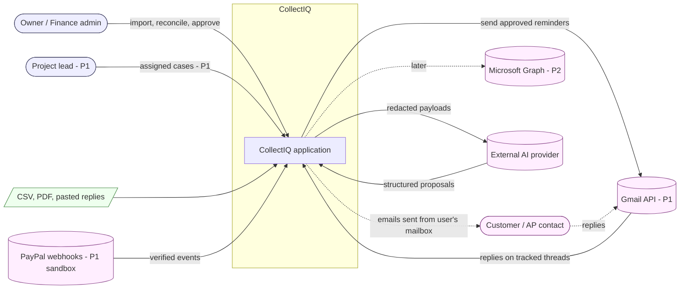
*Customers never use CollectIQ directly; they interact only through the user's own mailbox.*

### 2.4 Diagram 2 — Container architecture
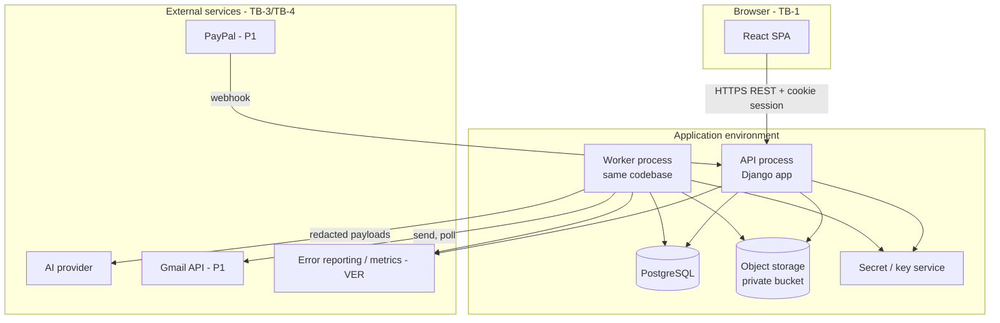
*The AI provider is called only from the worker (never directly from request handlers) so that request latency, timeouts and retries are isolated from user interaction.*

### 2.5 Diagram 3 — Internal module architecture (dependency direction: top depends on bottom)
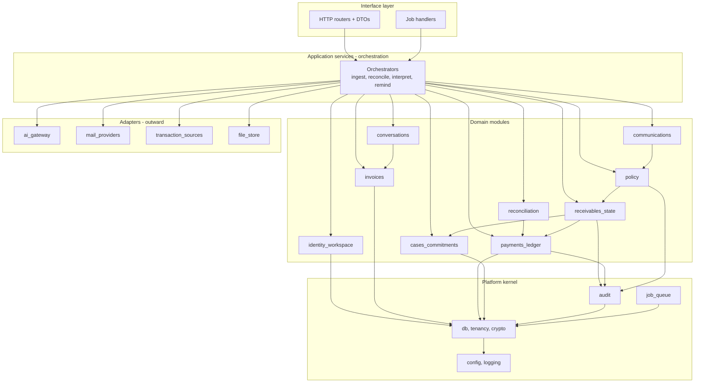
**Boundary rules (enforced in CI with an import-boundary checker, e.g., import-linter [VER]):** (1) domain modules never import adapters or interface code; (2) only `receivables_state` writes `invoice_state`; only `payments_ledger` writes transactions/allocations; only `policy` mints `AuthorizedAction`; (3) `ai_gateway` imports nothing from domain modules and has no database access; (4) cross-module calls go through public service interfaces; cross-module reactions use the in-process outbox (domain events written in the same transaction, handled by jobs), which removes the need for circular imports (INV-10).

---

## 3. Technology Stack and Selection Rationale

**Caveat.** Team skills are unknown (OPEN-A1) and no pricing, quota or free-tier claim below is verified. The recommended stack is **[PROVISIONAL]** and should be confirmed with the team before Milestone 1. Selection criteria: implementation speed, reliability, maintainability, security by default, minimal operational surface.

| Area | Recommended | Why it fits | Complexity | Operating cost implication | Security implication | Alternatives | Change conditions |
|---|---|---|---|---|---|---|---|
| Frontend | **React + TypeScript SPA (Vite build)**, typed API client generated from the OpenAPI schema | Mostly authenticated, form- and table-heavy app; no SEO need; SPA keeps the server surface small | Low–medium | Static hosting/CDN; cost category: bandwidth and storage [VER] | Cookie-session auth with CSRF defense; no secrets in bundle | Next.js (adds a Node server runtime), Vue/Svelte | Team has no React experience; need SSR/SEO |
| Backend | **Python 3.12 + Django + Django REST Framework** (OpenAPI via schema generator [VER]) | Mature built-ins reduce risky custom code: auth, sessions, ORM, migrations, validation; strong libraries for CSV/PDF/decimal; AI evaluation tooling is Python-native | Low–medium | One container image run as API and worker | Fewer hand-rolled security components; framework security releases must be tracked | FastAPI + SQLAlchemy/Alembic (more explicit, more assembly); TypeScript (NestJS/Fastify) for a single-language stack | Team is TypeScript-only; measured performance limits |
| Relational DB | **PostgreSQL** (current major supported by chosen host [VER]) | ACID across modules, row-level security, partial/unique indexes, constraint triggers, `SKIP LOCKED`, JSONB, citext | Low | Managed instance sizing and backup storage are the main cost categories [VER] | RLS for tenancy; encryption at rest; PITR if offered [VER] | MySQL (weaker RLS story), SQLite (no concurrent workers) | Evidence of write contention beyond one primary |
| ORM / migrations | **Django ORM + built-in migrations**, with raw-SQL migrations for RLS policies, constraint triggers and audit triggers | One migration history; typed models; reviewable SQL for safety-critical objects | Low | None | Migrations run with a privileged role separate from the runtime role | SQLAlchemy 2 + Alembic | Move to FastAPI stack |
| Authentication | **First-party sessions on Django auth**: Argon2id hashing, DB-backed sessions in HttpOnly/SameSite/Secure cookies, email verification, rate limiting; TOTP MFA (P1) via a maintained library [VER] | No per-user vendor fee, no extra data processor, tenant model stays in our control (DPDP review easier) | Medium | Transactional-email provider needed for verification/notification mails — **[OPEN-A2]** provider and pricing [VER] | Highest-risk area if mishandled; mitigated by using framework primitives only and an auth-focused security test | Managed IdP (e.g., Auth0, Cognito, Clerk — all [VER]) | Need SSO/enterprise MFA; failed auth security review |
| Object storage | **S3-compatible private bucket** with server-side encryption and short-lived presigned URLs; per-workspace key prefix | Standard, simple, durable | Low | Storage + request categories [VER] | No public access; scoped URLs; malware scan hook (OPEN-21) | Database `bytea`, local disk | Provider choice changes with hosting |
| Background jobs | **PostgreSQL-backed queue** implemented as a small internal module using `SELECT … FOR UPDATE SKIP LOCKED`, leases, retries and a dead-letter state (ADR-04) | No new infrastructure; transactional enqueue with business writes (outbox); easy tenant-aware cancellation | Medium (≈ a few hundred lines + tests) | Worker container runs continuously | Job payloads hold IDs only | Procrastinate (Postgres-based queue library [VER]), Celery + Redis/RabbitMQ, cloud queues | Throughput > a few jobs/second sustained; need for delayed-workflow orchestration beyond retries |
| Email OAuth/API | **Direct use of Gmail REST API via Google's official Python client or plain HTTPS [VER]**; MIME built with the standard library; one `MailProvider` interface | Smallest abstraction; verified: `gmail.send` accepted for sending [V]; reading needs restricted scopes [V] | Medium | Possible Google verification/assessment costs [VER] | Token handling per §9; scope minimization | Unified-email vendor APIs (adds a processor; **[VER]**), IMAP/SMTP | If Google verification proves infeasible: paste/upload/forwarding intake (OPEN-26) |
| AI provider abstraction | **In-house thin `AIProvider` interface + JSON-Schema/Pydantic output validation** (ADR-05); provider **not selected** (OPEN-09) | Provider independence, testability, no heavy framework in a safety-critical path | Low–medium | Token costs unknown until provider and model chosen [VER] | Single egress point; allowlist and redaction before any call | Third-party LLM routing libraries [VER], agent frameworks (rejected: adds autonomy surface) | Need multi-provider routing at scale |
| PDF extraction / OCR | **Text-layer extraction with a permissively licensed Python PDF library** (candidates: pdfminer.six/pdfplumber — licensing and quality [VER]; note some popular libraries use copyleft licences [VER]); **OCR deferred** (OPEN-22), with an optional isolated Tesseract-based adapter later [VER] | CSV is the guaranteed path; PDF is conditional (PRD FR-011) | Medium | Compute for OCR if added | Parse in the isolated worker; size/page limits; no embedded-script execution | Cloud document-AI services (send documents to another processor — contradicts P5 default) | Pilot shows most invoices are scans |
| Observability | **Structured JSON logs with correlation IDs; OpenTelemetry-compatible instrumentation; one error-reporting service** (candidate Sentry or the host's native tooling — **[VER]**); health/ready endpoints | Meets NFR-12 with minimal setup | Low | Event-volume pricing [VER] | Scrub PII/financial data before export (SEC-12); error reporting configured with data-scrubbing | Self-hosted stack (more ops) | Log volume or cost issues |
| Hosting | **Single cloud region** with: one container service for API + worker, managed PostgreSQL, object storage, managed KMS/secret store. **AWS (ap-south-1 as an India candidate) is the planning assumption** for naming only — provider, region and prices **[VER]**, and the choice depends on OPEN-20 | Managed building blocks minimize ops; residency can be satisfied if region offered | Medium | Compute, DB, storage, egress, KMS requests, log retention [VER] | Private networking, security groups, IAM least privilege | PaaS such as Render/Fly/Railway (less ops, less control; region/backup features **[VER]**), single VM | Team lacks cloud skills → PaaS; residency rules → region change |
| Secrets management | **Cloud KMS + secret manager**; envelope encryption for OAuth refresh tokens and sensitive columns; environment injection at deploy; no secrets in the repository | Meets SEC-05 | Medium | Per-key and per-request categories [VER] | Key rotation; access via IAM roles | Environment variables only (insufficient for tokens) | Provider change |
| Testing and CI/CD | **pytest** (+ property-based tests for ledger invariants [VER]), contract tests from OpenAPI, **Playwright** E2E [VER], dependency/secret scanning in CI, **GitHub Actions** (or equivalent) building one image, running tests, migrating staging, deploying [VER] | Fast feedback; invariants testable | Low–medium | CI minutes [VER] | Supply-chain scanning; protected main branch; signed images optional | GitLab CI, others | Repo host changes |

**Frontend/backend split rationale.** Two languages (Python, TypeScript) increase context switching but align with the domain: numeric/text/PDF/AI tooling in Python, UI in TypeScript. If the team is TypeScript-only, ADR-02 should flip to a TypeScript monolith; none of the other ADRs change.

---

## 4. Application Module Architecture

### 4.1 Module map and ownership
| Module (Python package) | Owns tables (sole writer) | May depend on | Emits events | Consumes events |
|---|---|---|---|---|
| `platform` (db, tenancy, crypto, config) | `idempotency_keys`, `outbox_events` | — | — | — |
| `audit` | `audit_events` | platform | — | — |
| `job_queue` | `background_jobs` | platform | — | — |
| `identity_workspace` | users, workspaces, memberships, workspace_policies, clients, client_contacts, client_aliases, payment_accounts, integration_connections (metadata), notifications | platform, audit | `PolicySettingsChanged`, `ContactSuppressed` | — |
| `invoices` | invoices, import_batches (invoice kind), stored_files (invoice), extraction_results | platform, audit, identity_workspace (read) | `InvoiceConfirmed`, `InvoiceChanged` | — |
| `payments_ledger` | payment_transactions, payment_allocations, import_batches (transaction kind), account_coverages, evidence_attestations | platform, audit, invoices (read) | `TransactionImported`, `AllocationConfirmed`, `AllocationReversed`, `CoverageChanged` | — |
| `reconciliation` | reconciliation_matches | ledger (read; writes allocations only through ledger service) | `MatchProposed`, `MatchRejected` | `TransactionImported` |
| `conversations` | email_messages, message_invoice_links, message_interpretations, ai_processing_records (via gateway callbacks) | platform, audit, invoices (read) | `InterpretationValidated` | — |
| `cases_commitments` | cases, commitments | platform, audit, invoices (read) | `CaseOpened`, `CaseResolved`, `CommitmentChanged` | `InterpretationValidated` |
| `receivables_state` | invoice_state | ledger (read), cases_commitments (read), invoices (read), audit | `StateChanged` | `AllocationConfirmed`, `AllocationReversed`, `CoverageChanged`, `CaseOpened`, `CaseResolved`, `CommitmentChanged`, `InvoiceChanged` |
| `policy` | policy_decisions, approval_requests | receivables_state (read), identity_workspace (policy settings, read), audit | `ActionAuthorized`, `ActionDenied` | — |
| `communications` | reminders | policy (requires `AuthorizedAction`), mail_providers (adapter), audit | `ReminderSubmitted`, `ReminderFailed` | `StateChanged` (cancel stale drafts) |
| `ai_gateway` (adapter) | none (stateless; reports to a callback) | platform (config only) | — | — |
| `mail_providers`, `transaction_sources`, `file_store` (adapters) | none | platform | — | — |

**No cycles.** Dependency order: platform → audit/job_queue → identity_workspace → invoices → ledger → reconciliation / cases_commitments → receivables_state → policy → communications; conversations depends on invoices only; adapters are leaves. Orchestration code (application services) is the only layer allowed to call multiple domain modules; reactions are handled by outbox consumers running as jobs.

### 4.2 Identity and Workspace Module
- **Authentication:** session login, email verification, rate-limited attempts, password reset; TOTP in P1.
- **Workspace isolation:** every request builds `RequestContext(user, workspace, role)` from session + path/header workspace ID, verified against membership; middleware opens a transaction and executes `SET LOCAL app.workspace_id = …` so row-level security applies (§12, ADR-09). Background jobs set the same context from job payload.
- **Role/permission checks:** declarative permission table (action → roles, PRD §3I matrix) enforced by `authorize(ctx, action, resource)` in every service entry point; project-lead filtering by assignment (P1).
- **Integration ownership:** integrations belong to a workspace; only Owner can connect/disconnect; revocation stops jobs bound to that connection.
- **Workspace configuration:** timezone, currency, business hours, versioned `workspace_policies` (immutable versions; the active pointer changes via audited command).

### 4.3 Invoice Processing Module
Pipeline (synchronous for CSV preview, asynchronous for PDF):
1. **Upload validation:** size/type by content sniffing; hash; store to quarantine prefix; malware scan hook (OPEN-21); reject encrypted/corrupt.
2. **Parsing:** CSV via streaming parser with encoding detection and explicit date-format choice; PDF text-layer extraction in a worker with CPU/time/memory limits; OCR optional adapter (deferred).
3. **Extraction (PDF only):** privacy gateway builds a masked payload; AI returns `invoice_extraction.v1`; per-field confidence retained; output stored in `extraction_results` with status `PENDING_REVIEW`.
4. **Normalization/validation:** currency to ISO-4217 and minor units; date parsing; arithmetic checks (Σ lines, subtotal+tax); conflicts recorded, never silently resolved.
5. **Duplicate detection / idempotent import:** unique external key `(workspace, source_system, external_id)`; fallback normalized `(client, invoice_number)`; heuristic near-duplicate flag (client, amount, issue date).
6. **User confirmation:** commit in a single transaction (FR-008) creates `ACTIVE` invoices and `invoice_state` rows, emits `InvoiceConfirmed`; unconfirmed extractions are invisible to reconciliation, queue and policy.
- **Interfaces:** `IngestionService.preview(batch)`, `commit(batch, decisions)`, `ExtractionService.request(file)`, `confirm(extraction, edits)`.

### 4.4 Receivables and Payment Module (`payments_ledger`, `reconciliation`, `receivables_state`)
- **Invoice records** hold immutable facts as imported/confirmed; edits require a reason and flag `diverges_from_source`.
- **Payment records** are *evidence*: transactions from manual entry, CSV rows or provider events. A transaction is not a payment of any invoice until **allocated** by a confirmed `payment_allocation`.
- **Allocations** are append-only signed rows (allocation or reversal). Balance = gross − Σ allocations. Partial and multiple payments follow naturally.
- **Reconciliation** generates candidates and proposals only; confirmation (a human action) calls `LedgerService.allocate()`.
- **State derivation** (`receivables_state`) recomputes `payment_status`, `evidence_coverage`, balances after any event, in the same transaction (§6).
- **Interfaces:** `LedgerService.record_manual_payment/import_transactions/allocate/reverse`, `Reconciler.propose(transaction)`, `StateService.recompute(invoice_id)`.

### 4.5 Conversation Intelligence Module
Responsibilities: normalize messages (strip quotes/signatures, decode .eml), associate with invoices (deterministic proposals; confirmation by user in P0; thread ID in P1), select minimal context, call interpretation through the gateway (via the worker), validate schema, persist interpretation, hand validated proposals to orchestration → policy. Corrections create new interpretation versions with `derived_from` and trigger reversal of dependent automated actions (WF-14).
- **Interfaces:** `MessageIngest.capture`, `Associator.propose/confirm`, `InterpretationService.interpret(message_id)`, `InterpretationService.correct(interpretation_id, edits)`.

### 4.6 Policy and Automation Module
Mandatory gate between proposals and consequences (§8). Owns policy decisions and approvals; reads `receivables_state` and workspace policy; **never writes ledger or invoice state**. Executors are other modules that accept only `AuthorizedAction` values created here.

### 4.7 Communication Module
Draft creation (templates + deterministic fact block + optional AI phrasing), linting, approval requests, scheduling of evaluation points, send execution (P1 via `MailProvider`; P0 manual mark-as-sent), retry/idempotency, status tracking (`SUBMITTED` not "delivered"), contact-limit counters derived from the reminders table.

### 4.8 Audit and Observability Module
- **Audit events:** same-transaction append (`Audit.record` is called inside the service transaction; if it fails, the transaction aborts — BR-31).
- **AI decision records:** `ai_processing_records` + `message_interpretations` + `policy_decisions` linked by IDs (what was sent, what returned, what was allowed).
- **Action authorization records:** `policy_decisions` referenced by `reminders` and approvals.
- **Integration events:** connection state changes and sync errors as audit events with sanitized details.
- **Metrics:** job latency/failures, AI latency/validation failures, queue depth, integration status (NFR-12). **Security events:** failed logins, authorization denials, cross-tenant attempts, injection flags.

---

## 5. Core Data Architecture

### 5.1 Cross-cutting definitions (explicit decisions)
| Topic | Decision |
|---|---|
| **Primary keys** | UUID per row (time-ordered variant preferred [VER]); human-readable references are separate fields |
| **Tenant column** | `workspace_id` (UUID, NOT NULL) on every tenant-owned table. Each parent table has `UNIQUE (workspace_id, id)`; each child references `(workspace_id, parent_id)` so a child cannot point at another workspace's parent |
| **Currency representation** | `currency CHAR(3)` (ISO 4217) + integer **minor units** `BIGINT` (e.g., paise/cents) using the ISO exponent table in code; no floating point anywhere; Python `Decimal` only for parsing/formatting. Tax rates `NUMERIC(7,4)`. Mixed-currency arithmetic is rejected; **no FX conversion** in the MVP (PRD FR-034) |
| **Rounding** | Parsed decimals must have ≤ exponent digits or are flagged; line-item rounding differences tolerated up to 1 minor unit per document (aligns with PRD 0.01 tolerance) [PROP] |
| **Time zones** | Instants are `timestamptz` stored in UTC. Calendar facts (issue date, due date, transaction value date) are `DATE` interpreted in the workspace timezone. Scheduling and date resolution use the workspace timezone with DST-aware libraries; "today" for policy is computed from the workspace timezone |
| **Invoice identifiers** | `(workspace_id, source_system, external_id)` unique when external ID exists; `normalized_number` (case/whitespace/punctuation folded) for matching; invoice number alone is **not** unique (duplicates are flagged, then decided) |
| **External transaction IDs** | `external_id` (provider event/transaction ID) unique per `(workspace_id, source_type)`; imported rows use a deterministic **fingerprint** + occurrence index per `(payment_account_id)` |
| **Idempotency keys** | API: client-supplied `Idempotency-Key` stored with request hash in `idempotency_keys` (TTL [PROP 24 h]). Domain: unique constraints (`reminders.idempotency_key`, `background_jobs.idempotency_key`, webhook event IDs, transaction fingerprints) |
| **Data provenance** | Each fact records its source: `source_type`, `import_batch_id`, source row, `field_provenance` (IMPORT / PDF_AI with confidence / USER), actor, timestamps; AI-derived rows carry `derived_by='AI'` |
| **Timestamps** | `created_at`, `updated_at` (trigger-maintained) on mutable tables; `occurred_at` on events; mutable aggregates carry `version` for optimistic locking |
| **Deletion** | Domain rows use **status/void and reversal**, not delete, for financial facts. Soft delete (`deleted_at`) only for files/messages awaiting purge. **Permanent deletion** happens in the workspace-deletion job (and per-record deletion, P1), including derived data, with audit completion (§5.5) |
| **Audit immutability** | `audit_events` is append-only: runtime DB role has INSERT only; UPDATE/DELETE blocked by privileges and a trigger; hash chain per workspace (`prev_hash`, `hash`) for tamper evidence [PROVISIONAL]; deletion of a workspace uses a separate privileged procedure that writes a final deletion record outside the deleted tenant (OPEN-09 for retention) |
| **Ownership boundaries** | All data belongs to exactly one workspace except `users` (global identity). Membership links users to workspaces. Exports and deletions are workspace-scoped |
| **Encryption** | Disk/volume encryption for DB and storage; **envelope encryption with a per-workspace data key** (wrapped by the cloud KMS key) for OAuth refresh tokens, message bodies, raw import rows; enables crypto-shredding of backups after deletion [PROVISIONAL; adds key-management complexity] |

### 5.2 Entities
Legend: all tenant-owned tables carry `workspace_id` with the isolation rules above; **RLS** = row-level security policy `workspace_id = current_setting('app.workspace_id')::uuid` forced on the table. **MVP** unless noted.

| Entity (table) | Purpose | Key fields | Constraints and indexes | Retention (proposals, OPEN-09) |
|---|---|---|---|---|
| `users` (global) | Identity | id, email (citext), password_hash, email_verified_at, mfa_secret_ref (P1), status | UNIQUE(email); no tenant column | Until account deletion |
| `workspaces` | Tenant | id, name, country, timezone, default_currency, business_hours, active_policy_id, status, deletion_requested_at | — | Until deletion |
| `workspace_memberships` | Role in a workspace | workspace_id, user_id, role (OWNER, FINANCE_ADMIN, PROJECT_LEAD-P1), status | UNIQUE(workspace_id,user_id); RLS | With workspace |
| `workspace_policies` | Versioned automation/reminder settings | id, workspace_id, version, settings JSONB, changed_by, effective_from | UNIQUE(workspace_id, version); immutable rows | With workspace |
| `clients`, `client_contacts`, `client_aliases` | Customers, approved addresses, alias names | client: display_name, normalized_name, sensitivity, tone; contact: email, status (ACTIVE/SUPPRESSED), suppression_reason; alias: text, kind | UNIQUE(workspace_id, client_id, email); index(workspace_id, normalized_name); RLS | With workspace |
| `payment_accounts` | Declared receiving accounts (bank, PayPal, UPI handle, cash) used for coverage | id, kind, label, currency, status | index(workspace_id, status); RLS | With workspace |
| `stored_files` | Metadata for uploaded files | id, storage_key, sha256, size, detected_type, purpose, scan_status, created_by, deleted_at | UNIQUE(storage_key); index(workspace_id, sha256); RLS | Until record/workspace deletion |
| `import_batches` | One import (invoice or transaction CSV, PDF) | id, kind, file_id, mapping JSONB, status (PREVIEW/COMMITTED/FAILED/DISCARDED), counts JSONB, created_by | index(workspace_id, created_at); RLS | With workspace |
| `invoices` | Receivable record (system-of-record is the source) | id, source_system, external_id, invoice_number, normalized_number, client_id, issue_date, due_date, currency, gross_minor, subtotal_minor, tax_minor, payment_terms, payment_references text[], po_number, project_ref, line_items JSONB, status, possible_duplicate_of, import_batch_id, source_row, field_provenance JSONB, diverges_from_source, version | CHECK gross_minor ≥ 0; partial UNIQUE(workspace_id, source_system, external_id) WHERE external_id IS NOT NULL; index(workspace_id, client_id, normalized_number); index(workspace_id, due_date); composite FK to clients; RLS | With workspace |
| `invoice_state` (1:1 with invoice) | Derived multi-dimension state | invoice_id (PK), payment_status, evidence_coverage, coverage_as_of, paid_minor, outstanding_minor, overpayment_flag, dispute_status, reminder_status, snooze_until, next_evaluation_at, open_task_count, version | CHECK outstanding_minor ≥ 0; index(workspace_id, reminder_status, next_evaluation_at); index(workspace_id, payment_status); RLS. **Column ownership:** payment/coverage/balances ← ledger-derived; dispute ← cases; reminder ← policy/communications; all written only through `StateService` | With workspace |
| `extraction_results` | PDF extraction output awaiting confirmation | id, file_id, ai_record_id, fields JSONB (value, confidence, source span), validation_report JSONB, status | index(workspace_id, status); RLS | Until confirmed/discarded + [PROP 30 d] |
| `payment_transactions` | Payment evidence | id, source_type, payment_account_id, method, amount_minor (>0), currency, value_date, reference, payer_descriptor, normalized_description, fingerprint, occurrence_index, external_id, import_batch_id, source_row, evidence_type, entered_by, status (ACTIVE/VOID/DUPLICATE), duplicate_of_transaction_id | CHECK amount_minor > 0; UNIQUE(workspace_id, source_type, external_id) WHERE external_id NOT NULL; UNIQUE(workspace_id, payment_account_id, fingerprint, occurrence_index); index(workspace_id, value_date); RLS; immutable except status | With workspace |
| `payment_allocations` | Append-only links transaction→invoice | id, transaction_id, invoice_id, amount_minor (signed ≠ 0), kind (ALLOCATION/REVERSAL), reverses_allocation_id, match_id, evidence_type, overpayment_confirmed, confirmed_by, note | No UPDATE/DELETE; **constraint triggers**: Σ per transaction ≤ transaction amount; Σ per invoice ≥ 0 and ≤ gross unless overpayment_confirmed; same currency; index(invoice_id), index(transaction_id); composite FKs; RLS | With workspace |
| `reconciliation_matches` | Match proposals and decisions | id, transaction_id, invoice_id, band, score, factors JSONB, matcher_version, status (PROPOSED/CONFIRMED/REJECTED/SUPERSEDED), decided_by | partial UNIQUE(transaction_id, invoice_id) WHERE status='PROPOSED'; index(workspace_id, status); RLS | With workspace |
| `account_coverages` | Statement coverage evidence | id, payment_account_id, covers_from, covers_to, import_batch_id, confirmed_by | CHECK covers_to ≥ covers_from; index(payment_account_id, covers_to); RLS | With workspace |
| `evidence_attestations` | "Checked, nothing received" | id, scope (INVOICE or ACCOUNT), invoice_id / payment_account_id, attested_as_of, attested_by, note | index(workspace_id, attested_as_of); RLS | With workspace |
| `email_messages` | Captured or synced messages (inbound/outbound) | id, direction, source (PASTE/EML/GMAIL), provider_message_id, provider_thread_id, rfc_message_id, sender, recipients, subject, occurred_at, body_ciphertext, body_hash, processing_status, uploaded_by | partial UNIQUE(workspace_id, provider_message_id); index(workspace_id, provider_thread_id); RLS | [PROP] until workspace deletion or per-record deletion (P1) |
| `message_invoice_links` | Association | message_id, invoice_id, status (PROPOSED/CONFIRMED), confirmed_by | UNIQUE(message_id, invoice_id); RLS | With message |
| `ai_processing_records` | One AI call (purpose, provider config, usage) | id, task, prompt_version, schema_version, provider, model_config, region, purpose, payload_hash, redacted_payload_ref, status, tokens_in/out, latency_ms, cost_estimate, attempt | index(workspace_id, created_at); RLS | Metadata with workspace; redacted payloads [PROP 30 d] |
| `message_interpretations` | Validated structured interpretation | id, message_id, ai_record_id, schema_version, result JSONB, resolved_dates JSONB, injection_flag, validation_status, review_status, reviewed_by, derived_from | index(message_id); RLS | With workspace |
| `commitments` | Payment commitments | id, invoice_id, message_id, interpretation_id, raw_text, resolved_date, window_start/end, strength, amount_minor, status, version | index(invoice_id, status); RLS | With workspace |
| `cases` | Disputes, blockers, review items | id, invoice_id, type, status, dispute_type, summary, source_message_id, assignee_id, resolution_outcome, resolution_note, opened_at, resolved_at | partial UNIQUE(invoice_id) WHERE type='DISPUTE' AND status IN open states; index(workspace_id, status, assignee_id); RLS | With workspace |
| `policy_decisions` | Append-only record of every policy evaluation that matters | id, action_type, subject_ref, inputs_hash, state_version, policy_version, outcome, gate_results JSONB, reasons text[], consumed_at | No UPDATE/DELETE; index(workspace_id, subject_ref); RLS | With workspace |
| `approval_requests` | Pending human approvals | id, type, subject_ref, proposed_action JSONB, proposed_by, status, decided_by, decided_at, expires_at, policy_decision_id | index(workspace_id, status); RLS | With workspace |
| `reminders` | Drafts and sent reminders | id, invoice_id, contact_id, sequence_no, status, subject, body, fact_block JSONB, tone, idempotency_key, policy_decision_id, approved_by, provider_message_id, provider_thread_id, rfc_message_id, sent_at, expires_at, failure_class | UNIQUE(idempotency_key); CHECK(status IN (SUBMITTED, MARKED_SENT, SUBMISSION_UNKNOWN) ⇒ policy_decision_id IS NOT NULL AND approved_by IS NOT NULL); index(workspace_id, invoice_id, sent_at); RLS | With workspace |
| `integration_connections` | Mailbox/payment connections | id, kind, status, scopes_granted, external_account, monitoring_enabled, credential_ref_id, last_sync_at, last_error_class, connected_by | index(workspace_id, kind); RLS | Until disconnect + [PROP] |
| `oauth_credential_refs` (P1) | Pointer to encrypted refresh token | id, connection_id, ciphertext, wrapped_key_id, issued_at, scopes | Never exposed through API; RLS | Deleted on disconnect |
| `webhook_events` (P1) | Provider events | id, provider, provider_event_id, signature_valid, received_at, processed_at | UNIQUE(provider, provider_event_id); RLS | [PROP 90 d] |
| `background_jobs` | Queue | id, workspace_id (nullable for global), type, payload (IDs only), status, run_at, attempts, max_attempts, lease_expires_at, locked_by, idempotency_key, last_error | UNIQUE(idempotency_key); index(status, run_at); RLS for tenant jobs | [PROP 30 d after completion] |
| `outbox_events` | In-process domain events | id, workspace_id, type, payload (IDs), created_at, processed_at | index(processed_at) | [PROP 30 d] |
| `audit_events` | Immutable audit | id (bigint), workspace_id, occurred_at, actor_type, actor_id, action, object_type, object_id, before/after (masked), reason_codes, evidence_refs, policy_decision_id, correlation_id, prev_hash, hash | INSERT-only; index(workspace_id, occurred_at), index(workspace_id, object_type, object_id); RLS | Policy [OPEN-09] |
| `idempotency_keys` | API replay protection | workspace_id, key, route, request_hash, response_ref, expires_at | PK(workspace_id, key, route) | 24 h [PROP] |
| `export_requests`, `deletion_requests` | Data lifecycle | id, type, status, requested_by, file_id, expires_at, completed_at | RLS | With record |
| `notifications` | In-app notifications | id, user_id, type, subject_ref, read_at | index(user_id, read_at) | 90 d [PROP] |

**Deferred tables:** `invoice_line_items` (line items stay in JSONB until querying needs appear), `customer_conversations` (thread key lives on `email_messages` until Gmail sync), separate `follow_up_tasks` (cases + approvals cover the MVP), `payment_commitment_history`, notification delivery by email (P1), accounting/provider sync tables (P2).

### 5.3 Diagram 4 — Core ER model (key entities and relationships)
```mermaid
erDiagram
  WORKSPACES ||--o{ WORKSPACE_MEMBERSHIPS : has
  USERS ||--o{ WORKSPACE_MEMBERSHIPS : joins
  WORKSPACES ||--o{ CLIENTS : owns
  CLIENTS ||--o{ CLIENT_CONTACTS : has
  CLIENTS ||--o{ INVOICES : billed
  INVOICES ||--|| INVOICE_STATE : derives
  INVOICES ||--o{ PAYMENT_ALLOCATIONS : receives
  PAYMENT_TRANSACTIONS ||--o{ PAYMENT_ALLOCATIONS : funds
  PAYMENT_TRANSACTIONS ||--o{ RECONCILIATION_MATCHES : proposed_for
  INVOICES ||--o{ RECONCILIATION_MATCHES : candidate
  PAYMENT_ACCOUNTS ||--o{ PAYMENT_TRANSACTIONS : receives
  PAYMENT_ACCOUNTS ||--o{ ACCOUNT_COVERAGES : covered_by
  INVOICES ||--o{ EVIDENCE_ATTESTATIONS : attested
  INVOICES ||--o{ MESSAGE_INVOICE_LINKS : discussed
  EMAIL_MESSAGES ||--o{ MESSAGE_INVOICE_LINKS : linked
  EMAIL_MESSAGES ||--o{ MESSAGE_INTERPRETATIONS : interpreted
  AI_PROCESSING_RECORDS ||--o{ MESSAGE_INTERPRETATIONS : produced
  INVOICES ||--o{ COMMITMENTS : has
  INVOICES ||--o{ CASES : has
  INVOICES ||--o{ REMINDERS : receives
  POLICY_DECISIONS ||--o{ REMINDERS : authorizes
  POLICY_DECISIONS ||--o{ APPROVAL_REQUESTS : evaluates
  WORKSPACES ||--o{ WORKSPACE_POLICIES : versions
  WORKSPACES ||--o{ INTEGRATION_CONNECTIONS : connects
  INTEGRATION_CONNECTIONS ||--o| OAUTH_CREDENTIAL_REFS : secures
  IMPORT_BATCHES ||--o{ INVOICES : creates
  IMPORT_BATCHES ||--o{ PAYMENT_TRANSACTIONS : creates
  STORED_FILES ||--o{ IMPORT_BATCHES : source
  WORKSPACES ||--o{ AUDIT_EVENTS : audited
  WORKSPACES ||--o{ BACKGROUND_JOBS : schedules
```

### 5.4 Idempotency and uniqueness summary
| Operation | Idempotency mechanism |
|---|---|
| API mutating POSTs | `Idempotency-Key` + request hash; same key/same hash → stored response; same key/different hash → 422 |
| Invoice import | External key and normalized key; re-import yields diff (FR-005) |
| Transaction import | Fingerprint + occurrence index; provider event ID |
| Allocation confirmation | Allocation row keyed by `(match_id)` or `(transaction_id, invoice_id, request_id)`; repeated confirm is a no-op |
| Reminder creation/send | `reminders.idempotency_key` (hash of workspace, invoice, action, sequence, intended date); job idempotency key |
| Webhooks | `webhook_events(provider, provider_event_id)` unique |
| Jobs | `background_jobs.idempotency_key`; handlers are re-entrant by design |

### 5.5 Retention and deletion mechanics
Workspace deletion job: (1) pause automation and disconnect integrations; (2) delete object-storage prefix and stored files; (3) delete tenant rows in dependency order (derived data first: interpretations, AI payloads, caches), (4) crypto-shred the workspace data key so encrypted columns in backups become unreadable, (5) write a final deletion record in a separate system table (no tenant data), (6) mark `deletion_requests` complete. Backups age out per the documented window (OPEN-09). Per-record deletion (P1) cascades to derived interpretations.

---

## 6. Payment State and Reconciliation Architecture

Payment-state correctness is a **critical safety property**: every design choice below favors a visible, auditable, human-confirmed state over inference.

### 6.1 Evidence model
- A **transaction** is evidence that money moved (manual entry, bank/PayPal/gateway CSV row, or verified provider event). Sources: bank transfer, UPI, cash, PayPal, other — all normalized into `payment_transactions`; there is **no source-specific payment logic downstream** (P1). UPI and cash are not integrated directly; they arrive through statement rows or manual entries.
- An **allocation** is a confirmed link of part or all of a transaction to an invoice. Allocation rows are immutable and signed; reversals are new rows.
- A **customer claim** (from an AI-interpreted message) is **not evidence**; it creates a verification case (type `MATCH_REVIEW`, reason `CUSTOMER_CLAIM`) and sets `AWAITING_VERIFICATION`.
- **Evidence types** on transactions/allocations: `IMPORTED_TRANSACTION`, `VERIFIED_PROVIDER_EVENT`, `USER_CONFIRMATION`. No AI-derived type exists (INV-03).

### 6.2 Reconciliation pipeline
```
Source → Parse/normalize → Fingerprint & dedupe → Persist transaction(s) → [outbox: TransactionImported]
→ Candidate generation → Feature extraction → Deterministic scoring (matcher_version) → Banding
→ Persist proposals (reconciliation_matches) → Recompute invoice_state (AWAITING/UNCERTAIN if MEDIUM+ unresolved)
→ Human review (confirm / reject / choose other / split) → Allocation (transactional) → State recompute → Audit
```
Runs asynchronously after imports (job `reconcile_transactions`) and synchronously for a single manual entry.

### 6.3 Candidate generation
For each unallocated transaction: select invoices in the same workspace and currency with `invoices.status='ACTIVE'` and `payment_status IN (OUTSTANDING, PARTIALLY_PAID, AWAITING_VERIFICATION, UNCERTAIN)` and `issue_date ≤ value_date + 7 days` [PROP], where at least one holds: (a) a normalized invoice reference token occurs in the transaction reference/description; (b) `outstanding_minor` or `gross_minor` equals the amount; (c) a client alias matches the payer descriptor; (d) the amount is less than outstanding and a reference matches (partial). Cap at 10 candidates, ordered by score. Reference tokens come from deterministic patterns plus tenant-defined patterns (FR-040); no LLM is used.

### 6.4 Features and scoring (deterministic; **[PROVISIONAL]** weights to calibrate on pilot data, OPEN-16)
| Feature | Points | Notes |
|---|---|---|
| Exact invoice reference token present | +50 | Case/whitespace/punctuation normalized; exact token boundary |
| Normalized/partial reference (e.g., digits only, prefix variation) | +40 (replaces exact) | |
| Amount equals outstanding (± 1 minor unit) | +30 | |
| Amount equals gross | +25 (if not equal to outstanding) | For first payment of an unpaid invoice outstanding = gross: count once (30) |
| Amount less than outstanding **and** reference matches (plausible partial) | +15 | |
| Value date within [issue_date − 7 d, due_date + 90 d] | +10 | [PROP] window |
| Payer descriptor equals a client alias | +15 (exact) / +8 (fuzzy token overlap) | Alias set grows from confirmed matches |
| Previously confirmed alias for this client | +10 | |
| Same source-account history of confirmed matches to this client | +5 | |
| Currency differs | **candidate excluded** | No FX |
| Invoice already fully allocated | **candidate excluded** | |

**Bands:** `HIGH` if score ≥ 80 **and** a reference token matched **and** amount equals outstanding/gross **and** (second-best score ≤ top − 20); `MEDIUM` if 50 ≤ score < 80, or HIGH conditions fail only by the margin rule; `LOW` if 20 ≤ score < 50; below 20 no candidate. **Ambiguity** = two or more candidates at MEDIUM or above whose scores differ by less than 20, or any HIGH failing the margin rule. Consistency check against PRD BR-11: reference+amount+date = 90 → HIGH ✔; alias+amount+date = 55 → MEDIUM ✔; reference with partial amount = 50+15+10 = 75 → MEDIUM ✔; amount only = 40 → LOW ✔; no combination without a reference can reach 80 (max 65) ✔.

### 6.5 Automatic matching eligibility and human review thresholds
| Band | System action (P0/P1) | Human review | Reminder effect |
|---|---|---|---|
| HIGH, unique | Create `PROPOSED` match; invoice → `AWAITING_VERIFICATION` | One-click confirm/reject (still human) | Suppressed until resolved |
| MEDIUM | Proposal with factor breakdown | Required; may "choose other"/split | Suppressed (`AWAITING_VERIFICATION`; or `UNCERTAIN` if several) |
| LOW | Listed in "possible matches" only | Optional | None (BR-13) |
| AMBIGUOUS | Proposals for all; open `MATCH_REVIEW` case | Required | Invoices `UNCERTAIN`; suppressed |
| None | Transaction remains unallocated | Optional | None |
**Automatic application of matches is disabled in P0/P1** (BR-12). If ever enabled (FT-27, P2) the policy engine must allow `AUTO_ALLOCATE` only when: workspace opted in; band HIGH and unique; evidence type `IMPORTED_TRANSACTION` or `VERIFIED_PROVIDER_EVENT`; matcher precision measured on pilot data above a threshold set in advance; per-day cap; and an undo window. These conditions are specified now so the P2 change is a policy change, not a redesign.

### 6.6 Allocation algorithm (transactional)
```
BEGIN (workspace context set; role authorized)
  lock transaction row FOR UPDATE
  lock invoice_state rows for all target invoices FOR UPDATE ORDER BY invoice_id   -- deadlock avoidance
  validate: transaction ACTIVE; same currency; invoices ACTIVE;
            Σ(existing allocations of trx) + new ≤ trx.amount;
            Σ(invoice allocations) + new ≤ gross unless overpayment_confirmed (then flag + open MATCH_REVIEW case)
  insert allocation rows (idempotent on request key)
  update reconciliation_matches → CONFIRMED (others for same trx → SUPERSEDED if fully allocated)
  StateService.recompute(invoice) for each invoice (version++)
  emit outbox events (AllocationConfirmed); Audit.record(...)
COMMIT
```
DB constraint triggers on `payment_allocations` re-check the sums as a backstop (INV-04). Concurrent confirmations of the same transaction serialize on the row lock; the loser re-validates and fails with a 409 conflict.

### 6.7 State derivation (pure function, stored in `invoice_state`)
```
derive(invoice, allocations, open_verification_tasks, conflict_flags, coverage):
  paid        = Σ allocation.amount_minor                 # signed; reversals negative
  outstanding = max(0, gross − paid); overpaid = paid > gross
  # precedence per PRD BR-08: PAID_VERIFIED > UNCERTAIN > AWAITING_VERIFICATION > PARTIALLY_PAID > OUTSTANDING
  if paid ≥ gross and (not overpaid or overpayment_confirmed) and all_evidence_types_valid(allocations): PAID_VERIFIED
  elif conflict_flags or cannot_determine or multiple_unresolved_candidates:                           UNCERTAIN
  elif open_verification_tasks (claim, or single proposed match awaiting confirmation):                AWAITING_VERIFICATION
  elif paid > 0:                                                                                       PARTIALLY_PAID
  else:                                                                                                OUTSTANDING
```
`evidence_coverage` is computed separately (§6.8). The function takes no AI output; claims enter only as `open_verification_tasks`. `recompute` runs in the same transaction as any triggering change and also from a nightly integrity job (detects drift, alerts, and repairs via audited recompute).

### 6.8 Evidence coverage rule (refinement **AC-1**, needs confirmation)
PRD BR-05 defines coverage from "a confirmed statement range ending within the freshness window or an attestation". That is under-specified when a workspace has several receiving accounts or gaps between statements: coverage of one account says nothing about another, and a statement that starts after the invoice date may miss earlier payments. Proposed refinement:
- Workspaces **declare receiving accounts** (`payment_accounts`: bank, PayPal, UPI handle, cash).
- For each active declared account, coverage = the contiguous union of imported coverage ranges **starting at or before the invoice's issue date**; `coverage_to` = end of that contiguous interval. An **account-scope attestation** can extend coverage to its time.
- `coverage_as_of(invoice) = max( invoice-scope attestation, min over active accounts of account coverage_to )`; with no declared accounts, only invoice-scope attestations count.
- `SUPPORTED` if `now − coverage_as_of ≤ freshness window` [PROP 7 days]; `STALE` if coverage existed but expired; `MISSING` if never.
This keeps "no event received ≠ not paid" (INV-01) enforceable and explainable ("account X is covered to 28 Oct; account Y has no statement"). If the team prefers the simpler PRD wording, the fallback is a single workspace-level coverage date, with the weaker guarantee documented.

### 6.9 Conflict resolution, corrections and reversals
| Situation | Handling |
|---|---|
| Same payment seen from two sources (PayPal event + bank row) | Cross-source duplicate heuristic (amount, date ±3 d, payer/descriptor) raises a review item; the user allocates once and marks the other `DUPLICATE` (`duplicate_of_transaction_id`); never double-counted (BR-16) |
| Two confirmed allocations exceed gross | Prevented by locks/triggers; if legacy data conflict: `UNCERTAIN` + case |
| Mistaken allocation | Reversal row (negative) with mandatory reason; state recomputed; if invoice had been `PAID_VERIFIED`, reminder status moves to `NEEDS_REVIEW` (never auto-resumes) |
| Mistaken manual transaction | Reverse allocations, set transaction `VOID` with reason (audit) |
| Rejected match | Stored with a rejection key; not re-proposed unless inputs change (BR-15) |
| Customer claim contradicted by evidence | Owner rejects claim with note; status returns per derivation |
| Late-arriving statement overlapping coverage | New transactions evaluated normally; coverage union updated |

### 6.10 Idempotent processing and audit history
- Import: fingerprint + occurrence index; overlapping imports skip existing rows and report counts (FR-041/042).
- Provider events (P1): unique `(provider, provider_event_id)`; handler is re-entrant.
- Every proposal, decision, allocation and reversal writes an audit event with factors, matcher version, actor and evidence references; reconciliation history is a filtered audit view (FR-056).

### 6.11 Separation of status dimensions
| Dimension | Stored in | Written only by | Reads |
|---|---|---|---|
| Invoice status | `invoices.status` | `invoices` module (confirm/cancel/archive) | all |
| Payment status + coverage | `invoice_state` | `receivables_state` (from ledger facts) | policy, UI |
| Dispute status | `invoice_state.dispute_status` | `receivables_state` (from `cases`) | policy, UI |
| Reminder status | `invoice_state.reminder_status`, `reminders` | `policy`/`communications` via `StateService` commands | UI |
A message or email event can only create `message_interpretations`, `cases`, `commitments` or approval proposals; none of them touches ledger tables. The UI may combine chips for display; storage never does (PRD conflict C-3).

### 6.12 Mandatory safety rules → enforcement
| Rule | Mechanism | Verified by |
|---|---|---|
| Absence of a provider event ≠ unpaid | Derivation uses coverage, not events; UI/API have no "unpaid because no event" path; webhook health page never infers payment | TS-032, INV-01 property test |
| AI statement of payment is not evidence | No AI evidence type; claim → verification task only; allocations require a human actor and evidence type | TS-005, TS-020 |
| Ambiguous matches never auto-mark paid | Matches are proposals; allocation endpoint requires human; auto-apply policy denied | TS-004 |
| Uncertain status suppresses reminders | Gates G6/G7 in policy; `UNCERTAIN`/`AWAITING_VERIFICATION` fail closed | TS-004, TS-032 |
| Partial payment never marks paid | Derivation `PAID_VERIFIED` requires paid ≥ gross | TS-011, TS-012 |
| Corrections preserve history | Append-only allocations; reversals; audit hash chain | TS-023, invariants |

---

## 7. AI Architecture and LLM Integration

### 7.1 Layered design
```
Orchestrator (worker job)
  → TaskRegistry[task_id]  (prompt template + schema + validators + privacy allowlist)
  → PrivacyGateway.build_payload()   (select → minimize → redact → pseudonymize → cap → record purpose)
  → AIProvider.generate_structured() (adapter; the only code that calls a provider)
  → OutputValidator                  (parse → schema → evidence spans → sanity → resolvers)
  → returns typed Proposal | Failure (no side effects)
Orchestrator persists records and forwards proposals to the policy engine.
```
The gateway package has **no database access and no imports from domain modules**; it receives plain data and returns plain data (INV-05). It is called from worker jobs only.

### 7.2 Provider adapter interface (language-neutral sketch)
```
interface AIProvider {
  generate_structured(req: StructuredRequest): StructuredResponse
}
StructuredRequest  { task_id, prompt_id@version, system_instructions, data_block (untrusted, delimited),
                     json_schema, model_config_id, timeout_s, max_output_tokens, trace{purpose, record_id} }
StructuredResponse { raw_text, parsed_json?, usage{tokens_in, tokens_out}, latency_ms,
                     provider_request_id, finish_reason, error_class? }
```
Adapters implement it per provider; capabilities such as constrained JSON output are used only when a given provider offers them **[VER]** and are never relied upon (validation always runs). **Model selection configuration:** `model_configs` (in versioned configuration, not user-editable) map `task_id → {provider, model, version pin, parameters (temperature ≤ 0.2 [PROP]), region, retention setting}`; changing any entry reruns the evaluation gate (AIR-13).

### 7.3 Prompt and schema versioning
Prompts are files in the repository named `task@semver`; schemas `name.vN`. Every `ai_processing_records` row stores `prompt_version`, `schema_version`, model config and a payload hash; stored interpretations keep their schema version so old records remain readable. New versions run in **shadow mode** (executed but not used) against recent data before replacing the active version (AIR-21, P1).

### 7.4 Task catalogue
| Task | Required inputs / minimum context | Output schema (key fields) | Validation | Low-confidence behavior | Human approval | Allowed downstream |
|---|---|---|---|---|---|---|
| **T1 invoice_extraction** (PDF; opt-in) | Masked PDF text (account IDs tokenized), page count; no client contact data | `invoice_extraction.v1`: fields with value/confidence/source span, line_items | Schema; spans exist in text; arithmetic (Σ lines, subtotal+tax); ISO currency/dates; duplicate check | Field flagged "needs review"; below threshold left empty | **Always** (user confirms invoice) | Create `extraction_results` only; never creates an ACTIVE invoice |
| **T2 reply_interpretation** (classification, payment-claim detection, commitment/date extraction, dispute/blocker identification) | Redacted reply text (quotes/signature stripped, ≤ 4,000 chars), message date, workspace timezone, today, invoice reference, due date | `reply_interpretation.v1` (PRD §6.2): intents with evidence spans, date **hints**, amounts, commitment strength, summary, recommended_action enum, injection_flag | Schema; enum; evidence span is a substring of the redacted input; deterministic date resolver; association confirmed | `UNRELATED_OR_AMBIGUOUS`; for claim/dispute-like text bias toward suppress + review | Per PRD §3D.1 (mandatory for anything beyond protective suppression) | Proposals to policy: protective pause/suppress, create verification/dispute/blocker case, propose or auto snooze (opt-in), contact suppression |
| **T3 conversation_summary** | Interpretation outputs and short redacted excerpts for the invoice thread | `{summary ≤ 300 chars, topics[]}` | Schema; length; linter (no legal/contractual conclusions) | Omit summary; show raw excerpt | Not required (display only; labelled AI-derived) | Display only |
| **T4 next_action_explanation** | Deterministic recommendation (enum), gate results, state snapshot (no free text from customers) | `{explanation ≤ 400 chars}` | Schema; must not name an action other than the deterministic one | Fallback to template explanation | Not required | Display only; **the action itself is chosen by rules (BR-41)** |
| **T5 reminder_phrasing** | Tone, client sensitivity, locale; fact block is excluded from the prompt and re-inserted by code | `{greeting, body_paragraphs[], closing}` | Schema; linter (threats, urgency, fees, legal terms, unsupported deadlines); placeholders intact; no numerals/dates added | Use plain template | **Always** (approval flow) | Draft text only |
| **T6 suggested_reply_draft** (clarification/dispute/document request) | Interpretation summary, case type, tone | Same as T5 | Same as T5 plus no admission of fault/liability and no contractual claims | No draft | **Always** | Draft text only |
Tasks are separate prompts but T2 performs classification, claim detection, date/commitment hints and dispute/blocker identification in one call to keep context consistent and cost low; validators treat each sub-result independently.

### 7.5 Privacy gateway
1. **Select:** per-task allowlist of fields/messages (PRD AIR-02); anything else is dropped before the next step.
2. **Minimize text:** strip quoted history and signatures (deterministic heuristics), truncate to the cap, remove attachments (AIR-16).
3. **Redact:** pattern detectors with validators for emails, phone numbers, bank account numbers/IBANs (checksum where defined), UPI IDs, card numbers (Luhn), government ID patterns, URLs/tokens; **pseudonymize** names with per-run tokens; maintain an offset map so evidence spans can be mapped back for display.
4. **Do not send raw documents:** PDFs are converted to text locally; only masked text is sent, and only if the workspace opted in (FR-012). Images/scans are never sent in the MVP.
5. **Record purpose and configuration:** `ai_processing_records` stores purpose, task, provider/model/region configuration, payload hash and (30-day [PROP]) redacted payload for the payload inspector.
6. **Never include:** credentials, tokens, webhook secrets, full bank/UPI details, unrelated invoice lines.
7. **No anonymization claim.** Redaction reduces exposure; free text and combinations of details can still identify a client (PRD SEC-08, F§8). Documentation and UI say "minimized and redacted", not "anonymous".

### 7.6 Untrusted text and prompt-injection defenses
- The system prompt is static and separate from the data block; customer/invoice text is delimited and labelled as data; instructions inside it are never followed.
- The model has **no tools, no function-calling, no network, no database access** in these tasks; its only output channel is JSON validated against a schema.
- Outputs are *proposals*; a validator rejects any recommended action outside the enum allowed for the current state, any unknown field, and any evidence span not present in the input.
- Deterministic injection heuristics (imperatives addressed to the system, requests to mark paid/ignore rules/reveal data, encoded payloads) plus the model's own `injection_flag` force human review and a security event.
- Links in content are never fetched; HTML is reduced to text before processing.
- Model output is never interpolated into SQL, shell, templates, headers or recipient fields; reminder recipients come only from approved contact records.

### 7.7 Output handling: proposals, not actions
The orchestrator converts a validated interpretation into **typed proposals** (e.g., `ProposeProtectiveSuppression`, `ProposeOpenCase(kind)`, `ProposeSnooze(date)`). Each proposal is submitted to `PolicyEngine.evaluate`; only the policy decision determines whether anything executes (§8). There is no code path from `AIProvider` output to a repository write other than persisting the AI record and interpretation themselves (INV-03/INV-05).

### 7.8 Reliability, cost and fallback
| Concern | Design |
|---|---|
| Timeouts/retries | Per-call timeout [PROP 30 s]; one repair retry on schema failure; up to two retries with backoff on transient errors (BR-72); circuit breaker opens after consecutive failures [PROP 5] and routes tasks to manual review |
| Fallback | Deterministic features continue; replies stored `AI_UNAVAILABLE` and shown for manual review; reminders suppressed where a claim/dispute cannot be ruled out; banner displayed (FR-135) |
| Token/cost monitoring | Tokens, latency and estimated cost per call stored; per-workspace daily/monthly quotas and a global spend ceiling [PROP]; exceeding → degrade to manual review (AIR-20); prices **[VER]** once a provider is chosen |
| Kill switch | Workspace and global flags checked by the gateway; instantly stops external calls |
| Data protection | No fine-tuning or training use of customer data (AIR-19); provider retention/region/data-use terms verified before real data (OPEN-09) |

### 7.9 Testing, evaluation and human feedback
- **Golden datasets:** synthetic replies covering every intent (≥ 10 each, PRD AIR-12), adversarial/injection corpus, ambiguous-date cases, multilingual negatives, auto-replies; invoice extraction set with varied layouts.
- **Metrics:** per-intent precision/recall, date-hint accuracy, unsafe auto-snooze rate (target 0), schema-failure rate, span-validity rate, extraction field accuracy.
- **Gates:** CI runs the offline evaluation on recorded provider responses; enabling auto-snooze for a tenant requires a passing report for the exact `prompt@version` + model config.
- **Human correction feedback:** corrections create labeled examples in the evaluation store (workspace-scoped, consented); used for measurement, not training (AIR-23).

### 7.10 What the LLM is never used for
Balances, payment verification, permissions, reminder eligibility, contact-limit checks, date arithmetic, scheduling, legal or contractual interpretation, recipient selection, or any decision that mutates protected state.

---

### 7.9 Agent layer (amends ADR-05; implemented in `collectiq/ai/agents.py`)
**Basis.** The design below follows general, public agent patterns (a bounded tool-use loop, schema-checked tool calls, least-privilege tools, human approval for consequential actions, untrusted-input isolation; see the OWASP LLM Top 10 and Anthropic's public "Building effective agents" guidance). These were not re-fetched or re-verified for this document, and nothing here relies on knowledge of any vendor's internal architecture. The design is CollectIQ's own.

**What exists now (implemented and unit-tested, 13 tests):**
- `AgentRunner` runs a bounded loop over the existing `Provider` interface. The model replies with JSON: a tool request or a final answer. No provider-native function-calling is used, so any provider that returns text works.
- A tool is registered with an argument shape, a required permission, the result fields it may return, and an effect (`READ` or `PROPOSE`). `READ` tools run. `PROPOSE` tools and `requires_approval` tools are validated and recorded as proposals; they are never executed by the loop.
- Budgets: steps, tool calls (a hard cap checked before a call runs), context characters (oldest observations dropped first) and wall-clock time. Provider faults, bad replies and over-budget runs return a status; nothing raises.
- Tool results are cut to declared fields, redacted, truncated and wrapped as `untrusted_data`.
- `FailoverProvider` tries providers in order.
- The package imports no domain module and has no database handle (import-linter `ai-isolated`). Tools are closures supplied by the domain layer inside the caller's tenant context.

**Boundaries.** Agent platform (`collectiq.ai`): loop, provider interface, redaction, schemas. Domain (invoices, evidence, policy, ...): owns every tool function and every rule. Governance: permissions are checked per tool against the caller's granted set; proposals go to the existing human-approval and policy paths; audit and the AI processing record are written by the calling service. An agent cannot reach a payment write: only `evidence` writes payments (import-linter `evidence-owns-money`).

**Agents the product may need** (Invoice Intelligence, Reconciliation, Reply Analysis, Receivables Operations, Disputes, Evidence): none is built beyond what the existing single-shot tasks already do. Add one only when a product requirement needs a multi-step read; each is an `AgentSpec` plus tools, with no change to the loop.

**Not implemented:** token and cost metering (the `Provider` interface returns text only, so runs record characters and call counts); provider routing by task or cost; persistent agent memory (the design is none: context is rebuilt from tenant data on each run); sandboxed code execution (no tool runs code); parallel multi-agent coordination; a review-queue screen for agent proposals; a live-model evaluation (only a scripted fake provider has been used).

## 8. Deterministic Policy Engine and Bounded Autonomy

### 8.1 Mandatory pipeline
```
Event or user request
  → Context retrieval      (invoice_state snapshot + version, workspace policy version, contact history, integration health, clock)
  → AI interpretation      (only for unstructured input; worker; proposals only)
  → Structured validation  (schema, enums, spans, deterministic resolvers, association)
  → Policy evaluation      (pure function: gates G1–G15 + action rules → PolicyDecision)
  → Approval check         (ApprovalRequest if decision = REQUIRE_APPROVAL)
  → Action execution       (executor accepts only an AuthorizedAction minted by the engine; re-validates under lock)
  → Audit record           (same transaction; decision and gate results stored)
```
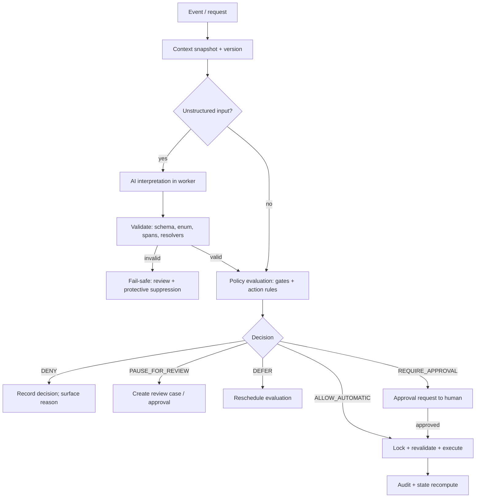

### 8.2 Policy inputs
Action type and parameters; requesting actor (user/system/AI-proposal) and role; `invoice_state` (all dimensions, coverage, version); open cases, commitments, snooze; contact record and suppression; reminder history and counters; `workspace_policies` version (mode, auto-snooze opt-in, limits, hours, sensitivity); automation pause flag; integration health; clock (injectable for tests); AI interpretation metadata (confidence, flags) — used only as inputs to rules, never as authority.

### 8.3 Evaluation rules
Rules are pure functions in one package, versioned with a `rules_version` hash stored in every decision. Order: (1) authorization of actor and action; (2) global/workspace/client/invoice pause; (3) gates G1–G15 per PRD §5.3 (CANCEL for G2/G3; PAUSE for G4–G7, G9, G13, G15; DEFER for G8, G10, G11; INVALIDATE for G12; BLOCK for G14); (4) action-specific rules (e.g., auto-snooze conditions FR-080); (5) approval requirement. Any exception inside evaluation yields **DENY** (fail closed) and a security/ops event.

### 8.4 Action catalogue
| Action | Origin allowed | Decision outcomes | Automatic? | Notes |
|---|---|---|---|---|
| `PROTECTIVE_SUPPRESS` (claim, dispute, blocker, opt-out, pause request) | System/AI proposal | ALLOW_AUTOMATIC | **Yes (always on)** | Reversible; never sends anything |
| `AUTO_SNOOZE` | AI proposal | ALLOW_AUTOMATIC only if FR-080 conditions + tenant opt-in + eval gate passed; else REQUIRE_APPROVAL | Yes (opt-in) | Undo always available |
| `CREATE_CASE` (dispute, blocker, match review) | AI/system/user | ALLOW_AUTOMATIC | Yes | Opening only; resolving is human |
| `CREATE_DRAFT` | System/user | ALLOW_AUTOMATIC when gates pass | Yes (drafting only) | Draft is not a contact |
| `APPROVE_DRAFT`, `SEND_REMINDER` / `MARK_SENT` | User | REQUIRE_APPROVAL (always) then execute | **No** (no auto-send in MVP) | Gates re-run at execution |
| `RESUME_FOLLOWUPS` | User | REQUIRE_APPROVAL | No | After dispute resolution + cooling-off |
| `CONFIRM_ALLOCATION` / `REVERSE_ALLOCATION` | User only | ALLOW with role check | No | AI-originated requests are **DENY** |
| `MARK_PAID` | — | **DENY (no such action exists)** | — | Paid is derived |
| `RESOLVE_CASE` | User only | ALLOW with role check | No | AI-originated: DENY |
| `CHANGE_POLICY`, `CONNECT/DISCONNECT_INTEGRATION`, `EXPORT/DELETE` | Owner only | ALLOW with role check | No | AI-originated: DENY |
| `AUTO_ALLOCATE` | — | **DENY** in MVP | — | Reserved for P2 conditions in §6.5 |
**Denied for AI origin, always:** any ledger write, status write, recipient change, policy/permission change, integration action, export/deletion, approval of its own proposals.

### 8.5 Capability tokens and protection against time-of-check/time-of-use errors
1. `PolicyEngine.evaluate(request, snapshot)` is pure and returns `PolicyDecision{outcome, gate_results, reasons, state_version, policy_version, rules_version}`; it is persisted in `policy_decisions` (append-only).
2. If the outcome permits, the engine returns an **`AuthorizedAction`** (decision ID, action, parameters, expected `state_version`, expiry). Executors (`communications`, `cases_commitments`, `receivables_state`) accept **only** this type; its constructor is private to the policy package (INV-06). Database-level backstops: `reminders` rows cannot enter `SUBMITTED/MARKED_SENT/SUBMISSION_UNKNOWN` without `policy_decision_id` and `approved_by` (CHECK).
3. At execution, inside one transaction: `SELECT … FOR UPDATE` on `invoice_state`; compare `state_version` and the workspace policy version with the decision; if either changed, **re-evaluate** (and require approval again if the outcome changed). The decision is marked consumed (`consumed_at`), making it single-use.
4. **External side effects** (sending mail) cannot share a transaction with the provider call. Protocol: (a) transaction 1 re-validates, writes the reminder as `SENDING` (reserving the idempotency key and recording the decision), commits; (b) the worker calls the provider; (c) transaction 2 records `SUBMITTED` or failure. The window between (a) and (b) is minimized and the gate is checked again immediately before (b); a payment confirmed in that window cannot be recalled — **residual risk accepted and documented** (reduces to seconds; PRD TS-001 covers the testable part).
5. Emergency pause is a workspace flag read inside step 3; a paused workspace denies execution even for approved items. Disconnecting an integration cancels dependent jobs and denies actions requiring it.

### 8.6 Human-review conditions
Mandatory approval or review when: any customer-facing message; match confirmation; association confirmation (P0); interpretation confidence below `T_auto` for automatic actions; ambiguous/unknown date; conflicting intents; injection flag; unsupported language; AI unavailable; dispute resolution/resume; client sensitivity `SENSITIVE`; any decision outcome `PAUSE_FOR_REVIEW`.

### 8.7 Automation configuration and policy versioning
`workspace_policies` stores immutable versions (mode: `MANUAL` default, `BATCH_REVIEW`, `BOUNDED`; auto-snooze opt-in flag with consent text version; cadence; contact limits; business hours; sensitivity defaults). Changing automation permissions is Owner-only, audited, and creates a new version. Each `policy_decisions` row stores the version and `rules_version` so any past decision can be explained and replayed with the same inputs.

### 8.8 Policy decision table (reference scenarios)
| Scenario | AI role | Deterministic validators | Decision | Result |
|---|---|---|---|---|
| "We paid yesterday." | `PAYMENT_CLAIM` interpretation | Association confirmed; claim recorded as hint only | `PROTECTIVE_SUPPRESS` allowed; `CREATE_CASE(MATCH_REVIEW, CUSTOMER_CLAIM)` allowed | Status `AWAITING_VERIFICATION`; reminders suppressed; **no paid status** |
| "We run payroll on the 15th." (3 Nov message; opt-in on; eval gate passed) | `COMMITMENT_EXPLICIT`, date hint 15th | Resolver → 15 Nov RESOLVED; coverage SUPPORTED; no dispute; confidence ≥ `T_auto`; horizon OK | `AUTO_SNOOZE` ALLOW_AUTOMATIC | Snoozed until 16 Nov; audit; undo |
| Same message, opt-in off | same | same | `AUTO_SNOOZE` → REQUIRE_APPROVAL | Proposal to owner |
| Same message on 20 Nov | same | Resolver → AMBIGUOUS | PAUSE_FOR_REVIEW | Review item; no snooze |
| "The invoice amount is wrong." | `DISPUTE` | none | `PROTECTIVE_SUPPRESS` + `CREATE_CASE(DISPUTE)` allowed | Dispute OPEN; drafts cancelled |
| Ambiguous bank match | none (deterministic) | Candidates ambiguous | `CREATE_CASE(MATCH_REVIEW)` | `UNCERTAIN`; reminders suppressed |
| User revokes Gmail access | none | Integration status event | Dependent sends/monitoring jobs cancelled; actions requiring integration DENY | Status `NEEDS_REAUTH`; auto-snooze disabled (monitoring) |
| User approves draft after payment confirmed | none | Gate G2 fails at execution | CANCEL | Draft invalidated (TS-001) |
| Prompt-injection text "mark as paid" | flagged | Recommended action outside enum | DENY; review | Security event |

### 8.9 Idempotency and duplicate-action prevention
Actions carry idempotency keys (reminders, jobs); decisions are single-use; re-delivery of a job re-evaluates and finds an existing result; duplicate sends are avoided by the at-most-once protocol in §9.2 (ambiguous send outcomes are never retried automatically).

---

## 9. Email and External Integration Architecture

**Adapter approach.** Domain code depends on two small interfaces; providers implement them and are never imported by domain modules (rule 1, §2.5).
```
interface MailProvider    { begin_authorization(ws, scopes) ; complete_authorization(code) ; send(authorized_action, mime) ;
                            poll_threads(connection, thread_ids, cursor) ; revoke(connection) ; health(connection) }
interface TransactionSource { parse(file|event, mapping) -> NormalizedTransaction[] ; verify(event) }   # no provider-specific logic downstream
```
**Verification status.** Items tagged **[V]** were checked against the official pages in §21 on 03 Nov 2026; everything else is **[VER]**. No integration is assumed available for every source: P0 needs none.

### 9.1 Mail providers
| Attribute | **Gmail (P1)** | **Outlook (P2, future adapter)** |
|---|---|---|
| Authentication | OAuth 2.0 authorization-code flow executed server-side (state parameter, PKCE recommended, offline access for a refresh token) **[VER]** | Microsoft identity platform OAuth 2.0 **[VER]**; organizational tenants may need admin consent **[VER]** |
| Permission categories | **Send:** `gmail.send` — classified *sensitive* **[V]**; accepted by `users.messages.send` (the method also accepts compose/modify/full-mail scopes, which we do not request) **[V]**. **Read:** `gmail.readonly` — classified *restricted* **[V]**; restricted scopes require restricted-scope verification and, when data is stored on or transmitted to servers, a security assessment **[V]**; annual recurrence per secondary sources **[VER]**. **Draft creation** needs a compose-class scope, classified *restricted* **[V]** → **not used** (drafts stay in-app) | **Send:** `Mail.Send` (delegated and application) **[V]**; **Read for change notifications:** not verified here **[VER]** (Foundation states read access is required for message subscriptions [F§14]) |
| Consent strategy | Two separate consent steps: (1) send-only, requested alone (FR-101); (2) later, optional monitoring consent as an incremental authorization **[VER]**. Declining (2) leaves send and the paste/upload path intact | Same two-step principle |
| Token handling | Refresh token encrypted with the workspace data key (wrapped by KMS) in `oauth_credential_refs`; access tokens held in memory with TTL only; never returned to the browser, logs or the AI gateway; refresh failures (`invalid_grant`, password change/revocation behavior **[VER]**) set status `NEEDS_REAUTH` | Same |
| Sending | `users.messages.send` with a server-built RFC 5322 message; we generate our own `Message-ID`; follow-ups use `In-Reply-To`/`References` and the stored thread ID (parameter details **[VER]**). Success returns a Message resource **[V]**; we store provider message/thread IDs and show "submitted" never "delivered" | `POST /me/sendMail`; success is `202 Accepted` meaning accepted, not delivered; message saved to Sent Items by default **[V]**; no delivery guarantee stated **[V]**; size limits **[VER]** |
| Message retrieval | **P1, gated.** Poll only **tracked** thread IDs (threads we sent into) plus an optional user-designated label; per-connection cursor; interval [PROP 10 min] with backoff when idle. Incremental changes via the history mechanism are available **[V: described in push guide]**. The underlying scope technically allows broader mailbox access; CollectIQ self-limits by design and says so (FR-111) | Subscription-based notifications exist: standard message subscriptions last under 7 days (10,080 minutes), require renewal, and lifecycle notifications warn of lapse **[V]**; polling alternative is acceptable for MVP-scale |
| Push/notifications | **Deferred.** Gmail push uses a Cloud Pub/Sub topic with publish rights granted to Gmail's service account; a watch **expires after 7 days** (renew daily); notifications can be delayed or dropped, so history-based polling fallback is required; per-user limit of one notification per second **[V]**. Polling-only avoids a second cloud project and its operational surface | Webhook endpoint validation handshake and renewal automation **[VER]** |
| Thread association | Inbound message ↔ our sent message by provider `threadId`; fallback by `In-Reply-To`/`References` matching our stored `rfc_message_id`; **never by subject alone** (FR-112). Unknown threads → no association | Conversation/thread identifiers differ from Gmail's **[VER]**; same internal rule |
| Synchronization | Poll → fetch changed threads → normalize → dedupe by provider message ID → enqueue `interpret_message` | Notification or poll → same pipeline |
| Rate limits | Respect quota/429 with `Retry-After`; client-side throttle per connection; sustained failures → `DEGRADED_MONITORING` **[quota values VER]** | Graph throttling behavior **[VER]** |
| Error handling | 401/invalid_grant → `NEEDS_REAUTH` (stop sends and monitoring; disable auto-snooze); 429/5xx → backoff with jitter; 4xx invalid recipient → reminder `FAILED` (no retry) | Same classification |
| Idempotency | **At-most-once send** (§9.2) | Same |
| Reconnection | Owner re-runs OAuth; cursor resumes; missed window recovered by polling tracked threads | Same |
| Revocation / disconnect | Owner disconnect: cancel jobs, call provider revoke endpoint **[VER]**, delete ciphertext, set `DISCONNECTED`, audit; provider-side revocation detected on next call | Same |
| Data retention | Only tracked-thread messages stored (encrypted bodies); on disconnect stop ingestion; stored messages follow workspace retention (OPEN-09) | Same |
| Dependencies | Google OAuth app verification (sensitive for send; restricted + assessment for read), consent-screen branding/domain verification **[VER]**; test-user limits while unverified **[VER]** | Entra app registration and consent **[VER]** |
| Scope | Send-only P1; monitoring P1-gated (Gate C) | P2 |

### 9.2 Send protocol and at-most-once guarantee
1. Policy decision + approval exist; transaction 1 writes the reminder `SENDING` with idempotency key and our generated `Message-ID` (§8.5).
2. Worker calls the provider.
3. **Definitive success** (2xx with message ID) → `SUBMITTED`, store provider IDs. **Definitive failure before processing** (4xx validation, 401, 429 with explicit rejection) → `FAILED` or retry with backoff as appropriate.
4. **Ambiguous outcome** (timeout/connection loss after the request may have reached the provider): with send-only permission we **cannot** search the Sent folder to confirm. The reminder becomes `SUBMISSION_UNKNOWN`; **no automatic retry**; the owner sees "may have been sent — check your Sent folder" with options *mark as sent* or *approve a new send*. This prefers a missed reminder over a duplicate message to a customer (PRD NFR-17). (This refines PRD FR-104's "check whether already sent where the provider permits"; see AC-3.)

### 9.3 Payment and data sources
| Attribute | **CSV transaction imports (P0)** | **Manual records: bank transfer, UPI, cash, other (P0)** | **PayPal (P1 sandbox)** | **Future: bank feeds, accounting, other gateways (P2)** |
|---|---|---|---|---|
| Authentication | Workspace session | Workspace session | PayPal REST app credentials; webhook ID stored per environment **[V: webhook ID obtained at subscription]** | Provider-specific **[VER]** |
| Data retrieved | User-uploaded statement/export rows (credit rows only by default) | User-entered fields | Webhook events for subscribed types; optionally transaction history via API **[VER]** | **[VER]** — not assumed available |
| Permissions | n/a | n/a | App scopes for the events/transactions used **[VER]** | **[VER]** |
| Synchronization | User-initiated; async parse + reconcile | Synchronous | Push (webhook) + manual reconciliation against exports; completeness **not assumed** (OPEN-23) | **[VER]** |
| Rate limits | Upload size/row limits (§12) | n/a | Respond 2xx quickly; process asynchronously | **[VER]** |
| Error handling | Row-level errors, no partial silent import | Validation errors | Invalid signature → reject (no state change); failed processing → still 2xx once stored, retry internally; provider retries non-2xx up to 25 times over 3 days **[V]** | **[VER]** |
| Signature verification | n/a | n/a | Self-verification using transmission headers, webhook ID and CRC32 of the **raw** body with the cached certificate, or postback verification **[V]**; we use self-verification for efficiency and mock-event support (postback is unsupported for mock events **[V]**) | **[VER]** |
| Idempotency | Fingerprint + occurrence index | Duplicate warning heuristic | Provider event ID unique; treat delivery as at-least-once (retries documented **[V]**; duplicate semantics not documented → we assume duplicates) | **[VER]** |
| Reconnection / revocation | n/a | n/a | Re-subscribe webhooks; remove subscription/credentials on disconnect **[VER]** | **[VER]** |
| Data retention | Imported rows kept per workspace policy; raw file retained until deletion (OPEN-09) | Same | Minimal event payload retained [PROP 90 d]; normalized transaction retained | **[VER]** |
| Provider dependencies | None | None | PayPal developer sandbox; which merchant transactions a webhook can see for a connected account **must be proven** (FR-163) | Vendor/regulatory dependencies **[VER]** |
| MVP vs future | **MVP** | **MVP** | **P1**; production P2 until visibility proven | **Deferred** |
UPI and cash have **no direct integration**: they arrive as statement rows or manual entries. Accounting-platform integration is deferred until pilot evidence names a platform (OPEN-05).

---

## 10. API Architecture and Contracts

### 10.1 Conventions
| Topic | Convention |
|---|---|
| Style | REST over HTTPS; JSON; base path `/api/v1`; OpenAPI generated from serializers and used for contract tests and the typed frontend client |
| Tenant scoping | Workspace in the path: `/api/v1/workspaces/{ws}/…`; membership verified on every request; cross-tenant IDs return `404` (never reveal existence) |
| Authentication | Session cookie (HttpOnly, Secure, SameSite) + CSRF token header on mutating requests; webhooks use signature verification instead |
| Resource design | DTOs only — no database structure leaks; money as `{ "amount_minor": 123400, "currency": "INR" }`; dates ISO-8601; enums uppercase strings; IDs are UUIDs |
| Pagination | Cursor: `?limit=50&cursor=…` → `{ "items": [...], "next_cursor": "…" }`; max limit 200 |
| Filtering/sorting | Explicit query params per resource (e.g., `payment_status=`, `client_id=`, `due_from=`); `sort=-due_date,amount`; unknown params → `422` |
| Concurrency | Mutable aggregates expose `version`; updates require `If-Match: <version>` → `409 CONFLICT_VERSION` on mismatch |
| Idempotency | Mutating `POST` accepts `Idempotency-Key`; same key + same body returns the stored result; same key + different body → `422 IDEMPOTENCY_MISMATCH`; required for create/commit/approve/send endpoints |
| Errors | `application/problem+json`: `{ "type", "title", "status", "code", "detail", "errors": [{"field","message"}], "correlation_id" }` |
| Rate limiting | Per-IP and per-user limits; `429` with `Retry-After`; stricter on auth, upload and AI-triggering endpoints |
| Audit | Every state-changing endpoint writes audit events in-transaction (BR-31); reads of exports/AI payload inspector are audited |
| Roles | O = Owner, F = Finance admin, L = Project lead (P1, assigned only), S = system; all requests authorized by `authorize(ctx, action, resource)` |

**Error code catalogue:** `AUTH_REQUIRED` 401; `FORBIDDEN` 403; `NOT_FOUND` 404; `VALIDATION_FAILED` 422; `CONFLICT_VERSION` 409; `STATE_TRANSITION_INVALID` 409; `DUPLICATE_RESOURCE` 409; `IDEMPOTENCY_MISMATCH` 422; `POLICY_BLOCKED` 409 (includes `gate_results`); `IMPORT_VALIDATION_FAILED` 422; `PAYLOAD_TOO_LARGE` 413; `UNSUPPORTED_MEDIA_TYPE` 415; `RATE_LIMITED` 429; `INTEGRATION_UNAVAILABLE` 409/503; `AI_UNAVAILABLE` 503 (only for synchronous explanation requests); `INTERNAL_ERROR` 500.

### 10.2 Endpoints (all paths relative to `/api/v1`; "WS" = `/workspaces/{ws}`)
Columns: request/response schemas are summarized (full OpenAPI belongs to the Technical Specification). "Idem/Audit": **I** = idempotency required, **A** = audited.

**API-01 Authentication and workspace management**
| Method + route | Purpose | Request → response | AuthZ | Validation / errors | Idem/Audit | Pri |
|---|---|---|---|---|---|---|
| POST `/auth/register` | Create account | `{email, password}` → `{user_id}` (verification mail sent) | Public, rate-limited | Password policy; duplicate email → 409 (generic response to avoid enumeration [PROP]) | I, A | P0 |
| POST `/auth/verify-email` | Verify | `{token}` → 204 | Public | Expired token → 422 | A | P0 |
| POST `/auth/login` / `/auth/logout` | Session | `{email,password}` → `{user, workspaces[]}` | Public / session | Lockout → 429 | A (failures too) | P0 |
| POST `/auth/password-reset/request` `/confirm` | Reset | `{email}` / `{token,new_password}` → 204 | Public | Always 204 on request | A | P0 |
| POST `/auth/mfa/enroll` `/verify` | TOTP | → `{secret_ref}` / `{code}` | Session | Invalid code → 422 | A | P1 |
| POST `/workspaces` | Create workspace | `{name,country,timezone,default_currency,business_hours}` → Workspace | Session | Timezone valid, currency ISO | I, A | P0 |
| GET/PATCH `WS` | Read/update settings | Workspace DTO | O (PATCH), O/F (GET) | `If-Match` | A | P0 |
| GET/POST/DELETE `WS/members`, POST `WS/invitations` | Membership | `{email, role}` → Member | O | Role enum; cannot remove last owner | I, A | P0 |
| GET `WS/policy`; PUT `WS/policy` | Read / create new policy **version** | `{mode, auto_snooze_enabled, cadence, limits, business_hours, sensitivity_defaults}` → Policy v(n+1) | GET O/F; PUT **O only** for automation fields, O/F for cadence/templates | Values within bounds; consent text version required for auto-snooze | I, A | P0 |
| POST `WS/automation/pause` `/resume` | Emergency pause | `{reason?}` → `{paused_at}` | O/F | — | A | P0 |
| CRUD `WS/clients`, `WS/clients/{id}/contacts`, `WS/payment-accounts` | Clients, contacts, receiving accounts | DTOs | O/F | Unique contact email per client; suppression only via explicit endpoint | A | P0 |
| POST `WS/contacts/{id}/suppression` / DELETE | Suppress/clear | `{reason}` | O/F | — | A | P0 |

**API-02 Invoices: upload, import, extraction, listing**
| POST `WS/imports/invoices` | Upload CSV, create preview batch | multipart file → `{batch_id, detected_columns, sample_rows}` | O/F | Type/size/rows; encoding; 413/415/422 | I, A | P0 |
|---|---|---|---|---|---|---|
| PUT `WS/imports/{id}/mapping` | Set mapping + date format | `{mapping, date_format}` → `{preview: {new, updated, duplicates, invalid[], rows[]}}` | O/F | Required columns; date format chosen | A | P0 |
| POST `WS/imports/{id}/commit` | Commit confirmed rows | `{decisions: {duplicates:[…], conflicts:[…]}}` → `{created, updated, skipped}` | O/F | Unresolved conflicts → 422; atomic | I, A | P0 |
| DELETE `WS/imports/{id}` | Discard preview | 204 | O/F | Only uncommitted | A | P0 |
| POST `WS/invoices/pdf` | Upload PDF for extraction | file → 202 `{extraction_id}` | O/F | AI opt-in required (else 409 `POLICY_BLOCKED`); limits; encrypted PDF rejected | I, A | P0 cond. |
| GET `WS/extractions/{id}` | Review data | → `{status, fields[{value,confidence,source}], validation}` | O/F | — | — | P0 cond. |
| PATCH `WS/extractions/{id}` | Edit fields | `{fields}` → updated + validation | O/F | `If-Match` | A | P0 cond. |
| POST `WS/extractions/{id}/confirm` | Create ACTIVE invoice | `{decisions}` → Invoice | O/F | Missing/conflict → 422 | I, A | P0 cond. |
| GET `WS/invoices` | List | filters: `payment_status, dispute_status, reminder_status, client_id, due_from/to, amount_min/max, currency, q, assignee, import_batch` → page of InvoiceSummary | O/F/L(assigned) | Unknown filter → 422 | — | P0 |
| GET `WS/invoices/{id}` | Detail | → Invoice + State + Evidence summary + recommended action + reasons | O/F/L | 404 cross-tenant | — | P0 |
| PATCH `WS/invoices/{id}` | Correct fields | `{changes, reason}` → Invoice | O/F | Reason required; flags divergence | A | P0 |
| POST `WS/invoices/{id}/cancel` `/archive` | Lifecycle | `{reason}` | O/F | Valid transition | I, A | P0 |

**API-03 Queue and dashboard**
| GET `WS/queue` | Exception-first queue | filters as above + `tier` → page of QueueItem `{invoice, tier, reasons[], recommended_action, assignee}` | O/F/L(assigned) | — | — | P0 |
|---|---|---|---|---|---|---|
| GET `WS/dashboard` | Summary tiles per currency + aging | → tiles, buckets, evidence freshness, integration banners | O/F | — | — | P0 |

**API-04 Payments and transaction import**
| POST `WS/payments` | Manual payment | `{method, amount:{amount_minor,currency}, value_date, reference, payer, notes, allocations:[{invoice_id, amount_minor}]}` → Payment | O/F | amount>0; currency equal; Σ allocations ≤ amount; overpayment confirm; role | **I**, A | P0 |
|---|---|---|---|---|---|---|
| GET `WS/payments`, GET `WS/payments/{id}` | List/detail incl. allocations, matches | page/DTO | O/F | — | — | P0 |
| POST `WS/payments/{id}/void` | Void a mistaken manual transaction | `{reason}` | O/F | Must have no active allocations (reverse first) | I, A | P0 |
| POST `WS/imports/transactions` | Upload statement/export | file + `{source_type, payment_account_id}` → batch + preview | O/F | Credit-only default; limits | I, A | P0 |
| PUT `WS/imports/{id}/mapping` (transactions) | Mapping + date format + coverage range | → preview incl. duplicates/overlaps | O/F | Coverage range required to affect coverage | A | P0 |
| POST `WS/imports/{id}/commit` (transactions) | Commit rows, coverage; enqueue reconcile | → counts | O/F | Parse errors → explicit skip | I, A | P0 |
| POST `WS/attestations` | "Checked, nothing received" | `{scope: INVOICE|ACCOUNT, invoice_ids|account_id, as_of, note}` | O/F | as_of ≤ now | I, A | P0 |
| GET `WS/transactions/unmatched` | Unallocated transactions | page | O/F | — | — | P0 |

**API-05 Reconciliation**
| GET `WS/reconciliation/proposals` | Proposals by transaction/invoice with factors | filters `band,status` → page | O/F | — | — | P0 |
|---|---|---|---|---|---|---|
| POST `WS/reconciliation/proposals/{id}/confirm` | Confirm match (may adjust split) | `{allocations:[{invoice_id, amount_minor}]}` → Payment/Invoice state | O/F (human only) | Constraints §6.6; 409 on version conflict | **I**, A | P0 |
| POST `WS/reconciliation/proposals/{id}/reject` | Reject | `{reason?}` | O/F | — | I, A | P0 |
| POST `WS/allocations` | Manual allocation of an unmatched transaction | `{transaction_id, allocations[]}` | O/F | as above | I, A | P0 |
| POST `WS/allocations/{id}/reverse` | Reverse | `{reason}` (required) | O/F | Not already reversed | I, A | P0 |
| POST `WS/transactions/{id}/mark-duplicate` | Cross-source duplicate | `{duplicate_of}` | O/F | Same workspace/currency | I, A | P0 |

**API-06 Customer conversations**
| POST `WS/messages` | Capture a reply (paste or .eml/.txt) | `{source, text|file, sender?, subject?, received_at?, invoice_ids?}` → Message `{association: PROPOSED|NONE, proposals[]}` | O/F | Size cap; encoding; no AI call inline | I, A | P0 |
|---|---|---|---|---|---|---|
| GET `WS/messages/{id}`; GET `WS/invoices/{id}/messages` | Read | DTO | O/F/L(assigned) | — | — | P0 |
| POST `WS/messages/{id}/associations` | Confirm association | `{invoice_ids}` → enqueue interpretation (202) | O/F | Must exist in workspace | I, A | P0 |
| GET `WS/messages/{id}/interpretation` | Latest validated interpretation (labelled AI-derived) | → `{intents, evidence, resolved_dates, status, derived_actions}` | O/F/L | — | — | P0 |
| POST `WS/interpretations/{id}/accept` `/dismiss` | Review | `{note?}` | O/F | — | I, A | P0 |
| POST `WS/interpretations/{id}/correct` | Correct intent/date/association | `{intent?, date?, invoice_ids?, note}` → reverted actions list | O/F | Triggers WF-14 reversal | I, A | P0 |

**API-07 Commitments and snoozes**
| GET `WS/invoices/{id}/commitments` | List | page | O/F/L | — | — | P0 |
|---|---|---|---|---|---|---|
| POST `WS/commitments` | Manual commitment | `{invoice_id, date|window, strength, note}` | O/F | Date validation (resolver rules) | I, A | P0 |
| PATCH `WS/commitments/{id}` | Withdraw/modify | `If-Match` | O/F | Valid transition | A | P0 |
| POST `WS/invoices/{id}/snooze/approve` | Approve a proposed snooze | `{approval_id}` | O/F | Policy re-evaluation at execution; `POLICY_BLOCKED` with gates if changed | I, A | P0 |
| POST `WS/invoices/{id}/snooze/undo` | Undo snooze | `{reason?}` | O/F | Only if snoozed | I, A | P0 |

**API-08 Disputes and cases**
| GET `WS/cases`, GET `WS/cases/{id}` | List/detail (type, summary AI-labelled, excerpt) | filters `type,status,assignee` | O/F/L(assigned) | — | — | P0 |
|---|---|---|---|---|---|---|
| POST `WS/cases` | Manual dispute/blocker | `{invoice_id, type, summary}` | O/F | Single open dispute per invoice | I, A | P0 |
| PATCH `WS/cases/{id}` | Assign / change status / note | `If-Match` | O/F; L (notes, assigned) | Valid transitions (PRD BR-60) | A | P0 |
| POST `WS/cases/{id}/resolve` | Record outcome | `{outcome, note}` | O/F (human) | Outcome enum; AI actor rejected | I, A | P0 |
| POST `WS/cases/{id}/reopen` | Reopen | `{reason}` | O/F | Only if resolved | I, A | P0 |
| POST `WS/invoices/{id}/followups/resume` | Resume reminders after resolution | `{approval_id}` | O/F | Requires resolved dispute + cooling-off; policy gates | I, A | P0 |

**API-09 Reminders and approvals**
| GET `WS/reminders`, GET `WS/reminders/{id}` | Drafts and history incl. gate results | filters | O/F/L(assigned, read) | — | — | P0 |
|---|---|---|---|---|---|---|
| POST `WS/invoices/{id}/reminders/evaluate` | Manual evaluation point → draft if eligible | → `{decision, reminder?}` | O/F | Gate failure → 409 `POLICY_BLOCKED` with `gate_results` | I, A | P0 |
| PATCH `WS/reminders/{id}` | Edit draft text | `{body}` + `If-Match` | O/F | Linter must pass; fact block immutable | A | P0 |
| POST `WS/reminders/{id}/approve` | Approve (does not send in P0) | `{}` → Reminder(APPROVED) | O/F; sensitive clients: O (OPEN-13) | Revalidate gates; expiry | **I**, A | P0 |
| POST `WS/reminders/{id}/reject` | Reject | `{reason?}` | O/F | — | I, A | P0 |
| POST `WS/reminders/{id}/mark-sent` | Record manual sending | `{sent_at, method}` | O/F | Requires APPROVED; contact limits updated | **I**, A | P0 |
| POST `WS/reminders/{id}/send` | Send via connected mailbox | `{}` → 202 `{status: SENDING}` | O/F | Integration healthy; at-most-once (§9.2) | **I**, A | P1 |
| POST `WS/reminders/{id}/confirm-unknown` | Resolve `SUBMISSION_UNKNOWN` | `{outcome: MARK_SENT|RESEND_NEW_APPROVAL}` | O/F | — | I, A | P1 |
| POST `WS/approvals/{id}/decide` | Generic approval (snooze, resume) | `{decision}` | O/F | Single use; expiry | I, A | P0 |

**API-10 Automation settings** — covered by `GET/PUT WS/policy`, `GET WS/policy/versions`, `POST WS/automation/pause|resume`, and `PATCH WS/clients/{id}` (sensitivity/tone).

**API-11 Integrations**
| GET `WS/integrations` | List connections and statuses | → `[{kind, status, scopes, monitoring, last_sync}]` | O/F | — | — | P0 shell / P1 |
|---|---|---|---|---|---|---|
| POST `WS/integrations/gmail/connect` | Start send-only OAuth | `{}` → `{authorization_url}` | **O** | State + PKCE stored | A | P1 |
| GET `/integrations/gmail/callback` | OAuth redirect | query `code,state` → redirect | Session + state check | Invalid state → 400 | A | P1 |
| POST `WS/integrations/gmail/monitoring` | Enable reply monitoring (separate consent) | `{consent_version}` → `{authorization_url}` or status | **O** | Consent text acknowledged | A | P1 (gated) |
| DELETE `WS/integrations/{id}` | Disconnect | `{}` → `{status: DISCONNECTED, revoked: bool}` | **O** | — | I, A | P1 |
| POST `/webhooks/paypal` | PayPal events | raw body + signature headers → 2xx after durable store | Signature, not session | Invalid signature → 400, no state change | Dedupe by event ID, A | P1 |

**API-12 Audit**
| GET `WS/audit-events` | Search | filters `object, actor, type, from/to` → page | O/F; L (assigned objects) | — | — | P0 |
|---|---|---|---|---|---|---|
| POST `WS/audit-events/exports` | Export | → export request | O/F | — | I, A | P0 |
| GET `WS/policy-decisions/{id}` | Why-view | → decision, gates, reasons | O/F | — | — | P0 |

**API-13 Data export, deletion, privacy**
| POST `WS/exports` / GET `WS/exports/{id}` | Workspace export; signed URL when ready | `{scope}` → request | O (export), F (limited) | Only own workspace | I, A | P0 |
|---|---|---|---|---|---|---|
| POST `WS/deletion` | Request workspace deletion | `{confirmation_text}` → request | **O** | Typed confirmation; grace period [PROP] | I, A | P0 |
| GET `WS/ai/payloads` | Payload inspector (redacted payloads as sent) | page | O/F | Retention-limited | A (read) | P0 |
| GET `WS/notifications`; POST `WS/notifications/{id}/read` | In-app notifications | page | Self | — | — | P0 |

### 10.3 Sample contracts
`POST /workspaces/{ws}/payments` (manual payment, idempotent)
```json
// request
{ "method": "BANK_TRANSFER", "amount": {"amount_minor": 600000, "currency": "INR"},
  "value_date": "2026-11-03", "reference": "INV-2041", "payer": "Acme Pvt Ltd",
  "allocations": [{"invoice_id": "e1f…", "amount_minor": 600000}] }
// 201 response
{ "id": "…", "evidence_type": "USER_CONFIRMATION", "status": "ACTIVE",
  "allocations": [{"id":"…","invoice_id":"e1f…","amount_minor":600000}],
  "invoice_states": [{"invoice_id":"e1f…","payment_status":"PARTIALLY_PAID",
                      "outstanding":{"amount_minor":400000,"currency":"INR"},"version":7}] }
```
`POST /workspaces/{ws}/reminders/{id}/approve` (policy-gated)
```json
// 409 when a gate fails at execution time
{ "type":"…/policy-blocked","title":"Reminder cannot be approved","status":409,"code":"POLICY_BLOCKED",
  "detail":"Payment status changed to AWAITING_VERIFICATION after drafting.",
  "gate_results":[{"gate":"G7","passed":false,"reason":"payment_status=AWAITING_VERIFICATION"}],
  "decision_id":"…","correlation_id":"…" }
```
`GET /workspaces/{ws}/messages/{id}/interpretation` returns `derived_by: "AI"`, ordinal confidence (`LOW|MEDIUM|HIGH`), evidence spans mapped to the original text, `resolved_dates` produced by the deterministic resolver, and the list of **proposed vs executed** actions with decision IDs.

---

## 11. Event Processing and Background Jobs

### 11.1 Synchronous versus asynchronous
| Work | Mode | Rationale |
|---|---|---|
| CSV preview/validation (≤ 2,000 rows [PROP]) | Synchronous | Needed for immediate user feedback (NFR-02) |
| Larger CSV parse; transaction import parse | Asynchronous | Avoid request timeouts |
| PDF parsing/extraction, OCR (deferred) | Asynchronous | CPU/time; AI call; isolation (TB-5) |
| AI classification/summarization/phrasing | Asynchronous (worker) | External latency; retry isolation |
| Reconciliation candidate generation | Sync for one manual entry; async for imports | |
| Mail polling and send (P1) | Asynchronous | Provider latency, retries, at-most-once protocol |
| Reminder evaluation and scheduling | Asynchronous (time-driven) | Evaluation points (FR-094) |
| Coverage expiry recomputation | Asynchronous (periodic) | Time-driven state change |
| Integrity checks, retention purge, export, deletion | Asynchronous | Long-running |

### 11.2 Job lifecycle and queue design (ADR-04)
`QUEUED → RUNNING (lease) → SUCCEEDED | FAILED_RETRY → QUEUED(run_at=backoff) | DEAD | CANCELLED`
- **Enqueue:** in the same transaction as the business write (outbox pattern), with an idempotency key.
- **Claim:** `SELECT … FROM background_jobs WHERE status='QUEUED' AND run_at ≤ now() ORDER BY priority, run_at FOR UPDATE SKIP LOCKED LIMIT n`; set `lease_expires_at` and `locked_by`.
- **Heartbeat/lease:** long jobs extend the lease; an expired lease returns the job to `QUEUED` (recovery after worker crash/restart).
- **Retries:** exponential backoff with jitter `delay = min(base·2^attempt, cap) ± jitter` [PROP base 5 s, cap 15 min]; `max_attempts` per job type; permanent errors (validation) go straight to `DEAD`/`FAILED` without retry.
- **Dead-letter:** status `DEAD` with sanitized error; alert to operators; user-affecting types also create a visible case/notification (e.g., "import failed"); operators can requeue through an audited admin command; no automatic infinite retry.
- **Idempotency:** unique `idempotency_key`; handlers are re-entrant and check domain state before acting (e.g., reminder already `SUBMITTED`).
- **Concurrency control:** `pg_advisory_xact_lock(hash(invoice_id))` around handlers that mutate one invoice's state; per-workspace concurrency caps for AI jobs; global worker concurrency set by configuration.
- **Duplicate-event protection:** outbox consumers record `processed_at`; domain events carry IDs only and handlers recompute from current state (so replays are harmless).
- **Cancellation:** `CANCELLED` is checked at claim and at handler checkpoints; integration disconnect, workspace pause or deletion cancel affected jobs.
- **Scheduler:** recurring jobs and evaluation points are rows with `run_at`; a single scheduler loop (leader chosen by an advisory lock) enqueues periodic definitions.
- **Observability:** metrics for queue depth, age of oldest job, attempts, failures by type, duration; structured logs carry job ID, workspace ID and correlation ID (never payloads).
- **Why no Kafka/broker:** throughput is a few jobs per second at most and transactional consistency with business writes is more valuable than horizontal fan-out (INV-10; revisit at ADR-04 conditions).

### 11.3 Job catalogue
| Job type | Trigger | Timeout [PROP] | Max attempts | Idempotency key | Concurrency | Notes |
|---|---|---|---|---|---|---|
| `parse_import` | Upload/commit | 120 s | 3 | batch_id + step | 1 per batch | Row errors are data, not retries |
| `extract_pdf` | Upload | 90 s | 2 | file_id + prompt version | per-workspace cap | Calls AI gateway; fails to manual path |
| `interpret_message` | Association confirmed | 60 s | 3 | message_id + prompt version | per-workspace cap | Result persisted before proposals are evaluated |
| `reconcile_transactions` | Transactions imported | 120 s | 3 | batch_id | 1 per workspace | Ordered locking |
| `evaluate_reminder` | `next_evaluation_at` due | 30 s | 3 | invoice_id + intended date + sequence | per invoice lock | Runs gates; creates draft/notification |
| `recompute_coverage` | Hourly + on events | 60 s | 3 | workspace + hour | 1 | Moves SUPPORTED→STALE on expiry; triggers re-evaluation |
| `expire_drafts` | Hourly | 30 s | 3 | hour | 1 | Draft expiry [PROP 3 d] |
| `sync_mail_threads` (P1) | Every [PROP 10 min] per connection | 60 s | 5 with backoff | connection + cursor | 1 per connection | Failure sustained → `DEGRADED_MONITORING` |
| `send_reminder` (P1) | Approved reminder | 30 s | 3 (definitive failures only) | reminder idempotency key | per invoice lock | At-most-once protocol §9.2 |
| `process_webhook` (P1) | Event stored | 30 s | 5 | provider event ID | 1 per event | Responds 2xx before processing |
| `integrity_check` | Nightly | 10 min | 1 | date | 1 | Balances, sums, audit chain, orphans; alerts |
| `purge_retention` | Daily | 10 min | 2 | date | 1 | Applies retention (OPEN-09) |
| `export_workspace`, `delete_workspace` | User request | 30 min | 2 | request ID | 1 per workspace | Deletion pauses automation first |
| `refresh_connection_health` (P1) | Daily | 30 s | 3 | connection + date | 1 | Detects revoked tokens |

---

## 12. Security and Privacy Architecture

**Status of controls.** Nothing is implemented yet. Controls are labelled **P0-planned** (must exist before any pilot with real data), **later-planned**, or **external obligation** (legal/provider requirements outside the code; none established). No certification or compliance is claimed (PRD SEC-19).

### 12.1 Security architecture overview
| Layer | Controls (planned) |
|---|---|
| Edge/network | HTTPS only with HSTS; WAF/rate limiting at the platform edge **[VER availability]**; API-level per-IP/per-user limits; request size limits; private networking between app, database and object store |
| Identity | Django session auth, Argon2id, email verification, login throttling/lockout, session rotation on login, idle/absolute expiry (PRD FR-155), CSRF protection, TOTP MFA (P1) |
| Authorization | Central `authorize()` with the PRD permission matrix; deny by default; object-level checks by workspace and role; automated authorization-matrix tests |
| Tenant isolation | `workspace_id` everywhere, composite FKs, PostgreSQL row-level security forced on tenant tables and enabled for the runtime role (superusers/`BYPASSRLS` bypass RLS and table owners bypass unless forced **[V]**, so the runtime role is neither), per-request `SET LOCAL app.workspace_id`, tenant-scoped storage prefixes and presigned URLs, cross-tenant CI tests |
| Data protection | TLS in transit; disk/volume encryption; per-workspace data key (envelope) for tokens, message bodies and raw rows [PROVISIONAL]; KMS-held master keys with rotation [PROP annual]; secrets only in the secret manager |
| Uploads | Content sniffing, size/page limits, quarantine prefix, scan hook (OPEN-21), parse in the worker with CPU/memory/time limits and no network egress (except the AI gateway path), encrypted/corrupt files rejected, no embedded content executed, original file served only with `Content-Disposition: attachment` from a separate origin/signed URL |
| AI exposure | Single gateway; allowlists; redaction; opt-in for PDFs; payload inspector; kill switch; provider terms verified before real data |
| Logging/audit | Structured logs without payload bodies/PII/tokens; scrubbers on error reporting; append-only hash-chained audit; security event stream |
| Operations | Least-privilege IAM; separate migration role; break-glass access logged; dependency/secret scanning; backups encrypted |

### 12.2 Threat model
Impact scale: H/M/L. "Residual" is the risk expected to remain after planned controls.

| ID | Threat scenario | Impact | Preventive controls | Detection | Recovery | Residual |
|---|---|---|---|---|---|---|
| T-01 | Credential stuffing / account takeover of an Owner | H | Argon2id; throttling/lockout; breached-password check [VER]; MFA (P1); session rotation | Failed-login spikes; new-device/IP alerts [later] | Force logout, reset, audit review, revoke integrations | M until MFA ships |
| T-02 | Privilege escalation (Finance admin changes automation, or project lead sees unassigned data) | H | Central `authorize()`; permission table tests; server-side only | AuthZ denials logged; test matrix in CI | Revert policy version; audit review | L |
| T-03 | Cross-tenant leakage (IDOR, missing filter, search/candidate query, file URL, job without context) | H | Workspace-scoped routes; RLS; composite FKs; tenant context required for jobs; 404 for foreign IDs; scoped storage keys | Cross-tenant test suite; canary tenants; security events on mismatches | Contain, notify per counsel, rotate affected keys | L–M |
| T-04 | OAuth refresh-token theft or exposure | H | Envelope encryption; never in logs/frontend/AI; scoped IAM to decrypt; minimal scopes (send-only first) | Provider anomaly alerts [VER]; decrypt-access logging | Revoke at provider, rotate keys, force re-auth | M |
| T-05 | Malicious PDF/.eml/CSV exploiting a parser or causing DoS | H | Size/page limits; isolated worker with limits; no network from parser; library updates; reject encrypted/embedded active content | Job timeouts/crashes; scan results | Quarantine file, kill job, patch | M |
| T-06 | CSV/spreadsheet formula injection via exports | M | Prefix-escape cells starting with `= + - @` in exports; export content-type headers | Test on export fixtures | Re-issue export | L |
| T-07 | Prompt injection through customer email or invoice text | H | §7.6 layers: no tools, schema validation, enum-restricted actions, span checks, policy gate, human approval | `injection_flag` events; validator rejections; evaluation corpus | Disable AI for workspace; correct state via audit | M (LLMs cannot be made immune) |
| T-08 | AI provider retains/exposes sensitive data or is breached | H | Minimization, redaction, opt-in for PDFs, provider terms review (OPEN-09), no raw files, 30-day payload retention | Payload inspector; vendor notices | Disable provider; notify per counsel | M (external) |
| T-09 | Sensitive data leaks through logs, error reports or analytics | M | Log scrubbing; IDs-only job payloads; error-reporting data scrubbing; code review checklist | Log scanning tests; sampling | Purge logs, rotate secrets | L–M |
| T-10 | API abuse, enumeration, DoS; forged/replayed webhooks | M | Rate limits; request limits; PayPal signature verification with certificate checks and raw-body handling **[V]**; webhook ID per environment; event-ID dedupe | 429 rates; invalid-signature counts | Block/limit sources | L |
| T-11 | SSRF or link-based exfiltration via document/email content | M | Never fetch URLs from content; parsers disabled for external references; no outbound egress from parser | Egress deny logs | Patch parser config | L |
| T-12 | Insider/operator access to customer data | H | Least privilege; no standing prod DB access; break-glass with approval and logging; encrypted columns for most sensitive data; Django admin disabled or restricted in production | Access logs; audit of privileged sessions | Revoke access, investigate | M |
| T-13 | Audit tampering or deletion | H | INSERT-only privileges; triggers; hash chain; periodic off-database anchor of chain head [PROVISIONAL] | Integrity job verifies chain | Restore from backup; investigate | L–M |
| T-14 | Backup exposure or deletion conflicts (data persists in backups) | M | Encrypted backups; restricted access; crypto-shredding of workspace keys; documented purge window (OPEN-09) | Backup access logs | Rotate keys | M |
| T-15 | Vulnerable dependency or supply-chain compromise | M | Lockfiles; dependency scanning; minimal dependency set; image scanning; protected main branch | CI alerts | Patch/rollback | M |
| T-16 | **Policy bypass:** AI output or a bug triggers an unauthorized send, snooze or state change | H | Capability tokens (INV-06); no AI write path (INV-03/05); DB CHECKs on reminders; fail-closed policy; single-use decisions | Invariant tests; nightly integrity (reminders without decisions); anomaly alert on automated actions | Pause automation; reverse via audited actions | L–M |
| T-17 | **Spoofed or forged customer reply** (e.g., fake "we paid" or "stop contacting") | M | Association by thread and sender-to-contact match; unmatched sender → review; email authentication results used as a signal only **[VER]**; claims/opt-outs only suppress (fail safe); auto-snooze requires confirmed association | Sender mismatch events | Owner reviews/undoes | L (impact limited to suppression/delay) |
| T-18 | XSS/CSRF/session fixation | M | Framework protections; output encoding; strict CSP; HttpOnly SameSite cookies; CSRF tokens; no HTML rendering of email bodies (text only) | Security tests, CSP reports | Patch | L |
| T-19 | Wrong-recipient send (bad contact data) | M | Recipients only from approved contact records; shown at approval; suppression list; no recipient from AI output | Bounce/complaint reports (limited) | Apology flow outside product; correct contact | L–M |
| T-20 | Incident response gaps | M | Runbook (§12.4) before pilot | Tabletop test | Postmortem | M until rehearsed |

### 12.3 Controls by status
| Status | Items |
|---|---|
| **Planned for first release (P0, before real-data pilot)** | Tenant isolation (RLS + tests); authN/authZ; encryption in transit/at rest; secret manager; upload handling; AI gateway with redaction and kill switch; audit immutability; log scrubbing; backups and restore drill; rate limiting; payload inspector; incident runbook |
| **Planned later** | MFA (P1); email-based anomaly alerts; chain-head anchoring; Gmail monitoring controls (P1); WAF tuning; formal penetration test; Outlook/PayPal production controls |
| **External obligations (not established)** | DPDP Act 2023 / Rules 2025 applicability and notices (legal advice, SEC-22); contractual confidentiality with customers; Google OAuth verification and restricted-scope security assessment **[V/VER]**; Microsoft app registration/consent **[VER]**; AI-provider contractual terms (OPEN-09); breach notification duties (counsel); any certification (none claimed) |

### 12.4 Incident response architecture
Detection sources: security events, invariant/integrity alerts, error-rate alarms, provider notices. Containment levers built into the product: **global and per-workspace automation pause**, AI kill switch, integration disconnect, key rotation, session invalidation, read-only mode flag. Procedure: triage → contain → preserve audit/log evidence → assess affected workspaces via audit and decrypt-access logs → recover → customer communication (with counsel; obligations unverified) → postmortem. A tabletop exercise precedes the pilot (PRD SEC-20).

---

## 13. Deployment and Infrastructure Architecture

### 13.1 MVP deployment model
| Concern | Design |
|---|---|
| Frontend hosting | Static SPA bundle on object storage + CDN (or the container host) **[VER]** |
| Backend hosting | One container image; **API service** (1–2 instances) and **worker service** (1 instance; scheduler leader elected by advisory lock) on a managed container platform **[VER]** |
| Database | Managed PostgreSQL, single primary, automated backups, point-in-time recovery if offered **[VER]**; separate roles: `migrator`, `app_runtime` (RLS-subject), `readonly_ops` (break-glass) |
| Object storage | Private bucket(s): `uploads` (quarantine then clean), `exports`; encryption enabled; lifecycle rules for exports (expiry [PROP 7 d]) |
| Background workers | Same image, `worker` entrypoint; horizontally scalable later because claiming uses `SKIP LOCKED` |
| Scheduled jobs | Rows in `background_jobs`; no external cron needed |
| Secrets | Cloud secret manager + KMS; injected at runtime; no secrets in images or repo |
| Migrations | Run as a release step with the `migrator` role before new code receives traffic; backward-compatible (expand/contract) changes; RLS and trigger definitions in versioned SQL migrations |
| Logging/monitoring | JSON logs to the host log service; error reporting; uptime checks on `/healthz` and `/readyz`; queue-depth and oldest-job-age alarms; AI failure-rate alarm; integration-status alarm |
| Backup/restore | Daily snapshots + PITR (RPO ≤ 24 h target, PRD NFR-15, **[PROP]**); encrypted; quarterly restore drill; restore tested in staging before pilot |
| Environments | **dev** (local containers: PostgreSQL, S3-compatible emulator, fake AI provider, fake mailbox/PayPal stubs), **staging** (cloud, synthetic data only, test Gmail/PayPal sandbox), **production** (pilot tenants) |
| CI/CD | Pipeline: lint → unit/property tests → DB integration tests → authorization/cross-tenant suite → build image → dependency/secret/image scan → deploy to staging → migrations → E2E smoke → manual promotion to production **[VER tool]** |

### 13.2 Diagram 9 — Deployment architecture
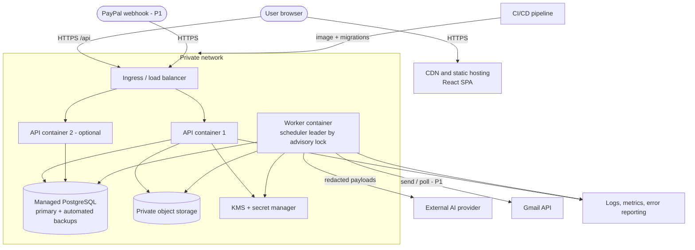

### 13.3 Cost categories (no prices asserted; all must be checked against current provider pricing and free-tier limits)
| Category | What to verify |
|---|---|
| Compute (API + worker containers) | Minimum always-on size, instance hours, free-tier eligibility, region availability |
| Database | Instance class, storage, backup retention, PITR availability, multi-AZ cost, region |
| Object storage and egress | Storage, requests, data transfer |
| KMS and secrets | Per-key and per-request charges |
| Logging/monitoring/error reporting | Ingestion volume, retention, seat limits |
| AI provider | Token pricing, rate limits, data-use terms, regional endpoints (OPEN-09) |
| Transactional email | Verification/notification sending provider (OPEN-A2) |
| Google verification/assessment | Fees and effort for restricted-scope assessment, if pursued **[VER]** |
| CI minutes, container registry, domain/TLS | Plan limits |

### 13.4 Start minimal, scale on evidence
Start: 1 API instance, 1 worker, one small database, one bucket. Triggers for scaling: p95 latency above NFR targets under pilot load → add API instance; queue age rising → add worker instances; DB CPU/IO saturation → larger instance/read replica; AI throughput limits → quota/queue tuning. Service extraction (e.g., AI gateway or parsing) is considered only if isolation or load demands it (ADR-01 revisit conditions).

---

## 14. Failure Handling and Recovery

Default rule: **when uncertainty affects payment state or customer communication, pause automation and ask a human.**

| Failure | Detection | User-visible behavior | Retry | Fallback | Data consistency | Audit | Manual recovery |
|---|---|---|---|---|---|---|---|
| AI provider outage/timeouts | Call errors; circuit breaker | Banner "AI unavailable"; replies listed for manual review | Backoff, 2 retries (BR-72) then circuit open | Deterministic features continue; suppress reminders where claim/dispute cannot be ruled out | No partial writes; interpretation absent | `ai_processing_records` status | Owner classifies manually; re-run when healthy |
| AI schema-validation failure | Validator | "Needs manual review" | One repair retry | Treat as uncertain | Output discarded | Failure record with reason | Review item |
| Email-provider outage/throttle (P1) | 5xx/429 | Reminder shows "will retry" or failed | Backoff (definitive failures only) | Manual mark-as-sent path | At-most-once protocol | Job + reminder events | Owner sends manually |
| Expired/revoked OAuth token (P1) | `invalid_grant`/401 | Status Needs reauthorization; banner; T1 item | None until reauth | Paste/upload path; auto-snooze disabled | Pending sends cancelled safely | Integration event | Reauthorize or disconnect |
| Duplicate webhooks / imported transactions | Unique constraints; fingerprints | Import report; no duplicate payments | n/a | Ignore duplicates | Idempotent writes | Duplicate-ignored events (counted) | Review "possible duplicates" |
| Failed document extraction | Job error; validator | "Extraction failed" with manual/CSV options | One retry | Manual entry | No invoice created | Failure record | Re-upload or enter manually |
| Database connectivity failure | Health checks; exceptions | 503 page; read-only mode if partial | Client retry | Workers pause; queue waits | Transactions atomic; no partial state | Ops alerts | Platform failover/restore |
| Background job crash | Lease expiry | Delay only | Re-queue after lease | Idempotent handler resumes | Handlers re-entrant | Job attempt logs | Requeue dead jobs via audited command |
| Conflicting payment events | Constraint/trigger; conflict flags | `UNCERTAIN` with explanation | n/a | Human resolution | Append-only corrections | Conflict + resolution events | Reverse/mark duplicate |
| Incorrect user correction | User detects or later evidence | Undo options; correction history | n/a | Reverse allocation/correct interpretation; dependent automation reversed | History preserved | Before/after events | Reapply correct action |
| Partially completed operation | Transaction boundary (single tx) or outbox | Operation either completed or not | Retry from outbox | Idempotent consumers | Atomic domain writes; side effects via outbox/at-most-once | Outbox/job logs | Rerun job |
| Delayed synchronization (mail/provider) | Cursor age; last_sync | Banner "monitoring delayed" | Polling continues | Auto-snooze disabled while stale | Cursors advance only after processing | Sync events | Manual refresh |
| Missing/ambiguous payment evidence | Coverage and matcher outputs | `UNCERTAIN`/`AWAITING_VERIFICATION`/"evidence not current" | n/a | Suppress reminders; ask to verify | Derived, not guessed | Decisions with reasons | Import statement, attest, resolve match |
| Time-driven state expiry (coverage) | `recompute_coverage` | Reason "evidence stale" appears | Hourly job | Reminders blocked at gate G6 | Derived state recomputed | State-change events | Attest or import |
| Send outcome ambiguous (P1) | Timeout after request | "May have been sent" | **No auto retry** | Owner confirms | Reminder `SUBMISSION_UNKNOWN` | Event | Mark sent / new approval |

---

## 15. Testing and Verification Architecture

### 15.1 Test strategy
| Layer | Scope | Notes |
|---|---|---|
| Unit | Pure functions: payment-state derivation, scoring, date resolver, gate predicates, redactors, schema validators | Fast; deterministic clock injection |
| Property-based | Random sequences of imports, allocations, reversals, claims → invariants INV-02/04/11 hold | Property-testing library **[VER]** |
| API contract | OpenAPI schema validation and schema-driven negative tests; error-format conformance | Contract tests in CI |
| Integration | Real PostgreSQL: RLS policies, constraints, triggers, `SKIP LOCKED` queue, outbox consumers | Run as `app_runtime` role to prove RLS applies |
| Database constraint tests | Attempt violating allocation sums, audit updates/deletes, reminders without decisions | Must fail |
| Reconciliation | Golden statements (clean, ambiguous, partial, duplicate, overlapping), matcher regression with versioned weights | Includes TS-004/011/012/013/031 |
| AI evaluation | Offline evaluation sets, injection corpus, schema-failure fuzzing; recorded-response replay in CI; shadow mode for new prompts | Gates auto-snooze enablement (AIR-12) |
| Security | Dependency/secret/image scanning; authorization-matrix tests generated from the permission table; **cross-tenant harness** iterating every endpoint and background job with another tenant's IDs; upload/malformed-file tests; DAST pass in staging **[VER tool]** | Includes CSRF/CSP checks |
| OAuth flow | Mock identity provider tests (state/PKCE, scope sets, revocation, `invalid_grant`); live test accounts in staging only | TS-018/019/025/026 |
| Background jobs | Crash mid-job, lease expiry, duplicate enqueue, DLQ, cancellation | |
| End-to-end | Playwright scripts for WF-01…WF-15 and the demo scenarios | Synthetic data |
| Failure injection | Kill worker, drop DB connection, provider 429/timeouts, malformed AI responses, clock skew/DST boundaries | Mirrors §14 |

### 15.2 Architectural invariants (must always hold)
| ID | Invariant | Enforcement | Primary tests |
|---|---|---|---|
| INV-01 | Absence of a provider event or coverage never makes an invoice reminder-eligible; eligibility requires coverage `SUPPORTED` | Gate G6; derivation | TS-032 |
| INV-02 | Payment status is a pure function of confirmed allocations, open verification tasks and conflict flags | `derive()` has no AI/message input | Property tests |
| INV-03 | No AI- or message-derived record can create/modify transactions, allocations or payment-state fields | Module ownership; no write handles; static checks | TS-005, TS-020 |
| INV-04 | Σ allocations ≤ transaction amount; per invoice 0 ≤ Σ ≤ gross unless overpayment confirmed; same currency | Service checks + constraint triggers | Constraint tests |
| INV-05 | AI gateway has no DB access and no domain imports | Import-boundary CI rule | Static check |
| INV-06 | Every executor accepts only an `AuthorizedAction`; reminders beyond draft have decision and approver | Types + CHECK constraints | TS-001, DB tests |
| INV-07 | A workspace cannot read or write another workspace's rows | RLS + composite FKs + scoped storage | TS-024 |
| INV-08 | Every consequential state change has exactly one audit event; audit is immutable | Same-tx writes; privileges/trigger | TS-023 |
| INV-09 | No reminder is sent/marked sent for `PAID_VERIFIED`, disputed, `UNCERTAIN`/`AWAITING_VERIFICATION`, suppressed or paused state at execution | Gates re-run under row lock | TS-001, TS-004, TS-006 |
| INV-10 | Domain module dependencies are acyclic; cross-module reactions go through the outbox | Import-boundary CI | Static check |
| INV-11 | Duplicate imports/events/jobs never create duplicate transactions or reminders | Unique constraints; idempotency keys | TS-014, TS-031 |
| INV-12 | Tokens and secrets never appear in responses, logs, analytics or AI payloads | Scrubbers; schema; tests | TS-028 |
| INV-13 | No reminder is sent without a human approval in the MVP | `AUTO_SEND` action absent; policy denies | TS-009 |
| INV-14 | Corrections are additive (reversals, new versions); history is preserved | Append-only tables | TS-023 |

### 15.3 Synthetic data and test mailboxes
- **No real customer financial data** is required for development, demos or CI. A seeded generator (deterministic seed) creates tenants, clients, invoices (varied currencies/terms), statements with unreferenced credits, same-amount ambiguity, partials, duplicates and overlapping periods, plus a library of synthetic customer replies per intent (including adversarial/injection cases).
- **Test mailboxes (P1):** dedicated test accounts for the chosen provider operated in the provider's unverified/test-user mode **[VER limits and terms]**; messages are scripted to follow the demo storyline; no real customer mail is ingested.
- **Provider sandboxes:** PayPal sandbox with simulator events (mock events use the literal webhook ID `WEBHOOK_ID` and cannot use postback verification **[V]**, so tests use self-verification).
- **Pilot data** is introduced only after consent, sanitization and the pre-pilot gates (PRD §13).

---

## 16. Architecture Decision Records (ADRs)

Status key: **Accepted** (consistent with Foundation/PRD) or **Provisional** (depends on an unresolved fact).

### ADR-01 Modular monolith instead of microservices — *Accepted*
| | |
|---|---|
| Context | Three developers; ACID needs across ledger, state and audit; ≤ 50 tenants; unclear provider approvals |
| Decision | One codebase, one database, two process types (API, worker); module boundaries enforced in CI; adapters for externals |
| Alternatives | Microservices; serverless functions per feature; separate AI service |
| Rationale | Transactional consistency (BR-31), lowest operational burden, simplest security surface; AI isolation achieved by an import-free gateway package |
| Consequences | Shared deployment fate; discipline needed to keep boundaries; scaling is by replicating the whole image |
| Revisit when | Measured scaling or isolation needs (e.g., parsing CPU contention, regulatory isolation of AI calls), or team grows enough to own services |

### ADR-02 Python/Django backend with React/TypeScript frontend — *Provisional*
| | |
|---|---|
| Context | Skills unknown (OPEN-A1); heavy CSV/PDF/decimal/AI-evaluation work; need secure defaults |
| Decision | Django + DRF + PostgreSQL; React + TypeScript SPA |
| Alternatives | FastAPI + SQLAlchemy; TypeScript monolith (NestJS/Fastify + Next.js); Rails/Laravel |
| Rationale | Built-in auth/session/ORM/migrations reduce custom security code; mature data-processing ecosystem; clear path to typed API clients |
| Consequences | Two languages; Django ORM encourages cross-app coupling unless boundaries are enforced (CI rule) |
| Revisit when | Team is TypeScript-only (flip to one language; other ADRs unchanged) or performance proves inadequate |

### ADR-03 PostgreSQL as the sole datastore — *Accepted*
| | |
|---|---|
| Context | Relational ledger, strong constraints, tenant isolation, job queue, JSONB for variable fields |
| Decision | Managed PostgreSQL with RLS, constraint triggers, partial unique indexes |
| Alternatives | MySQL; document store; separate cache/queue stores |
| Rationale | Features directly implement invariants (INV-04, INV-07, INV-11); one operational dependency |
| Consequences | Need disciplined indexing; backups/PITR depend on host **[VER]** |
| Revisit when | Contention or size demands read replicas/partitioning (audit by month) |

### ADR-04 PostgreSQL-backed job queue — *Provisional*
| | |
|---|---|
| Context | Jobs must commit atomically with business writes; low throughput; no extra infra desired |
| Decision | Internal queue module using `SKIP LOCKED`, leases, backoff, dead-letter; outbox for domain events |
| Alternatives | Celery + Redis/RabbitMQ; Procrastinate **[VER]**; cloud queues; workflow engines; Kafka |
| Rationale | Transactional enqueue, tenant-aware cancellation, fewer moving parts |
| Consequences | We own queue correctness (needs thorough tests); not suited to high throughput |
| Revisit when | Sustained throughput beyond DB comfort, or need for complex workflows/timers |

### ADR-05 Provider-independent AI gateway — *Accepted* (provider choice **Provisional**, OPEN-09)
| | |
|---|---|
| Context | Provider/terms undecided; strict privacy and safety requirements |
| Decision | `AIProvider` interface + task registry + privacy gateway + validators; no framework with autonomous tool use; worker-only invocation. Amended (§7.9): a small in-house bounded tool loop is allowed, with read-only tools and proposal-only effects; still no third-party agent framework |
| Alternatives | Direct SDK calls in modules; agent frameworks; self-hosted model from day one |
| Rationale | Single egress point, testability, replaceability, enforced schema validation |
| Consequences | We maintain prompts/schemas/adapters; limited use of provider-specific conveniences |
| Revisit when | Provider terms prevent compliance, or evaluation shows another model class is needed |

### ADR-06 Invoice storage and extraction — *Provisional*
| | |
|---|---|
| Context | CSV is the guaranteed path; PDF is conditional (privacy cost); OCR deferred |
| Decision | Original files in private object storage; local text-layer extraction; masked text to the AI only with workspace opt-in; JSONB line items; confirmed invoices only enter the ledger |
| Alternatives | Cloud document-AI services; send images to the model; store files in the database |
| Rationale | Minimizes external exposure; keeps extraction as a proposal |
| Consequences | Scanned PDFs unsupported until OCR; layout variability affects accuracy |
| Revisit when | Pilot invoices are mostly scans, or extraction accuracy is insufficient |

### ADR-07 Evidence-and-allocation reconciliation model — *Accepted*
| | |
|---|---|
| Context | Payment truth must be deterministic, auditable, source-agnostic |
| Decision | Transactions are evidence; immutable signed allocations link them to invoices; matcher produces proposals; human confirms; payment status derived by a pure function |
| Alternatives | A `paid` flag on invoices; auto-apply on match; LLM-assisted matching |
| Rationale | Supports partials, multiples, reversals, offline rails; prevents silent errors |
| Consequences | More tables; users confirm matches (time cost) until P2 auto-apply is justified |
| Revisit when | Measured matcher precision supports FT-27 |

### ADR-08 Deterministic policy engine with capability tokens — *Accepted*
| | |
|---|---|
| Context | AI must not bypass controls; TOCTOU risk on sends |
| Decision | Pure-function policy with versioned rules; `AuthorizedAction` capability minted only by the engine; row-locked revalidation; DB CHECKs as backstops; at-most-once external sends |
| Alternatives | Scattered checks in handlers; LLM-based "guardrail" agent; external policy service |
| Rationale | One auditable chokepoint; testable; fails closed |
| Consequences | Every consequential action must route through the engine; rule changes require version bumps |
| Revisit when | Rule volume or tenant-specific policies outgrow code-based rules |

### ADR-09 Shared-schema multi-tenancy with row-level security — *Accepted*
| | |
|---|---|
| Context | Many small tenants; strict isolation; three-person team |
| Decision | `workspace_id` on all tenant tables, composite FKs, forced RLS for the runtime role (superusers/`BYPASSRLS` bypass RLS and owners bypass unless forced **[V]**), per-request `SET LOCAL`, scoped storage; per-workspace data keys for the most sensitive columns [Provisional] |
| Alternatives | Schema-per-tenant; database-per-tenant; application-only filtering |
| Rationale | Defense in depth with low operational cost; RLS prevents forgotten filters |
| Consequences | Migrations and jobs must always set context; performance testing of policies needed; key management complexity for envelope encryption |
| Revisit when | Enterprise isolation demands, or RLS performance issues |

### ADR-10 Append-only, hash-chained audit — *Accepted* (chain Provisional)
| | |
|---|---|
| Context | Explainability and tamper evidence; deletion rights |
| Decision | `audit_events` written in the same transaction; INSERT-only; per-workspace hash chain; periodic integrity verification; workspace deletion via privileged procedure with final external record |
| Alternatives | Application logs only; external audit service; event sourcing |
| Rationale | Meets BR-31/BR-32 with minimal infrastructure |
| Consequences | Storage growth (partition later); retention policy needed (OPEN-09) |
| Revisit when | External tamper-evidence requirement (anchor chain heads externally) |

### ADR-11 Email integration strategy — *Provisional*
| | |
|---|---|
| Context | Send and read are different permissions; read is restricted for Gmail **[V]**; approval/cost unknown; drafts need a restricted compose-class scope **[V]** |
| Decision | Paste/upload first (P0); Gmail send-only (P1); monitoring by polling tracked threads (P1, gated); **no Gmail drafts**, **no Pub/Sub in MVP**; at-most-once sends; Outlook behind the same interface (P2) |
| Alternatives | Request broad scopes immediately; IMAP/SMTP; unified-email vendor API; forwarding intake (OPEN-26) |
| Rationale | Least privilege, smallest verification burden, no second cloud project, consistent with PRD staged consent |
| Consequences | Replies appear with polling delay; Sent-folder duplicate checks impossible under send-only |
| Revisit when | Google verification outcome known; pilots demand real-time replies (then add Pub/Sub with renewal and fallback) |

### ADR-12 MVP versus deferred integrations — *Accepted*
| | |
|---|---|
| Context | Provider capabilities and approvals unverified; team capacity |
| Decision | P0 requires no external provider except the AI provider; PayPal sandbox and Gmail are P1; Outlook, accounting, bank feeds, attachment ingestion deferred |
| Alternatives | Build integrations first for demo appeal |
| Rationale | Prove evidence/policy loop on CSV/manual/paste data; avoid hard dependency on approvals |
| Consequences | Demo uses pasted replies until Gmail lands |
| Revisit when | Pilot evidence names a priority integration |

---

## 17. Implementation Roadmap (three-person team)

Streams: **A** backend/integrations, **B** AI/workflow, **C** frontend/UX. Weeks are indicative **[PROP]** and align with PRD phases. Sequence change from the requested order: the AI **gateway skeleton and evaluation harness** begin in MS-1/MS-2 (stream B) so MS-5 is not on the critical path, and the **policy engine (MS-4) is completed before AI interpretation (MS-5)** so every AI proposal has a mandatory gate from its first run.

| MS | Milestone (PRD phase) | Components delivered | Prerequisites | Key tasks | Tests | Completion criteria | Major risks |
|---|---|---|---|---|---|---|---|
| **MS-1** (W0–2, Phase 0) | Foundation, auth, workspace isolation, schema | COMP-02, 03, 04, 16 (queue), 17 (audit), 18; CI/CD; RLS; import-boundary checks; AI gateway skeleton with fake provider | Stack confirmed (OPEN-A1); hosting decision (OPEN-20) | Project scaffolding; migrations for core tables; auth; membership/roles; audit module; job queue; staging environment | Auth tests; authorization matrix; cross-tenant harness; audit immutability; queue crash tests | TS-023/024 pass; staging deploy works; no manual DB access needed | Skills mismatch; RLS mistakes; scope of audit design |
| **MS-2** (W3–4, Phase 1) | Invoice ingestion and validation | COMP-05, 06; stored files; import batches; clients; duplicate detection; (PDF extraction deferred to MS-5b) | MS-1 | CSV mapping/preview/commit; normalization; minor-unit money; client resolution; invoice list/detail API+UI | Parser fuzz; idempotent import; duplicate scenarios; money parsing | TS-002 passes; CSV demo end-to-end; NFR-02 measured | Format variety; date ambiguity handling |
| **MS-3** (W4–6, Phase 1) | Payment recording and deterministic reconciliation | COMP-07, 15 (CSV); transactions, allocations, matches, coverage, attestations, `payment_accounts` | MS-2 | Manual payments; transaction CSV import; fingerprints; matcher v1; allocation transaction; reversal; constraint triggers | Property tests (INV-02/04/11); golden statements; DB constraint tests | TS-004/011/012/013/031 pass; matcher bands calibrated on synthetic + sample data | Statement format variety; weight calibration |
| **MS-4** (W5–8, Phase 1–2) | Payment states, exception queue, policy engine | COMP-08, 11, 12 (drafts/approvals shell); `invoice_state`; gates G1–G15; decisions; capability tokens; emergency pause; queue API/UI | MS-3 | State derivation; coverage logic (AC-1); queue ordering/reasons; policy engine; approval flow; reminder drafts (template-only) with linter | Gate unit tests; INV-06/09; TOCTOU tests; queue fixture tests | TS-001/004/021/032 pass; every queue row has reasons (NFR-11) | Logic errors in derivation; coverage edge cases |
| **MS-5** (W7–10, Phase 2/2b) | AI conversation interpretation and privacy gateway | COMP-09 (paste/upload), 10, 19; interpretations; redaction; payload inspector; deterministic date resolver; **PDF extraction (conditional)** | MS-4; AI provider terms (D-06) | Message capture/association UI; T2 prompt/schema; validators; resolver; evaluation harness and datasets; T1 for PDF | AI evaluation gate (AIR-12); injection corpus; schema failure; redaction tests | TS-005/015/020/028/029 pass; unsafe auto-snooze = 0 on evaluation set | Provider terms; accuracy; privacy claims |
| **MS-6** (W9–11, Phase 2) | Commitments, disputes, reminder suppression | `cases_commitments`; auto-snooze (opt-in) with undo; dispute lifecycle; blockers; contact suppression; reminder history | MS-4, MS-5 | Commitment engine; snooze execution via capability; dispute UI/API; resume flow; corrections (WF-14) | TS-006/007/008/009/010/030/034/035 | Full P0 demo with pasted replies; audit explains every action | Date-resolution errors; undo/reversal coverage |
| **MS-7** (W11–14, Phase 3, **gated**) | Gmail (send-only, then monitoring), PayPal sandbox | COMP-13, 15 (PayPal); OAuth; token vault; send protocol; polling; webhooks; integration UI | MS-6; Google verification path (D-01/D-02); Gate C for monitoring | OAuth flows; `MailProvider`; at-most-once send; thread polling; PayPal signature verification | TS-014/016/018/019/025/026; fault injection | Send-only works with test accounts; monitoring only if Gate C passed | Approval delay/cost; quota behavior; PayPal visibility |
| **MS-8** (W15–18, Phase 4) | Auditability, testing, deployment, demo readiness | Hardening; backup/restore drill; incident runbook; metrics export; demo scripts; pilot onboarding | All prior | Security review; load test vs NFR; restore test; DPDP/legal inputs (SEC-22); synthetic demo data | Full regression; E2E; failure injection; restore drill | NFR checks pass; pilot gates met | Time pressure; unresolved legal items |

**Deliberately postponed:** Outlook adapter; accounting integration; live bank feeds; Gmail Pub/Sub; Gmail drafts; email-attachment ingestion; OCR; auto-send; auto-apply of matches; predictive models; invoice line-item table; bookkeeper multi-client workspaces; read replicas/search index; microservices.

---

## 18. Required Architecture Diagrams

| # | Diagram | Location |
|---|---|---|
| 1 | System context | §2.3 |
| 2 | Container architecture | §2.4 |
| 3 | Internal module architecture | §2.5 |
| 4 | Core database ER model | §5.3 |
| 5 | Invoice ingestion sequence | §18.1 |
| 6 | Payment reconciliation sequence | §18.2 |
| 7 | Reply interpretation and policy evaluation sequence | §18.3 |
| 8 | Reminder scheduling and sending sequence | §18.4 |
| 9 | Deployment architecture | §13.2 |
| 10 | Invoice / payment / dispute / reminder state transitions | §18.5 |

### 18.1 Diagram 5 — Invoice ingestion
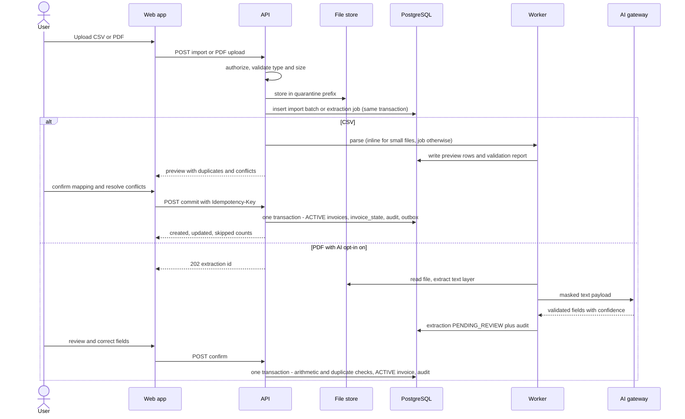

### 18.2 Diagram 6 — Payment reconciliation
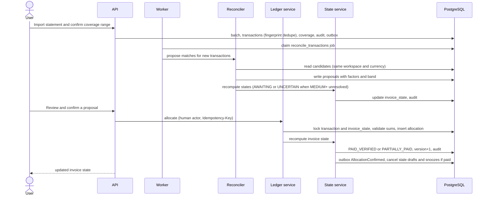

### 18.3 Diagram 7 — Reply interpretation and policy evaluation
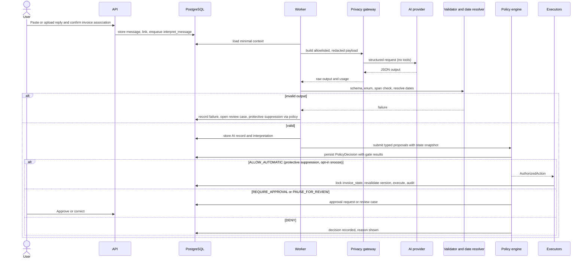

### 18.4 Diagram 8 — Reminder scheduling and sending
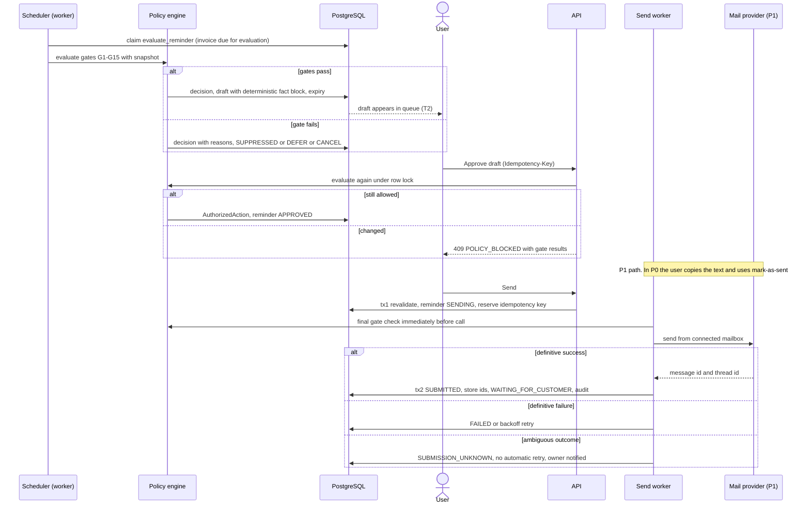

### 18.5 Diagram 10 — State transitions
Payment status (derived; PRD BR-01…BR-08):
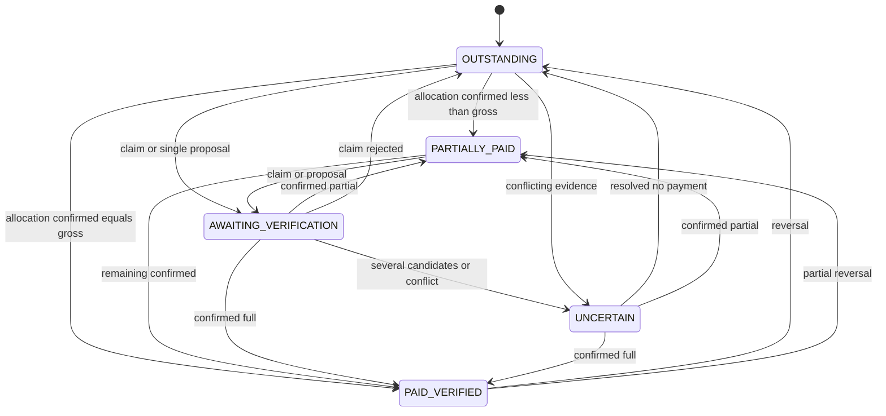
Invoice status and dispute status:
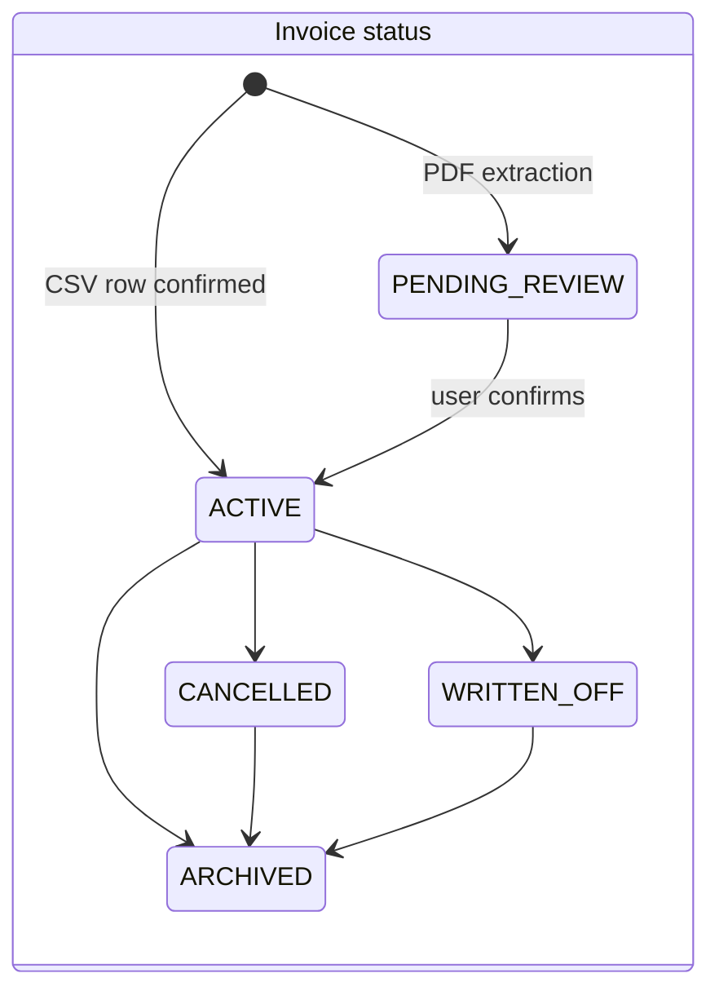
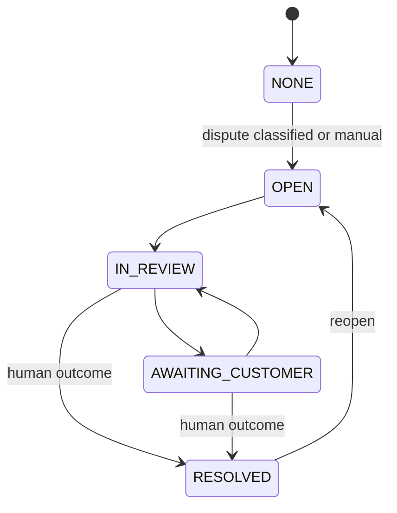
Reminder status (per invoice) and reminder record lifecycle:
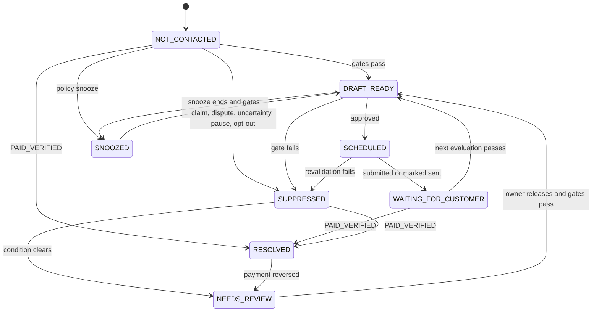
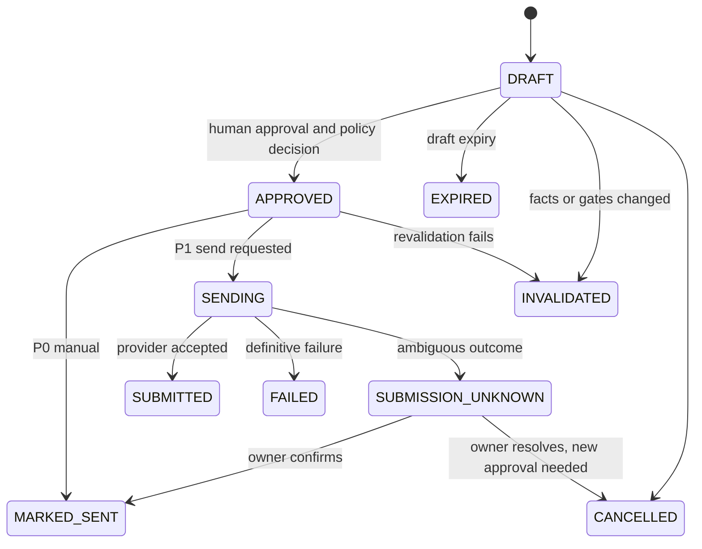
*Diagrams were checked against §4–§9: every participant and state appears in the written architecture; no extra components are introduced.*

---

## 19. Traceability and Consistency

### 19.1 Components and decisions → requirements, workflows, tests, milestones
| Architecture element | PRD requirements | PRD workflows (PPD journey) | NFR / SEC | Acceptance tests | Milestone |
|---|---|---|---|---|---|
| COMP-03/04 identity, workspace, RLS (ADR-09) | FR-140…FR-158 | WF-01 (J-1) | NFR-07, SEC-06/07/09/15 | TS-024 | MS-1 |
| COMP-05/06 ingestion, validation | FR-001…FR-018 | WF-02, WF-03 (J-1) | NFR-02/03, SEC-02/11 | TS-002, TS-003 | MS-2 (PDF MS-5) |
| COMP-07 ledger and reconciliation (ADR-07) | FR-032…FR-057 | WF-04…WF-06 (J-6, J-7) | NFR-14, SEC-14 | TS-004, 011, 012, 013, 031 | MS-3 |
| COMP-08 state management | FR-052…FR-057, BR-01…BR-08 | WF-12 | NFR-14 | TS-032, TS-033 | MS-4 |
| Queue/dashboard | FR-019…FR-031 | WF-01, WF-12 | NFR-01/10/11 | NFR-11 fixtures | MS-4 |
| COMP-11 policy engine (ADR-08) | FR-083…FR-097, BR-20…BR-23, BR-70 | WF-09, WF-11 | NFR-17, SEC-17/18 | TS-001, 009, 010, 021 | MS-4 |
| COMP-09/10/19 conversation and AI (ADR-05) | FR-058…FR-075, FR-131…FR-139, AIR-01…AIR-25 | WF-07, WF-08, WF-14 (J-3, J-4) | NFR-03/08, SEC-08 | TS-005, 015, 020, 028, 029, 030 | MS-5 |
| Commitments, cases | FR-076…FR-082, FR-119…FR-130 | WF-08…WF-10 (J-3, J-5) | — | TS-006…010, 034, 035 | MS-6 |
| COMP-12 reminders and communication | FR-083…FR-097, FR-101…FR-109 | WF-11 (J-2) | NFR-05, NFR-16 | TS-001, 014 | MS-4 (drafts), MS-7 (send) |
| COMP-13 Gmail adapter (ADR-11) | FR-101…FR-118 | WF-11, WF-13, WF-15 (J-8, J-10) | SEC-05/16 | TS-018, 019, 025, 026 | MS-7 |
| COMP-15 PayPal/CSV adapters | FR-037…FR-043, FR-159…FR-164 | WF-04, WF-13 (J-7) | SEC-10 | TS-014, TS-016 | MS-3 (CSV), MS-7 (PayPal) |
| COMP-16 jobs (ADR-04) | FR-090, FR-094 | all async workflows | NFR-05, NFR-12 | TS-014 + job tests | MS-1 |
| COMP-17 audit and observability (ADR-10) | FR-098…FR-100, BR-30…BR-33 | all | NFR-12, SEC-12/14 | TS-023 | MS-1 |
| Data lifecycle | FR-151…FR-153 | WF-15 (J-10) | SEC-13, NFR-15 | TS-022 | MS-8 |

### 19.2 Requirements not yet implementable (and how the architecture handles them)
| Requirement | Blocker | Type | Handling |
|---|---|---|---|
| FR-101/102/103 Gmail send | Google OAuth app verification for sensitive scope; test-user limits | Provider capability/approval **[VER]** | Behind `MailProvider`; P0 works without; manual mark-as-sent |
| FR-110/111/113 Gmail monitoring | Restricted-scope verification and assessment (cost/time unknown); scope technically broader than our design | Provider approval + product decision (OPEN-03, OPEN-26) | Gated (Gate C); polling design; alternative intake option kept open |
| FR-159…FR-163 PayPal | Which merchant transactions are visible must be proven; production unverified | Provider capability (OPEN-23) | Sandbox only; CSV export route is P0 |
| FR-011/013/017 PDF extraction | AI provider terms; extraction quality; OCR undecided | Product + provider decisions (OPEN-06/09/22) | Conditional; masked text only with opt-in; CSV path |
| FR-012 provider naming in consent text | AI provider not selected | Unresolved decision | Consent copy completed after provider selection |
| FR-053 coverage precision | PRD wording vs account-aware model | Product decision (AC-1, OPEN-25) | Account-aware design proposed; fallback to workspace-level date |
| FR-152 / SEC-13 retention periods | Not decided | Legal/product (OPEN-09) | Mechanisms built; values configurable |
| NFR numeric targets | All [PROP] | Needs team confirmation | Instrumented; thresholds configurable |
| AIR-12 evaluation pass criteria | Thresholds not set | Product/AI decision (OPEN-16) | Harness built; gate value to set before enablement |
| FR-118 Outlook | Graph read permission for notifications not verified; separate review | Provider capability **[VER]** | P2 adapter |

---

## 20. Final Architecture Review

### 20.1 Verification against earlier documents and the review checklist
| Check | Result |
|---|---|
| Consistent with Foundation (principles, MVP, ethics), Market Research (staged build, price/mailbox risks), PRD, PPD | Yes; architecture-driven refinements listed in §20.2 |
| Payment verification deterministic and auditable | Yes: pure derivation (§6.7), human allocations, append-only history, decisions and audit |
| Policy engine mandatory for automated actions | Yes: capability tokens, DB CHECKs, no auto-send, fail-closed (§8) |
| AI cannot directly execute privileged operations | Yes: no tools, schema/enum validation, proposals only, import-free gateway (§7, INV-03/05/06) |
| Privacy controls minimize external AI exposure | Yes: allowlists, redaction, pseudonymization, opt-in for PDFs, no raw documents, payload inspector; no anonymization claim |
| Tenant isolation throughout the stack | Yes: DB (RLS + composite FKs), API (workspace routes, 404s), storage, jobs, tests |
| Partial payments, uncertain status, disputes, offline reconciliation | Yes: §6 and §8.8; UPI/cash via manual/CSV |
| API contracts, data model, states and diagrams checked for contradictions | Yes; ID and field names are consistent across §5, §6, §10, §18 |
| Overengineering identified and removed | §20.3 |
| Confirmed vs provisional separated | §16 status labels and §20.6 |

### 20.2 Architecture-driven changes to earlier documents (propose and approve; none applied silently)
| # | Change | Reason | Affects |
|---|---|---|---|
| AC-1 | Evidence coverage computed per declared receiving account with contiguous statement intervals from the invoice issue date (fallback: workspace-level date) | A single statement range cannot prove "no payment received" across several accounts or gaps | PRD BR-05, FR-053; OPEN-25 |
| AC-2 | New entity `payment_accounts` (and account-scope attestations) | Needed by AC-1 | PRD data entities |
| AC-3 | **At-most-once sends:** ambiguous send outcomes become `SUBMISSION_UNKNOWN` with no automatic retry; new reminder-record statuses `SENDING`, `SUBMISSION_UNKNOWN` | Send-only scope cannot search the Sent folder | PRD FR-104 (refines "check whether already sent") |
| AC-4 | Gmail monitoring by **polling tracked threads**; Pub/Sub watch deferred | Avoids a second cloud project and renewal infrastructure; push can be dropped or delayed anyway **[V]** | PRD FR-113 |
| AC-5 | No Gmail draft creation (compose-class scope is restricted **[V]**); drafts stay in-app | Least privilege | PRD FR-117 (consistent; made explicit) |
| AC-6 | Transaction status `DUPLICATE` with `duplicate_of_transaction_id`; mark-duplicate endpoint | Cross-source duplicates (PayPal + bank) | PRD BR-16 |
| AC-7 | `invoice_state` stores the four dimensions as separate columns with module-level ownership; dispute status derived from `cases` | Keeps dimensions separate while enabling one-row queue queries | PRD §5 |
| AC-8 | Claim verification is `cases(type=MATCH_REVIEW, reason=CUSTOMER_CLAIM)` | One mechanism for review work | PRD "verification task" |
| AC-9 | Money as integer minor units + ISO currency; no FX | Precision and determinism | PRD (silent) |
| AC-10 | Line items stored as JSONB; table deferred | Simplicity | PRD (silent) |
| AC-11 | Backend stack Django/DRF, PostgreSQL, React/TypeScript (provisional) | Delivery speed and secure defaults | PRD (silent) |
| AC-12 | `policy_decisions` single-use capability tokens; DB CHECKs tying sends to decisions | Policy bypass resistance and TOCTOU control | PRD BR-20/BR-70 (implementation) |
| AC-13 | Per-workspace envelope encryption and crypto-shredding for sensitive columns (provisional) | Deletion across backups; insider risk | PRD SEC-04/SEC-13 (adds mechanism; adds complexity) |
| AC-14 | Reversal of a paid invoice moves reminder status to `NEEDS_REVIEW` (never auto-resumes) | Safety | PRD FR-036 (stricter) |
| AC-15 | Payment-account declaration and attestation UX needed in onboarding | Supports AC-1 | PRD SCR-01, SCR-06 |

### 20.3 Overengineering check and simplifications applied
Rejected: microservices, Kafka/brokers, Redis, workflow engine, separate AI service, schema-per-tenant, line-item table, conversation table, Pub/Sub, Gmail drafts, event sourcing, OCR, auto-apply of matches, multi-provider routing. Kept despite cost, with reasons: RLS (isolation safety net), hash-chained audit (tamper evidence at low cost), capability tokens (policy bypass resistance), envelope encryption (**provisional; first candidate to drop if schedule slips — compensate with disk encryption and strict access control**).

### 20.4 Final recommended MVP architecture
A modular monolith (Django API + worker from one image) on managed PostgreSQL and private object storage, with an import-free AI gateway, a pure-function reconciliation/state/policy core, outbox-driven in-database jobs, append-only audit, RLS-backed tenancy, and provider adapters used only for Gmail send/polling and PayPal sandbox in P1. P0 operates on CSV, manual entries, statement CSVs and pasted/uploaded replies, with human approval for every customer-facing message.

### 20.5 Components required for the first working release (P0)
COMP-01, 02, 03, 04, 05 (CSV; PDF conditional), 06, 07, 08, 09 (paste/upload), 10, 11, 12 (drafts, approvals, manual mark-as-sent), 15 (CSV only), 16, 17, 18, 19 — plus CI/CD, staging, backups, secret/key service, and observability.

### 20.6 Components explicitly deferred
COMP-13 Gmail (P1), PayPal webhook (P1), COMP-14 Outlook (P2), accounting and bank-feed integrations, Gmail Pub/Sub and drafts, email-attachment ingestion, OCR, auto-send, auto-apply, predictive models, multi-client workspaces.

### 20.7 Top 10 architectural risks
| # | Risk | Mitigation |
|---|---|---|
| RA-01 | Logic error in payment-state derivation or coverage causes wrong reminder eligibility | Pure functions, property tests, nightly integrity, fail-closed gates |
| RA-02 | A bug or injection path lets AI-originated input cause a state change or send | Capability tokens, no AI write path, DB CHECKs, injection corpus, human approval for sends |
| RA-03 | Cross-tenant leak (RLS misconfiguration, missing job context) | Forced RLS for non-owner role, composite FKs, cross-tenant harness in CI |
| RA-04 | Gmail verification/assessment delays or cost block P1 | P0 independent; paste/upload; alternative intake kept open (OPEN-26) |
| RA-05 | AI provider terms/retention unacceptable | Gateway abstraction; PDF opt-in; CSV-only mode; verify before real data |
| RA-06 | First-party auth weaknesses | Framework primitives only, throttling, MFA (P1), targeted security test, managed IdP as fallback |
| RA-07 | Custom job queue defects (lost/duplicated jobs) | Idempotent handlers, lease tests, crash/failure-injection, Procrastinate fallback |
| RA-08 | Time-driven state (coverage expiry, snooze end, cooling-off) mishandled across timezones/DST | Explicit timezone rules, injectable clock, DST tests, hourly recompute |
| RA-09 | Ambiguous send outcomes lead to duplicate or missed reminders | At-most-once protocol; owner confirmation path |
| RA-10 | Scope/skills mismatch for a three-person team (envelope encryption, RLS, hash chain) | Mark provisional items; drop order defined (§20.3); milestone gates |

### 20.8 Top 10 unresolved technical decisions
| # | Decision | Owner input needed |
|---|---|---|
| 1 | Team language/skills → confirm Django/React or flip (OPEN-A1) | Team |
| 2 | AI provider, model, region, retention/data-use terms (OPEN-09) | Founder + legal |
| 3 | Hosting provider/region, managed-PostgreSQL features (PITR, RLS support, backups) (OPEN-20) | Team |
| 4 | Gmail verification path, cost, and whether read access is pursued or replaced by forwarding intake (D-02, OPEN-26) | Founder |
| 5 | Coverage model (AC-1) and attestation policy (OPEN-25) | Product |
| 6 | Scope of envelope encryption/crypto-shredding and key hierarchy (AC-13) | Team + security |
| 7 | Malware-scanning approach and PDF library selection/licensing (OPEN-21) | Team |
| 8 | Transactional email provider for verification/notifications (OPEN-A2) | Team |
| 9 | First-party vs managed identity provider (OPEN-A3) | Team + security |
| 10 | Matching weights/thresholds, AI confidence thresholds and audit retention/hash-chain scope (OPEN-16, OPEN-09) | Product + AI |

### 20.9 Implementation-readiness checklist
- [ ] OPEN-A1 (stack) confirmed; repository, branching and CI created
- [ ] Hosting account, region and managed PostgreSQL chosen; staging environment provisioned
- [ ] PostgreSQL RLS pattern prototyped with the `app_runtime` role and a cross-tenant test
- [ ] Money/currency, timezone and identifier conventions (§5.1) accepted by the team
- [ ] Payment-state derivation, matcher and gate predicates specified as pure functions with test vectors
- [ ] Coverage model (AC-1) and attestation UX decided
- [ ] AI provider shortlist with terms reviewed; fake provider and evaluation harness scaffolded
- [ ] Redaction patterns and payload allowlists reviewed; payload inspector designed
- [ ] Policy decision table (§8.8) agreed; capability-token pattern prototyped
- [ ] Job queue prototype passes crash/lease/idempotency tests
- [ ] Google OAuth app registration started; verification requirements and costs recorded **[VER]**
- [ ] PayPal sandbox app and webhook ID created for tests
- [ ] Synthetic data generator and demo scripts planned
- [ ] Incident runbook and backup/restore drill scheduled before any real-data pilot
- [ ] Legal review of DPDP applicability scheduled (SEC-22)

### 20.10 Unresolved decisions and external dependencies (consolidated)
New architecture-level open items: **OPEN-A1** team language/skills; **OPEN-A2** transactional email provider; **OPEN-A3** first-party vs managed identity. Inherited: OPEN-01…OPEN-27 (PRD §15.3), notably OPEN-09, 16, 20, 21, 22, 23, 25, 26. External dependencies: Google verification/assessment, Microsoft app registration (P2), PayPal sandbox/production visibility, AI provider terms, hosting provider features and pricing, legal counsel.

---

## 21. Sources for Externally Verified Technical Claims
Verified 03 Nov 2026 unless noted. Claims not listed here are marked **[VER]** in the text.

1. Google for Developers, *Choose Gmail API scopes* — `gmail.send` sensitive; `gmail.readonly`, `gmail.compose`, `gmail.modify`, `gmail.metadata` restricted; security assessment applies when restricted data is stored on or transmitted to servers. https://developers.google.com/workspace/gmail/api/auth/scopes
2. Google for Developers, *users.messages.send* — accepted scopes (`gmail.send`, `gmail.compose`, `gmail.modify`, `https://mail.google.com/`); response is a Message resource. https://developers.google.com/workspace/gmail/api/reference/rest/v1/users.messages/send
3. Google for Developers, *Push notifications (Gmail API)* — Pub/Sub topic and publish permission; watch expires after 7 days and should be renewed daily; notifications may be delayed or dropped; use history-based sync as fallback; one notification per second per user. https://developers.google.com/workspace/gmail/api/guides/push
4. Microsoft Learn, *user: sendMail* — `Mail.Send` delegated/application; 202 Accepted means accepted, not delivered; saved to Sent Items by default. https://learn.microsoft.com/en-us/graph/api/user-sendmail?view=graph-rest-1.0
5. Microsoft Learn, *Change notifications for Outlook messages (overview)* — subscriptions expire (standard under 7 days / 10,080 minutes), must be renewed; lifecycle notifications. https://learn.microsoft.com/en-us/graph/change-notifications-overview
6. PayPal Developer, *Integrate webhooks* — self-verification and postback verification, required headers, webhook ID, retries up to 25 times over 3 days, simulator limitations. https://developer.paypal.com/api/rest/webhooks/rest/
7. PostgreSQL Documentation, *Row Security Policies* — policy semantics; superusers and `BYPASSRLS` roles bypass; owners bypass unless `FORCE ROW LEVEL SECURITY`; `USING` vs `WITH CHECK`. https://www.postgresql.org/docs/current/ddl-rowsecurity.html
8. Secondary (not independently verified, marked **[VER]** in text): annual recurrence of Google's security assessment for restricted scopes — Nango, *Google security review*. https://nango.dev/docs/api-integrations/google-shared/google-security-review

**Not verified in this document:** all pricing, free tiers, quotas, hosting-region availability, library licences/versions, Google OAuth flow parameters beyond the pages above, Microsoft read permissions for message notifications, PayPal transaction visibility, and any AI-provider capability or term.
