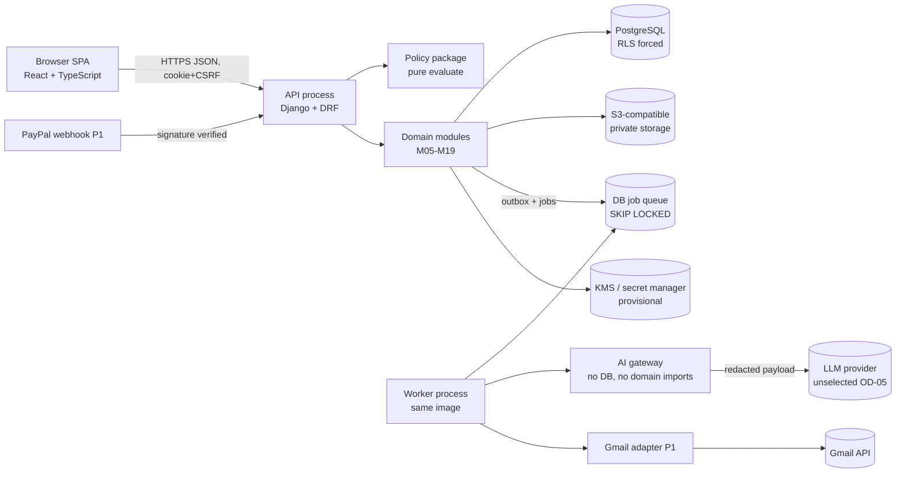
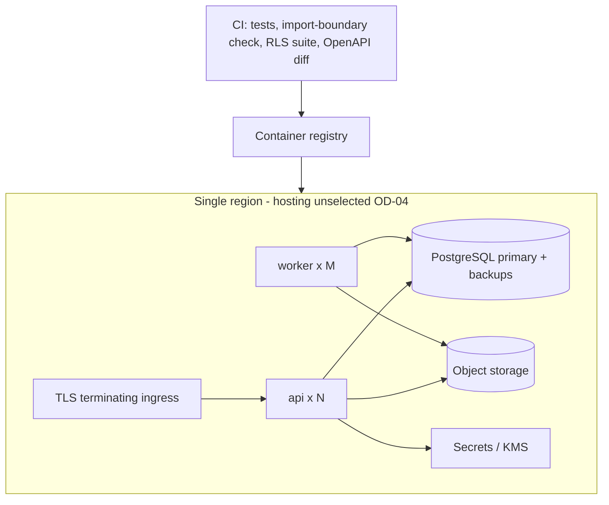
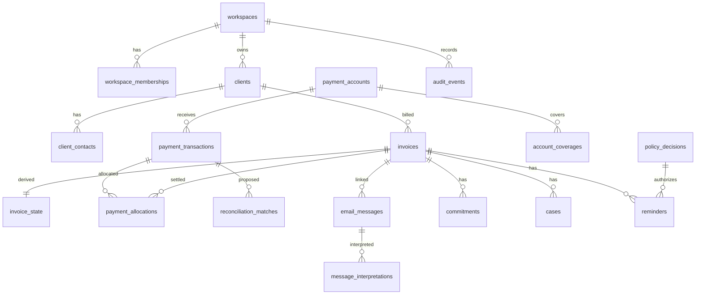

# CollectIQ — Technical Specification (TSD) v1.0

> **Status of this document.** Target specification for implementation by Claude Code and the engineering team. **No repository, DESIGN.md, Stitch export or data dictionary was supplied; therefore nothing described here exists yet.** Every endpoint, table, module and screen is *specified, not implemented*. Labels used throughout: **[CONF]** confirmed in an approved earlier document (Foundation PDF, PRD v0.1, SAD v0.1, UX v0.1); **[PROP]** proposed by this TSD or an earlier doc and awaiting approval; **[ASSUME]** assumption; **[VER]** must be verified before use; **[V]** verified against official provider documentation recorded in SAD v0.1 (re-verify before build, provider terms change).

## 1. Document Control

| Item | Value |
|---|---|
| Document | CollectIQ Technical Specification |
| Version | 1.0 (draft for engineering review) |
| Date | 2026-11-03 |
| Purpose | Implementation-level contract: modules, data, APIs, safety logic, tests, roadmap M0–M8 |
| Audience | Claude Code, backend/frontend engineers, QA, security reviewer |
| Supersedes | None. Refines SAD v0.1 §5–§17 and PRD v0.1 |
| Companion files | `CollectIQ_API_Contracts.yaml`, `CollectIQ_Requirements_Traceability.csv`, `CollectIQ_Open_Decisions.md`, `CollectIQ_Implementation_Roadmap.md` |

**Source documents reviewed.** Foundation PDF (source of truth, via project), PPD v0.1, Problem Statement & Market Research v0.1, PRD v0.1 (FR-001…FR-164, AIR-01…25, SEC-01…22, NFR-01…20, BR, TS-001…035), SAD v0.1 (COMP-01…19, ADR-01…12, INV-01…14, AC-1…15, API-01…13), UX Design v0.1 (SCR-01…15, DC-1…14, UXR-01…15).

**Missing source documents (not fabricated).**

| Missing | Effect on this TSD |
|---|---|
| Repository / existing code | No "current implementation" exists. Every status = *Specified; not implemented*. |
| `DESIGN.md` and Stitch exports | Component styling follows UX v0.1 tokens only; pixel/visual fidelity cannot be verified. |
| **SCR-16 / SCR-17** | UX v0.1 defines SCR-01…15 only. The brief's SCR-16/17 are undefined; mapped as **OD-01** (no screen invented). |
| Separate "Product & Business Requirements" doc | PRD v0.1 is used as the requirement source; naming conflict recorded (OD-02). |
| Data dictionary / bank statement samples | Parser formats and field lengths unspecified (OD-10). |

**Conflict register (this TSD vs sources).**

| ID | Conflict | Proposed resolution |
|---|---|---|
| TC-1 | Brief lists 17 screens; UX defines 15 | Map SCR-01…15; hold SCR-16/17 until supplied (OD-01) |
| TC-2 | Brief module list includes "notifications & review inbox"; SAD has `notifications` only | Review inbox specified as a **read model** (E108, proposed); no new table |
| TC-3 | Brief wants per-endpoint contracts; SAD §10.2 is summarised | Contracts in YAML; body schemas schematic until M1/M2 DTO design |
| TC-4 | UX DC-7 wants per-invoice/client pause; SAD has workspace pause only | Deferred; workspace pause only in MVP (OD-07) |

## 2. Technical Overview

**Product.** Privacy-first receivables copilot for small B2B businesses: reconciles payments across PayPal/UPI/bank/cash evidence, interprets customer replies, recommends the next action, and keeps the owner in control **[CONF]**.

**Scope of this TSD.** MVP (P0) fully specified; P1 (Gmail send-only, PayPal sandbox, monitoring, MFA, project lead) specified as gated extensions; P2 (Outlook, accounting sync) listed only.

**Engineering invariants (binding).** Restated from SAD INV-01…14:

1. Money is `BIGINT` minor units + ISO-4217 currency; floats are forbidden in code, DB and JSON.
2. Transactions are evidence; only immutable signed `payment_allocations` change balances; corrections are reversals.
3. Payment status is a pure function of allocations, open verification tasks and conflict flags. There is **no "mark paid" action**.
4. A missing payment event is never "unpaid"; a customer claim is never "paid".
5. AI output is advisory: it cannot confirm payments, allocate, resolve disputes, bypass policy or send.
6. Every consequential action requires a single-use policy decision; no sending without human approval in the MVP.
7. Workspace isolation by `workspace_id`, composite FKs and forced RLS.
8. Frontend permission checks are presentation only; the backend is authoritative.
9. No bank passwords or OTPs are requested or stored. No compliance certification or tamper-proof audit is claimed.

**Current implementation vs target.** Current: none. Target: modular monolith described below.

## 3. System Architecture

Provisional stack per SAD AC-11: modular monolith; one image run as API and worker processes **[PROP, pending OD-03 approval]**.





*No cloud vendor, region, domain or credentials are specified; AWS ap-south-1 in SAD is a planning assumption only (OD-04).*

**Process model.** API handles request/response and enqueues jobs; workers run imports, reconciliation, AI calls, renewals, expiry. Cross-module reactions go through `outbox_events` (INV-10).

**Data flow (critical path).** Statement import → transactions (evidence) → deterministic match proposals → human confirm → allocations → `derive()` → `invoice_state` → queue/policy. AI is a side branch that can only create *proposals, cases and protective suppression*.

## 4. Technology Stack

| Layer | Choice | Status | Notes |
|---|---|---|---|
| Language/runtime | Python 3.12 | [PROP] | Pin minor in `pyproject` |
| Backend | Django + Django REST Framework | [PROP] AC-11 | ORM used with raw SQL for RLS/constraint triggers |
| Database | PostgreSQL (version selected at M0, a supported major) | [PROP] | RLS semantics: owners bypass unless `FORCE` **[V]** |
| Frontend | React + TypeScript SPA, typed client generated from OpenAPI | [PROP] | Token set from UX §design system |
| Queue | PostgreSQL table + `SELECT … FOR UPDATE SKIP LOCKED` | [PROP] ADR-04 | No Redis/Celery in MVP |
| Object storage | S3-compatible private bucket | [PROP] | Vendor open |
| Secrets/crypto | KMS/secret manager, per-workspace envelope keys | [PROP] AC-13 | Vendor open |
| AI | In-process gateway + provider adapter | [PROP] | Provider unselected (OD-05) |
| Testing | pytest, hypothesis (property), Playwright (E2E), schemathesis or equivalent contract tests | [PROP] | |
| CI checks | Import-boundary linter, RLS coverage test, OpenAPI diff, secret scan, dependency audit | [PROP] | |

## 5. Repository and Module Structure

Proposed monorepo (no existing repo):

```
collectiq/
  backend/
    manage.py, pyproject.toml
    collectiq/
      platform/      # settings, db (rls), jobs, outbox, errors, logging, crypto, storage
      identity/      # M01, M03
      tenancy/       # M02, M04
      invoices/      # M05, M06, M07
      evidence/      # M08, M09, M10  (ledger owns allocations; sole writer)
      conversations/ # M11
      ai/            # M12 gateway, prompts, schemas, date_resolver  (no domain imports)
      cases/         # M13
      comms/         # M14, M16 adapters
      policy/        # M15  (sole minter of AuthorizedAction)
      audit/         # M18
      settings_privacy/ # M19, M17
      api/           # DRF views, serializers, urls (thin)
    tests/ (unit, property, integration, rls, contract, safety)
  frontend/
    src/ (app, routes, features/<screen>, components, tokens, api-client)
  docs/ (this TSD, ADRs, runbooks)
  .github-or-ci/ (pipeline definition; vendor unspecified)
```

**Dependency rules (enforced by CI).** `ai` imports nothing from domain apps and has no DB handle (INV-05). Only `evidence` writes `payment_transactions/allocations/invoice_state` payment fields (INV-03). Only `policy` constructs `AuthorizedAction`; executors in `comms` accept it by type (INV-06). `api` calls services, never ORM directly. No cycles (INV-10).

## 6. Functional Module Specifications

Twenty modules. Module IDs M01–M20 are introduced by this TSD [PROP] and map onto SAD components COMP-01…19. Every module: authorization is enforced by the backend; every state change writes an audit event in the same transaction; no module lets AI output change balances, allocations, dispute resolution or policy.

### M01 — Authentication and session (COMP-01)

**Purpose.** Identify users and maintain server-side sessions.

**Responsibilities.**
- Registration, email verification, login/logout, password reset; session cookie + CSRF; lockout and rate limits.
- TOTP MFA enrolment/verify [P1]; secrets stored via `secret_ref`, never returned.
- Generic responses to prevent account enumeration [PROP].

| Aspect | Specification |
|---|---|
| Inputs / outputs | In: email, password, token, TOTP code. Out: session cookie, `{user, workspaces[]}`, CSRF token via `GET /auth/session` (E009, proposed). |
| Preconditions | Email not verified blocks workspace creation [PROP]. Password policy configured server-side. |
| Postconditions | Session established with `user_id`; no workspace context until a workspace path is used. |
| Business rules | Passwords hashed with the framework's current recommended hasher [VER: choose Argon2id or framework default in M1]; reset tokens single-use and expiring; failed-login lockout returns 429. No bank passwords or OTPs are ever collected (Foundation boundary). |
| State transitions | User: UNVERIFIED -> ACTIVE -> LOCKED(temporary) -> ACTIVE; DISABLED (admin/deletion). |
| Data/API dependencies | Tables: `users`. APIs: E001-E009. No tenant column on `users`. |
| Authorization | Public endpoints rate-limited; session required elsewhere. Frontend gating is presentation only. |
| Failure cases | Duplicate email -> generic success; expired token -> 422; lockout -> 429 + `Retry-After`; email provider outage -> job retry, user told to retry later. |
| Audit events | `auth.register`, `auth.login.success/failure`, `auth.logout`, `auth.password_reset.*`, `auth.mfa.*` (failures audited; no secrets in payload). |
| Tests | Unit (password policy, token expiry); API (E001-E009); security (enumeration, CSRF, cookie flags); TS-024. |

**Acceptance criteria.**
- Wrong-password attempts beyond threshold lock the account for the configured window.
- Reset token cannot be reused.
- Responses for existing vs new email are indistinguishable.

### M02 — Workspace and tenant management (COMP-02)

**Purpose.** Create and scope tenants; guarantee isolation.

**Responsibilities.**
- Create workspace with country, timezone, default currency, business hours.
- Resolve `{ws}` for every request, verify membership, set `SET LOCAL app.workspace_id` per transaction.
- Deletion request lifecycle (grace period [PROP]).

| Aspect | Specification |
|---|---|
| Inputs / outputs | In: workspace settings. Out: Workspace DTO with `version`. |
| Preconditions | Authenticated user. |
| Postconditions | Workspace row exists; creator is OWNER; default policy v1 created in safe defaults (automation OFF). |
| Business rules | Single-currency per invoice, no FX (PRD). Timezone must be valid IANA; currency ISO-4217. Cross-tenant IDs return 404. |
| State transitions | Workspace: ACTIVE -> DELETION_REQUESTED -> DELETED. |
| Data/API dependencies | Tables: `workspaces`, `workspace_memberships`, `workspace_policies`. APIs: E010-E012, E104. RLS forced (INV-07). |
| Authorization | Create: any verified user. Read: O,F. Update: O. Delete: O only. |
| Failure cases | Invalid timezone/currency -> 422; stale version -> 409; RLS misconfiguration is a release-blocking failure (CI test). |
| Audit events | `workspace.created`, `workspace.updated`, `workspace.deletion_requested`. |
| Tests | RLS suite (TS-024), API tests, migration tests that fail if a tenant table lacks `workspace_id` or policy. |

**Acceptance criteria.**
- A user without membership receives 404 for any `{ws}` path.
- Every tenant table has RLS forced and composite FKs (schema test).

### M03 — Roles and permissions (COMP-03)

**Purpose.** Single authorization decision point.

**Responsibilities.**
- `authorize(ctx, action, resource)` for every request and job.
- Membership management; last-owner protection.
- Role matrix: OWNER, FINANCE_ADMIN, PROJECT_LEAD (P1, assigned invoices only).

| Aspect | Specification |
|---|---|
| Inputs / outputs | In: actor, action, resource. Out: allow/deny with reason code. |
| Preconditions | Workspace resolved. |
| Postconditions | Decision logged to metrics; denials of sensitive actions audited. |
| Business rules | Owner-only: policy automation fields, integrations connect/disconnect, deletion, AI settings. AI/system actors are denied human-only actions (INV-03, INV-06). OPEN-13: whether Finance admin may approve for sensitive clients (default O only [PROP]). |
| State transitions | Membership: INVITED -> ACTIVE -> REMOVED. |
| Data/API dependencies | Tables: `workspace_memberships`. APIs: E013-E015. |
| Authorization | Matrix in §6.3 of this module; enforced server-side; frontend hides controls only for ergonomics. |
| Failure cases | Removing last owner -> 409; unknown role -> 422; permission check failure -> 403 (404 if resource hidden). |
| Audit events | `member.invited`, `member.role_changed`, `member.removed`, `authz.denied` (sensitive only). |
| Tests | Table-driven authorization test generated from registry (every E-ID x role); TS-024. |

**Acceptance criteria.**
- Matrix tests cover every endpoint x role.
- Project lead sees only assigned invoices and cannot approve.

### M04 — Onboarding (SCR-01)

**Purpose.** Guide first-run setup without hiding safety defaults.

**Responsibilities.**
- Workspace creation, safe-default automation OFF, AI opt-in explanations, first import entry point.
- Checklist state derived from data (accounts declared, first import, etc.); no separate onboarding table [PROP].

| Aspect | Specification |
|---|---|
| Inputs / outputs | In: user choices. Out: checklist state. |
| Preconditions | Verified user. |
| Postconditions | Workspace with default policy; AI features disabled until explicit opt-in. |
| Business rules | No automation enabled during onboarding. Consent text versions stored with policy version. |
| State transitions | Checklist item: PENDING -> DONE (derived). |
| Data/API dependencies | APIs: E010, E011, E109/E110 (proposed), E033. |
| Authorization | Owner for opt-ins. |
| Failure cases | Abandoned onboarding leaves a valid empty workspace. |
| Audit events | `workspace.created`, `ai.settings_changed`. |
| Tests | E2E onboarding journey FL-01 (UX), API tests. |

**Acceptance criteria.**
- User can reach first import with automation OFF and AI OFF.

### M05 — Invoice import and validation (COMP-05)

**Purpose.** Bring invoices in through CSV (and conditional PDF extraction) with explicit validation.

**Responsibilities.**
- CSV upload, mapping, explicit date format, per-row validation, duplicate detection, atomic commit.
- PDF extraction path only after AI opt-in; extraction results require human confirmation (FR-007 range).
- Provenance per field.

| Aspect | Specification |
|---|---|
| Inputs / outputs | In: file, mapping, date format, decisions. Out: preview counts, committed invoices, downloadable error report. |
| Preconditions | Role O/F; for PDF, AI opt-in true and kill switch off. |
| Postconditions | Invoices ACTIVE only after confirmation; `invoice_state` row created via derivation; audit events per batch and per invoice. |
| Business rules | No guessing dd/mm vs mm/dd (FR-003). total = subtotal + tax tolerance 0.01 when both present. Amount parsed with `Decimal` to minor units by currency exponent [VER: currency exponent table source]. Limits [PROP 5 MB / 10,000 rows]. Extraction confidence is a hint; any unvalidated total blocks confirmation (TS-003). |
| State transitions | Batch: PREVIEW -> COMMITTED | DISCARDED | FAILED. Extraction: PENDING -> READY -> CONFIRMED | DISCARDED. |
| Data/API dependencies | Tables: `import_batches`, `stored_files`, `invoices`, `invoice_state`, `extraction_results`. APIs: E033-E041. Dependencies: M20 (jobs), M12 gateway for T1 only. |
| Authorization | O,F. PDF extraction also requires AI opt-in (Owner-set). |
| Failure cases | Wrong type/size -> 415/413; unresolved duplicate conflicts -> 422 `IMPORT_VALIDATION_FAILED`; AI unavailable -> manual entry path, deterministic CSV unaffected. |
| Audit events | `import.previewed`, `import.committed`, `import.discarded`, `invoice.created`, `extraction.confirmed`. |
| Tests | Fixture CSVs (encodings, BOM, locale dates), property test on amount parsing, TS-002/003, upload fuzz, E2E. |

**Acceptance criteria.**
- Renamed .xlsx rejected with plain reason, nothing stored as invoice (FR-001).
- Re-import creates no duplicates (TS-002).
- Mismatched extracted total cannot be confirmed (TS-003).

### M06 — Invoice ledger and exception queue (COMP-06/08)

**Purpose.** Present receivables with derived state and reasons.

**Responsibilities.**
- List/filter/sort invoices; exception-first queue with tiers and reasons; dashboard per currency with aging and evidence freshness.
- Queue computed from `invoice_state`; never from AI output (INV-02).

| Aspect | Specification |
|---|---|
| Inputs / outputs | In: filters. Out: pages of InvoiceSummary/QueueItem; tiles per currency (no cross-currency sums). |
| Preconditions | Role O/F/L(assigned). |
| Postconditions | Read-only; no state mutation. |
| Business rules | Every queue row has at least one reason (NFR-11). Unknown filters -> 422. Currencies never summed together. |
| State transitions | None (read model). |
| Data/API dependencies | Tables: `invoices`, `invoice_state`. APIs: E042, E047, E048. |
| Authorization | O,F; L limited to assigned. |
| Failure cases | Slow query -> keyset pagination and indexes; stale `invoice_state` flagged by nightly re-derivation check. |
| Audit events | Reads not audited (except exports). |
| Tests | Fixture-based queue ordering tests, load test, TS-032. |

**Acceptance criteria.**
- p95 <= 2 s at 5,000 invoices (NFR-01) [measured in M8].
- Reason present on every row.

### M07 — Invoice details and customer profiles (SCR-04, SCR-14)

**Purpose.** Single place to understand an invoice and a client.

**Responsibilities.**
- Invoice detail with evidence summary, three-layer facts (record / derived / AI-claimed), recommended action and reasons.
- Field correction with reason; cancel/archive; client profile, contacts, suppression, sensitivity/tone.

| Aspect | Specification |
|---|---|
| Inputs / outputs | In: changes + reason. Out: Invoice DTO, client DTO. |
| Preconditions | O/F. |
| Postconditions | Corrections create version + audit; corrections flagged `diverges_from_source`. |
| Business rules | Corrections never alter payment evidence. Suppression via explicit endpoint only. Unique contact email per client. |
| State transitions | Invoice: DRAFT -> ACTIVE -> CANCELLED | ARCHIVED | WRITTEN_OFF; client contact: ACTIVE <-> SUPPRESSED. |
| Data/API dependencies | Tables: `invoices`, `clients`, `client_contacts`, `client_aliases`. APIs: E021-E028, E043-E046. |
| Authorization | O,F; L read assigned. |
| Failure cases | Version conflict -> 409; invalid transition -> 409. |
| Audit events | `invoice.corrected`, `invoice.cancelled`, `invoice.archived`, `contact.suppressed`, `contact.suppression_cleared`. |
| Tests | API + component tests; UXR conformance tests. |

**Acceptance criteria.**
- Correction without reason rejected.
- Three layers are visually and structurally distinct in the DTO (`facts`, `derived`, `ai_claims`).

### M08 — Payment accounts and statement coverage (SCR-15, AC-1)

**Purpose.** Declare receiving accounts and know what evidence covers which dates.

**Responsibilities.**
- CRUD for declared accounts (bank, PayPal, UPI handle, cash).
- Coverage records from statement imports; attestations ('checked, nothing received').
- Freshness window [PROP 7 days] and per-invoice coverage derivation inputs.

| Aspect | Specification |
|---|---|
| Inputs / outputs | In: accounts, coverage ranges, attestations. Out: coverage timeline, freshness. |
| Preconditions | O/F. |
| Postconditions | Coverage rows append; `invoice_state.evidence_coverage` re-derived via outbox event. |
| Business rules | Missing payment event never means unpaid (INV-01). Coverage must be contiguous from invoice issue date to count as SUPPORTED. Attestation `as_of` <= now. |
| State transitions | Account: ACTIVE <-> INACTIVE. Evidence coverage: UNSUPPORTED/STALE/SUPPORTED (derived). |
| Data/API dependencies | Tables: `payment_accounts`, `account_coverages`, `evidence_attestations`. APIs: E029-E032, E054. |
| Authorization | O,F. |
| Failure cases | Gaps in coverage reported with dates; attestation in the future -> 422. |
| Audit events | `account.declared`, `coverage.recorded`, `attestation.recorded`. |
| Tests | Coverage derivation property tests, TS-031/032. |

**Acceptance criteria.**
- Gap in statements prevents SUPPORTED (TS-032).
- Attestation expires after freshness window.

### M09 — Statement and transaction ingestion

**Purpose.** Parse CSV exports into immutable payment evidence.

**Responsibilities.**
- Upload, mapping, date format, coverage range, duplicate/overlap detection (fingerprint + occurrence_index), commit and enqueue reconciliation.
- PayPal CSV in P0, PayPal API/webhook P1.

| Aspect | Specification |
|---|---|
| Inputs / outputs | In: file + `source_type` + `payment_account_id`. Out: batch preview, committed counts. |
| Preconditions | O/F; account must exist. |
| Postconditions | Transactions ACTIVE; reconciliation job enqueued; no allocation created. |
| Business rules | Credit-only by default. Amounts positive minor units. Overlaps never duplicate transactions (INV-11). Parse errors require explicit skip. |
| State transitions | Transaction: ACTIVE -> VOID | DUPLICATE. |
| Data/API dependencies | Tables: `payment_transactions`, `import_batches`, `account_coverages`. APIs: E053, E034, E035. |
| Authorization | O,F. |
| Failure cases | Bad encoding/dates -> row errors; unsupported format -> 415. |
| Audit events | `transactions.imported`, `transaction.void`, `transaction.duplicate_marked`. |
| Tests | Parser fixtures per bank format (to be collected, OPEN), TS-031. |

**Acceptance criteria.**
- 20-row overlap imports zero duplicates (TS-031).

### M10 — Reconciliation and allocation (COMP-07, ADR-07)

**Purpose.** Propose matches; humans confirm allocations; ledger invariants hold.

**Responsibilities.**
- Deterministic matcher producing proposals with factor breakdown.
- Confirm/reject/manual allocation/reversal/void; payment-status derivation as pure function.

| Aspect | Specification |
|---|---|
| Inputs / outputs | In: confirmations. Out: allocations, updated `invoice_state`. |
| Preconditions | O/F human actor; version match. |
| Postconditions | Immutable allocation rows; state re-derived; audit in same transaction. |
| Business rules | INV-02, INV-03, INV-04, INV-11. No auto-apply in P0/P1. AI cannot call this module. Overpayment requires explicit confirmation. Corrections only by REVERSAL rows (INV-14). |
| State transitions | Match: PROPOSED -> CONFIRMED | REJECTED | SUPERSEDED. Payment status per precedence PAID_VERIFIED > UNCERTAIN > AWAITING_VERIFICATION > PARTIALLY_PAID > OUTSTANDING. |
| Data/API dependencies | Tables: `payment_transactions`, `payment_allocations`, `reconciliation_matches`, `invoice_state`. APIs: E049-E052, E055-E061. |
| Authorization | O,F only; AI/system denied. |
| Failure cases | Constraint trigger violation -> 409 with explanation; currency mismatch -> 422; concurrent confirm -> 409 `CONFLICT_VERSION`. |
| Audit events | `allocation.created`, `allocation.reversed`, `payment.recorded`, `payment.voided`, `match.confirmed/rejected`. |
| Tests | Property tests on invariants; concurrency tests; TS-004, 011, 012, 013, 032, 033. |

**Acceptance criteria.**
- Partial/multiple/over-payment behave per TS-011..013.
- Ambiguous matches are never auto-confirmed (TS-004).

### M11 — Conversation timeline (SCR-07)

**Purpose.** Capture and associate customer replies.

**Responsibilities.**
- Paste/.eml/.txt capture; association proposals; timeline per invoice; conversation index (DC-1).
- Gmail sync later (M16, P1).

| Aspect | Specification |
|---|---|
| Inputs / outputs | In: text/file/metadata. Out: Message with proposed association. |
| Preconditions | O/F. |
| Postconditions | Message stored (body ciphertext); no AI call inline; interpretation job only after confirmed association. |
| Business rules | Association is human-confirmed. Message bodies treated as untrusted data. |
| State transitions | Message: CAPTURED -> ASSOCIATED -> INTERPRETED | INTERPRETATION_FAILED. |
| Data/API dependencies | Tables: `email_messages`, `message_invoice_links`. APIs: E062-E066. |
| Authorization | O,F; L read assigned. |
| Failure cases | Oversize/encoding -> 413/422. |
| Audit events | `message.captured`, `message.associated`. |
| Tests | Parser tests, TS-029, TS-035. |

**Acceptance criteria.**
- Capture works with AI disabled.

### M12 — AI message and payment-claim interpretation (COMP-09/10, ADR-06)

**Purpose.** Convert replies into reviewed, structured, advisory interpretations.

**Responsibilities.**
- Privacy gateway, prompt registry, schema-validated T2 output, evidence-span check, deterministic date resolver (BR-34), injection flag.
- Commitments and proposals derived from validated interpretations only; AI summaries/explanations T3/T4.

| Aspect | Specification |
|---|---|
| Inputs / outputs | In: message id. Out: `message_interpretations` row, proposed actions. |
| Preconditions | AI opt-in true; kill switch off; association confirmed. |
| Postconditions | Validated interpretation stored or failure recorded; PROTECTIVE_SUPPRESS may run automatically; nothing else without policy decision. |
| Business rules | Claim != payment (INV-03). Ordinal confidence only; no percentage claims. Date hints only; resolver decides dates. Model has no tools and no DB access (INV-05). Auto-snooze only if FR-080 conditions + opt-in + evaluation gate (AIR-12). |
| State transitions | Interpretation: PENDING -> VALID | INVALID; review: UNREVIEWED -> ACCEPTED | DISMISSED | CORRECTED. |
| Data/API dependencies | Tables: `ai_processing_records`, `message_interpretations`, `commitments`. APIs: E066-E075. Dependencies: M15. |
| Authorization | Review actions O,F; execution by system under policy. |
| Failure cases | Invalid JSON/enum/span -> INVALID + case; provider down -> deterministic features continue (TS-017). |
| Audit events | `ai.call` (metadata), `interpretation.validated/failed`, `interpretation.corrected`, `commitment.*`. |
| Tests | Offline eval sets, recorded-response replay, schema fuzz, TS-005, 007-010, 015, 020, 029, 030. |

**Acceptance criteria.**
- Injection text cannot trigger an action (TS-020).
- Correction reverses derived actions (TS-030).

### M13 — Dispute and blocker management (SCR-08)

**Purpose.** Own disputes and blockers; resolution is human.

**Responsibilities.**
- Open (AI/system/user), assign, status, notes, resolve, reopen; resume follow-ups after cooling-off.

| Aspect | Specification |
|---|---|
| Inputs / outputs | In: case actions. Out: Case DTO. |
| Preconditions | O/F; L notes on assigned. |
| Postconditions | Opening a dispute sets `dispute_status` via derivation and PAUSES reminders (G4). |
| Business rules | Single open dispute per invoice (partial unique index). AI actor cannot resolve. Resume needs approval + cooling-off [PROP 24 h]. |
| State transitions | Case: OPEN -> IN_PROGRESS -> RESOLVED -> REOPENED (BR-60). |
| Data/API dependencies | Tables: `cases`, `approval_requests`. APIs: E076-E082. |
| Authorization | O,F; L limited. |
| Failure cases | Duplicate open dispute -> 409 `DUPLICATE_RESOURCE`. |
| Audit events | `case.opened`, `case.status_changed`, `case.resolved`, `case.reopened`, `followups.resumed`. |
| Tests | State-machine tests, TS-006/034/035. |

**Acceptance criteria.**
- Disputed invoice never receives a reminder (TS-006).
- Resume requires explicit approval (TS-034).

### M14 — Reminder composition and human approval (SCR-09)

**Purpose.** Draft compliant reminders; humans approve; sending only through policy.

**Responsibilities.**
- Template-first drafting (T5/T6 optional), fact block generated by code and immutable, linter for prohibited content.
- Approve/reject/mark-sent (P0); send via mailbox, SUBMISSION_UNKNOWN resolution (P1).

| Aspect | Specification |
|---|---|
| Inputs / outputs | In: edits/approval. Out: Reminder DTO with gate results. |
| Preconditions | O/F. |
| Postconditions | Approved reminder has `policy_decision_id` and `approved_by`; sent states require both (CHECK). |
| Business rules | INV-06, INV-09, INV-13. No threats, fake urgency, invented fees (TS-027). Decision single-use. At-most-once send protocol; outcome unknown is surfaced, never retried blindly. |
| State transitions | Reminder: DRAFT -> APPROVED -> SENDING -> SUBMITTED | MARKED_SENT | SUBMISSION_UNKNOWN | FAILED; DRAFT/APPROVED -> CANCELLED/INVALIDATED/REJECTED/EXPIRED. |
| Data/API dependencies | Tables: `reminders`, `policy_decisions`, `approval_requests`. APIs: E083-E091. Dependencies: M15, M16. |
| Authorization | Approve/send: O,F (sensitive clients O). |
| Failure cases | Gate failure at execution -> 409 `POLICY_BLOCKED` with `gate_results`. |
| Audit events | `reminder.drafted/edited/approved/rejected/marked_sent/send_attempted/submitted/unknown`. |
| Tests | Linter corpus tests, TOCTOU concurrency tests, TS-001, 014, 027. |

**Acceptance criteria.**
- Payment verified after approval cancels send (TS-001).
- No send without human approval (INV-13).

### M15 — Automation policy evaluation (COMP-11, ADR-08)

**Purpose.** Deterministic safety layer for all consequential actions.

**Responsibilities.**
- Pure `evaluate(action, snapshot, policy)` returning PolicyDecision; gates G1-G15; capability token `AuthorizedAction`; emergency pause; policy versions; approvals.

| Aspect | Specification |
|---|---|
| Inputs / outputs | In: action request + state snapshot. Out: decision with gate results and reasons. |
| Preconditions | Snapshot read under row lock. |
| Postconditions | Decision row inserted; consumed once; audit event. |
| Business rules | Order: authorize -> pause -> gates -> action rules -> approval requirement; exception => DENY. `MARK_PAID` does not exist. Rules versioned by `rules_version` hash. |
| State transitions | Decision: issued -> consumed | expired. Approval: PENDING -> APPROVED | REJECTED | EXPIRED. |
| Data/API dependencies | Tables: `workspace_policies`, `policy_decisions`, `approval_requests`. APIs: E016-E020, E074, E075, E092, E101. |
| Authorization | Policy changes: O (automation fields), O/F (cadence/templates). |
| Failure cases | Evaluation error => DENY + ops event. |
| Audit events | `policy.version_created`, `automation.paused/resumed`, `policy.decision` (every consequential). |
| Tests | Gate matrix tests, property tests, mutation testing of policy package, TS-001, 009, 010, 021. |

**Acceptance criteria.**
- Every gate has a failing-case test.
- No code path performs a consequential action without an `AuthorizedAction` (static check).

### M16 — Integrations management (COMP-13/15)

**Purpose.** Manage mailbox/PayPal connections, scopes and health.

**Responsibilities.**
- List status; Gmail send-only OAuth with state+PKCE; separate monitoring consent; disconnect with revoke; PayPal webhook receiver with signature verification and dedupe.
- Polling of tracked threads (no Pub/Sub); renewal jobs where provider requires.

| Aspect | Specification |
|---|---|
| Inputs / outputs | In: OAuth callbacks, webhooks. Out: connection status. |
| Preconditions | Owner for connect/disconnect. |
| Postconditions | Tokens encrypted (envelope); scopes recorded exactly as granted. |
| Business rules | Send-only scope has no read scope (TS-025). Out-of-scope inbox mail never fetched (TS-026). Invalid signature => 400, no state change (TS-016). Provider claims are [V] per SAD sources only. |
| State transitions | Connection: NOT_CONNECTED -> CONNECTED -> DEGRADED -> NEEDS_REAUTH -> DISCONNECTED. |
| Data/API dependencies | Tables: `integration_connections`, `oauth_credential_refs`, `webhook_events`. APIs: E093-E098. |
| Authorization | Owner. |
| Failure cases | Revoked token -> NEEDS_REAUTH and automation pause for dependent features (TS-018). |
| Audit events | `integration.connected/disconnected/degraded`, `webhook.received/rejected`. |
| Tests | Provider contract tests against sandbox [OPEN: sandbox availability], TS-016/018/019/025/026. |

**Acceptance criteria.**
- Disconnect revokes and deletes credentials.

### M17 — Notifications and review inbox

**Purpose.** Surface items needing human attention.

**Responsibilities.**
- In-app notifications; review inbox aggregating pending approvals, unmatched proposals, interpretation reviews, integration problems (proposed, read-model over existing tables; no new table).

| Aspect | Specification |
|---|---|
| Inputs / outputs | In: none. Out: lists. |
| Preconditions | Self / O,F. |
| Postconditions | Read marks only. |
| Business rules | Notification payloads contain IDs and codes, no PII bodies. Email notifications are P1. |
| State transitions | Notification: UNREAD -> READ. |
| Data/API dependencies | Tables: `notifications`. APIs: E106-E108 (E108 proposed). |
| Authorization | Self. |
| Failure cases | Dropped notification never loses the underlying item (inbox is derived). |
| Audit events | none |
| Tests | API tests. |

**Acceptance criteria.**
- Every pending approval appears in inbox.

### M18 — Audit history (COMP-17, ADR-10)

**Purpose.** Append-only record of consequential events.

**Responsibilities.**
- Same-transaction audit writes, hash-chain convention, search and export.

| Aspect | Specification |
|---|---|
| Inputs / outputs | In: events. Out: pages/exports. |
| Preconditions | O/F; L assigned. |
| Postconditions | Insert-only. |
| Business rules | INV-08, INV-14. Append-only is a DB-privilege + trigger convention with a per-workspace hash chain; it is NOT claimed tamper-proof or WORM; external anchoring is an open decision. |
| State transitions | None. |
| Data/API dependencies | Table: `audit_events`. APIs: E099-E101. |
| Authorization | O,F. |
| Failure cases | Audit write failure aborts the transaction. |
| Audit events | `audit.exported`. |
| Tests | TS-023 harness over all mutating endpoints. |

**Acceptance criteria.**
- Exactly one audit event per consequential change (TS-023).

### M19 — Workspace settings and AI payload inspection

**Purpose.** Settings, data export/deletion, AI controls and transparency.

**Responsibilities.**
- Export, deletion request, notification preferences, AI opt-ins/kill switch (proposed endpoints), payload inspector showing redacted payloads as sent.

| Aspect | Specification |
|---|---|
| Inputs / outputs | In: settings. Out: DTOs. |
| Preconditions | Role O (settings, deletion) or O/F (export, inspector). |
| Postconditions | Opt-in changes versioned in policy history. |
| Business rules | Inspector retention-limited [PROP 30 d]; reading is audited. Deletion requires typed confirmation and grace period [PROP]. |
| State transitions | Export/deletion: REQUESTED -> PROCESSING -> DONE. |
| Data/API dependencies | Tables: `export_requests`, `deletion_requests`, `ai_processing_records`. APIs: E102-E105, E109-E110. |
| Authorization | Owner for settings/deletion; O/F for export and inspector. |
| Failure cases | Export failure -> retry; partial export never delivered. |
| Audit events | `export.requested`, `deletion.requested`, `ai.payload_viewed`. |
| Tests | TS-022, TS-028. |

**Acceptance criteria.**
- Inspector shows exactly what was sent, redacted (TS-028).

### M20 — Error handling and observability (COMP-16/17)

**Purpose.** Uniform errors, jobs, logs, metrics, health.

**Responsibilities.**
- problem+json errors with correlation IDs; background job runner (SKIP LOCKED, leases, backoff, dead-letter); structured logs with scrubbers; metrics; health probes.

| Aspect | Specification |
|---|---|
| Inputs / outputs | In: exceptions, jobs. Out: error DTOs, metrics. |
| Preconditions | Infra. |
| Postconditions | Every failure classified. |
| Business rules | INV-12 (no secrets/tokens/PII in logs). Dead-letter jobs visible to Owner/ops. Alert thresholds are proposals. |
| State transitions | Job: QUEUED -> RUNNING -> SUCCEEDED | RETRY | DEAD. |
| Data/API dependencies | Tables: `background_jobs`, `outbox_events`, `idempotency_keys`. APIs: E111, E112. |
| Authorization | Infra/ops. |
| Failure cases | Poison jobs go to dead-letter after max attempts. |
| Audit events | Job outcomes logged; security events audited. |
| Tests | Chaos tests (kill worker mid-job), TS-014/017. |

**Acceptance criteria.**
- Duplicate job delivery is harmless (TS-014).

## 7. Frontend Specification

**Principles.** UI renders server-derived state; it never computes payment status, eligibility or permissions (UXR). Permission-aware rendering uses server-supplied `allowed_actions` on DTOs (UX DC-8, **[PROP]**; until supplied, UI shows actions and the server rejects with 403). Money is formatted from `{amount_minor, currency}` using the currency exponent; no floating arithmetic in the client. Dimensions (payment, evidence, dispute, reminder) render as separate shape-coded chips; "Disputed" is its own chip (DC-12).

**Screen mapping (SCR-01…15 [CONF]; SCR-16/17 undefined → OD-01).**

| Screen | Route (UX §13.1) | Modules | Primary endpoints | Notes |
|---|---|---|---|---|
| SCR-01 Onboarding | `/onboarding` | M04, M02, M19 | E010, E011, E109–E110, E030 | Automation OFF, AI OFF by default |
| SCR-02 Dashboard | `/w/:ws/dashboard` | M06 | E048 | Tiles per currency; evidence freshness banner |
| SCR-03 Exception queue | `/w/:ws/receivables` | M06 | E047, E042 | Reasons on every row |
| SCR-04 Invoice details | `/w/:ws/receivables/:id` | M07, M10, M12 | E043–E046, E065, E071 | Three-layer facts |
| SCR-05 Import & review | `/w/:ws/import` | M05, M09 | E033–E041, E053 | PDF tab only if AI opt-in |
| SCR-06 Reconciliation | `/w/:ws/reconciliation` | M10 | E055–E061, E049–E052 | Strong/Possible/Weak (DC-10); PayPal tab P1 |
| SCR-07 Conversation timeline | `/w/:ws/conversations` | M11, M12 | E062–E070 | AI content labelled "AI-derived" |
| SCR-08 Disputes & blockers | `/w/:ws/cases` | M13 | E076–E082 | |
| SCR-09 Follow-ups & composer | `/w/:ws/followups` | M14, M15 | E083–E092 | Gate results visible; no send in P0 |
| SCR-10 Automation settings | `/w/:ws/settings/automation` | M15 | E016–E020 | `auto_snooze_available` flag (DC-5) |
| SCR-11 Integrations | `/w/:ws/settings/integrations` | M16 | E093–E098 | Shell in P0 |
| SCR-12 Audit history | `/w/:ws/settings/audit` | M18 | E099–E101 | |
| SCR-13 Workspace settings | `/w/:ws/settings` | M02, M03, M17, M19 | E011–E015, E102–E110 | |
| SCR-14 Client profile | `/w/:ws/clients/:id` | M07 | E021–E028 (E023 proposed) | |
| SCR-15 Payment accounts & coverage | `/w/:ws/accounts` | M08 | E029–E032, E054 | E032 proposed |

**Client architecture.** Route-level code splitting; server state via a query cache keyed by `(ws, resource, params)`; mutations send `Idempotency-Key` (UUID generated per user intent, reused on retry) and `If-Match`; global handler maps problem+json `code` to UX messages; `POLICY_BLOCKED` renders `gate_results` verbatim. Accessibility target WCAG 2.2 AA per UX; automated axe checks in CI plus manual keyboard pass. Frontend tests: component (Vitest/RTL), E2E (Playwright) for FL-01…FL-16 critical flows.

**Frontend must not.** Show "Paid" from a claim; offer a "Mark as paid" control; display AI confidence as a percentage; enable send in P0; hide a gate failure.

## 8. Backend Specification

**Layering.** `api` (DRF view → serializer validation) → `service` (use-case, transaction boundary, authorization via `authorize()`) → `domain` (pure rules: `derive()`, matcher, resolver, `evaluate()`) → `repository` (ORM/SQL). Services open one transaction, set `SET LOCAL app.workspace_id`, perform the change, write the audit event and any `outbox_events` row, commit.

**Transaction rules.** (1) Mutations on `invoice_state` lock the invoice row `FOR UPDATE` and increment `version`. (2) Reminder approve/send re-run gates under the invoice row lock (TOCTOU, INV-09). (3) Allocation creation is blocked by constraint triggers (INV-04) in addition to service checks. (4) Idempotency: lookup `(workspace_id,key,route)`; store result within the same transaction.

**Jobs.** Types: `import.parse`, `reconcile.transaction`, `reconcile.invoice`, `interpret.message`, `extract.pdf`, `derive.invoice_state`, `evaluate.invoice`, `expire.drafts`, `expire.approvals`, `renew.integration` (P1), `poll.threads` (P1), `export.build`, `deletion.execute`. Each job carries IDs only, an idempotency key, `max_attempts`, exponential backoff with jitter, lease timeout, dead-letter status. Handlers must be idempotent (TS-014).

**Domain functions (pure, 100% unit/property tested).**
- `derive(snapshot) -> InvoiceStateFields` (precedence §11).
- `match(transaction, candidates, matcher_version) -> [Proposal]` (§11).
- `resolve_date(hint, message_received_at, workspace_tz, business_calendar) -> ResolvedDate | AMBIGUOUS` (BR-34; holidays excluded [PROP]).
- `evaluate(action, snapshot, policy) -> PolicyDecision` (§13).
- `lint_reminder(body, fact_block) -> [Violation]`.

**Permission matrix (backend-enforced; summarised from SAD §10).**

| Action class | Owner | Finance admin | Project lead (P1) | AI/system |
|---|---|---|---|---|
| Read invoices/queue/payments | ✔ | ✔ | assigned only | — |
| Import, record payment, confirm/reverse allocation | ✔ | ✔ | ✖ | ✖ (DENY) |
| Open case, add note | ✔ | ✔ | notes on assigned | create only (opening) |
| Resolve case, resume follow-ups | ✔ | ✔ | ✖ | ✖ (DENY) |
| Draft edit, approve, mark-sent | ✔ | ✔ (sensitive clients: Owner only, OD-06) | ✖ | draft creation only |
| Policy automation fields, pause is O/F | ✔ | pause/resume + cadence/templates | ✖ | ✖ |
| Integrations connect/disconnect, AI settings, deletion | ✔ | ✖ | ✖ | ✖ |
| Export, audit search, payload inspector | ✔ | ✔ | audit on assigned | ✖ |

## 9. Database Specification

**Conventions.** Every tenant table: `workspace_id uuid NOT NULL`, composite FKs `(workspace_id, id)`, RLS enabled **and forced**, policy `workspace_id = current_setting('app.workspace_id', true)::uuid`. Application DB role is not the table owner and has no `BYPASSRLS`; migrations run as a separate owner role. Money columns `BIGINT` + `CHAR(3)` currency with `CHECK (currency ~ '^[A-Z]{3}$')`. Dates: invoice dates are `DATE` (business calendar, workspace timezone), events are `timestamptz` (UTC). Surrogate keys UUID (audit uses `bigint` identity). Entity list, fields, indexes and retention proposals: **SAD v0.1 §5.2 is incorporated by reference [CONF]**; this section adds DDL for the safety-critical tables.



**Core DDL (safety-critical subset; remaining tables follow SAD §5.2).**

```sql
-- payment_transactions: evidence only
CREATE TABLE payment_transactions (
  id uuid PRIMARY KEY, workspace_id uuid NOT NULL,
  payment_account_id uuid NOT NULL, source_type text NOT NULL,
  method text NOT NULL, amount_minor bigint NOT NULL CHECK (amount_minor > 0),
  currency char(3) NOT NULL CHECK (currency ~ '^[A-Z]{3}$'),
  value_date date NOT NULL, reference text, payer_descriptor text,
  fingerprint text NOT NULL, occurrence_index int NOT NULL DEFAULT 0,
  external_id text, evidence_type text NOT NULL, status text NOT NULL DEFAULT 'ACTIVE'
    CHECK (status IN ('ACTIVE','VOID','DUPLICATE')),
  duplicate_of_transaction_id uuid, import_batch_id uuid, entered_by uuid,
  created_at timestamptz NOT NULL DEFAULT now(),
  UNIQUE (workspace_id, id),
  UNIQUE (workspace_id, payment_account_id, fingerprint, occurrence_index)
);
CREATE UNIQUE INDEX uq_txn_external ON payment_transactions (workspace_id, source_type, external_id) WHERE external_id IS NOT NULL;

-- payment_allocations: append-only signed ledger
CREATE TABLE payment_allocations (
  id uuid PRIMARY KEY, workspace_id uuid NOT NULL,
  transaction_id uuid NOT NULL, invoice_id uuid NOT NULL,
  amount_minor bigint NOT NULL CHECK (amount_minor <> 0),
  kind text NOT NULL CHECK (kind IN ('ALLOCATION','REVERSAL')),
  reverses_allocation_id uuid, match_id uuid,
  overpayment_confirmed boolean NOT NULL DEFAULT false,
  confirmed_by uuid NOT NULL,                       -- human only
  note text, created_at timestamptz NOT NULL DEFAULT now(),
  FOREIGN KEY (workspace_id, transaction_id) REFERENCES payment_transactions (workspace_id, id),
  FOREIGN KEY (workspace_id, invoice_id) REFERENCES invoices (workspace_id, id),
  CHECK ((kind='ALLOCATION' AND amount_minor > 0 AND reverses_allocation_id IS NULL)
      OR (kind='REVERSAL'   AND amount_minor < 0 AND reverses_allocation_id IS NOT NULL))
);
REVOKE UPDATE, DELETE, TRUNCATE ON payment_allocations FROM app_role;
-- constraint triggers (DEFERRABLE INITIALLY DEFERRED) enforce INV-04:
--  sum(amount) per transaction <= transaction.amount_minor
--  sum(amount) per invoice >= 0 and <= invoice.gross_minor unless overpayment_confirmed
--  invoice.currency = transaction.currency; a REVERSAL cannot exceed its original.

-- policy_decisions: single-use, append-only except consumed_at
CREATE TABLE policy_decisions (
  id uuid PRIMARY KEY, workspace_id uuid NOT NULL, action_type text NOT NULL,
  subject_ref text NOT NULL, inputs_hash text NOT NULL, state_version bigint NOT NULL,
  policy_version int NOT NULL, rules_version text NOT NULL,
  outcome text NOT NULL CHECK (outcome IN ('ALLOW_AUTOMATIC','REQUIRE_APPROVAL','DENY','DEFER','PAUSE_FOR_REVIEW','CANCEL')),
  gate_results jsonb NOT NULL, reasons text[] NOT NULL,
  expires_at timestamptz, consumed_at timestamptz, created_at timestamptz NOT NULL DEFAULT now()
);
-- trigger: only consumed_at may change, only NULL -> timestamp.

-- reminders: sends require decision + approver (INV-06)
ALTER TABLE reminders ADD CONSTRAINT ck_reminder_send_authorized CHECK (
  status NOT IN ('SENDING','SUBMITTED','MARKED_SENT','SUBMISSION_UNKNOWN')
  OR (policy_decision_id IS NOT NULL AND approved_by IS NOT NULL));

-- audit_events: insert-only convention with hash chain (not claimed tamper-proof)
CREATE TABLE audit_events (
  id bigint GENERATED ALWAYS AS IDENTITY PRIMARY KEY, workspace_id uuid NOT NULL,
  occurred_at timestamptz NOT NULL DEFAULT now(), actor_type text NOT NULL, actor_id uuid,
  action text NOT NULL, object_type text NOT NULL, object_id text NOT NULL,
  before_masked jsonb, after_masked jsonb, reason_codes text[], evidence_refs jsonb,
  policy_decision_id uuid, correlation_id text NOT NULL, prev_hash bytea, hash bytea NOT NULL
);
REVOKE UPDATE, DELETE, TRUNCATE ON audit_events FROM app_role;
```

**Migrations.** Forward-only, expand/contract; each migration reviewed for RLS and constraint coverage; a CI test enumerates tables and fails when a tenant table lacks RLS/`workspace_id`. Down-migrations are not relied on in production; restore from backup is the rollback path for destructive errors.

**Seed policy.** No seed data in production except enumerations and default policy template. Dev/test fixtures use synthetic data with fake emails (`@example.test`) and no real PII.

**Backup/restore.** Point-in-time recovery and restore drills are required before pilot **[PROP]**; RPO/RTO numbers are not promised (OD-04). Crypto-shredding of per-workspace keys supports deletion across backups (AC-13, provisional). Object storage versioning/lifecycle to match retention (OD-08).

## 10. API Specification

**Conventions [CONF SAD §10.1]:** base `/api/v1`; workspace in path; session cookie + CSRF; DTOs only; money `{amount_minor,currency}`; cursor pagination (max 200); `If-Match` versions; `Idempotency-Key` on create/commit/approve/send; problem+json with code catalogue; per-IP/per-user rate limits; audit in transaction.

**Endpoint inventory (112 endpoints; generated from the registry that also produced `CollectIQ_API_Contracts.yaml`).** *Origin* column distinguishes **Confirmed** (SAD §10.2) from **PROPOSED-NEW** (introduced here, require approval; see OD-12). Shared routes: E034/E035 serve both invoice and transaction imports, discriminated by the batch kind.

| ID | Method | Path (under `/api/v1`) | Purpose | Roles | Flags | Pri | Origin | Module |
|---|---|---|---|---|---|---|---|---|
| E001 | POST | `/auth/register` | Create account | Public | I,A | P0 | Confirmed (SAD §10.2) | M01 |
| E002 | POST | `/auth/verify-email` | Verify email token | Public | A | P0 | Confirmed (SAD §10.2) | M01 |
| E003 | POST | `/auth/login` | Start session | Public | A | P0 | Confirmed (SAD §10.2) | M01 |
| E004 | POST | `/auth/logout` | End session | Session | A | P0 | Confirmed (SAD §10.2) | M01 |
| E005 | POST | `/auth/password-reset/request` | Request reset (always 204) | Public | A | P0 | Confirmed (SAD §10.2) | M01 |
| E006 | POST | `/auth/password-reset/confirm` | Confirm reset | Public | A | P0 | Confirmed (SAD §10.2) | M01 |
| E007 | POST | `/auth/mfa/enroll` | Start TOTP enrolment | Session | A | P1 | Confirmed (SAD §10.2) | M01 |
| E008 | POST | `/auth/mfa/verify` | Verify TOTP code | Session | A | P1 | Confirmed (SAD §10.2) | M01 |
| E009 | GET | `/auth/session` | Current user, memberships and CSRF token | Session | — | P0 | **PROPOSED-NEW** | M01 |
| E010 | POST | `/workspaces` | Create workspace | Session | I,A | P0 | Confirmed (SAD §10.2) | M02 |
| E011 | GET | `/workspaces/{ws}` | Read workspace settings | O,F | — | P0 | Confirmed (SAD §10.2) | M02 |
| E012 | PATCH | `/workspaces/{ws}` | Update workspace settings | O | A,V | P0 | Confirmed (SAD §10.2) | M02 |
| E013 | GET | `/workspaces/{ws}/members` | List members | O,F | — | P0 | Confirmed (SAD §10.2) | M03 |
| E014 | POST | `/workspaces/{ws}/invitations` | Invite member | O | I,A | P0 | Confirmed (SAD §10.2) | M03 |
| E015 | DELETE | `/workspaces/{ws}/members/{member_id}` | Remove member (not last owner) | O | I,A | P0 | Confirmed (SAD §10.2) | M03 |
| E016 | GET | `/workspaces/{ws}/policy` | Read active policy | O,F | — | P0 | Confirmed (SAD §10.2) | M15 |
| E017 | PUT | `/workspaces/{ws}/policy` | Create new policy version | O,F | I,A | P0 | Confirmed (SAD §10.2) | M15 |
| E018 | GET | `/workspaces/{ws}/policy/versions` | List policy versions | O,F | — | P0 | Confirmed (SAD §10.2) | M15 |
| E019 | POST | `/workspaces/{ws}/automation/pause` | Emergency pause | O,F | A | P0 | Confirmed (SAD §10.2) | M15 |
| E020 | POST | `/workspaces/{ws}/automation/resume` | Resume automation | O,F | A | P0 | Confirmed (SAD §10.2) | M15 |
| E021 | GET | `/workspaces/{ws}/clients` | List clients | O,F,L | — | P0 | Confirmed (SAD §10.2) | M07 |
| E022 | POST | `/workspaces/{ws}/clients` | Create client | O,F | I,A | P0 | Confirmed (SAD §10.2) | M07 |
| E023 | GET | `/workspaces/{ws}/clients/{client_id}` | Client profile (SCR-14) | O,F,L | — | P0 | **PROPOSED-NEW** | M07 |
| E024 | PATCH | `/workspaces/{ws}/clients/{client_id}` | Update client (sensitivity, tone) | O,F | A,V | P0 | Confirmed (SAD §10.2) | M07 |
| E025 | POST | `/workspaces/{ws}/clients/{client_id}/contacts` | Add approved contact | O,F | I,A | P0 | Confirmed (SAD §10.2) | M07 |
| E026 | PATCH | `/workspaces/{ws}/clients/{client_id}/contacts/{contact_id}` | Update contact | O,F | A | P0 | Confirmed (SAD §10.2) | M07 |
| E027 | POST | `/workspaces/{ws}/contacts/{contact_id}/suppression` | Suppress contact | O,F | I,A | P0 | Confirmed (SAD §10.2) | M07 |
| E028 | DELETE | `/workspaces/{ws}/contacts/{contact_id}/suppression` | Clear suppression | O,F | I,A | P0 | Confirmed (SAD §10.2) | M07 |
| E029 | GET | `/workspaces/{ws}/payment-accounts` | List receiving accounts | O,F | — | P0 | Confirmed (SAD §10.2) | M08 |
| E030 | POST | `/workspaces/{ws}/payment-accounts` | Declare receiving account | O,F | I,A | P0 | Confirmed (SAD §10.2) | M08 |
| E031 | PATCH | `/workspaces/{ws}/payment-accounts/{account_id}` | Update/deactivate account | O,F | A,V | P0 | Confirmed (SAD §10.2) | M08 |
| E032 | GET | `/workspaces/{ws}/payment-accounts/{account_id}/coverage` | Coverage timeline and freshness (SCR-15) | O,F | — | P0 | **PROPOSED-NEW** | M08 |
| E033 | POST | `/workspaces/{ws}/imports/invoices` | Upload invoice CSV, create preview batch | O,F | I,A | P0 | Confirmed (SAD §10.2) | M05 |
| E034 | PUT | `/workspaces/{ws}/imports/{import_id}/mapping` | Set mapping and date format | O,F | A | P0 | Confirmed (SAD §10.2) | M05 |
| E035 | POST | `/workspaces/{ws}/imports/{import_id}/commit` | Commit confirmed rows | O,F | I,A | P0 | Confirmed (SAD §10.2) | M05 |
| E036 | DELETE | `/workspaces/{ws}/imports/{import_id}` | Discard uncommitted preview | O,F | A | P0 | Confirmed (SAD §10.2) | M05 |
| E037 | GET | `/workspaces/{ws}/imports/{import_id}` | Read batch/preview | O,F | — | P0 | **PROPOSED-NEW** | M05 |
| E038 | POST | `/workspaces/{ws}/invoices/pdf` | Upload PDF for AI extraction (AI opt-in required) | O,F | I,A | P0 cond. | Confirmed (SAD §10.2) | M05 |
| E039 | GET | `/workspaces/{ws}/extractions/{extraction_id}` | Read extraction for review | O,F | — | P0 cond. | Confirmed (SAD §10.2) | M05 |
| E040 | PATCH | `/workspaces/{ws}/extractions/{extraction_id}` | Edit extracted fields | O,F | A,V | P0 cond. | Confirmed (SAD §10.2) | M05 |
| E041 | POST | `/workspaces/{ws}/extractions/{extraction_id}/confirm` | Create ACTIVE invoice from extraction | O,F | I,A | P0 cond. | Confirmed (SAD §10.2) | M05 |
| E042 | GET | `/workspaces/{ws}/invoices` | List invoices | O,F,L | — | P0 | Confirmed (SAD §10.2) | M06 |
| E043 | GET | `/workspaces/{ws}/invoices/{invoice_id}` | Invoice detail with state, evidence, reasons | O,F,L | — | P0 | Confirmed (SAD §10.2) | M07 |
| E044 | PATCH | `/workspaces/{ws}/invoices/{invoice_id}` | Correct invoice fields (reason required) | O,F | A,V | P0 | Confirmed (SAD §10.2) | M07 |
| E045 | POST | `/workspaces/{ws}/invoices/{invoice_id}/cancel` | Cancel invoice | O,F | I,A | P0 | Confirmed (SAD §10.2) | M07 |
| E046 | POST | `/workspaces/{ws}/invoices/{invoice_id}/archive` | Archive invoice | O,F | I,A | P0 | Confirmed (SAD §10.2) | M07 |
| E047 | GET | `/workspaces/{ws}/queue` | Exception-first queue | O,F,L | — | P0 | Confirmed (SAD §10.2) | M06 |
| E048 | GET | `/workspaces/{ws}/dashboard` | Dashboard tiles and aging | O,F | — | P0 | Confirmed (SAD §10.2) | M06 |
| E049 | POST | `/workspaces/{ws}/payments` | Record manual payment with allocations | O,F | I,A | P0 | Confirmed (SAD §10.2) | M10 |
| E050 | GET | `/workspaces/{ws}/payments` | List payments | O,F | — | P0 | Confirmed (SAD §10.2) | M10 |
| E051 | GET | `/workspaces/{ws}/payments/{payment_id}` | Payment detail with allocations and matches | O,F | — | P0 | Confirmed (SAD §10.2) | M10 |
| E052 | POST | `/workspaces/{ws}/payments/{payment_id}/void` | Void a mistaken manual transaction | O,F | I,A | P0 | Confirmed (SAD §10.2) | M10 |
| E053 | POST | `/workspaces/{ws}/imports/transactions` | Upload statement/export CSV | O,F | I,A | P0 | Confirmed (SAD §10.2) | M09 |
| E054 | POST | `/workspaces/{ws}/attestations` | Attest checked, nothing received | O,F | I,A | P0 | Confirmed (SAD §10.2) | M08 |
| E055 | GET | `/workspaces/{ws}/transactions/unmatched` | Unallocated transactions | O,F | — | P0 | Confirmed (SAD §10.2) | M10 |
| E056 | GET | `/workspaces/{ws}/reconciliation/proposals` | List match proposals with factors | O,F | — | P0 | Confirmed (SAD §10.2) | M10 |
| E057 | POST | `/workspaces/{ws}/reconciliation/proposals/{proposal_id}/confirm` | Confirm match (human only) | O,F | I,A | P0 | Confirmed (SAD §10.2) | M10 |
| E058 | POST | `/workspaces/{ws}/reconciliation/proposals/{proposal_id}/reject` | Reject proposal | O,F | I,A | P0 | Confirmed (SAD §10.2) | M10 |
| E059 | POST | `/workspaces/{ws}/allocations` | Manual allocation of unmatched transaction | O,F | I,A | P0 | Confirmed (SAD §10.2) | M10 |
| E060 | POST | `/workspaces/{ws}/allocations/{allocation_id}/reverse` | Reverse allocation (additive) | O,F | I,A | P0 | Confirmed (SAD §10.2) | M10 |
| E061 | POST | `/workspaces/{ws}/transactions/{transaction_id}/mark-duplicate` | Mark cross-source duplicate | O,F | I,A | P0 | Confirmed (SAD §10.2) | M10 |
| E062 | POST | `/workspaces/{ws}/messages` | Capture customer reply (paste/.eml/.txt) | O,F | I,A | P0 | Confirmed (SAD §10.2) | M11 |
| E063 | GET | `/workspaces/{ws}/messages` | Conversation index (DC-1) | O,F | — | P0 | **PROPOSED-NEW** | M11 |
| E064 | GET | `/workspaces/{ws}/messages/{message_id}` | Read message | O,F,L | — | P0 | Confirmed (SAD §10.2) | M11 |
| E065 | GET | `/workspaces/{ws}/invoices/{invoice_id}/messages` | Conversation timeline for invoice | O,F,L | — | P0 | Confirmed (SAD §10.2) | M11 |
| E066 | POST | `/workspaces/{ws}/messages/{message_id}/associations` | Confirm invoice association, enqueue interpretation | O,F | I,A | P0 | Confirmed (SAD §10.2) | M11 |
| E067 | GET | `/workspaces/{ws}/messages/{message_id}/interpretation` | Latest validated interpretation (AI-derived) | O,F,L | — | P0 | Confirmed (SAD §10.2) | M12 |
| E068 | POST | `/workspaces/{ws}/interpretations/{interpretation_id}/accept` | Accept interpretation | O,F | I,A | P0 | Confirmed (SAD §10.2) | M12 |
| E069 | POST | `/workspaces/{ws}/interpretations/{interpretation_id}/dismiss` | Dismiss interpretation | O,F | I,A | P0 | Confirmed (SAD §10.2) | M12 |
| E070 | POST | `/workspaces/{ws}/interpretations/{interpretation_id}/correct` | Correct interpretation (triggers reversal) | O,F | I,A | P0 | Confirmed (SAD §10.2) | M12 |
| E071 | GET | `/workspaces/{ws}/invoices/{invoice_id}/commitments` | List commitments | O,F,L | — | P0 | Confirmed (SAD §10.2) | M12 |
| E072 | POST | `/workspaces/{ws}/commitments` | Record manual commitment | O,F | I,A | P0 | Confirmed (SAD §10.2) | M12 |
| E073 | PATCH | `/workspaces/{ws}/commitments/{commitment_id}` | Withdraw/modify commitment | O,F | A,V | P0 | Confirmed (SAD §10.2) | M12 |
| E074 | POST | `/workspaces/{ws}/invoices/{invoice_id}/snooze/approve` | Approve proposed snooze | O,F | I,A | P0 | Confirmed (SAD §10.2) | M15 |
| E075 | POST | `/workspaces/{ws}/invoices/{invoice_id}/snooze/undo` | Undo snooze | O,F | I,A | P0 | Confirmed (SAD §10.2) | M15 |
| E076 | GET | `/workspaces/{ws}/cases` | List cases | O,F,L | — | P0 | Confirmed (SAD §10.2) | M13 |
| E077 | GET | `/workspaces/{ws}/cases/{case_id}` | Case detail | O,F,L | — | P0 | Confirmed (SAD §10.2) | M13 |
| E078 | POST | `/workspaces/{ws}/cases` | Open manual dispute/blocker | O,F | I,A | P0 | Confirmed (SAD §10.2) | M13 |
| E079 | PATCH | `/workspaces/{ws}/cases/{case_id}` | Assign/status/note | O,F,L | A,V | P0 | Confirmed (SAD §10.2) | M13 |
| E080 | POST | `/workspaces/{ws}/cases/{case_id}/resolve` | Record outcome (human only) | O,F | I,A | P0 | Confirmed (SAD §10.2) | M13 |
| E081 | POST | `/workspaces/{ws}/cases/{case_id}/reopen` | Reopen case | O,F | I,A | P0 | Confirmed (SAD §10.2) | M13 |
| E082 | POST | `/workspaces/{ws}/invoices/{invoice_id}/followups/resume` | Resume reminders after resolution | O,F | I,A | P0 | Confirmed (SAD §10.2) | M13 |
| E083 | GET | `/workspaces/{ws}/reminders` | List drafts and history | O,F,L | — | P0 | Confirmed (SAD §10.2) | M14 |
| E084 | GET | `/workspaces/{ws}/reminders/{reminder_id}` | Reminder with gate results | O,F,L | — | P0 | Confirmed (SAD §10.2) | M14 |
| E085 | POST | `/workspaces/{ws}/invoices/{invoice_id}/reminders/evaluate` | Manual evaluation point; draft if eligible | O,F | I,A | P0 | Confirmed (SAD §10.2) | M14 |
| E086 | PATCH | `/workspaces/{ws}/reminders/{reminder_id}` | Edit draft text (linter, fact block immutable) | O,F | A,V | P0 | Confirmed (SAD §10.2) | M14 |
| E087 | POST | `/workspaces/{ws}/reminders/{reminder_id}/approve` | Approve draft (does not send in P0) | O,F | I,A | P0 | Confirmed (SAD §10.2) | M14 |
| E088 | POST | `/workspaces/{ws}/reminders/{reminder_id}/reject` | Reject draft | O,F | I,A | P0 | Confirmed (SAD §10.2) | M14 |
| E089 | POST | `/workspaces/{ws}/reminders/{reminder_id}/mark-sent` | Record manual sending | O,F | I,A | P0 | Confirmed (SAD §10.2) | M14 |
| E090 | POST | `/workspaces/{ws}/reminders/{reminder_id}/send` | Send via connected mailbox (202) | O,F | I,A | P1 | Confirmed (SAD §10.2) | M14 |
| E091 | POST | `/workspaces/{ws}/reminders/{reminder_id}/confirm-unknown` | Resolve SUBMISSION_UNKNOWN | O,F | I,A | P1 | Confirmed (SAD §10.2) | M14 |
| E092 | POST | `/workspaces/{ws}/approvals/{approval_id}/decide` | Generic approval decision | O,F | I,A | P0 | Confirmed (SAD §10.2) | M15 |
| E093 | GET | `/workspaces/{ws}/integrations` | List connections and status | O,F | — | P0 | Confirmed (SAD §10.2) | M16 |
| E094 | POST | `/workspaces/{ws}/integrations/gmail/connect` | Start send-only Gmail OAuth | O | A | P1 | Confirmed (SAD §10.2) | M16 |
| E095 | GET | `/integrations/gmail/callback` | OAuth redirect (state+PKCE check) | Session | A | P1 | Confirmed (SAD §10.2) | M16 |
| E096 | POST | `/workspaces/{ws}/integrations/gmail/monitoring` | Enable reply monitoring (separate consent) | O | A | P1 | Confirmed (SAD §10.2) | M16 |
| E097 | DELETE | `/workspaces/{ws}/integrations/{integration_id}` | Disconnect integration | O | I,A | P1 | Confirmed (SAD §10.2) | M16 |
| E098 | POST | `/webhooks/paypal` | PayPal webhook (signature, not session) | Webhook | A | P1 | Confirmed (SAD §10.2) | M16 |
| E099 | GET | `/workspaces/{ws}/audit-events` | Search audit events | O,F,L | — | P0 | Confirmed (SAD §10.2) | M18 |
| E100 | POST | `/workspaces/{ws}/audit-events/exports` | Export audit events | O,F | I,A | P0 | Confirmed (SAD §10.2) | M18 |
| E101 | GET | `/workspaces/{ws}/policy-decisions/{decision_id}` | Why-view for a policy decision | O,F | — | P0 | Confirmed (SAD §10.2) | M15 |
| E102 | POST | `/workspaces/{ws}/exports` | Request workspace export | O,F | I,A | P0 | Confirmed (SAD §10.2) | M19 |
| E103 | GET | `/workspaces/{ws}/exports/{export_id}` | Export status and signed URL | O,F | — | P0 | Confirmed (SAD §10.2) | M19 |
| E104 | POST | `/workspaces/{ws}/deletion` | Request workspace deletion | O | I,A | P0 | Confirmed (SAD §10.2) | M19 |
| E105 | GET | `/workspaces/{ws}/ai/payloads` | AI payload inspector (redacted as sent) | O,F | A | P0 | Confirmed (SAD §10.2) | M19 |
| E106 | GET | `/workspaces/{ws}/notifications` | In-app notifications | Self | — | P0 | Confirmed (SAD §10.2) | M17 |
| E107 | POST | `/workspaces/{ws}/notifications/{notification_id}/read` | Mark notification read | Self | — | P0 | Confirmed (SAD §10.2) | M17 |
| E108 | GET | `/workspaces/{ws}/review-inbox` | Aggregated review items (proposed; no new table) | O,F,L | — | P0 | **PROPOSED-NEW** | M17 |
| E109 | GET | `/workspaces/{ws}/ai/settings` | Read AI opt-ins and kill-switch state | O,F | — | P0 | **PROPOSED-NEW** | M19 |
| E110 | PUT | `/workspaces/{ws}/ai/settings` | Set AI opt-ins and tenant kill switch | O | I,A | P0 | **PROPOSED-NEW** | M19 |
| E111 | GET | `/health/live` | Liveness probe | Infra | — | P0 | **PROPOSED-NEW** | M20 |
| E112 | GET | `/health/ready` | Readiness probe (DB, queue) | Infra | — | P0 | **PROPOSED-NEW** | M20 |


**Representative contracts.** Full machine-readable shapes are in the YAML; the following are binding behaviours.

| Endpoint | Request essentials | Success | Key errors |
|---|---|---|---|
| E049 POST payments | `method, amount{amount_minor,currency}, value_date, allocations[]`; `Idempotency-Key` | 201 payment + allocations + resulting `invoice_states` | 422 amount ≤ 0 / currency mismatch / Σalloc > amount; 409 `CONFLICT_VERSION`; 403 non-O/F; replay → same body |
| E057 confirm proposal | `allocations[{invoice_id,amount_minor}]` | 200 payment + states | 409 constraint/INV-04 with explanation; human actor only |
| E087 approve reminder | `{}` | 200 APPROVED (no send in P0) | 409 `POLICY_BLOCKED` with `gate_results` + `decision_id` |
| E090 send (P1) | `{}` | 202 `{status:SENDING}` | 409 integration unhealthy / blocked; outcome unknown → `SUBMISSION_UNKNOWN` |
| E070 correct interpretation | `intent?, date?, invoice_ids?, note` | 200 + list of reverted actions | 422 missing note |
| E010 create workspace | settings | 201 Workspace | 422 invalid timezone/currency |

**Versioning/compatibility.** Additive changes only within `v1`; CI runs an OpenAPI diff and fails on breaking changes. Unknown query params → 422. Cross-tenant IDs → 404.

## 11. Financial Data and Reconciliation Specification

**Money representation.** `amount_minor BIGINT` and ISO-4217 `currency`. Conversion between decimal text and minor units uses `Decimal` and a currency-exponent table **[VER: authoritative exponent source selected in M0]**; rounding is *rejected, not applied* — a CSV amount with more fractional digits than the currency allows is a row error. No FX; cross-currency allocation is forbidden. Aggregates (dashboard) are per currency.

**Evidence model.** Transactions (statement rows, PayPal export, manual entry, cash/UPI confirmation) are evidence with `evidence_type`. `USER_CONFIRMATION` evidence (manual payment) is flagged as lower-assurance than statement evidence in the DTO **[PROP]**. Allocations link evidence to invoices and are human-confirmed.

**Matcher (deterministic, additive).** Candidate invoices: same workspace and currency, `ACTIVE`, not fully allocated, `issue_date ≤ value_date + 7 d` [PROP]. Scoring per SAD §6.4 **[CONF, weights PROVISIONAL, OD-09]**: exact reference +50 (normalized/partial +40), amount equals outstanding +30 (gross +25), plausible partial with reference +15, date window +10, alias exact +15/fuzzy +8, confirmed alias +10, account history +5. Bands: HIGH (≥80, reference matched, amount equals outstanding/gross, second-best ≤ top−20); MEDIUM (50–79 or margin fail); LOW (20–49); AMBIGUOUS when ≥2 candidates tie in MEDIUM+. **P0/P1 never auto-apply any band.** UI shows Strong/Possible/Weak with factors, not scores (DC-10).

**Derivation precedence (pure function `derive`).**

```
if confirmed_allocations_sum >= gross and no open conflict      -> PAID_VERIFIED
elif open conflict flag (e.g. reversed after paid, dup, overpay) -> UNCERTAIN
elif open verification case (claim) or PROPOSED strong match     -> AWAITING_VERIFICATION
elif confirmed_allocations_sum > 0                               -> PARTIALLY_PAID
else                                                             -> OUTSTANDING
```
Precedence **PAID_VERIFIED > UNCERTAIN > AWAITING_VERIFICATION > PARTIALLY_PAID > OUTSTANDING** [CONF SAD §6.7]. Where the pseudocode above and SAD §6.7 differ in a corner case, SAD §6.7 governs and the divergence is an M0 audit item (OD-13). `evidence_coverage` (UNSUPPORTED/STALE/SUPPORTED) is a separate dimension per AC-1 [PROP]: reminder eligibility requires `SUPPORTED`.

**Financial invariants (executable).**

| ID | Invariant | Enforcement | Tests |
|---|---|---|---|
| F-1 | Σ allocations per transaction ≤ transaction amount | Service + deferred constraint trigger | Property + DB negative |
| F-2 | Per invoice 0 ≤ Σ ≤ gross unless overpayment confirmed | Same | Property |
| F-3 | Allocation currency = invoice currency = transaction currency | Trigger + CHECK | TS-013 |
| F-4 | Reversal amount ≤ original, one reversal per allocation | Trigger | Unit |
| F-5 | Allocation rows never updated/deleted | Privileges + trigger | DB test as app role |
| F-6 | Re-importing identical rows yields zero new transactions | Fingerprint+occurrence unique | TS-031 |
| F-7 | `derive()` output equals stored `invoice_state` (nightly check, and in tests after every mutation) | Reconcile job + alert | Property |
| F-8 | Concurrent confirmations of the same transaction cannot over-allocate | Row lock + trigger | Concurrency test (N threads) |
| F-9 | No float types in money paths | Lint rule + mypy + JSON schema integer | Static |

**Edge cases.** Partial/multiple/over-payments (TS-011…013); cross-source duplicates (PayPal + bank) via `mark-duplicate`; payment reversed after PAID (→ `UNCERTAIN`, reminders `NEEDS_REVIEW`, AC-14); statement overlap; payer name differs from client (alias learning only after human confirmation).

## 12. AI Integration Specification

**Gateway.** `ai.gateway.run(task, payload_spec)` is the only provider caller (AIR-01). Pipeline: select fields (allowlist per task) → minimise → redact (emails, phones, account numbers, tax IDs) → pseudonymise parties → cap length → record purpose + `payload_hash` + redacted payload ref → call → parse → schema-validate → task-specific checks → store. No tools/function-calling granted to the model; no DB handle; no domain imports (INV-05).

| Task | Input (redacted) | Output | Checks | Phase |
|---|---|---|---|---|
| T1 invoice_extraction | masked PDF text | fields + source spans | totals arithmetic, currency valid, human confirmation | P0 conditional |
| T2 reply_interpretation | reply text + invoice facts subset | ≤10 intents, evidence spans, date *hints* | enum, evidence span is a substring, injection flag | P0 |
| T3 summary / T4 next-action explanation | structured facts | prose labelled AI-derived | no new numbers (numbers must exist in input) | P0 |
| T5/T6 drafting | facts + tone | draft body | linter; fact block code-generated | P0 optional |

**Rules.** Temperature/params fixed in prompt registry; prompts, schemas and model config versioned; ordinal confidence (`LOW|MEDIUM|HIGH`) only — **no claim of calibrated probabilities** (thresholds in OD-09 are proposals); dates come only from the deterministic resolver; message bodies are data, wrapped and delimited, never instructions; injection-looking content sets `injection_flag` and disables auto-actions for that message; sensitive actions never depend on model self-report. Failure modes: provider timeout/5xx → job retry then `INTERPRETATION_FAILED` + case; invalid output → one repair attempt max, then INVALID; kill switch (tenant + global) returns deterministic-only behaviour; cost/quota caps per workspace [PROP].

**Evaluation gate (AIR-12).** Auto-snooze may be enabled for a workspace only if the offline evaluation for the exact `prompt@version + model config` passes: ≥150 labelled replies and **zero** unsafe auto-snoozes **[PROP, per PRD]**. The label set does not exist yet (OD-09); until it does, `auto_snooze_available=false` and approval is always required.

**Privacy.** No raw documents or attachments leave the system (AIR-16); the payload inspector (E105) shows redacted payloads as sent; provider terms, residency and retention are unresolved (OD-05). No claim that the provider does not train on data is made without a contract.

## 13. Policy and Safety Engine Specification

**Interface.**
```python
@dataclass(frozen=True)
class ActionRequest: action: ActionType; actor: Actor; subject: Ref; params: Mapping
def evaluate(req: ActionRequest, snap: StateSnapshot, policy: PolicyVersion) -> PolicyDecision: ...
# PolicyDecision(outcome, gate_results[G1..G15], reasons, rules_version, expires_at)
def authorize_execution(decision: PolicyDecision, tx: DbTx) -> AuthorizedAction  # only in policy package; consumes decision row
```

**Evaluation order.** (1) actor/role authorization → (2) emergency pause (workspace) → (3) gates G1–G15 → (4) action rules (e.g. FR-080 auto-snooze conditions) → (5) approval requirement. Any exception → `DENY` (fail closed) + ops event.

**Gates [CONF PRD §5.3].** G1 invoice ACTIVE; G2 not PAID_VERIFIED; G3 not cancelled/written-off/archived; G4 no dispute (or resolved + resume + cooling-off); G5 no open blocker; G6 coverage SUPPORTED; G7 status OUTSTANDING/PARTIALLY_PAID; G8 no active snooze/commitment window; G9 approved, unsuppressed recipient; G10 contact limits/max count; G11 business hours (defer); G12 draft facts valid; G13 automation mode permits, not paused, sensitivity satisfied; G14 idempotency key unused; G15 (P1) integration healthy. Outcomes: CANCEL (G2/G3), PAUSE (G4–G7, G9, G13, G15), DEFER (G8, G10, G11), INVALIDATE draft (G12), BLOCK (G14).

**Action catalogue [CONF SAD §8.4].** `PROTECTIVE_SUPPRESS`, `CREATE_CASE`, `CREATE_DRAFT`, `AUTO_SNOOZE` (opt-in + eval gate) may be automatic; `APPROVE_DRAFT`, `SEND_REMINDER`/`MARK_SENT`, `RESUME_FOLLOWUPS` require approval; `CONFIRM_ALLOCATION`, `REVERSE_ALLOCATION`, `RESOLVE_CASE`, policy/integration/export/delete are human-only (AI origin → DENY); `MARK_PAID` does not exist.

**Enforcement in the backend.** (a) Executors accept only `AuthorizedAction`; (b) decision is single-use (`consumed_at` trigger); (c) execution re-runs gates under the invoice row lock and compares `state_version` — mismatch → `POLICY_BLOCKED`; (d) DB CHECK ties sent states to `policy_decision_id` + `approved_by`; (e) no `AUTO_SEND` enum value exists in MVP (INV-13). **Versioning.** `workspace_policies` rows immutable; each change creates `version+1` with `changed_by` and consent text version; decisions record `policy_version` + `rules_version` hash.

**Prohibited reminder content (linter).** Threats, legal/credit-reporting claims, invented fees/interest, false urgency, shaming, claims inconsistent with the fact block, mention of AI-derived claims as facts (TS-027).

## 14. Integrations and Ingestion Specification

| Integration | Phase | Spec | Verified facts [V] (SAD sources; re-verify at M6) |
|---|---|---|---|
| CSV invoices | P0 | M05 | n/a |
| CSV statements / PayPal export | P0 | M09 | Bank formats unknown (OD-10) |
| Manual payment, paste/.eml/.txt replies | P0 | M10/M11 | n/a |
| Gmail send-only | P1 | OAuth state+PKCE, `gmail.send` scope only, tokens in `oauth_credential_refs` | `gmail.send` is a sensitive scope; send-only cannot search Sent → `SUBMISSION_UNKNOWN` protocol |
| Gmail reply monitoring | P1 gated | Separate consent; polling tracked threads; no Pub/Sub; no drafts | readonly/compose/modify/metadata are restricted scopes; restricted data stored on servers triggers security assessment (OD-11); `watch` expires after 7 days (not used in MVP) |
| Outlook | P2 | Graph sendMail | 202 = accepted, not delivered |
| PayPal webhooks | P1 sandbox | Verify signature (headers, webhook ID, CRC32 of raw body, cert) or postback; dedupe by event ID; 2xx after durable store | Retries up to 25 times over 3 days |

**Ingestion pipeline.** Upload → type/size/content sniff → store (private, hashed) → malware scan **[OD-14 pending]** → parse job → preview → human commit → transactions → reconcile job. **Failure handling.** Provider errors classified (transient/permanent/auth); transient → backoff; auth → `NEEDS_REAUTH` + Owner notification + dependent automation paused; webhook signature failure → 400, no state change, security event. No integration capability is assumed beyond the table; sandbox availability and provider approval timelines are unverified (OD-11).

## 15. Security and Privacy Specification

| Area | Specification |
|---|---|
| AuthN | Session cookie HttpOnly/Secure/SameSite; CSRF on mutations; lockout; MFA P1; no bank credentials/OTPs ever |
| AuthZ | Central `authorize()`; deny by default; 404 for cross-tenant |
| Tenant isolation | `workspace_id` + composite FKs + forced RLS + scoped object keys (`ws/{id}/…`); RLS test suite runs as the app role |
| Data classes | identity/contact, commercial, financial evidence, communication content, credentials (highest) — SEC-01 |
| Encryption | TLS in transit; at-rest encryption by platform; per-workspace envelope encryption for message bodies and tokens [PROP, AC-13] |
| Secrets | Secret manager; never in repo, logs or AI payloads (INV-12); secret scanning in CI |
| Uploads | Allowlist types, size caps, sniffing, no execution, private storage, scan before parse (OD-14) |
| Web | CSP, HSTS, frame denial, SameSite cookies, output encoding; rate limits stricter on auth/upload/AI |
| AI | Gateway controls (§12); prompt-injection defences; kill switch |
| Privacy | Purpose limitation, minimisation, retention per OD-08, export/deletion (E102–E104); DPDP/GDPR obligations unresolved (OD-08) — **no compliance claim is made** |
| Logging | Structured, scrubbed (emails/tokens/amounts of payloads excluded), correlation IDs |
| Threats | SAD T-01…T-20 are the threat register [CONF]; each maps to a test in §17 |

## 16. Audit and Observability Specification

**Audit.** Same-transaction insert per consequential change (INV-08). Event schema in §9. Taxonomy (examples; full list in module specs): `auth.*`, `workspace.*`, `member.*`, `import.*`, `invoice.*`, `transactions.imported`, `payment.*`, `allocation.*`, `match.*`, `message.*`, `interpretation.*`, `commitment.*`, `case.*`, `reminder.*`, `policy.decision`, `automation.*`, `integration.*`, `webhook.*`, `export.*`, `deletion.*`, `ai.*`. **Append-only vs tamper-resistant:** the design provides *append-only by convention* (no UPDATE/DELETE privilege, trigger, per-workspace hash chain). It is **not** tamper-resistant against a database superuser; WORM storage or external anchoring is an open decision (OD-15) and the product must not advertise immutability beyond this.

**Observability.** Structured logs; RED metrics per endpoint; job metrics (queue depth, age, dead-letter count); AI metrics (latency, failure, schema-invalid rate, kill-switch state); integration health; invariant monitors (F-7, orphan allocations = 0, decisions consumed twice = 0). Alert thresholds are proposals and tuned post-pilot. Health endpoints E111/E112 (proposed).

## 17. Error Handling and Recovery Specification

| Class | Examples | Handling | User-visible |
|---|---|---|---|
| Validation | bad CSV row, invalid date, currency mismatch | 422 `VALIDATION_FAILED`/`IMPORT_VALIDATION_FAILED` with field list; nothing partially committed | Plain-language, per-row downloadable report |
| Conflict | stale `version`, concurrent confirm | 409 `CONFLICT_VERSION`; client refetches and reapplies intent | "This changed while you were editing" |
| Policy | gate failed at execution | 409 `POLICY_BLOCKED` + `gate_results`; draft invalidated or paused | Gate reasons shown verbatim |
| Authorization | wrong role | 403 (404 for cross-tenant) | Role-appropriate message; no existence leak |
| Idempotency | same key different body | 422 `IDEMPOTENCY_MISMATCH` | Generic retry guidance |
| Integration | revoked token, quota, outage | `NEEDS_REAUTH`/`DEGRADED`; dependent automation paused; Owner notified | Banner + review inbox item |
| AI | timeout, invalid JSON, injection flag | Retry (bounded) → INVALID + case; deterministic features continue | "Couldn't interpret — review manually" |
| Send outcome unknown | network drop after submit | `SUBMISSION_UNKNOWN`; no auto-retry; human resolves (E091) | Explicit choice: mark sent / new approval |
| Infrastructure | DB failover, worker crash | Lease expiry re-queues; idempotent handlers; 5xx `INTERNAL_ERROR` with correlation ID | Retry message |

**Recovery rules.** Jobs retry with exponential backoff + jitter up to `max_attempts`, then dead-letter; dead-letters are surfaced to operators and, for tenant-visible failures, to the Owner. Corrections are additive (reversals/new versions, INV-14); no destructive repair scripts on ledger tables — a repair is a new audited reversal. Backup restore drills precede pilot. Incident runbooks (auth outage, wrong-send suspicion, token compromise, bad-allocation bug) are written in M7 (`docs/runbooks`).

## 18. Testing and QA Specification

| Layer | Scope | Tooling [PROP] | Gate |
|---|---|---|---|
| Unit | pure functions: `derive`, matcher, resolver, `evaluate`, linter, amount parser | pytest | ≥ 95% branch coverage on `policy`, `evidence` domain, `ai.date_resolver` |
| Property | invariants F-1…F-9, derivation monotonicity, idempotent imports | hypothesis | Run in CI nightly + on PR (small) |
| Integration | services with real PostgreSQL: RLS, constraint triggers, row locks, outbox, jobs | pytest + testcontainers or CI service | All PRs |
| Contract | OpenAPI ↔ implementation; frontend client regeneration | schemathesis or equivalent | No breaking diff |
| Security | authz matrix (every E-ID × role), CSRF, enumeration, SSRF/upload fuzz, dependency & secret scans | custom + SAST | Zero high findings at M8 |
| AI safety | injection corpus, schema fuzz, recorded-response replay, offline eval | custom harness | AIR-12 before auto-snooze enablement |
| E2E | FL-01…FL-16 critical journeys | Playwright | M8 |
| Accessibility | axe + keyboard + screen-reader spot checks | axe, manual | WCAG 2.2 AA at M8 |
| Performance | NFR-01…: 5,000-invoice tenant load | k6 or equivalent | Targets in §20 |
| Chaos/recovery | kill worker mid-job, drop connection mid-send, restore from backup | scripted | M7/M8 |

**Critical-requirement test mapping.** TS-001 (payment verified after approval), TS-004 (ambiguous match), TS-005/033 (claim ≠ payment), TS-006 (dispute blocks reminders), TS-009/010 (auto-snooze not authorised/blocked), TS-014 (duplicates/retries), TS-020 (prompt injection), TS-021 (pause), TS-023 (audit completeness), TS-024 (tenant isolation), TS-032 (missing evidence blocks reminders) are **release-blocking**. The full requirement → test map is the CSV. Test files do not exist yet; the "Test IDs" column references PRD scenarios.

**Definition of done (per module).** Spec acceptance criteria met; unit+integration tests; authz test rows auto-generated; audit event asserted; OpenAPI updated; UX safety rules (UXR) checked where UI exists; no TODOs on safety paths.

## 19. Deployment and Operations Specification

**Environments.** local (docker-compose: PostgreSQL, object store emulator), CI, staging, production **[PROP]**; names only — no cloud account, region, domain, certificate or credential is specified (OD-04). **Pipeline.** Lint/type-check → unit/property → integration (RLS, triggers) → contract/OpenAPI diff → build image → staging deploy → smoke + E2E subset → manual approval → production. Migrations run before app rollout (expand/contract). **Configuration.** 12-factor env vars; secrets from secret manager; feature flags for P1 integrations and PDF extraction (default OFF); global AI kill switch. **Operations.** Health probes (E111/E112), dashboards, on-call runbooks, backup/restore drill schedule, dependency update cadence. **Release gates.** All release-blocking tests green; RLS coverage test green; no open Sev-1/2; Open Decisions flagged "blocks pilot" closed (OD-05, OD-08, OD-14).

## 20. Performance and Reliability

All figures are **[PROP]** targets pending measurement (NFR-01…20 [CONF] where cited).

| Target | Value | Source |
|---|---|---|
| Dashboard/queue p95, tenant with 5,000 invoices | ≤ 2 s; filter/sort ≤ 1 s | NFR-01 |
| CSV import 10,000 rows end to end | measured in M2; no target promised | — |
| Reconcile job per transaction | p95 ≤ 1 s with indexed candidate query | [PROP] |
| Job pickup latency | p95 ≤ 30 s | [PROP] |
| Availability / RPO / RTO | **not promised** until hosting chosen (OD-04) | — |

Techniques: composite indexes (`workspace_id, …`), keyset pagination, derived `invoice_state` for read speed, batch inserts, bounded candidate generation, connection pooling, statement timeouts, AI calls only in workers.

## 21. Traceability Matrix

Machine-readable matrix: `CollectIQ_Requirements_Traceability.csv` — **221 requirements** (FR, AIR, SEC, NFR from PRD v0.1) → module(s) → screen(s) → endpoint IDs → entities → gates → test IDs → status. **Honesty note:** mapping granularity is *range-level* (e.g. FR-032…051 → M09/M10); per-requirement refinement is an **M0 task** (OD-22). All status = *Specified; not implemented*.

| Requirement band | Modules | Screens | Endpoints | Entities | Gates | Tests |
|---|---|---|---|---|---|---|
| FR-001…018 import | M05 | SCR-05 | E033–E041 | import_batches, invoices, extraction_results | G1 | TS-002/003 |
| FR-019…031 queue | M06 | SCR-02/03 | E042/E047/E048 | invoices, invoice_state | G1–G3 | NFR-01/11 |
| FR-032…057 payments/evidence | M08–M10 | SCR-06/15 | E029–E032, E049–E061 | transactions, allocations, matches, coverage | G6/G7 | TS-004/011–013/031–033 |
| FR-058…082 conversations/commitments | M11/M12/M15 | SCR-07/04 | E062–E075 | messages, interpretations, commitments | G8/G13 | TS-005/007–010/015/020/029/030 |
| FR-083…097 reminders/policy | M14/M15 | SCR-09/10 | E016–E020, E083–E092 | reminders, policy_decisions, approvals | G1–G15 | TS-001/021/027 |
| FR-098…100 audit | M18 | SCR-12 | E099–E101 | audit_events | — | TS-023 |
| FR-101…118 mailbox | M16 | SCR-11 | E093–E098 | integration_connections | G15 | TS-018/019/025/026 |
| FR-119…130 disputes | M13 | SCR-08 | E076–E082 | cases | G4/G5 | TS-006/034/035 |
| FR-131…158 AI recs/settings/privacy | M06/M12/M19/M01–04 | SCR-03/04/13 | E001–E015, E102–E110 | users, workspaces, export/deletion | — | TS-020/022/024/028 |
| FR-159…164 PayPal | M16 | SCR-06/11 | E098 | webhook_events | — | TS-014/016 |

## 22. Implementation Roadmap (summary)

Full detail: `CollectIQ_Implementation_Roadmap.md`. Dependency-aware; durations are not estimated here (SAD MS-1…8 week ranges are indicative only).

| M | Name | Key deliverables | Depends on | Exit gate |
|---|---|---|---|---|
| M0 | Repo/spec audit | Repo scaffold, CI, OD approvals needed to start, per-requirement traceability refinement, DESIGN.md/Stitch gap resolved | — | Approvals OD-03/OD-12; CI green on empty skeleton |
| M1 | Foundation | Auth, tenancy+RLS, roles, jobs, outbox, audit core, errors, design system | M0 | RLS suite, authz matrix, TS-024 |
| M2 | Data/import/ledger | Core schema, invoice import, ledger, queue read model | M1 | TS-002/003, NFR-01 baseline |
| M3 | Statements/reconciliation | Accounts, coverage, ingestion, matcher, allocations, derive | M2 | F-1…F-9, TS-004/011–013/031–033 |
| M4 | Policy/disputes/conversations | Policy engine, gates, cases, capture, commitments | M3 | TS-001/006/009/010/021/034 |
| M5 | AI + approved follow-ups | Gateway, T2, resolver, drafts, linter, approval flow | M4 | TS-015/020/027/029/030; AIR-12 report (gate for auto-snooze) |
| M6 | Integrations + review inbox | Integration shell, Gmail send-only (P1), PayPal sandbox (P1), inbox | M4 | TS-016/018/025/026 |
| M7 | Audit/settings/hardening | Audit UI, settings, export/deletion, payload inspector, runbooks | M5 | TS-022/023/028 |
| M8 | Validation/readiness | E2E, a11y, perf, security review, pilot checklist | M6, M7 | All release-blocking tests green |

## 23. Risks, Assumptions and Open Decisions

Full register: `CollectIQ_Open_Decisions.md` (OD-01…OD-21).

**Top risks.** (1) Reconciliation logic errors produce wrong balances → F-1…F-9 invariants, property tests, human confirmation. (2) Policy bypass or TOCTOU leads to a wrong send → single-use decisions, row-lock revalidation, DB CHECKs. (3) AI misreads a reply → advisory only, protective-only automation, evaluation gate. (4) Tenant data leak → forced RLS + isolation suite. (5) Restricted Gmail scope assessment delays P1 → P0 does not depend on it. (6) Unknown bank formats → collect samples in M0/M3. (7) Overclaiming (compliance, immutability, AI accuracy) → explicit wording rules.

**Key assumptions.** [ASSUME] Django/React/PostgreSQL approved; single region; English-only; INR default with multi-currency recording; no FX; pilot with ≤ ~5,000 invoices/tenant; matcher weights provisional.

**Decisions requiring human approval before/while building:** see §24 and the Open Decisions file.

## 24. Final Engineering Checklist

- [ ] OD-03 (stack) and OD-12 (proposed-new endpoints) approved before M1.
- [ ] No float in money paths; lint rule active.
- [ ] RLS forced on every tenant table; CI coverage test green; app role is non-owner, no BYPASSRLS.
- [ ] `payment_allocations` and `audit_events`: no UPDATE/DELETE for app role (tested).
- [ ] No "mark paid" endpoint/action anywhere; no `AUTO_SEND` enum.
- [ ] `ai` package: no DB handle, no domain imports (CI rule); no tools given to model.
- [ ] Every consequential endpoint writes exactly one audit event in-transaction (TS-023 harness).
- [ ] `POLICY_BLOCKED` returns `gate_results`; gates re-run under lock at execution.
- [ ] Frontend never derives status/permissions; AI content labelled; no percentage confidence.
- [ ] Release-blocking tests (§18) green; OpenAPI diff clean.
- [ ] Open Decisions marked "blocks pilot" are closed (OD-05, OD-08, OD-14).
- [ ] No documentation or UI copy claims compliance certification, immutable audit, or guaranteed AI accuracy.
