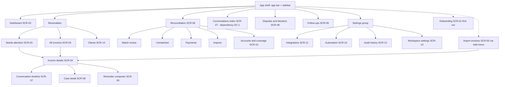
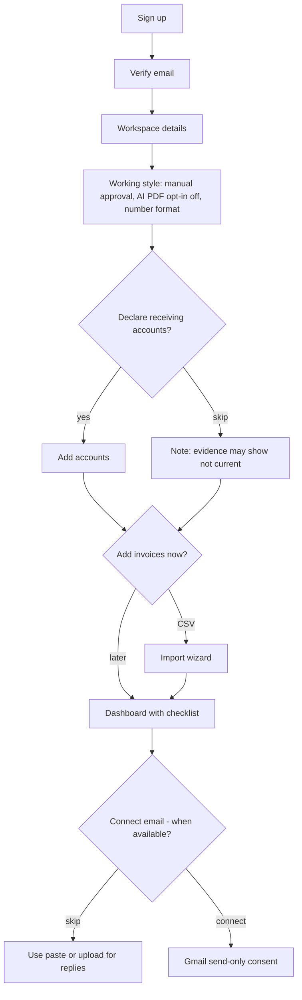
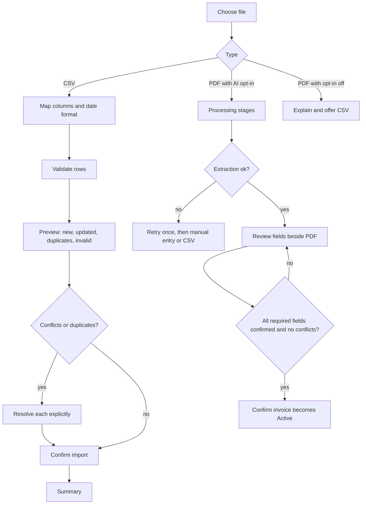
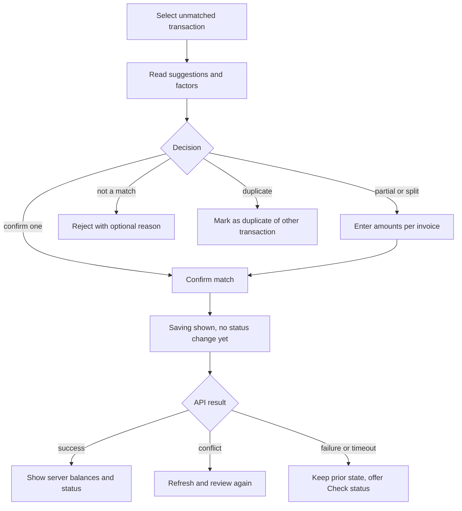
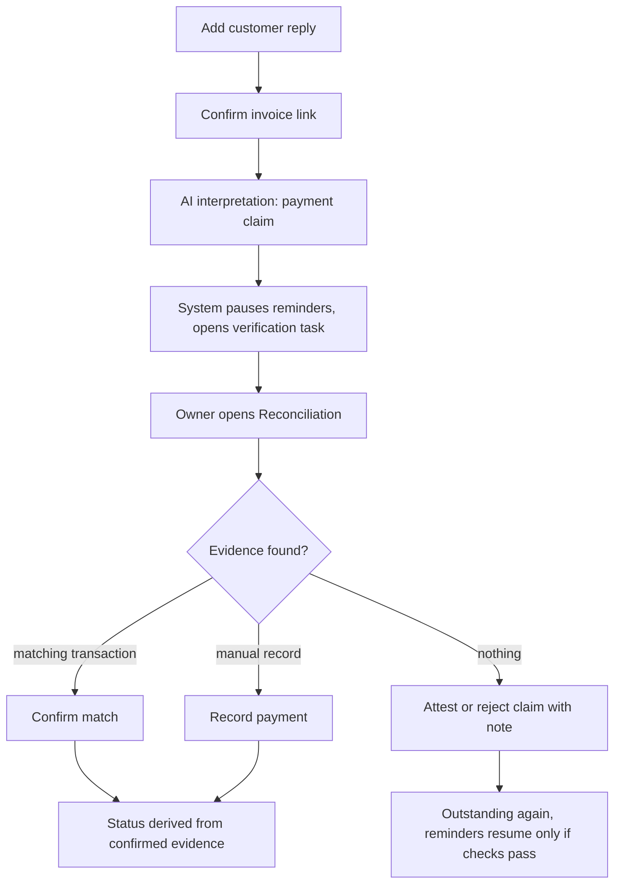
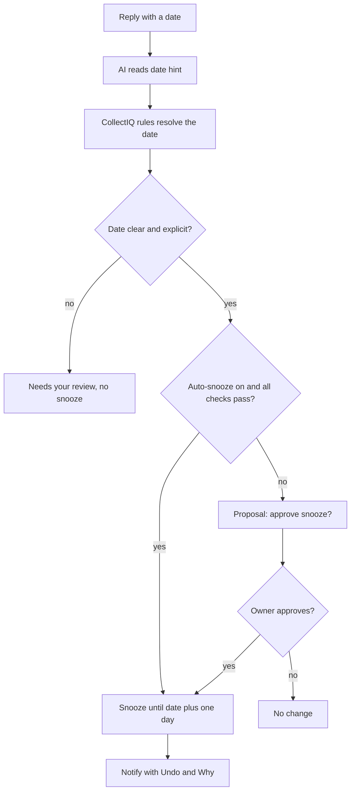
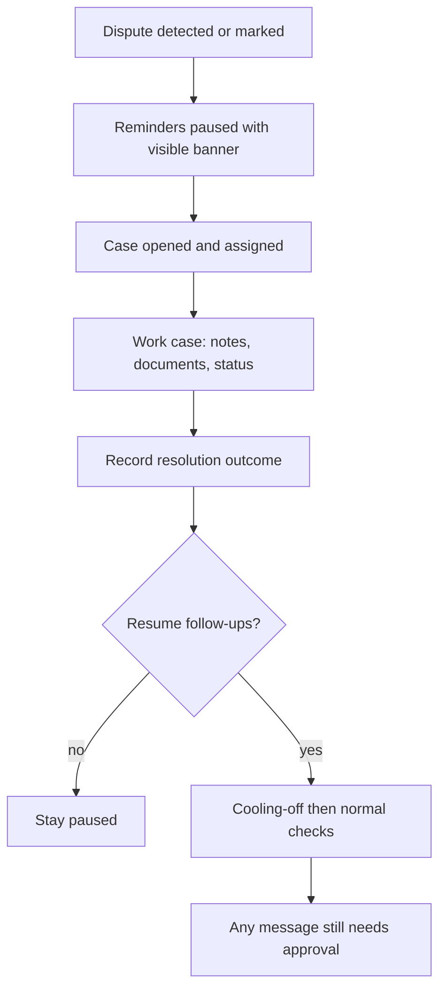
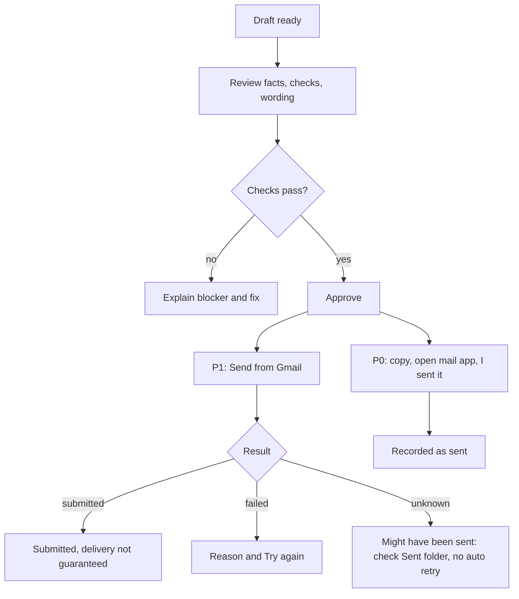
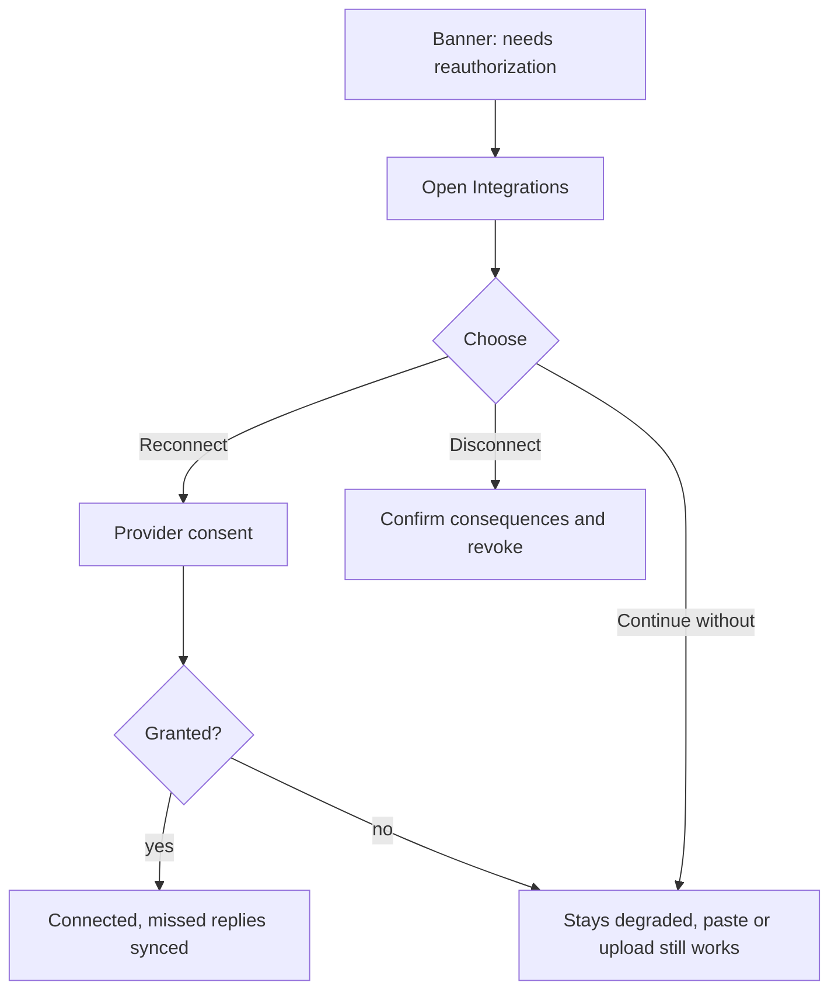

# CollectIQ — UI/UX Design Document

**Document ID:** COLLECTIQ-UX-001 | **Version:** 0.1 (Draft for review) | **Date:** 03 November 2026
**Status:** Design specification. Nothing here is a working prototype or implemented behavior; no part of it has been usability-tested.
**Authoritative inputs (precedence order):** Foundation PDF v1.0 ("F§n") → project instructions → Market Research v0.1 ("MR§n") → PRD v0.1 (IDs: FR-, AIR-, SEC-, NFR-, BR-, TS-, WF-, SCR-, OPEN-) → PPD v0.1 → SAD v0.1 (API-nn, COMP-nn, INV-nn, AC-n, ADR-nn). Where this document changes or extends an earlier one, it is listed in §15.2 as a design-driven change (DC-n) with a proposed resolution; nothing is changed silently.

---

## 0. Document Control

### 0.1 Purpose, dependencies, assumptions
- **Purpose:** translate requirements and architecture into a coherent experience, screen specifications, reusable components, interaction rules, visual system and handoff guidance for design tools, frontend developers and usability testers.
- **Dependencies:** PRD §9 screens (SCR-01…SCR-13) and SAD §10 API (the only backend capabilities the UI may rely on). Screens, fields and actions that need an endpoint the SAD does not define are flagged as **design dependencies** rather than assumed.
- **Assumptions:** the interface is a responsive web app (React + TypeScript SPA, SAD §3, provisional); English UI; INR default currency; no real customer data appears in design artefacts.

### 0.2 Evidence and labelling rules
| Tag | Meaning |
|---|---|
| **[PRD]/[SAD]** | Requirement or capability established in that document |
| **[DD]** | Design decision proposed here (rationale given) |
| **[ASM]** | Untested design assumption (never a research finding) |
| **[PROP]** | Proposed target or default needing team confirmation |
| **[OPEN-D]** | Unresolved design decision (§15.4) |
| **[VER]** | Requires verification (tooling, licences, behavior) |
| **[V]** | Verified on 03 Nov 2026 against an official source (§15.5) |

**What was verified.** The WCAG 2.2 criteria cited in §10 were checked on the W3C "What's new in WCAG 2.2" page **[V]**. The colour pairs in §9.2 had their contrast ratios computed on 03 Nov 2026; they are *design values* and must be re-measured on the implemented UI. **What was not done:** no user interviews, no usability tests, no tool-specific (Stitch/Figma) feature verification.

### 0.3 Identifier scheme
SCR-nn screens (PRD IDs reused; SCR-14/15 added, §3.2) · FL-nn user flows · CMP-nn components · TK-… design tokens · UXR-nn critical UX safety rules · UT-nn usability tasks · DC-n design-driven changes · OPEN-D-n unresolved design decisions · DD-n design decisions.

---

## 1. Product Experience and Design Principles

### 1.1 Experience strategy
CollectIQ is a **Payment Relationship Assistant / Receivables Operations Copilot** [F§1]. The interface must feel like a careful, well-informed colleague who tells the owner *what is actually going on* and *what is safe to do next* — not like a collections dashboard that counts overdue money and urges action. Concretely:

1. **The first question the UI answers is "what needs my judgment, and why?"** — not "what is overdue?"
2. **Every claim shows where it came from:** original message, AI interpretation, or recorded system fact (the **three-layer fact model**, §8).
3. **Doing nothing is a valid, visible outcome:** reminders are paused, snoozed or suppressed *for stated reasons*, and the UI says so.
4. **The owner is always in control:** every customer-facing message is approved by a person; automation is narrow, explained and one click from paused.

### 1.2 Principles and their design consequences
| # | Principle | Navigation | Information hierarchy | Visual design | Interaction patterns | Effect on user decisions |
|---|---|---|---|---|---|---|
| P1 | **Clarity over complexity** | ≤ 6 primary destinations; settings grouped separately | One headline fact per card; secondary detail behind disclosure | Hairline rules, generous whitespace, few colors | One primary action per view region | Fewer, clearer choices |
| P2 | **Exception-first** | Dashboard and Receivables open on "Needs your attention" | Rows ordered by tier then age (SAD/PRD FR-022); non-exceptions collapsed | Exception rows carry reason chips; non-exceptions are visually quiet | Bulk actions only for safe, gate-passing items | Users review judgement items, not every invoice |
| P3 | **Trustworthy financial information** | "Evidence as of" visible app-wide | Amounts always paired with currency, status and evidence source | Separate visual treatments for suggested vs confirmed vs verified; no single "all green" | No optimistic success for financial actions (UXR-04) | Users can tell what is proven vs suspected |
| P4 | **Minimal manual data entry** | Import is a global "Add" action | Prefill from imports; confirm rather than type | Inline confirm/edit controls for extracted fields | Remember mappings; never ask twice (WCAG 3.3.7) | Users correct instead of re-key |
| P5 | **Explainable AI** | Evidence rail on every AI-derived item | AI content labelled and placed below the original message | Dashed "AI interpretation" frame vs solid "Recorded fact" frame | "Why?" disclosure; evidence highlighted in original text | Users inspect, accept, modify or dismiss |
| P6 | **Safe automation, visible control** | Pause-all control in the app bar on every screen | Automation settings spell out what is and is not automatic | Pause state shown with a persistent banner | Confirmation only where consequence warrants; undo for snoozes | Users know exactly what the system may do alone |
| P7 | **Low cognitive load** | Consistent placement of actions; contextual links between records | Progressive disclosure; max ~3 chips per row by default | Consistent shapes/icons per dimension | Defaults that are safe (MANUAL, auto-snooze off) | Fewer states to hold in mind |
| P8 | **Professional B2B SaaS** | Familiar left navigation; keyboard-first operations | Dense-but-calm tables with tabular numerals | Restrained palette; precise typography | Predictable shortcuts and bulk patterns | Confidence for daily operators |
| P9 | **Privacy-conscious** | Data & privacy under Workspace settings, reachable from AI surfaces | Show what is sent to AI only when asked (payload inspector) | Masked values for account numbers/emails where possible | Explicit consents (AI processing, mailbox monitoring) with plain language | Users consent knowingly |
| P10 | **Consistent, accessible, responsive** | Same IA across breakpoints | Priority-ordered content on narrow screens | Tokens for color, type, spacing; non-color status cues | Keyboard-complete; 44 px touch targets [PROP] | Usable for everyone, everywhere |

### 1.3 Signature interface ideas (distinctive, not a generic finance dashboard)
| Idea | What it is | Why |
|---|---|---|
| **Reason-first rows [DD-1]** | Each queue row leads with a plain-language reason ("Customer says they've paid — not verified") before amounts | Makes attention explainable (FR-023) and discourages raw "overdue" thinking |
| **Three-layer fact model [DD-2]** | Original message → AI interpretation (dashed) → Recorded fact (solid, with source) | Prevents AI claims or customer claims being read as facts (UXR-01) |
| **Margin rail [DD-3]** | A persistent right-hand "Evidence & reasoning" rail (drawer on tablet, sheet on mobile) showing sources, gate results and history for the selected item | Keeps the main column clean while making evidence inspectable |
| **Shape-coded state dimensions [DD-4]** | Payment = rounded chip with glyph; Dispute = flag-shaped chip; Follow-up = bell/pause pill; Evidence = ring indicator | Dimensions stay distinct even without color (PRD §5; SAD §6.11) |
| **Pause is a first-class state [DD-5]** | "Reminders paused — dispute open" appears as a banner on the invoice and a chip in lists | Supports UXR-02 (users must see why reminders are paused) |
| **Split totals [DD-6]** | Outstanding totals split into *evidence-supported* vs *evidence not current* | Avoids presenting unverified balances as certain |

### 1.4 Voice and language rules (copy deck principles)
| Use | Avoid |
|---|---|
| "follow up", "payment reminder", "customer", "outstanding", "payment not yet verified" | "chase", "collect", "debtor", "demand", "overdue notice", "delinquent", "final warning" |
| "Customer says they've paid — not verified yet" | "Customer claims payment" (implies disbelief) in primary text |
| "Payment status uncertain: two bank entries could match" | "Possibly unpaid" |
| "Indicated date (not a promise)" for tentative timing | "Promised" unless the customer explicitly committed |
| "Submitted to your mail provider" | "Delivered" |
| "AI interpretation (unverified)" | "AI detected", "AI verified", "AI-powered" as a quality claim |
| "Paused because a dispute is open" | "Blocked", "failed" for protective behavior |
Microcopy is neutral, short, and never uses urgency or pressure language in the product or its message drafts (PRD SEC-18, FR-086).

---

## 2. Target Users and UX Needs

**Prioritization.** The design serves the **initial ICP** only [MR§2.2; PRD §1.5]: a small B2B services firm (agency, studio, consultancy) with roughly 30+ invoices a month, multiple payment channels, email-based clarifications, and a named person who reconciles and chases manually. Low-volume solo users are a negative control; they are not a design target. Personas below are **hypothesis composites** from the PRD/PPD, **not research findings**; every "need" is an [ASM] until Phase-0 interviews and usability tests (§14) confirm it.

### 2.1 Personas and UX needs
| | **Owner** (founder-operator) | **Reconciler** (bookkeeper / finance admin) | **Delivery lead** (project lead; P1) |
|---|---|---|---|
| Goals | See what needs a decision; avoid chasing the wrong people; stay in control | Match payments accurately; keep an audit trail; keep the queue small | Pause follow-up when delivery is disputed; supply project context |
| Pain points [ASM] | Searching threads/bank apps; fear of looking pushy; uncertainty whether money arrived | Unreferenced transfers, duplicate amounts, partials, stale data | Learning of disputes late; unfamiliar with finance tools |
| Technical familiarity [ASM] | Moderate; comfortable with email, accounting software | High with spreadsheets and bank exports | Low–moderate with finance tools |
| Working environment [ASM] | Laptop between client work; phone for quick approvals | Desktop, often large screen, long sessions | Mostly phone and email; short visits |
| Most frequent tasks | Review attention list; approve/edit reminders; check a customer's claim | Import statements; confirm/reject matches; record manual payments | Read assigned case; add note; request pause |
| Critical decision points | Approve a message; resume after dispute; turn auto-snooze on | Confirm a match; mark duplicate; reverse an allocation | Resolve an assigned blocker |
| Trust concerns | "Will it email my client by mistake?"; "Where does my data go?" | "Can I see why it matched this?"; "Can I undo?" | "Will it keep chasing during a dispute?" |
| Accessibility needs [ASM] | Varies; treat as general population: low vision, color-vision deficiency, keyboard-only, screen reader, cognitive load, motor limitations | Same; long sessions → readable density, keyboard operation | Small-screen, touch, one-handed use |
| UI emphasis | Dashboard, queue, composer, automation settings | Reconciliation, imports, audit | Case detail, notifications (P1) |

### 2.2 Goal → experience mapping
| User goal | Primary surfaces | Key mechanism | Success signal (proposed, unmeasured) |
|---|---|---|---|
| Know what needs my attention and why | Dashboard, Receivables queue | Reason-first rows, tiers | Users name the reason for the top item without help (UT-02) |
| Know if a payment has arrived | Reconciliation, Invoice details | Evidence-source labels; suggested vs confirmed | Users distinguish verified from uncertain (UT-03) |
| Understand what the customer said | Conversation timeline | Original / AI / fact layers | Users locate the customer's own words (UT-05) |
| Avoid inappropriate reminders | Banners, chips, composer gates | Visible pause reasons; gate explanations | Users explain why a reminder is paused (UT-04) |
| Stay in control of automation | Automation settings, pause control | Plain-language policy; one-click pause | Users state what is automatic (UT-08) |
| Avoid re-entering data | Import & review | Mapping, extraction review | Time to first populated queue (M-U2) |

### 2.3 Accessibility baseline
Target **WCAG 2.2 AA** (§10), verified during implementation. Specific needs to design for: color-vision deficiency (no color-only meaning), low vision/zoom (reflow at 400%), keyboard-only operation, screen readers (semantic structure, live regions for async results), cognitive load (consistent patterns, plain language), motor control (target sizes, no drag-only actions), and fatigue during long reconciliation sessions.

---

## 3. Information Architecture and Navigation

### 3.1 Navigation structure
Navigation contains only destinations justified by the PRD and MVP scope; future capabilities are listed separately and **not shown** in the product until implemented and verified (prompt rule; PRD SCR-11).

| Group | Label | Screen(s) | Scope | Notes |
|---|---|---|---|---|
| **Primary** | Dashboard | SCR-02 | MVP (P0) | Default landing after setup |
| | Receivables | SCR-03 queue, SCR-04 invoice details, SCR-14 clients | P0 | Tabs: *Needs attention* (default), *All invoices*, *Clients*; "Import invoices" action opens SCR-05 |
| | Reconciliation | SCR-06, SCR-15 accounts & coverage | P0 | Tabs: *Match review*, *Unmatched*, *Payments*, *Imports*, *Accounts & coverage* (+ *PayPal events* P1) |
| | Conversations | SCR-07 | P0 (**design dependency DC-1**) | Index of captured replies needing review. The SAD has no list-all-messages endpoint (only per-invoice and by-ID). Until added, the index is a filtered queue view ("Reply needs review") and the timeline is reached from invoices |
| | Disputes & blockers | SCR-08 | P0 | Case list and detail; badge count of open cases |
| | Follow-ups | SCR-09 | P0 | Drafts awaiting approval, snoozed items, waiting for customer, reminder history. Named **Follow-ups**, not "Scheduled", because the MVP never sends automatically [DD-7] |
| **Secondary** (Settings group) | Integrations | SCR-11 | P0 shell / P1 | Gmail and PayPal cards appear when implemented; placeholders for future integrations are **not** displayed |
| | Automation | SCR-10 | P0 | Policy settings, pause control, version history |
| | Audit history | SCR-12 | P0 | |
| | Workspace settings | SCR-13 | P0 | Members, notifications, data & privacy (export, deletion, AI payload inspector) |
| **Not in navigation** | Onboarding | SCR-01 | P0 | First-run flow and checklist |
| **Future (not shown)** | Outlook, accounting integrations, bank feeds, bookkeeper multi-client switcher, reports/analytics, WhatsApp/SMS channels | — | P2 | Listed in §3.7 only |

### 3.2 Screen inventory additions to the PRD
PRD §9 defines SCR-01…SCR-13. Two additional screens are required by existing requirements and are added here:
| ID | Screen | Reason |
|---|---|---|
| **SCR-14** Client profile | PRD FR-149 (client contacts, sensitivity, tone, suppression, aliases) has no screen in PRD §9 (PPD had S-11) |
| **SCR-15** Payment accounts & coverage | SAD AC-1/AC-2/AC-15 (declared receiving accounts, statement coverage, attestations) need a home; lives as a Reconciliation tab and an onboarding step |
See DC-2, DC-3 in §15.2.

### 3.3 Hierarchy, breadcrumbs, global placement
- **Left sidebar (desktop):** primary group on top; Settings group at the bottom; collapsed icon rail on tablet; bottom bar (Dashboard, Receivables, Reconciliation, Cases, More) on mobile.
- **App bar (always visible):** workspace name · **global search** · **Add** menu (Import invoices, Record payment, Add customer reply) · **Evidence freshness** indicator ("Evidence current to 28 Oct" / "Evidence not current") · **Pause all automation** control (PRD FR-156; shows state) · notifications · account menu.
- **Breadcrumbs** only on detail pages: `Receivables / Invoice INV-2041`, `Disputes & blockers / Case #…`, `Reconciliation / Match review / Transaction …`. The back control restores the previous list *with its filters and scroll position* (filters live in the URL).
- **Workspace and account controls:** workspace name and role in the account menu (workspace *switching* is not needed in the MVP: one workspace per user is assumed [OPEN-D-1]); sign out, profile, help link (placed consistently, WCAG 3.2.6).

### 3.4 Search and filtering
| Aspect | Rule |
|---|---|
| Global search | Searches invoices (number, client, reference, amount) using the invoice list endpoint (`q`, API-02) and clients; results grouped by type; keyboard `/` focuses it |
| Local filters | Per list, mirroring API filters: payment status, dispute status, reminder status, client, due range, amount range, currency, assignee, import batch (FR-025); stored in the URL so views are shareable and restorable |
| Saved views | P1 (FR-030); not in MVP |
| Filter UI | Filter bar with removable "applied filter" chips; "Clear all"; counts of results; a "Reset to exception order" control (FR-026) |
| Sorting | Default exception order (deterministic tier → age → amount); user can sort by any column; changing sort shows a persistent "Custom sort — reset to exception order" affordance |
| Pagination | Cursor-based "Load more" with a visible loaded count (no infinite surprise scroll); keyboard accessible |

### 3.5 Contextual navigation between related records
| From | To | Mechanism |
|---|---|---|
| Queue row / Invoice | Conversation timeline, Case, Match review, Draft, Audit for this invoice | Tabs and "Related" links in the evidence rail |
| Reconciliation proposal | Invoice(s) and transaction detail | Linked chips |
| Case | Source message, invoice, project reference | Linked chips |
| Audit event | Object it affected | Object link |
| Reminder draft | Invoice, gate results, policy decision ("Why?") | Links |
| Banner (integration error, paused) | Relevant settings screen | Inline action |

### 3.6 Diagram — Information architecture


### 3.7 Future capabilities (kept out of the navigation)
Outlook mailbox; accounting-platform integration; live bank feeds; attachment ingestion; bounded auto-send; auto-apply of matches; predictive views; bookkeeper multi-client workspace switcher; WhatsApp/SMS. Each requires cost/risk/value analysis before promotion (project rule 6) and verified provider capability before appearing in the UI.

---

## 4. Core Screen Specifications

This section defines the *design intent, layout, content logic and behavior* of each core screen. Section 11 repeats each MVP screen as a structured handoff record (IDs, regions, validation, states, API dependencies, acceptance criteria). All sample names and amounts in wireframes are **synthetic placeholders**, not real data. Wireframes are low-fidelity structure guides, not visual designs.

### A. Onboarding and Workspace Setup (SCR-01)
**Intent:** reach a populated queue quickly with safe defaults, without requiring a mailbox connection (PRD WF-01; FR-140…FR-143).

| Step | Content | Notes |
|---|---|---|
| 1 Welcome | One-sentence promise ("Know which invoices truly need attention, check payments from any channel, and follow up in your own words") plus **"What CollectIQ is not"**: not an invoicing tool, not a payment processor, not a collections agency | A static "how it works" illustration labelled *Illustration — sample data* |
| 2 Account | Email, password, email verification | Password rules shown inline; verification mail wait state with resend |
| 3 Workspace | Business name, country, timezone, default currency, business hours | Timezone prefilled from the browser and confirmed (redundant-entry rule, WCAG 3.3.7) |
| 4 Working style | **Approval mode: "I approve every message" (default, only available choice in P0/P1)**; AI processing of uploaded PDFs: *Off* by default with plain explanation of what is sent and to whom (provider named when selected, OPEN-09); number format (Indian grouping or international) [OPEN-D-3] | Auto-snooze is **not** offered here; it is an informed choice later in Automation settings |
| 5 Where do payments arrive? | Declare receiving accounts: bank account(s), PayPal, UPI handle, cash (labels only — no credentials) | Skippable with a visible consequence: "Without this, payment status may show *evidence not current*" (SAD AC-1) |
| 6 Add your invoices | **Import a CSV** (primary; template download), upload PDFs (shown only if AI processing opted in), or "I'll do this later" | Opens SCR-05 |
| 7 Optional connections | Gmail (when implemented): explained as optional; "Skip — you can paste customer replies instead" | **No step blocks on email** |
| Done | Checklist: import invoices ✓/☐, add payment evidence ☐, set follow-up cadence ☐, review the queue | Links to each; checklist persists on the Dashboard until complete |

**Permission explanations** appear at the moment of need, in plain language, and say what each permission cannot do ("Send-only access cannot read your mailbox.").

### B. Main Dashboard (SCR-02)
**Intent:** answer "what needs my judgment today?" in under a minute (proposed target, unmeasured). Not a wall of charts: four summary cards, two short lists, one compact aging bar.
```
+--------------------------------------------------------------------------------------+
| Dashboard                         Evidence current to 28 Oct  [i]       [Pause all: Off] |
+--------------------------------------------------------------------------------------+
| [Needs your decision]  [Outstanding         ] [Overdue            ] [Awaiting verification]|
|  7 items               | INR 12,40,000       | INR 4,10,000 · 9 inv| 3 invoices · INR 95,000 |
|  Open the queue ->     | 9,10,000 evidence-  | 2,60,000 evidence-  | Reminders suppressed    |
|                        | supported / 3,30,000| supported           | until verified          |
|                        | evidence not current|                     |                         |
+------------------------------------------+-------------------------------------------+
| Recommended next actions                 | Upcoming commitments (next 14 days)        |
|  1 Example Client Ltd · INV-2041         |  16 Nov  INV-2037  indicated "after payroll"|
|    Customer says they've paid —          |  21 Nov  INV-2052  stated 20 Nov           |
|    not verified     [Review matches]     |  Wording: "indicated date", not a promise   |
|  2 ... (max 5)            [Open queue]   |                                            |
+------------------------------------------+-------------------------------------------+
| Disputes & blockers (open: 2)            | Recent reconciliation activity              |
|  INV-2029 · amount query · Assigned: You | 3 Nov  Match confirmed INV-2044 (Priya)     |
|  INV-2033 · PO number requested          | 2 Nov  Statement imported (14 rows)         |
+------------------------------------------+-------------------------------------------+
| Aging (by due date):  Not due ▮▮▮▮  1-30 ▮▮▮  31-60 ▮▮  61-90 ▮  90+ ▮     [as of 3 Nov] |
+--------------------------------------------------------------------------------------+
```
- **Verified vs unverified:** the *Outstanding* and *Overdue* cards split amounts into **evidence-supported** and **evidence not current** (DD-6), each with an "as of" date. Totals are per currency, never summed across currencies (FR-019). The dashboard shows **no estimates or predictions**; anything not derived from imported invoices and confirmed payments is labelled as such.
- **Needs your decision** counts tier T1 items (BR-40) and links to the queue.
- **Recommended next actions** reuses queue rows (reason + action) so there is one source of truth.
- **Upcoming commitments** lists invoices with a snooze/commitment date, using the term *indicated date* for tentative timing and *stated date* for explicit ones; it never says "promised" unless the customer committed. (Data: invoice list filtered by reminder status `SNOOZED`; needs `snooze_until` in the list summary — **DC-4**.)
- **Onboarding checklist card** replaces the lists until the first import exists.

### C. Receivables Exception Queue (SCR-03)
**Intent:** a calm list of only what needs attention, each with *why* and *what next* (FR-021…FR-029).
```
+------------------------------------------------------------------------------------------+
| Receivables   [Needs attention 12] [All invoices] [Clients]            [Import invoices] |
| Search...  Status v  Client v  Due v  Amount v  Assignee v      Showing 12 · Reset order |
+------------------------------------------------------------------------------------------+
| NEEDS YOUR DECISION (4)                                                                  |
| [ ] Example Client Ltd · INV-2041        Why: Customer says they've paid — not verified  |
|     Due 12 Oct · 22 days overdue         [Payment: Awaiting verification] [Follow-up: Paused]|
|     "We transferred it this morning" · 3 Nov            Outstanding  INR 2,50,000        |
|                                          [Review matches]                                 |
| [ ] Sample Studio · INV-2029            Why: Dispute open — amount query                  |
|     ...  [Payment: Outstanding] [Dispute: Open] [Follow-up: Paused]       [Open case]    |
| READY TO APPROVE (2)    OVERDUE — NO EXCEPTION (5)    SNOOZED / WAITING (collapsed)       |
+------------------------------------------------------------------------------------------+
| Selected: 2   [Approve eligible drafts]  [Dismiss informational]  [Assign]               |
+------------------------------------------------------------------------------------------+
```
- **Row anatomy:** (1) *Why* line (reason chips in plain language, first); (2) invoice/client; (3) due date and **age as text** ("22 days overdue") not color alone; (4) outstanding amount + currency, right-aligned with tabular numerals; (5) three shape-coded state chips (payment, dispute, follow-up) plus an evidence ring; (6) latest relevant communication (excerpt, date, and an *AI* tag if the excerpt is an AI summary); (7) one recommended action button (role-aware).
- **Avoiding overload:** the *Needs attention* tab shows only tiered exceptions (T1–T3 expanded; T4/T5 collapsed groups); non-exception invoices live in *All invoices*. A header line states "12 of 214 invoices need attention" and how many are fine ("202 need no action").
- **Uncertainty indicators:** payment state chips carry evidence qualifiers (e.g., "Outstanding · evidence not current"); AI-derived reasons show the *AI interpretation* tag and an ordinal level (Low/Medium/High) — never a percentage.
- **Bulk actions:** limited to PRD FR-028 (approve eligible drafts, dismiss informational, assign). The confirmation dialog lists excluded items and why (gate reasons). There is no bulk "send", "mark paid", or "resolve".
- **States:** loading skeleton rows; empty ("Nothing needs your attention. Evidence current to 28 Oct."); error (last results kept with a timestamp and a retry).

### D. Invoice Details (SCR-04)
**Intent:** one place to understand and act on a single invoice with its state dimensions visibly separate (PRD §5).
```
+--------------------------------------------------------------------------------------------+
| Receivables / INV-2041                                                                      |
| INV-2041 · Example Client Ltd       Outstanding INR 2,50,000   Due 12 Oct (22 days overdue) |
| Invoice: Active | Payment: [? Awaiting verification] | Dispute: None | Follow-up: [|| Paused]  |
| Evidence: [o] covered to 28 Oct                                                              |
| +----------------------------------------------------------------------------------------+ |
| | ! Reminders are paused: a customer message says payment was sent. Nothing will be sent  | |
| |   until you verify it.                         [Review the claim]  [See why]            | |
| +----------------------------------------------------------------------------------------+ |
| Tabs: Overview | Payments & matches | Conversation | Follow-ups | Cases | History          |
| Overview:  Gross 2,50,000 − Confirmed payments 0 = Outstanding 2,50,000                    |
|            Line items (collapsed) · Source: import batch 14 / row 7 · Payment refs          |
|                                                          | EVIDENCE & REASONING (rail)       |
|                                                          | Status: why Awaiting verification |
|                                                          | Gates: G7 not passed (…)          |
|                                                          | Sources: bank import 2 Nov row 14 |
+--------------------------------------------------------------------------------------------+
```
- **Four dimensions, four shapes:** *Invoice status* is a plain labelled outline (only emphasized if not Active); *Payment* is a rounded chip with glyph; *Dispute* is a flag-shaped chip; *Follow-up* is a pill with bell/pause/clock glyph; *Evidence coverage* is a ring indicator with text (DD-4).
- **Prominence rule:** *Payment uncertain/awaiting verification* and *Dispute open* produce a full-width **banner** above the tabs; routine reminder actions in the primary area are replaced by the verify/resolve action (UXR-02/03).
- **Overview tab:** balance math displayed as read-only server values (gross, confirmed payments, outstanding); line items collapsed; provenance (source batch/row; field provenance incl. "corrected by you"); payment references; client link; PO/project refs.
- **Payments & matches:** transactions allocated to this invoice with evidence type; *Suggested* proposals separate from *Confirmed*; reversal control with required reason.
- **Conversation, Follow-ups (commitments, drafts, history), Cases, History (audit for this invoice)** as tabs.
- **Actions:** primary = the deterministic recommended action (BR-41); secondary menu: Record payment, Attest "checked, nothing received", Add customer reply, Mark as disputed, Edit invoice (reason required; flags "differs from source"), Cancel/Archive, Pause follow-ups for this invoice.
- **No "Mark as paid" action exists**; paid status appears only after a confirmed allocation (PRD FR-052).

### E. Invoice Import and Review (SCR-05)
**Intent:** intake without re-entry; never save questionable values as verified (FR-001…FR-018).

**CSV path (guaranteed):** Upload → (validation of type/size) → **Map columns** (auto-suggested; required fields marked; saved mapping) → **Date format** (user must choose; no guessing) → **Validate** (row-level errors list, downloadable) → **Preview** (new / updated / possible duplicate / invalid counts, with diff for updates) → **Resolve** (duplicates: keep both / merge / ignore; conflicts: pick value) → **Confirm import** → **Summary** ("38 invoices added, 2 updated, 1 skipped — view them").

**PDF path (conditional; only if AI processing is on):** Upload → processing screen (**staged status**: *Uploaded → Reading text → Extracting fields → Ready for review*; the user may leave; an in-app notification arrives) → **Review**: PDF viewer on the left, fields on the right.
```
+---------------------------------------------+-------------------------------------------+
| [PDF page 1 of 2   - +  fit]                | Review extracted invoice  (AI-extracted)   |
|                                             | Invoice number   [INV-2041        ] Confirmed by you |
|   (document preview, highlighted source     | Client           [Example Client Ltd] Needs review ◐ Medium |
|    text for the selected field)             | Issue date       [12 Sep 2026      ] Confirmed|
|                                             | Due date         [  --             ] Missing — required |
|                                             | Total            [ INR 2,50,000    ] CONFLICT: lines sum to 2,40,000 |
|                                             |    ( ) Use stated total  ( ) Use lines total  ( ) Enter… |
|                                             | [Confirm invoice] disabled until required fields confirmed |
+---------------------------------------------+-------------------------------------------+
```
- **Field states:** *Confirmed by you*, *Needs review* (below threshold or failed validation; empty or marked "AI suggestion — not yet confirmed"), *Missing*, *Conflict*. Each field shows its source span on click. Confidence is ordinal (Low/Medium/High) with a "Why?" tooltip; no percentages.
- **Explicit confirmation:** extracted values enter the ledger only after the user confirms the invoice (SAD: extraction → `PENDING_REVIEW`; confirm → `ACTIVE`). Edits are inline and logged with before/after.
- **Failure states:** encrypted/corrupt file (rejected, reason); no text layer (OCR not available: offer manual entry/CSV); extraction timeout or invalid output (one automatic retry happened; offer manual entry); AI opt-in off (PDF area replaced by an explanation and CSV option).
- **Duplicates:** inline panel comparing the new invoice with the existing one; no silent merge.

### F. Payment Reconciliation Workspace (SCR-06, SCR-15)
**Intent:** make evidence and matching legible; make "suggested" visibly different from "confirmed" (FR-032…FR-057; SAD §6).
```
+--------------------------------------------------------------------------------------------+
| Reconciliation  [Match review 5] [Unmatched 3] [Payments] [Imports] [Accounts & coverage]   |
+---------------------------------+----------------------------------------------------------+
| UNMATCHED / PROPOSED            | Transaction · 2 Nov · INR 2,50,000 · Bank import row 14   |
| > 2 Nov  INR 2,50,000  ACME…    | Description: "NEFT ACME INV-2041"                         |
|   3 Nov  INR   40,000  …        |                                                           |
|                                 | SUGGESTED MATCHES (not applied yet)                        |
|                                 | ( ) INV-2041 · Example Client Ltd         [Strong match]   |
|                                 |     ✓ Reference INV-2041 found in description              |
|                                 |     ✓ Amount equals outstanding (INR 2,50,000)             |
|                                 |     ✓ Date within expected window                          |
|                                 |     – Payer name partly matches client alias               |
|                                 | ( ) INV-2043 · Sample Studio              [Weak match]     |
|                                 |     ✓ Amount equals outstanding  ✗ No reference            |
|                                 | [Confirm match]  [Split / partial…]  [Not a match] [Duplicate of…]|
+---------------------------------+----------------------------------------------------------+
```
- **Suggested vs confirmed:** suggestions use a **blue dashed** frame with the label "Suggested — not applied"; confirmed allocations use a **solid** frame with "Applied to INV-2041 by Priya, 3 Nov, from bank import row 14". The confirmed state is never rendered with the same style as a suggestion, and no single green check summarizes the screen (UXR-05).
- **Match strength:** labels *Strong / Possible / Weak match* with a **factor checklist**; numeric scores are not shown (avoid false precision; DD-8). Ambiguity is shown explicitly: "Two invoices could match — reminders for both are paused until you decide" with a side-by-side compare.
- **Partial payments:** a numeric amount field per invoice with "Apply full remaining balance"; no drag sliders (WCAG 2.5.7). A read-only *preview* of the resulting balance is labelled "Preview — the confirmed balance appears after saving" and the server response is authoritative.
- **Manual payment entry:** drawer form (method, amount, currency, value date, reference, payer, notes, allocations) with validation (currency must match; overpayment requires explicit confirmation and creates a review item); success appears only after the API confirms.
- **Duplicate detection:** banner "Possible duplicate of a PayPal entry on 2 Nov" with compare view and "Mark as duplicate" (never auto-merge).
- **Imports tab:** statement/export upload, mapping, coverage range confirmation, overlap report ("20 rows already imported").
- **Accounts & coverage (SCR-15):** list of declared receiving accounts with "covered through" date or "no statement imported", gaps called out, actions *Import statement* and *I checked this account — nothing received* (attestation, with date and expiry note). Language explains *why*: "CollectIQ only treats an invoice as 'outstanding with current evidence' when your accounts are covered."
- **History tab:** reconciliation proposals, confirmations, rejections, reversals with actor and reason.

### G. Conversation and Customer Timeline (SCR-07)
**Intent:** distinguish three things at a glance — what the customer said, what AI thinks it means, and what the system has actually recorded (DD-2; UXR-01).
```
+--------------------------------------------------------------------------------------------+
| INV-2041 · Conversation                         [Add customer reply]                       |
| 3 Nov · From: accounts@example-client.test · Pasted by you · Linked to INV-2041 ✓           |
| +- CUSTOMER WROTE (original) -----------------------------------------------------------+ |
| |  "Hi, we transferred the amount this morning. Please check your account."               | |
| |        ^^^^^^^^^^^^^^^^^^^^^^^^^^^^^^^^^^^^^ (evidence highlighted)                       | |
| +------------------------------------------------------------------------------------------+ |
| +- - AI INTERPRETATION (unverified) - - - - - - - - - - - - - - - - - - - - - - - - - - - -+ |
| | Reads as: Payment claim · Confidence: Medium (rough signal, not proof)  [Why?]           | |
| | Summary: Customer says payment was sent this morning.                                    | |
| | [Accept] [Correct…] [Dismiss]                                                            | |
| +- - - - - - - - - - - - - - - - - - - - - - - - - - - - - - - - - - - - - - - - - - - - -+ |
| +- RECORDED BY THE SYSTEM (facts) ------------------------------------------------------+ |
| | ✓ Reminders paused — reason: payment claim awaiting verification  · 3 Nov 10:14 [Why?]  | |
| | ✓ Verification task opened · No payment has been recorded for this message              | |
| +------------------------------------------------------------------------------------------+ |
+--------------------------------------------------------------------------------------------+
```
- **Capture:** "Add customer reply" opens a drawer: paste text or upload .eml/.txt → *confirm which invoice(s) this is about* (required before processing; suggestions shown) → "Interpreting…" state with a time estimate-free spinner and a timeout message → result. When mailbox monitoring exists (P1) the same layout shows synced messages with a *Gmail* source tag and thread-based association.
- **Dates:** when the AI reads a date, the card shows **both** "Customer wrote: 'the 15th'" (AI hint) and "Resolved date: 15 Nov 2026 (calculated by CollectIQ rules)" or "Date unclear — needs your review" (never an AI-guessed date).
- **Commitments** appear as chips: *Stated date* (explicit) vs *Indicated timing* (tentative).
- **Correction drawer:** change intent, date, or linked invoice; a confirmation states "Actions taken because of the original reading will be reversed"; after saving, the list of reversed actions returned by the system is shown.
- **Failure:** "We couldn't read this message automatically. Reminders for this invoice stay paused until you review it." with *Review manually*.
- **Injection-flagged messages** show a neutral notice: "This message contains text that looks like instructions to the system; it was ignored and needs your review."

### H. Disputes and Blockers (SCR-08)
**Intent:** make pause status unmistakable and keep resolution human (FR-119…FR-130).
- **List:** type (Dispute, Missing document, Question, Proposal, Match review…), invoice, summary (AI-labelled), assignee, status, age; filters by type/status/assignee.
- **Detail:** header banner **"Routine reminders are paused for INV-2029 while this dispute is open"** (with the reason chip, always visible); original customer message (layer 1); AI summary (layer 2, labelled, never states merits or legal status); requested corrections/documents checklist; internal notes (timeline of notes with author); assignee control; status control (Open → In review → Awaiting customer → Resolved).
- **Resolve:** a form with outcome (No change / Invoice corrected / Adjustment agreed / Withdrawn by customer / Other) and note; text states "Resolving does not restart reminders."
- **Resume follow-ups:** a separate, explicit step after resolution: explains the cooling-off period [PROP 3 business days], that nothing is sent automatically, and that any message still needs approval; shows gate status.
- **Language guard:** the UI offers no escalation, penalty, or legal-action affordances; suggested-reply drafts (when offered) are neutral and always editable.

### I. Reminder Composer and Approval (SCR-09)
**Intent:** a person approves every customer-facing message, with facts that cannot be altered by AI or by accident (FR-083…FR-097; AIR-11).
```
+--------------------------------------------------------------------------------------------+
| Follow-ups / Draft for INV-2041                                       Draft expires in 3 days |
| To: [Accounts · accounts@example-client.test ▾] (approved contacts only)                    |
| Subject: [Payment reminder — INV-2041                      ]   Tone: (•)Neutral ( )Friendly ( )Formal |
| Message:  [Hello ... editable wording ...                                   ] [Regenerate wording] |
| ┌ Facts from your records (locked) ───────────────────────────────────────────────────────┐ |
| │ Invoice INV-2041 · Amount outstanding INR 2,50,000 · Due 12 Oct 2026                    │ |
| └──────────────────────────────────────────────────────────────────────────────────────────┘ |
| Checks: ✓ Payment not marked paid  ✓ No open dispute  ✓ Evidence current  ✓ Within contact limits |
| Wording check: ✓ No pressure, penalty or legal language                                      |
| [Approve]   [Reject draft]   [Pause follow-ups for this invoice]                              |
+----------------------------------------------------------------------------------------------+
```
- **Recipient** is restricted to approved contacts; changing it shows the contact list, never free text. **Subject/body** editable; the **facts block is locked** (explained: "Filled from your records so it can't drift").
- **Tone** (Neutral default, Friendly, Formal) regenerates only wording around the facts; "Regenerate wording" is a deliberate action (AI-labelled).
- **No scheduled send time** is offered: the product has no automatic sending in the MVP (PRD FR-088). The draft states "Draft expires in 3 days" [PROP]; the UI never implies it will be sent later.
- **Checks panel** lists gate results in plain language (§6.9 copy deck); a failed check disables Approve and explains the blocker and the fix.
- **After Approve (P0):** status *Approved — ready to send*; actions *Copy text*, *Open in your mail app*, and *I sent it* (requires confirmation: "Mark as sent — records that you sent this"). Approve and Mark-as-sent are separate, idempotent actions (SAD §10, API-09).
- **P1 sending:** primary action *Send from your Gmail*; statuses: **Sending…** → **Submitted to your mail provider** (with note "Delivery isn't guaranteed"), or **Failed** (reason, *Try again* only for definitive failures), or **Might have been sent** (ambiguous: no retry offered automatically; options *I checked — mark as sent* / *Approve a new send*, SAD §9.2).
- **Duplicate-send protection:** after Approve/Send the controls are disabled while pending; the same Idempotency-Key is reused on retry; the contact-limit check displays "Last reminder: 5 Nov".

### J. Automation Settings (SCR-10)
**Intent:** the user can state exactly what the system may do on its own (UT-08).
| Row | Control | Behavior shown |
|---|---|---|
| **Protective pauses** (customer says they've paid, dispute, question, opt-out, uncertainty) | *Always on* (not switchable) | "These pause reminders automatically and never send anything." |
| **Uncertain-payment suppression** | *Always on* | Explains the checks (§6.9) |
| **Dispute suppression** | *Always on* | |
| **Automatic snooze when a customer states a payment date** | Off by default → consent dialog → On | Plain-language example ("If a customer writes 'we pay on the 15th' and your records are consistent, reminders move to the 16th. You'll be told and can undo.") and "What it will not do". Availability comes from the server (the safety evaluation gate, AIR-12) — **DC-5** |
| **Draft reminders** | On (drafting only) | "Drafts are suggestions. Nothing is sent without your approval." |
| **Sending reminders** | **Locked: "Always needs your approval"** | No automatic-send option in this version |
| **Applying payment matches** | **Locked: "Always needs your confirmation"** | |
| **Reminder cadence & limits** | Numeric fields with bounds (e.g., first reminder after N days; at most 1 per invoice per 7 days) [PROP defaults per PRD] | Changes affect future checks only |
| **Business hours / quiet periods** | Time range pickers (timezone shown) | |
| **Client sensitivity defaults** | Standard / Long-term / Sensitive | Sensitive = always manual, excluded from batch |
| **Pause all automation** | Prominent switch (mirrors the app-bar control) | Immediate; resume requires an explicit action |
- **"How decisions are made"** disclosure lists the checks in plain language with an example.
- **History:** policy versions (who, when, what changed), read-only.
- **Permissions:** Owner changes automation permissions; Finance admin may change cadence/templates but sees locked controls with an explanation (PRD §3I matrix).

### K. Integration Settings (SCR-11)
**Intent:** honest status and permissions; never imply availability that doesn't exist (FR-101…FR-118, FR-150).
- **Gmail card (P1):** states — *Not connected*, *Connected — send only*, *Connected — sending and reply monitoring*, *Needs reauthorization*, *Degraded monitoring*, *Disconnected*. Permission descriptions: **Send** ("Lets CollectIQ send emails you have approved from your Gmail. It cannot read your mailbox.") and **Reply monitoring** (optional; "Lets CollectIQ read replies to conversations it started. CollectIQ is designed to look only at those. The permission Google grants may technically allow wider access; CollectIQ limits itself by design.") **[PRD FR-111; DD-9]**. Shows last sync time, last error (plain language), *Reconnect*, *Disconnect and revoke access* (confirmation lists consequences: sending stops, monitoring stops, access token revoked where Google supports it, stored data remains until you delete it).
- **PayPal card (P1, sandbox):** webhook health, last event time; text: "No events received does not mean no payments."
- **Payment sources card:** "Statement imports and manual entries" with a link to Reconciliation (UPI, bank transfer, cash are recorded this way — no direct integration).
- **Not shown:** Outlook, accounting platforms, bank feeds — not until implemented and verified.
- **Data access explanation panel:** what is read, what is stored, how to revoke (provider link).

### L. Audit History and Workspace Settings (SCR-12, SCR-13)
- **Audit list:** time, actor (person / system / *AI proposal* — labelled), action, object (linked), outcome. **Detail drawer** shows: initiator, AI recommendation (if any, labelled), **policy decision** (outcome and plain-language gate results, rules version), approval (who/when), final outcome, correlation ID. Filters: object, actor, type, date. *Export* (audited).
- **Why-view:** from any queue chip or banner a "Why?" link opens the policy decision for that state.
- **Workspace settings:** *Members & roles* (invite, change role, revoke); *Notifications* (in-app P0; email P1); **Data & privacy**: data-use statement (AI provider, retention summary), **AI payload inspector** (list of payloads as sent to AI, redacted, with purpose and date), *Export data*, *Delete workspace* (typed confirmation, irreversible, grace period if any [PROP]), *Sign out everywhere*. Language never claims certification or "zero retention" (PRD SEC-19).

---

## 5. Critical User Flows

Flows map to PRD workflows (WF-nn) and use SAD API behavior (idempotent mutations, `POLICY_BLOCKED` explanations, version conflicts). "P1" marks steps that exist only when the integration is implemented.

### 5.1 Flow records
**FL-01 First-time onboarding (WF-01)**
- *Start:* sign-up link. *Goal:* a workspace with safe defaults and a populated queue. *Steps/screens:* SCR-01 steps 1–7 → SCR-05 import → SCR-03.
- *Decisions:* approval mode (fixed to manual), AI PDF opt-in, declare receiving accounts, import now or later, connect email now or never. *System:* creates workspace, default policy v1 (MANUAL, auto-snooze off), checklist state.
- *Validation:* email verified; timezone/currency valid; password rules. *Errors:* unverified email → resend; timezone mismatch → confirm; abandoned → resume at checklist.
- *Success:* user lands on Dashboard/queue; checklist shows what remains; no mailbox required.

**FL-02 Importing an invoice (WF-02)**
- *Start:* Add ▸ Import invoices (or Receivables ▸ Import). *Goal:* invoices in the ledger without retyping. *Steps:* choose CSV or PDF → CSV: map → date format → validate → preview → resolve duplicates/conflicts → confirm → summary; PDF: upload → processing → review (FL-03) → confirm.
- *Decisions:* mapping, date format, duplicate handling, conflict values. *System:* validates type/size, previews with counts and diffs, commits atomically (idempotent), shows summary.
- *Validation:* required columns, ISO currency, arithmetic checks, duplicate keys. *Errors:* invalid rows (download/fix/skip by choice); commit failure → "Nothing was saved. Try again" (batch preserved); PDF failure → retry/manual/CSV.
- *Success:* summary with counts and link to the new invoices; imported items appear in the queue only if they need attention.

**FL-03 Correcting extracted invoice data (WF-03)**
- *Start:* "Review extracted invoice" notification or import step. *Goal:* confirm accurate values. *Steps:* inspect fields beside the PDF → fix *Needs review/Missing/Conflict* fields → Confirm.
- *Decisions:* choose between stated total and line-sum total; accept/edit each AI suggestion. *System:* revalidates after each edit; keeps Confirm disabled until required fields are confirmed and conflicts resolved.
- *Errors:* duplicate detected → compare panel; leave page → draft preserved (extraction remains pending review). *Success:* invoice becomes Active; corrections logged.

**FL-04 Recording a UPI or bank-transfer payment (WF-04)**
- *Start:* Add ▸ Record payment, or invoice ▸ Record payment, or statement import. *Goal:* payment evidence recorded. *Steps:* drawer: method (Bank transfer / UPI / Cash / PayPal / Other), amount, currency, value date, reference, payer, allocations → Save.
- *Decisions:* allocation across invoices; overpayment confirmation. *System:* shows *Saving…*; on success displays the server's updated balances and status; adds History entry.
- *Validation:* amount > 0; currency must match; date not in the future; Σ allocations ≤ amount. *Errors:* inline field errors; conflict (invoice changed) → refresh prompt; timeout → "Check status" before retry.
- *Success:* payment listed with evidence type "Recorded by you"; invoice status updated only as returned by the API.

**FL-05 Confirming a payment match (WF-05)**
- *Start:* Reconciliation ▸ Match review (or queue action "Review matches"). *Goal:* apply the right payment to the right invoice. *Steps:* select transaction → read suggestions and factors → choose invoice → Confirm match.
- *Decisions:* confirm, choose different invoice, split, not a match, duplicate. *System:* confirmation shows the pending state, then "Applied to INV-2041"; proposals for the same transaction are superseded.
- *Errors:* 409 version conflict → "This invoice changed. Review again"; ambiguous → explanation and compare view. *Success:* confirmed allocation (solid frame), invoice status derived by the system.

**FL-06 Handling a partial payment (WF-06)**
- *Start:* a transaction smaller than the outstanding balance. *Goal:* record exactly what was paid. *Steps:* Match review ▸ "Split / partial…" → enter amount per invoice (or "Apply full remaining balance") → Confirm.
- *System:* status becomes *Partially paid*; remaining balance shown as returned; existing drafts regenerate with remaining balance only. *Errors:* over-allocation blocked; overpayment requires explicit confirmation and creates a review item. *Success:* invoice shows "Partially paid — INR 1,50,000 remaining".

**FL-07 Reviewing a customer payment claim (WF-07)**
- *Start:* Add customer reply (or P1 sync) ▸ interpretation shows *Payment claim*. *Goal:* verify before any follow-up. *Steps:* confirm invoice link → read AI interpretation → system pauses reminders and opens a verification task → user checks Reconciliation (match / attest / reject claim).
- *Decisions:* confirm a match, record a payment manually, or reject the claim with a note. *System:* status *Awaiting verification*; banner on invoice; the claim never changes the balance.
- *Errors:* AI failure → treated as possible claim: reminders stay paused, message goes to manual review. *Success:* Paid/Partially paid after a confirmed allocation, or *Outstanding* after the owner rejects the claim (reminders resume only if checks pass).

**FL-08 Recording an explicit payment commitment (WF-08)**
- *Start:* a reply states a date. *Goal:* record the date accurately. *Steps:* interpretation card shows hint and resolved date → user accepts, edits, or dismisses.
- *System:* date resolved by rules; ambiguous dates are flagged "needs your review". *Errors:* ambiguous ("the 15th" received on the 20th) → no commitment saved until user chooses a date. *Success:* commitment chip "Stated date: 15 Nov" (explicit) or "Indicated timing" (tentative).

**FL-09 Snoozing reminders under an authorized policy (WF-09)**
- *Start:* explicit commitment while auto-snooze is on. *Goal:* avoid reminding before the date, without surprises. *System (automatic):* conditions pass → reminders snoozed until the resolved date + 1 day → notification "Reminders for INV-2037 paused until 16 Nov because the customer stated 15 Nov" with *Undo* and *Why?*.
- *Decisions:* undo any time. *Errors/fallback:* any check fails → a proposal appears ("Approve snooze?") instead; monitoring degraded (P1) → auto-snooze unavailable banner. *Success:* chip "Snoozed until 16 Nov"; at the end date a normal check runs and any draft still needs approval.

**FL-10 Detecting and resolving a dispute (WF-10)**
- *Start:* reply classified as dispute, or manual "Mark as disputed". *Goal:* stop follow-ups and resolve properly. *Steps:* banner "Reminders paused" → open case → assign → work notes/status → record resolution → optionally *Resume follow-ups*.
- *System:* drafts cancelled; dispute chip; AI summary labelled. *Errors:* misclassification → correct (FL-14), case voided with audit. *Success:* case Resolved with outcome; follow-ups remain paused until the owner explicitly resumes.

**FL-11 Reviewing and sending a reminder (WF-11)**
- *Start:* Follow-ups ▸ draft ready (or queue "Approve draft"). *Goal:* send an accurate, respectful message. *Steps:* open composer → review facts and checks → edit wording/tone → Approve → (P0) copy/open mail app → *I sent it*; (P1) Send from Gmail.
- *Decisions:* approve/edit/reject; choose contact; mark as sent. *System:* gates re-run on approve and on send; stale or changed facts invalidate the draft with an explanation.
- *Errors:* `POLICY_BLOCKED` (e.g., payment now awaiting verification) → explanation, action to fix; failure/unknown (P1) per §4-I. *Success:* reminder recorded as sent/submitted; invoice follow-up status "Waiting for customer".

**FL-12 Handling uncertain payment status (WF-12)**
- *Start:* banner "Payment status uncertain" or "Evidence not current". *Goal:* establish what happened. *Steps:* open reason → choose: import a statement, attest "checked — nothing received", review matches, or mark "cannot determine".
- *System:* reminders remain suppressed; status derives from confirmed evidence. *Errors:* none can force a "paid" label; "cannot determine" keeps uncertain state and offers *Contact customer outside CollectIQ* (recorded as a note). *Success:* status resolved by evidence, or remains uncertain with reminders suppressed and a clear explanation.

**FL-13 Recovering from an email integration failure (WF-13, P1)**
- *Start:* banner "Gmail needs reauthorization" / "Reply monitoring delayed". *Goal:* restore or safely stop. *Steps:* banner ▸ Integrations ▸ *Reconnect* → provider consent → return → status Connected. *Decisions:* reconnect, disconnect, or continue with paste/upload.
- *System:* while unhealthy, sending is stopped and auto-snooze is unavailable; the app states this plainly. *Errors:* consent declined → remains degraded; repeated failure → *Disconnect* option and manual path. *Success:* status Connected; missed replies recovered ("3 replies synced").

**FL-14 Correcting an AI classification (WF-14)**
- *Start:* user disagrees with an interpretation. *Goal:* make the record match reality and undo dependent actions. *Steps:* *Correct…* → change intent/date/invoice → confirm.
- *System:* shows what will be reversed (generic statement), then the actual reversed actions returned; stores the correction. *Errors:* conflict with newer events → shown for confirmation. *Success:* states consistent with the corrected reading; audit shows before/after.

**FL-15 Pausing automation (FR-095)**
- *Start:* app-bar *Pause all automation* (any screen). *Goal:* stop automatic behavior immediately. *Steps:* toggle → confirm dialog (consequences) → paused banner everywhere.
- *System:* evaluations and auto-snooze stop; existing drafts cannot be approved while paused (shown as disabled with reason); resume requires explicit action. *Errors:* request fails → state unchanged and an error shown (never a false "paused"). *Success:* persistent "Automation is paused" banner with *Resume*.

**FL-16 Disconnecting an integration (WF-15, P1)**
- *Start:* Integrations ▸ Disconnect. *Goal:* stop access. *Steps:* dialog lists consequences → confirm → progress → result.
- *System:* stops jobs, revokes tokens where supported; result states "Disconnected. Access revoked at Google" or "Disconnected here; please also remove access in your Google account" with instructions. *Errors:* revoke failure handled by the second message. *Success:* status Disconnected; data remains until deleted (stated).

### 5.2 Flowcharts for the most important workflows
**FL-01 onboarding**

**FL-02/03 import and correction**

**FL-05/06 match and partial**

**FL-07 payment claim**

**FL-08/09 commitment and snooze**

**FL-10 dispute**

**FL-11 reminder review and send**

**FL-13 integration failure**


---

## 6. Interaction Design and Behavioral Rules

### 6.1 Financial-action interaction pattern (UXR-04)
For any action that changes payments, allocations, invoice state, approvals, sends, or settings with consequences:
1. User activates the control → control enters **pending** (spinner, label "Saving…", disabled; double-activation prevented; same `Idempotency-Key` reused for retries).
2. The affected record shows a neutral **"Saving…"** marker; **balances and status chips do not change yet.**
3. On **success** the UI renders the *values returned by the API* (not locally computed ones), shows an in-place confirmation, and (optionally) a toast with *View history*.
4. On **validation error** (422): field-level messages; input preserved.
5. On **conflict** (409 `CONFLICT_VERSION`): banner "This record changed since you opened it" with *Refresh* (user's unsaved edits are kept and re-shown).
6. On **policy block** (409 `POLICY_BLOCKED`): plain-language list of failed checks with fixes.
7. On **timeout/network failure**: "We can't confirm this saved. Check status before trying again." with a *Check status* button that re-fetches the record; retry reuses the idempotency key.
Only reversible, purely presentational actions (e.g., expanding a section, changing a view) may update optimistically.

### 6.2 Behavior rules
| Interaction | Rule | Expected result | Error behavior |
|---|---|---|---|
| **Primary buttons** | One primary action per region; verb + object ("Confirm match", "Approve reminder"); never "OK/Submit" | Predictable completion | Disabled state shows a reason tooltip/inline text (`aria-describedby`) |
| **Confirmation dialogs** | Required for: reverse allocation, void payment, approve/mark as sent, resume follow-ups, enable auto-snooze, disconnect, delete workspace, cancel invoice, global pause. Not for reversible low-impact actions | Dialog states the object, the consequence list, and a verb-specific primary button | Escape/Cancel closes without effect; focus returns to trigger |
| **Destructive/irreversible actions** | No hard delete of financial facts: use *reverse*, *void*, *cancel* with a required reason; workspace deletion requires typed confirmation; default focus on *Cancel* | Action recorded in History | Failure leaves state unchanged with a clear message |
| **Forms and validation** | Labels always visible (no placeholder-as-label); required marked "(required)"; validate on blur and submit; error summary on submit with links to fields; preserve input on error; server `errors[]` mapped to fields | Errors are specific and fixable | Never clear a form on failure |
| **Dropdowns/menus** | Native select for short lists; combobox with type-ahead for clients/invoices; arrow-key navigation; no hover-only menus | Keyboard- and touch-operable | Empty option explained |
| **Search and filters** | Debounce ~300 ms [PROP]; results count announced via live region; filters synced to URL; "Clear all" | Shareable, restorable views | No-results message with clear-filters action |
| **Sorting and pagination** | Sortable headers with `aria-sort`; "Load more" (cursor) with loaded count; position restored on back | Stable lists | Failed page load keeps existing rows and shows retry |
| **Toasts/notifications** | Non-blocking confirmations only; never the sole record of an important outcome; errors persist until dismissed; `role="status"`/`"alert"`; max 3; include *Undo*/*View* when relevant | Users notice outcomes without losing context | Error toasts include a recovery action |
| **Inline errors** | "What happened + what to do" in plain language; no blame | Faster recovery | Errors include a correlation ID in an expandable detail |
| **Loading indicators** | Skeletons for lists (>300 ms), inline spinners for actions, **staged progress** for imports/AI ("Reading text → Extracting fields → Ready") | Users see progress | Timeout message after [PROP 60 s] with *Keep waiting*/*Leave and notify me* |
| **Empty states** | Explain purpose and the next action; distinguish "nothing yet" from "no results for filters" | Guided start | — |
| **Retry actions** | Offered only for safe, idempotent operations; never for ambiguous email sends (§4-I) | Safe recovery | Repeated failure suggests an alternative path |
| **Keyboard** | Logical tab order; skip link; `/` focuses search; `?` opens shortcut help; `Esc` closes layers; shortcuts can be disabled; no keyboard traps | Fully operable without a mouse | — |
| **Modal vs drawer** | **Modal:** confirmations and ≤ 3-field decisions. **Drawer (right, ~480 px):** record entry (manual payment, add reply, correction). **Evidence rail:** persistent on desktop; drawer on tablet; full-screen sheet on mobile. Focus is trapped; background inert; focus returns to trigger; at most one drawer plus one confirmation layer | Context preserved | Unsaved-changes prompt on close |
| **Responsive tables** | Desktop: full table; tablet: priority columns + expandable row; mobile: **cards** in priority order (reason → invoice/client → outstanding → status → action); horizontal scroll with sticky first column only for dense factor tables | Critical information stays visible | — |
| **Dragging** | Never required (WCAG 2.5.7); amounts entered numerically | Operable by all | — |
| **Session expiry** | Warn before expiry; unsaved form state preserved where safe | No silent data loss | Re-login returns to the same screen |

### 6.3 Notifications (in-app, P0; email P1)
Events: new items needing your decision; auto-snooze performed (with Undo); integration needs attention; import/extraction ready or failed; draft expiring. Each notification links to the relevant screen and states what changed in one sentence; none uses urgency language.

---

## 7. Payment-State and Safety Visual Language

### 7.1 Prominence levels
| Level | Treatment | Used for |
|---|---|---|
| **L3 Banner** | Full-width bar with icon, text, action; sticky within the detail view | Payment uncertain, Awaiting verification, Dispute open, Reminders paused (with reason), Integration error blocking sends, Automation paused |
| **L2 Chip** | Filled tinted chip with glyph + text | State of each dimension in lists and headers |
| **L1 Text/outline** | Plain text or outlined label | Invoice status (Active), neutral facts, timestamps |
Rule: **uncertainty and disputes are always L3 on the invoice and L2 in lists**, so they cannot be missed before a reminder decision (UXR-03).

### 7.2 State definitions
Icon names are semantic; the actual icon set is selected during implementation (an open-licence set is preferred; licence and availability **[VER]**). Color tokens are defined in §9.2; every state has a **glyph and text**, so color is never the only signal.

| State (system value) | Label | Icon (semantic) | Color token | Supporting text | Appropriate actions | Prohibited representations |
|---|---|---|---|---|---|---|
| **Verified paid** (`PAID_VERIFIED`) | "Paid — verified" | shield-check | `status-verified` | "Confirmed from bank import row 14 by Priya, 3 Nov" (evidence type + actor + date) | View evidence; Reverse (with reason) | Green used for anything not backed by a confirmed allocation; "Paid" without "verified"; a green dot on suggested matches |
| **Outstanding** (`OUTSTANDING`) | "Outstanding" + qualifier "· evidence current to 28 Oct" or "· evidence not current" | circle-outline | `status-neutral` | Shows what evidence supports "outstanding" | Verify payment; Review draft | Red/alarming styling merely for being unpaid; "Unpaid" when evidence is not current |
| **Partially paid** (`PARTIALLY_PAID`) | "Partially paid" | circle-half | `status-partial` | "INR 1,50,000 remaining of 2,50,000" (server values) | Review matches; Draft with remaining balance | Showing the original total as due in messages |
| **Payment status uncertain** (`UNCERTAIN`) | "Payment uncertain" | help-diamond | `status-uncertain` | "Two bank entries could match. Reminders are paused." | Review matches; Attest; Mark cannot-determine | Muted/grey styling; hiding in collapsed groups; any reminder action visible as primary |
| **Awaiting reconciliation** (`AWAITING_VERIFICATION`) | "Awaiting verification" | hourglass | `status-awaiting` | "A customer message or suggested match needs checking" | Review claim/match | Presenting as "paid" or "pending payment from customer" |
| **Disputed** (dispute `OPEN`/`IN_REVIEW`/`AWAITING_CUSTOMER`) | "Dispute open" (and sub-status) | flag | `status-disputed` | "Reminders are paused while this dispute is open" | Open case; Assign; Resolve | Combining dispute into the payment chip; any "send reminder" primary action |
| **Commitment recorded** (commitment `CONFIRMED`) | "Stated date: 15 Nov" (explicit) / "Indicated timing: around 15 Nov" (tentative) | calendar-check / calendar-clock | `status-commitment` | "Customer wrote 'the 15th' · resolved by CollectIQ rules" | Undo; Edit date | "Promised" for tentative timing; implying certainty of payment |
| **Reminder scheduled** (reminder `SCHEDULED`/approved) | "Approved — ready to send" (P0 manual) and "Next check: 16 Nov" for evaluation points | bell / calendar | `status-scheduled` | "You approve every message. Nothing sends automatically." | Send/copy/mark sent; Reject | Calling it "scheduled" when it won't send by itself (DD-7); implying auto-send |
| **Reminder paused** (`SUPPRESSED`/`SNOOZED`) | "Reminders paused" + reason ("dispute", "payment not verified", "customer asked", "snoozed until 16 Nov") | pause-circle | `status-paused` | Always includes the reason and who/what caused it | See why; Resume (when allowed); Undo snooze | Pause without a reason; showing as "failed" or "blocked" |
| **Human review required** (case/needs review) | "Needs your review" | hand/eye (user-check) | `status-review` (solid ink) | "AI wasn't certain" / "Date unclear" / "Possible duplicate" | Review item | Auto-dismissal; low-visibility styling |
| **Integration error** (`NEEDS_REAUTH`, `DEGRADED_MONITORING`) | "Gmail needs reauthorization" / "Reply monitoring delayed" | plug-x | `status-error` | States what is stopped (sending, monitoring, auto-snooze) | Reconnect; Disconnect | Implying monitoring is active; hiding the error in a settings page only |

### 7.3 Match and draft sub-states
| State | Treatment |
|---|---|
| Transaction — Unmatched | Neutral outline, "Not applied to any invoice" |
| Match — **Suggested** | Blue dashed frame, "Suggested — not applied"; strength label (Strong/Possible/Weak) |
| Match — **Confirmed (applied)** | Solid frame, check glyph, "Applied to INV-2041 by Priya, 3 Nov" |
| Match — Rejected | Struck-through label "Not a match" with reason, de-emphasized |
| Transaction — Duplicate | Link chip "Duplicate of …" |
| Draft — Draft / Approved / Submitted (P1) / Marked as sent / Might have been sent / Failed / Expired / Invalidated | Distinct text + glyph for each; *Might have been sent* uses the uncertain treatment |
| Evidence coverage — Current / Not current / Missing | Ring glyph (full/partial/empty) + text with date |

### 7.4 Prohibited misleading representations (summary)
No single green status for a mixed list; no progress bars implying a payment is "mostly verified"; no red/green traffic-light on overdue age alone; no "Paid" without "verified"; no AI sparkle/"smart" iconography implying authority; no countdown/urgency visuals; no hiding paused reasons; no numeric match scores or AI percentages.

---

## 8. AI Transparency and User Trust

### 8.1 Rules for every AI-assisted surface
1. **Mark it:** content produced by AI is inside a dashed frame headed "AI interpretation (unverified)" (or "AI-extracted", "AI-suggested wording") with a small text tag *AI*. The tag is a label, not a decoration or a quality badge.
2. **Separate the layers (UXR-01):** *Customer wrote* (original, solid quote frame) → *AI interpretation* (dashed) → *Recorded by the system* (solid, with source/actor/time). AI content never appears inside the "Recorded" layer.
3. **Confidence is ordinal and explained:** *Low / Medium / High* with a three-step glyph and the phrase "a rough signal, not proof" in the "Why?" disclosure. **No percentages** or decimals (AIR-07; DD-8).
4. **Evidence is inspectable:** the evidence span is highlighted in the original text; "Why?" shows what the system used (message text, due date, workspace rules) and which deterministic checks ran (date resolution, association, gates).
5. **Correctable in one place:** *Correct…* on every AI card; corrections are logged and reverse dependent actions (WF-14).
6. **Approval before consequence:** anything beyond protective pausing needs a person (PRD AIR-10); the card says what *will not* happen without approval.
7. **Privacy link:** "What was sent to AI?" opens the payload inspector entry for that item (redacted; SAD §7.5).
8. **No overclaiming:** the UI never says AI "verified", "confirmed", "determined", or "knows"; it never states legal obligations, contract status, or customer intent.

### 8.2 Feature-by-feature specification
| AI feature | How users know AI was involved | Extracted vs verified | Confidence / uncertainty | Evidence inspection | Correction | Approval required | Failure / ambiguity |
|---|---|---|---|---|---|---|---|
| **Invoice field extraction** (PDF; conditional) | Review screen header "AI-extracted — please check"; per-field *AI* tag until confirmed | Fields stay **unconfirmed** until the user confirms; confirmed fields show "Confirmed by you" | Low/Medium/High per field; low-confidence fields left empty or marked "suggestion" | Click field → source span highlighted on the PDF | Inline edit; before/after logged | **Always** (Confirm invoice) | Failure → manual entry/CSV; conflicts block confirmation |
| **Reply interpretation** (intent, payment claim, dispute, blockers) | AI interpretation frame under the original message | Interpretation never becomes a payment record; "Recorded" layer lists only system actions | Ordinal level with "Why?" | Highlighted span in original | *Correct…* (intent, date, invoice) with reversal of dependent actions | Beyond protective pause: yes | Unreadable/invalid → "We couldn't read this automatically. Reminders stay paused until you review." |
| **Payment-claim detection** | Same card; text "Reads as: payment claim" | Claim ≠ payment; banner says "No payment has been recorded" | Ordinal | Highlighted span | Correct/dismiss | Verification needs a human match/attestation | AI failure treated as possible claim (reminders paused) |
| **Commitment/date reading** | "Customer wrote: 'the 15th' (read by AI)" | "Resolved date: 15 Nov (calculated by CollectIQ rules)" — rule-based, labelled | Ordinal for the reading; **date certainty is rule-based** ("clear"/"unclear") | Shows message date, timezone, rule used | Edit date | Auto-snooze only when opted in and all checks pass; else proposal | Ambiguous → "Date unclear — needs your review" |
| **Dispute/blocker summary** | Frame "AI summary (unverified)" | Original message shown first; summary never states merits or legal position | Ordinal | Excerpt highlighted | Edit summary text | Resolution is always human | No summary → show original only |
| **Conversation summary** | "AI summary" tag | Labelled as summary, not a record | — | "Based on N messages" with links | Hide/dismiss | Not required (display only) | Omitted gracefully |
| **Next-action explanation** | Action chosen by rules; explanation tagged *AI wording* | The *recommended action* label is system logic ("Recommended by CollectIQ rules"); AI only phrases the explanation | n/a | "Why?" opens the policy decision (gates, rules version) | Dismiss | The action itself still needs the user | Falls back to a template explanation |
| **Draft phrasing** | "AI-suggested wording" label; facts block marked "From your records" | Facts locked and sourced from the ledger | n/a | Compare with plain template | Edit freely; *Regenerate wording* | **Always** (Approve) | Falls back to plain template |

### 8.3 Standard AI messages (copy deck)
| Situation | Text |
|---|---|
| AI output present | "AI interpretation (unverified). Check it against the original message." |
| Low confidence | "Confidence: Low — treat this as a hint. We've paused reminders until you review." |
| AI unavailable | "AI isn't available right now. You can review messages manually; payments and reminders still work." |
| Invalid/ambiguous | "We couldn't read this message reliably. Reminders stay paused until you review it." |
| Injection-like text | "This message contains text that looks like instructions to the system. It was ignored and needs your review." |
| Date unclear | "Date unclear — needs your review." |

---

## 9. Visual Design System

### 9.1 Design direction — "Ledger & Margin" [DD-10]
| Aspect | Specification |
|---|---|
| **Concept** | A calm, paper-like workspace in which the *main column* holds the facts and a *margin rail* holds sources, reasons and history — like annotations beside a ledger. Distinct from a generic dashboard: no gauge widgets, no gradient hero cards, no neon fintech palette |
| **Brand personality** | Careful, precise, respectful, steady, plain-spoken. A trusted colleague, not a collector. Never urgent, never "gamified" |
| **Visual references (inspiration only)** | Paper ledgers and bank statements (hairline rules, tabular numerals, right-aligned amounts); editorial layouts with marginalia; calm list-detail work tools with side panels. No product's interface is to be reproduced; reference images must be the team's own sketches or clearly generic (§12.4) |
| **Density and spacing** | Comfortable by default (48 px table rows, 16 px content gutters, 24–32 px between regions); optional compact mode (40 px rows) [PROP]. Generous space around decisions; denser space for evidence lists |
| **Surfaces and cards** | Warm off-white app background (`bg.app`) with white content surfaces; **sections are separated by hairline rules rather than stacked boxed cards**; cards used only for summary tiles, banners, suggestion cards and framed fact layers |
| **Borders and elevation** | Borders carry structure (1 px subtle; 1 px control-strength for inputs); shadows only for floating layers (menus, drawers, dialogs) |
| **Typography** | Humanist sans for UI (candidate: **IBM Plex Sans**, open licence **[VER]**) and a matching mono for references/IDs (**IBM Plex Mono**); tabular figures for all amounts and dates (`font-variant-numeric: tabular-nums`; font support for tabular figures and the ₹ glyph **[VER]**); fallback system UI stack. Alternative if verification fails: another open-licence humanist sans with tabular numerals |
| **Iconography** | 20 px outline icons, 1.5–2 px stroke, always paired with text for state; open-licence set to be selected **[VER]**; no decorative or "AI sparkle" icons |
| **Charts/data visualization** | Minimal by design: one compact **aging bar** on the Dashboard; no pie/donut; direct value labels; "as of" date on every figure; text/table alternative; colors never carry meaning alone; no gradients/3D; per-currency separation |
| **Motion** | 120–200 ms ease-out for disclosure and drawers; none conveys status; respects `prefers-reduced-motion` |

### 9.2 Design tokens (names and example values)
Token naming: `category.role.variant`. Values are **design proposals**; contrast ratios below were computed for these exact values on 03 Nov 2026 and must be re-measured in the implementation.

**Color — neutrals and brand**
| Token | Value | Use | Contrast (computed) |
|---|---|---|---|
| `color.text.primary` | `#1B1F27` | Body and headings | 16.5:1 on white; 15.0:1 on `bg.app` |
| `color.text.secondary` | `#505968` | Secondary text | 7.1:1 on white; 6.4:1 on `bg.app`; 6.0:1 on `bg.sunken` |
| `color.text.tertiary` | `#5F6877` | Metadata (≥ 14 px) | 5.6:1 on white; 5.1:1 on `bg.app`; 4.8:1 on `bg.sunken` |
| `color.text.onBrand` | `#FFFFFF` | Text on brand fill | 7.8:1 on `brand.600` |
| `color.bg.app` | `#F6F4EF` | App background (warm paper) | — |
| `color.bg.surface` | `#FFFFFF` | Content surface | — |
| `color.bg.sunken` | `#EFECE5` | Inset areas, table headers | — |
| `color.border.subtle` | `#E3DFD6` | Decorative separators (not required for identification) | — |
| `color.border.control` | `#7A808C` | Input and control borders | 4.0:1 on white; 3.6:1 on `bg.app` (≥ 3:1 required) |
| `color.brand.600` | `#0E5A6B` | Primary actions, links | 7.8:1 with white text; 7.1:1 as text on `bg.app` |
| `color.brand.700` | `#0A4856` | Hover/pressed | 10.1:1 with white text |
| `color.brand.50` | `#E6F1F4` | Selected row, subtle emphasis | `brand.600` text 6.8:1 |
| `color.focus.ring` | `#1D4ED8` | Focus indicator (with white inner ring) | 6.7:1 on white; 6.1:1 on `bg.app` |

**Color — semantic status (foreground text / background tint / icon-border)**
| Token group | Text `fg` | Background `bg` | Icon/border `icon` | Text contrast | Non-text contrast |
|---|---|---|---|---|---|
| `status.verified` | `#14532D` | `#E3F3E8` | `#1E7A45` | 7.9:1 | 4.7:1 |
| `status.neutral` (outstanding) | `#2F3947` | `#ECEFF3` | `#5F6877` | 10.1:1 | 4.9:1 |
| `status.partial` | `#0B4F5C` | `#DDF0F3` | `#137A8C` | 7.8:1 | 4.3:1 |
| `status.awaiting` | `#1E3A8A` | `#E4EBFB` | `#2F55C0` | 8.7:1 | 5.5:1 |
| `status.uncertain` | `#7A2E00` | `#FFEBD6` | `#C2570C` | 8.2:1 | 3.9:1 |
| `status.disputed` | `#8A1C2B` | `#FBE5E8` | `#B42339` | 7.7:1 | 5.4:1 |
| `status.commitment` | `#3730A3` | `#E8E7FB` | `#4F46C8` | 8.2:1 | 5.7:1 |
| `status.scheduled` | `#334155` | `#E8EDF3` | `#475569` | 8.8:1 | 6.4:1 |
| `status.paused` | `#6B4A00` | `#FFF2C7` | `#A06A00` | 7.2:1 | 4.1:1 |
| `status.review` | `#FFFFFF` | `#1B1F27` | `#FFFFFF` | 16.5:1 | — |
| `status.error` | `#991B1B` | `#FEE2E2` | `#C42A2A` | 6.8:1 | 4.6:1 |
| `layer.ai` | `#3B3280` | `#EDEBF7` | `#6B63A8` (dashed border) | 9.1:1 | 5.3:1 |
| `banner.uncertain` | text `#5C2200` | `#FFF1E0` | border `#C2570C` | 11.2:1 | 4.1:1 vs `bg.app` |
Other semantic tokens: `color.feedback.success.text` `#14532D`, `color.feedback.error.text` `#9B1C1C` (8.2:1 on white), `color.action.destructive` `#B42323` (6.6:1 with white text).
*Hue allocation:* **orange** = uncertainty, **crimson** = dispute, **blue** = awaiting/suggested, **indigo** = commitment, **amber** = paused, **solid ink** = needs review, **violet** = AI layer only, **green** = verified only. Green is reserved exclusively for confirmed, evidence-backed facts (UXR-05).

**Typography scale**
| Token | Size / line-height | Weight | Use |
|---|---|---|---|
| `type.display` | 28 / 36 px | 600 | Page titles |
| `type.h2` | 22 / 30 px | 600 | Section titles |
| `type.h3` | 18 / 26 px | 600 | Card/section headings |
| `type.body` | 16 / 24 px | 400 | Default body |
| `type.bodySm` | 14 / 20 px | 400 | Tables, secondary text (minimum body size) |
| `type.caption` | 12 / 16 px | 500 | Timestamps/labels only (never sole carrier of critical meaning) |
| `type.amount` | 16 / 24 px tabular, 600 | — | Amounts in tables |
| `type.metric` | 28 / 32 px tabular, 600 | — | Dashboard metrics |
| `type.mono` | 14 / 20 px | 400 | Invoice numbers, references, IDs |

**Spacing, radius, elevation, borders, focus**
| Token | Values |
|---|---|
| `space.0…16` | 0, 4, 8, 12, 16, 20, 24, 32, 40, 48, 64 px (named `space.0,1,2,3,4,5,6,8,10,12,16`) |
| `radius.sm / md / lg / pill` | 4 / 8 / 12 / 999 px |
| `elevation.0 / 1 / 2 / 3` | none / `0 1px 2px rgba(27,31,39,.08)` / `0 4px 12px rgba(27,31,39,.12)` (menus) / `0 12px 32px rgba(27,31,39,.18)` (dialogs, drawers) |
| `border.width.thin / thick` | 1 px / 2 px |
| `border.style.fact / ai / suggested` | solid / dashed (`layer.ai` color) / dashed (`status.awaiting` icon color) |
| `focus.ring` | 2 px outline `color.focus.ring` + 2 px offset with a 1 px white inner ring; never removed; scroll-padding equals sticky header height so focus is not obscured |
| `motion.fast / base` | 120 / 200 ms |

**Component sizes and breakpoints**
| Token | Value |
|---|---|
| `size.control.sm / md / lg` | 32 / 40 / 44 px (44 px is the default on touch layouts [PROP]) |
| `size.row.compact / comfortable` | 40 / 48 px |
| `size.appbar` | 56 px |
| `size.sidebar / rail` | 240 / 72 px |
| `size.drawer / dialog` | 480 px / 480–640 px |
| `size.rail.evidence` | 360 px |
| `bp.mobile / tablet / desktop / wide` | < 768 / 768–1023 / 1024–1439 / ≥ 1440 px |
| `layout.content.max` | 1280 px (main column) |

### 9.3 Reusable components (inventory)
All components consume tokens only (no hard-coded colors), expose focus/hover/active/disabled/loading/error states where relevant, and meet §10.
| ID | Component | Purpose | Variants | Key properties | Interaction states | Accessibility |
|---|---|---|---|---|---|---|
| CMP-01 | **Application shell** | Frame: app bar, sidebar, content, evidence rail | Desktop / tablet rail / mobile bottom bar | `navItems`, `railOpen`, `banners[]` | Collapsed/expanded; rail open/closed | Landmarks (`header`, `nav`, `main`, `complementary`); skip link; consistent help placement |
| CMP-02 | **Sidebar & top navigation** | Primary/secondary nav; global actions | Expanded, icon rail, bottom bar | `items`, `activeKey`, `badgeCounts` | Hover, focus, active, badge | `aria-current="page"`; badge counts in accessible names |
| CMP-03 | **Pause-all control** | Visible emergency pause | Off / On | `paused`, `onToggle` | Pending, error | Switch role with state text; announces result |
| CMP-04 | **Metric card** | Headline figure with context | Plain / split (supported vs not current) | `label`, `value`, `currency`, `asOf`, `split` | Link focus | Value + label read together; "as of" included |
| CMP-05 | **Receivables table / list** | Exception queue and invoice lists | Tiered groups; compact/comfortable; card mode | `columns`, `rows`, `groupBy=tier`, `selection` | Row hover/focus/selected; sort; loading skeleton | Table semantics (`aria-sort`), row headers, keyboard row actions; cards keep reading order |
| CMP-06 | **Reason chip** | Plain-language reason for attention | Info / caution / needs-review | `text`, `evidenceLink` | Focus/hover | Text is the label; link to evidence |
| CMP-07 | **Status chip** (single source of truth) | Render any state | `kind` = payment / dispute / reminder / invoice / commitment / review / integration; sizes sm/md | `kind`, `value`, `qualifier`, `detail` | Static; optional link | Always icon + text; `title`/accessible name includes qualifier; shape per dimension |
| CMP-08 | **Evidence indicator** | Evidence coverage for an invoice/account | Current / Not current / Missing | `state`, `asOf`, `accounts[]` | Opens detail popover | Ring + text ("Evidence current to 28 Oct") |
| CMP-09 | **Amount & currency display** | Consistent money rendering | Table / metric / signed (reversal) | `amountMinor`, `currency`, `numberFormat` | — | Integer minor units; locale formatting; currency always present; negative values with sign and text, not color only |
| CMP-10 | **Banner** | L3 messages (uncertain, dispute, paused, integration) | uncertain / dispute / paused / integration / automation-paused | `tone`, `title`, `body`, `actions` | Dismiss only for informational | `role="status"`/`"alert"` appropriately; actions focusable |
| CMP-11 | **Fact-layer frame** | Three-layer model | Original / AI interpretation / Recorded | `layer`, `source`, `timestamp`, `actor` | Expand "Why?" | Heading per layer; layer name in accessible name; dashed vs solid plus text label |
| CMP-12 | **AI insight panel** | Show AI interpretation with controls | Reply / extraction / summary | `intents`, `confidenceLevel`, `evidenceSpans`, `actions` | Accept/Correct/Dismiss; pending | Ordinal level as text; "Why?" is a button controlling a region (`aria-expanded`) |
| CMP-13 | **Confidence meter** | Ordinal confidence | Low / Medium / High | `level` | — | Text "Confidence: Medium"; no numeric value |
| CMP-14 | **Recommendation card** | Recommended next action + reason | Primary / compact | `action`, `reason`, `onAct` | Pending/disabled with reason | Button text = action; reason read before action |
| CMP-15 | **Match suggestion card** | Candidate invoice with factors | Suggested / Confirmed / Rejected | `invoice`, `strength`, `factors[]` | Select, confirm | Radio group semantics; factors as list with ✓/✗ plus text |
| CMP-16 | **Invoice summary** | Header block | Full / compact | `invoice`, `states`, `balanceMath` | — | Reads number, client, amount, statuses |
| CMP-17 | **Payment timeline** | Payments, matches, reversals | Vertical list | `events[]` | Expand event | List semantics; each event has date + actor + type |
| CMP-18 | **Confirmation dialog** | Confirm consequential actions | Standard / destructive / typed-confirm | `title`, `consequences[]`, `confirmLabel`, `typedPhrase?` | Pending, error | `alertdialog`/`dialog`, focus trap, initial focus on Cancel for destructive |
| CMP-19 | **Drawer / evidence rail** | Record entry; evidence & reasoning | Right drawer, rail, mobile sheet | `title`, `open`, `onClose` | Open/close; unsaved prompt | Focus trap (drawer), inert background, return focus; rail is a landmark |
| CMP-20 | **Reminder composer** | Draft review and approval | Draft / Approved / P1 sending | `recipient`, `subject`, `body`, `facts`, `checks[]`, `status` | Edit, regenerate, approve, pending | Locked facts region labelled; checks list read before approve; live status updates |
| CMP-21 | **Import progress** | Staged progress for imports/extraction | Linear stages | `stages[]`, `current`, `status` | Running/failed/complete | `aria-live` polite stage announcements; text for each stage |
| CMP-22 | **Filter controls** | Filtering/sorting/search | Filter bar + applied chips | `filters`, `values`, `onChange` | Open/closed popovers | Labels, keyboard operable; result count announced |
| CMP-23 | **Empty state** | Guide next step | First-use / no-results / all-clear | `title`, `body`, `action` | — | Heading + actionable control; no empty decorative-only content |
| CMP-24 | **Error state** | Recoverable errors | Inline / section / page | `title`, `detail`, `correlationId`, `retry` | Retry pending | `role="alert"` where appropriate; no blame; correlation ID in expandable detail |
| CMP-25 | **Audit-event row** | One audit event | Collapsed/expanded | `time`, `actor`, `action`, `object`, `outcome`, `policyDecision` | Expand | Expand button with `aria-expanded`; AI proposals labelled |
| CMP-26 | **Toast** | Non-blocking feedback | Success / info / error | `message`, `action`, `persistent` | Auto-dismiss (success only) | Live region; never sole record |
| CMP-27 | **Form field set** | Inputs with labels/errors | Text, amount, date, select, combobox, textarea | `label`, `hint`, `error`, `required` | Focus/error/disabled | Visible label; `aria-describedby`; error text not color-only |

---

## 10. Responsive and Accessibility Requirements

Target: **WCAG 2.2 AA**, subject to verification in implementation and testing. Criteria new in 2.2 and relevant here **[V: W3C "What's new in WCAG 2.2"]**: 2.4.11 Focus Not Obscured (Minimum, AA), 2.5.7 Dragging Movements (AA), 2.5.8 Target Size (Minimum, AA: 24×24 CSS px or sufficient spacing), 3.2.6 Consistent Help (A), 3.3.7 Redundant Entry (A), 3.3.8 Accessible Authentication (Minimum, AA); 2.4.13 Focus Appearance is AAA (the focus ring is nonetheless designed to meet its 2 px / 3:1 intent); 4.1.1 Parsing was removed in 2.2.

### 10.1 Breakpoint behavior
| Aspect | Desktop (≥ 1024 px) | Tablet (768–1023 px) | Mobile (< 768 px) |
|---|---|---|---|
| Navigation | Left sidebar (240 px) with labels; settings group at bottom | Collapsed icon rail (72 px) with tooltips and accessible names | Bottom bar: Dashboard, Receivables, Reconciliation, Cases, More (Follow-ups, Integrations, Automation, Audit, Settings) |
| App bar | Search field, Add menu, evidence indicator, pause control, bell, account | Search collapses to icon; others retained | Search icon; **pause-all remains visible** (icon + state text on the first line of the screen or in a persistent bar); Add via floating action button |
| Evidence rail | Persistent right rail (360 px) | Drawer from right | Full-screen sheet |
| Tables | Full table with sticky header | Priority columns + expandable row | **Cards**: Reason → Invoice/client → Outstanding → status chips → action; filters in a bottom sheet |
| Invoice details | Tabs + rail | Tabs; rail as drawer | Tabs as segmented control/scrollable tabs; sections collapsible; banners at top |
| Reconciliation | Two-pane (list + candidate detail) | Two-pane narrow or stacked | Stacked: transaction → candidates → actions; factor lists as accordions |
| Composer | Form + checks rail | Form with checks above | Single column; checks summary first; actions in a sticky footer |
| Import/review | Split view (PDF + fields) | Stacked with PDF collapsible | Fields first; PDF viewable in a sheet; mapping best on desktop (stated in UI) |
| Primary workflow priority | Fully supported | Fully supported | **Critical info and actions supported:** reading the queue, understanding why reminders are paused, approving/rejecting drafts, verifying a claim, viewing cases. Heavy tasks (bulk import mapping, long reconciliation sessions) are desktop-first, with a clear notice |

### 10.2 Content priority on narrow screens
(1) State banners (uncertain/dispute/paused/integration); (2) reason; (3) invoice/client; (4) outstanding amount with currency; (5) state chips; (6) recommended action; (7) latest communication; (8) secondary metadata behind disclosure.

### 10.3 Accessibility requirements
| Area | Requirement |
|---|---|
| **Touch targets** | ≥ 44 × 44 CSS px for primary touch controls [PROP]; never below the 24 × 24 px minimum (2.5.8), with spacing between adjacent targets |
| **Keyboard** | Every function operable by keyboard (2.1.1); logical focus order; visible focus on all controls; no keyboard traps; shortcuts can be disabled; **no drag-only actions** (2.5.7) |
| **Focus management** | Move focus into dialogs/drawers; return to the trigger on close; after an async result, move focus to the status message or updated heading; sticky headers/banners must not obscure the focused element (2.4.11: use scroll-padding) |
| **Screen-reader labels** | Chips expose "Payment: Awaiting verification — a customer message needs checking"; icon-only buttons have names; amounts read with currency and sign; AI frames announce their layer ("AI interpretation, unverified") |
| **Live regions** | Results counts, async status changes (import stages, saving, saved), and errors use `aria-live` (polite for progress/success, assertive/alert for errors) (4.1.3) |
| **Semantic structure** | One `h1` per page; heading hierarchy; landmarks; real `table`/`list`/`button`/`a` elements; forms with `label`/`fieldset`/`legend`; tabs follow the ARIA tabs pattern or use links to routes |
| **Contrast** | Text ≥ 4.5:1; large text and UI components/graphics ≥ 3:1 (1.4.3, 1.4.11); tokens in §9.2 satisfy this on their specified backgrounds; re-measure on implementation including hover/disabled/selected states |
| **Non-color status** | Every state has an icon shape and text label; dimensions use distinct shapes; links are underlined in body text; required fields marked in words; charts include labels/patterns and a table alternative |
| **Error messages** | Identified in text, adjacent to the field, programmatically associated (`aria-describedby`/`aria-invalid`), with a summary and links on submit; plain language with a fix (3.3.1, 3.3.3) |
| **Reflow and spacing** | Usable at 320 CSS px width and 400% zoom without two-dimensional scrolling for main content (1.4.10); respects text-spacing overrides (1.4.12) |
| **Consistent help / redundant entry** | Help link in the same place on every page (3.2.6); previously entered information (timezone, currency, account labels, mapping) is reused rather than re-typed (3.3.7) |
| **Authentication** | Login supports password managers and paste; no CAPTCHA puzzles; email verification by link; MFA (P1) accepts paste/autofill (`autocomplete="one-time-code"`) (3.3.8) |
| **Motion/time** | Respect `prefers-reduced-motion`; session timeout warnings with the option to extend; no auto-dismissing error messages |
| **Verification plan** | Automated checks in CI (axe-core or equivalent **[VER]**) catch only a subset; add manual keyboard walkthroughs, screen-reader passes with at least one desktop and one mobile reader **[VER which]**, zoom/reflow and color-vision simulation, and a documented conformance review before release |

---

## 11. Screen-by-Screen Design Handoff

Each record uses the same 18 fields. Component names refer to §9.3 (CMP-nn); design detail refers to §4; copy to §1.4/§6/§7/§8. API dependencies are limited to SAD §10; gaps are flagged **DC-n** (design-driven change requests, §15.2). Common to all screens unless stated: **Loading** = skeletons (>300 ms) and inline spinners; **Error** = CMP-24 with retry and correlation ID; **Permission denied** = explanation of who can do it (404 for foreign IDs); pause-all control, evidence indicator and help link present in the app bar.

### SCR-01 Onboarding and workspace setup
| # | Field | Specification |
|---|---|---|
| 1 | ID / name | SCR-01 Onboarding |
| 2 | Purpose | Reach a populated queue with safe defaults; no mailbox required |
| 3 | Target user | New Owner |
| 4 | Entry points | Sign-up; "Resume setup" checklist on Dashboard |
| 5 | Layout regions | Stepper (left/top), step content, helper panel (permission explanations), footer actions |
| 6 | Component hierarchy | Shell-lite › Stepper › Form field set (CMP-27) › Banner (CMP-10) › Checklist |
| 7 | Data displayed | Business name, country, timezone, currency, hours; approval mode (fixed manual); AI-PDF opt-in; number format; receiving accounts; import options; checklist progress |
| 8 | User actions | Create account, verify email, save workspace, toggle AI opt-in (Owner), add/skip accounts, start import, skip integrations |
| 9 | Validation | Email format/verified; password policy; timezone/currency valid; account labels non-empty; no credentials requested |
| 10 | Loading | Verification-wait state with resend; save spinners |
| 11 | Empty | n/a (first run); checklist shows all steps pending |
| 12 | Error | Duplicate/unverified email, invalid timezone, save failure (state preserved) |
| 13 | Permissions | Owner only |
| 14 | Responsive | Single column on all sizes; stepper becomes progress text on mobile |
| 15 | Accessibility | Step heading focus on change; errors summary; redundant entry avoided (3.3.7); auth per 3.3.8 |
| 16 | PRD IDs | FR-140…FR-144, FR-141, FR-148 (defaults), FR-012, WF-01, SCR-01 |
| 17 | API dependencies | API-01 (register, verify, login, `POST /workspaces`, `PUT /policy` default), payment-accounts CRUD, imports (API-02) |
| 18 | Acceptance criteria | (a) A user can reach the Dashboard without connecting email. (b) Default approval mode is manual and auto-snooze is absent from onboarding. (c) AI PDF processing is off unless explicitly enabled. (d) Skipping receiving accounts shows the consequence text. |

### SCR-02 Main dashboard
| # | Field | Specification |
|---|---|---|
| 1 | ID / name | SCR-02 Dashboard |
| 2 | Purpose | Show what needs judgment and the evidence state of the numbers |
| 3 | Target user | Owner (primary), Finance admin |
| 4 | Entry points | Default landing; nav; logo |
| 5 | Layout regions | Summary cards row; recommended actions list; upcoming commitments; disputes/blockers list; recent reconciliation activity; aging bar; checklist card (until complete) |
| 6 | Component hierarchy | Shell › Metric cards (CMP-04, split variant) › Recommendation cards (CMP-14) › lists with Status chips (CMP-07) › Aging bar |
| 7 | Data displayed | Needs-decision count; outstanding and overdue totals per currency split by evidence-supported vs not current, with "as of"; awaiting/uncertain count and amount; top 5 recommended actions with reasons; commitments in next 14 days; open cases; recent payments/matches; aging buckets |
| 8 | User actions | Open queue/filtered queue from cards; act on recommendation; open case; open reconciliation; start import (empty state) |
| 9 | Validation | n/a |
| 10 | Loading | Card skeletons |
| 11 | Empty | First-use: checklist + import CTA; all-clear: "Nothing needs your attention. Evidence current to 28 Oct." |
| 12 | Error | Per-card error with retry; cached values shown with timestamp |
| 13 | Permissions | Project lead (P1) sees assigned items only; Finance admin sees all but cannot change policy |
| 14 | Responsive | Cards stack; lists become cards; aging bar becomes list of buckets |
| 15 | Accessibility | Card = labelled region; split totals read as "X evidence-supported, Y evidence not current"; aging bar has table alternative |
| 16 | PRD IDs | FR-019, FR-020, FR-027, FR-021, SCR-02 |
| 17 | API dependencies | `GET /dashboard` (tiles, buckets, freshness, banners); `GET /queue`; `GET /cases`; `GET /payments`; commitments via `GET /invoices?reminder_status=SNOOZED` — needs `snooze_until` in summary (**DC-4**) |
| 18 | Acceptance criteria | (a) Totals are never summed across currencies. (b) Outstanding/Overdue show evidence-supported vs not-current amounts with an "as of" date. (c) No prediction/risk figure appears. (d) Every recommended action shows its reason. (e) Tentative timing is never labelled "promised". |

### SCR-03 Receivables exception queue
| # | Field | Specification |
|---|---|---|
| 1 | ID / name | SCR-03 Receivables (Needs attention / All invoices) |
| 2 | Purpose | Prioritized exceptions with reason and next action |
| 3 | Target user | Owner, Finance admin |
| 4 | Entry points | Nav; dashboard cards; notifications; search results |
| 5 | Layout regions | Tabs; filter bar; tiered list; bulk-action bar; (desktop) evidence rail |
| 6 | Component hierarchy | Shell › Tabs › Filter controls (CMP-22) › Receivables table (CMP-05) › Reason chips (CMP-06) › Status chips (CMP-07) › Amount (CMP-09) › Recommendation button |
| 7 | Data displayed | Per row: reason(s), invoice number, client, due date and age (text), outstanding amount + currency, payment/dispute/follow-up chips, evidence qualifier, latest communication excerpt (AI-tagged if summary), recommended action, assignee; tier headers with counts; "N of M need attention" |
| 8 | User actions | Open invoice; perform recommended action; filter/sort/search; select rows; bulk approve eligible drafts, dismiss informational, assign; reset order; import invoices |
| 9 | Validation | Bulk approve: per-item gate results shown; excluded items listed with reasons |
| 10 | Loading | Skeleton rows; "Load more" spinner |
| 11 | Empty | "Nothing needs your attention" (all-clear) vs "No results for these filters" (with Clear) |
| 12 | Error | Keep last results; banner with retry |
| 13 | Permissions | Recommended action buttons shown only if role permits; Project lead (P1) sees assigned |
| 14 | Responsive | Card mode < 768 px; filters in bottom sheet; bulk selection via long-press/checkbox |
| 15 | Accessibility | Table semantics with `aria-sort`; group headers as headings; row action named with invoice number; selection count announced |
| 16 | PRD IDs | FR-021…FR-029, FR-131, BR-40, BR-41 |
| 17 | API dependencies | `GET /queue`, `GET /invoices` (filters per API-02), `POST /reminders/{id}/approve` per item for bulk (no bulk endpoint in SAD — iterate with per-item results, **DC-6**) |
| 18 | Acceptance criteria | (a) Order is deterministic and matches the API order; Reset restores it. (b) Every row shows ≥ 1 reason. (c) A disputed row never offers a reminder action. (d) No bulk send/mark paid/resolve exists. (e) Age is shown in text. |

### SCR-04 Invoice details
| # | Field | Specification |
|---|---|---|
| 1 | ID / name | SCR-04 Invoice details |
| 2 | Purpose | Understand and act on one invoice with separate state dimensions |
| 3 | Target user | Owner, Finance admin; Project lead (assigned, P1) |
| 4 | Entry points | Queue row; search; links from reconciliation, cases, audit, notifications |
| 5 | Layout regions | Header; state strip; banner zone; tabs (Overview, Payments & matches, Conversation, Follow-ups, Cases, History); evidence rail |
| 6 | Component hierarchy | Invoice summary (CMP-16) › Status chips + Evidence indicator (CMP-07/08) › Banner (CMP-10) › Tab panels (Payment timeline CMP-17, Fact-layer frames CMP-11, Audit rows CMP-25) › Drawer (CMP-19) |
| 7 | Data displayed | Invoice fields, client (link), amounts (gross, confirmed payments, outstanding — server values), line items (collapsed), provenance (batch/row, corrected-by-you markers), payment references; payments and allocations with evidence type; suggested vs confirmed matches; conversation summary; commitments; drafts and reminder history; cases; audit; policy decision for current state |
| 8 | User actions | Recommended action; Record payment; Attest "checked, nothing received"; Add customer reply; Mark as disputed; Edit invoice (reason); Cancel/Archive; Reverse allocation (reason); Undo snooze; Pause follow-ups for this invoice (**DC-7**: per-invoice pause endpoint not in SAD) |
| 9 | Validation | Edit requires reason; allocation/reversal per FR-032…FR-036; transitions per BR rules; version conflicts handled |
| 10 | Loading | Skeleton header/tabs; tabs load independently |
| 11 | Empty | Per-tab guidance ("No payments recorded. Record a payment or import a statement.") |
| 12 | Error | Per-tab errors; 404 for unknown/foreign invoice; conflict banner |
| 13 | Permissions | Per PRD matrix; Project lead has notes/request-pause only (P1) |
| 14 | Responsive | Tabs scroll; rail → sheet; sections collapsible; banners sticky |
| 15 | Accessibility | Banner announced on load; chips have full accessible names; tabs follow ARIA tabs pattern; focus moves to panel heading on tab change |
| 16 | PRD IDs | FR-027, FR-052, FR-053…FR-057, FR-076…FR-097, FR-119…FR-130, SCR-04 |
| 17 | API dependencies | `GET /invoices/{id}`; `GET /invoices/{id}/payments`, `/messages`, `/commitments`; `GET /cases`; `GET /reminders`; `GET /audit-events`; `GET /policy-decisions/{id}`; mutations in API-04…API-09 |
| 18 | Acceptance criteria | (a) Invoice, payment, dispute and follow-up states are visually distinct and individually labelled. (b) Uncertain/awaiting/dispute states show an L3 banner and no routine reminder action. (c) No "Mark as paid" control exists. (d) All amounts displayed are server-provided values. (e) "Why?" opens the decision explanation. |

### SCR-05 Invoice import and review
| # | Field | Specification |
|---|---|---|
| 1 | ID / name | SCR-05 Import & review |
| 2 | Purpose | Bring invoices in without re-entry; confirm uncertain values |
| 3 | Target user | Owner, Finance admin |
| 4 | Entry points | Add menu; Receivables; onboarding; "Review extracted invoice" notification |
| 5 | Layout regions | Step header; step content; (PDF review) split pane; footer actions |
| 6 | Component hierarchy | Import progress (CMP-21) › Form fields (CMP-27) › Mapping table › Preview table › Banners › Fact-layer/AI tags for extracted fields |
| 7 | Data displayed | File info; detected columns and mapping; date-format choice; validation report; preview counts and diffs; duplicates/conflicts; extraction stages; per-field value, status (Confirmed/Needs review/Missing/Conflict), ordinal confidence, source span; success summary |
| 8 | User actions | Upload; map; choose date format; fix/skip rows; resolve duplicates/conflicts; confirm/discard; edit extracted fields; download error report; retry/manual entry |
| 9 | Validation | FR-001…FR-018 (type/size, required columns, ISO currency, arithmetic, duplicate keys); Confirm disabled until resolved |
| 10 | Loading | Staged progress; "Leave and notify me" option |
| 11 | Empty | Template download and instructions |
| 12 | Error | Corrupt/unsupported file; AI opt-in off (PDF disabled, explanation); extraction failure (manual/CSV); commit failure (nothing saved) |
| 13 | Permissions | Owner/Finance admin; AI-PDF requires the Owner's opt-in |
| 14 | Responsive | Mapping desktop-first (notice on mobile); review fields-first on mobile |
| 15 | Accessibility | Stage announcements; error summary with links; PDF viewer has keyboard controls and a text alternative of extracted fields |
| 16 | PRD IDs | FR-001…FR-018, WF-02, WF-03 |
| 17 | API dependencies | `POST /imports/invoices`, `PUT /imports/{id}/mapping`, `POST /imports/{id}/commit`, `DELETE /imports/{id}`; `POST /invoices/pdf`, `GET/PATCH /extractions/{id}`, `POST /extractions/{id}/confirm` |
| 18 | Acceptance criteria | (a) Nothing is saved before explicit confirmation. (b) Extracted fields below the threshold are unconfirmed and visually flagged. (c) Conflicting totals show both values and block confirmation. (d) Duplicates are never merged silently. (e) Failure leaves the ledger unchanged and says so. |

### SCR-06 Payment reconciliation workspace
| # | Field | Specification |
|---|---|---|
| 1 | ID / name | SCR-06 Reconciliation |
| 2 | Purpose | Review evidence and confirm matches |
| 3 | Target user | Finance admin (primary), Owner |
| 4 | Entry points | Nav; queue action "Review matches"; invoice Payments tab; notifications |
| 5 | Layout regions | Tabs (Match review, Unmatched, Payments, Imports, Accounts & coverage, PayPal events P1); two-pane list/detail; manual payment drawer |
| 6 | Component hierarchy | Filter controls › Transaction list › Match suggestion cards (CMP-15) › Payment timeline (CMP-17) › Drawer (CMP-19) › Confirmation dialog (CMP-18) |
| 7 | Data displayed | Transaction (source, date, amount, descriptor, import row); suggestions with strength label and factor checklist; ambiguity compare; duplicate warnings; partial amounts; coverage per account; reconciliation history |
| 8 | User actions | Confirm match; choose other invoice; split/partial; reject; mark duplicate; record manual payment; import statement; reverse allocation; attest |
| 9 | Validation | Currency equality; Σ allocations ≤ amount; overpayment confirm; amount > 0; value date ≤ today |
| 10 | Loading | Skeleton lists; pending state on confirm (no status change until response) |
| 11 | Empty | "No statements imported" with steps; "No matches to review" |
| 12 | Error | Parse failures per row; 409 conflict → review again; timeout → Check status |
| 13 | Permissions | Owner/Finance admin; Project lead none |
| 14 | Responsive | Stacked panes; factor lists as accordions |
| 15 | Accessibility | Suggestions as radio group; ✓/✗ factors also in text; confirmed vs suggested not color-only |
| 16 | PRD IDs | FR-032…FR-057, FR-159…FR-164 (P1), WF-04…WF-06 |
| 17 | API dependencies | API-04, API-05 (`GET /reconciliation/proposals`, confirm/reject, `POST /allocations`, reverse, mark-duplicate), `GET /transactions/unmatched` |
| 18 | Acceptance criteria | (a) Suggested and confirmed matches have different frames and labels. (b) No numeric match scores are displayed. (c) Ambiguity shows both candidates and states that reminders are paused. (d) Confirmation shows pending then server values. (e) Reversal requires a reason and preserves history. |

### SCR-07 Customer conversation timeline
| # | Field | Specification |
|---|---|---|
| 1 | ID / name | SCR-07 Conversation timeline (and index, **DC-1**) |
| 2 | Purpose | Distinguish original message, AI interpretation, recorded facts; review and correct |
| 3 | Target user | Owner, Finance admin; Project lead (assigned, P1) |
| 4 | Entry points | Invoice tab; queue "Reply needs review"; notifications; Conversations nav (dependency) |
| 5 | Layout regions | Header; message timeline; capture drawer; correction drawer; evidence rail |
| 6 | Component hierarchy | Fact-layer frames (CMP-11) › AI insight panel (CMP-12) › Confidence meter (CMP-13) › Banner › Drawer |
| 7 | Data displayed | Message meta (from, date, source, association); original text with highlighted evidence; interpretation (intent tags, summary, ordinal confidence, date hint vs resolved date, commitment strength); recorded system actions with decision links; correction history |
| 8 | User actions | Add reply (paste/upload); confirm association; accept/dismiss/correct interpretation; undo automated action; open "What was sent to AI?" |
| 9 | Validation | Association required before processing; size/encoding limits; corrections require valid intent/date |
| 10 | Loading | "Interpreting…" with timeout message |
| 11 | Empty | "No messages yet. Add a customer reply to interpret it." |
| 12 | Error | AI unavailable/invalid: manual review copy (§8.3); injection notice |
| 13 | Permissions | Owner/Finance admin full; Project lead read/assigned |
| 14 | Responsive | Single column; drawers become sheets |
| 15 | Accessibility | Layers have headings/labels; "Why?" is an expandable button; highlights also indicated by text markers |
| 16 | PRD IDs | FR-058…FR-075, FR-131…FR-139, WF-07, WF-08, WF-14 |
| 17 | API dependencies | `POST /messages`, `GET /messages/{id}`, `GET /invoices/{id}/messages`, `POST /messages/{id}/associations`, `GET /messages/{id}/interpretation`, interpretation accept/dismiss/correct; **index list endpoint missing (DC-1)** |
| 18 | Acceptance criteria | (a) The three layers are visually and textually distinct. (b) AI content never appears in the "Recorded" layer. (c) Confidence appears only as Low/Medium/High. (d) The resolved date is labelled as rule-calculated. (e) Correction lists the reversed actions. |

### SCR-08 Dispute and blocker management
| # | Field | Specification |
|---|---|---|
| 1 | ID / name | SCR-08 Disputes & blockers |
| 2 | Purpose | Run cases to human resolution; make pause obvious |
| 3 | Target user | Owner, Finance admin; Project lead (assigned, P1) |
| 4 | Entry points | Nav; queue; invoice Cases tab; notifications |
| 5 | Layout regions | Case list; case detail (banner, original message, AI summary, requests checklist, notes, status/assignee, resolution) |
| 6 | Component hierarchy | Banner (paused) › Fact-layer frames › Form fields › Timeline of notes › Confirmation dialog |
| 7 | Data displayed | Type, reason/summary (AI-labelled), invoice link, requested corrections/documents, assignee, status, notes, history, reminder suppression status, resume eligibility |
| 8 | User actions | Assign; change status; add note; record resolution outcome; reopen; choose "Resume follow-ups" |
| 9 | Validation | Outcome + note required to resolve; one open dispute per invoice; transitions per BR-60 |
| 10 | Loading | Skeleton |
| 11 | Empty | "No open cases" |
| 12 | Error | Conflict/version; resolve failure leaves status unchanged |
| 13 | Permissions | Humans only resolve; Project lead (P1) notes/assigned blockers |
| 14 | Responsive | Detail as stacked sections |
| 15 | Accessibility | Banner announced; status changes via live region |
| 16 | PRD IDs | FR-119…FR-130, WF-10 |
| 17 | API dependencies | API-08 (`GET/POST/PATCH /cases`, resolve, reopen, `POST /invoices/{id}/followups/resume`) |
| 18 | Acceptance criteria | (a) "Reminders paused" banner is visible whenever a dispute/blocker is open. (b) Resolving does not resume reminders. (c) No escalation/penalty/legal affordance exists. (d) AI summary is labelled and never states merits. |

### SCR-09 Reminder composer and approval (and Follow-ups list)
| # | Field | Specification |
|---|---|---|
| 1 | ID / name | SCR-09 Follow-ups / Reminder composer |
| 2 | Purpose | Human approval of every message; track follow-up status |
| 3 | Target user | Owner, Finance admin |
| 4 | Entry points | Follow-ups nav; queue "Approve draft"; invoice Follow-ups tab |
| 5 | Layout regions | List (Drafts, Snoozed, Waiting, History); composer (recipient, subject, body, locked facts, checks, actions, status panel) |
| 6 | Component hierarchy | Reminder composer (CMP-20) › Form fields › Banner/Checks list › Status chips › Confirmation dialog |
| 7 | Data displayed | Approved contacts; subject/body; locked fact block (amount, currency, invoice, due date, remaining balance); gate results in plain language with timestamps; draft expiry; contact-limit info; sending status |
| 8 | User actions | Edit text; change tone; regenerate wording; change contact (approved only); Approve; Reject; copy/open mail app; I sent it (confirm); P1 Send, Try again, resolve "might have been sent" |
| 9 | Validation | Wording linter; facts locked; approval requires passing checks; "mark as sent" requires approved draft |
| 10 | Loading | Pending states on approve/send; staged send status |
| 11 | Empty | "No drafts to review" |
| 12 | Error | `POLICY_BLOCKED` explanation; stale draft invalidated; send failure/unknown (P1) |
| 13 | Permissions | Sensitive clients: Owner approval [OPEN-13]; paused automation disables Approve with reason |
| 14 | Responsive | Single column; checks first; sticky action footer |
| 15 | Accessibility | Locked facts region labelled "From your records, not editable"; checks announced before Approve; status updates in live region |
| 16 | PRD IDs | FR-083…FR-097, FR-101…FR-109 (P1), AIR-11, WF-11 |
| 17 | API dependencies | API-09 (`GET /reminders`, `PATCH`, approve, reject, `mark-sent`, `evaluate`; P1 `send`, `confirm-unknown`), `GET /policy-decisions/{id}` |
| 18 | Acceptance criteria | (a) Nothing is sent without Approve and a user action. (b) No scheduled-send control exists. (c) Facts cannot be edited. (d) Prohibited wording blocks approval. (e) Ambiguous sends never offer automatic retry. (f) "Submitted" is never shown as "Delivered". |

### SCR-10 Automation settings
| # | Field | Specification |
|---|---|---|
| 1 | ID / name | SCR-10 Automation settings |
| 2 | Purpose | Show and control exactly what may happen automatically |
| 3 | Target user | Owner (permissions), Finance admin (cadence/templates) |
| 4 | Entry points | Settings group; pause control; banners |
| 5 | Layout regions | "What CollectIQ may do on its own" table; cadence & limits; hours; sensitivity defaults; explanation; version history |
| 6 | Component hierarchy | Form fields › Switch rows › Confirmation dialog (opt-in) › Banner |
| 7 | Data displayed | Each automation type with status and explanation; limits; policy versions (who/when/what); availability flag for auto-snooze |
| 8 | User actions | Enable/disable auto-snooze (consent dialog); edit cadence/limits/hours; set sensitivity defaults; pause/resume all |
| 9 | Validation | Bounded numeric ranges; consent acknowledgement; Owner-only fields |
| 10 | Loading | Skeleton rows |
| 11 | Empty | n/a (defaults exist) |
| 12 | Error | Save failure with unchanged state; version conflict |
| 13 | Permissions | Finance admin sees locked rows with explanation |
| 14 | Responsive | Rows stack; explanations in accordions |
| 15 | Accessibility | Switches expose state text; locked rows explain why; consent dialog focus managed |
| 16 | PRD IDs | FR-083…FR-088, FR-095, FR-147, FR-148, SEC-17, SCR-10 |
| 17 | API dependencies | `GET/PUT /policy`, `GET /policy/versions`, `POST /automation/pause|resume`, `PATCH /clients/{id}`; `auto_snooze_available` flag from server (**DC-5**) |
| 18 | Acceptance criteria | (a) Default shows auto-snooze off. (b) Sending and match-application rows are locked with explanations. (c) Protective pauses are shown as always on. (d) Enabling requires a consent dialog with an example. (e) Changes appear in version history. |

### SCR-11 Integration settings
| # | Field | Specification |
|---|---|---|
| 1 | ID / name | SCR-11 Integrations |
| 2 | Purpose | Honest status, permissions and control of connections |
| 3 | Target user | Owner |
| 4 | Entry points | Settings group; integration banners |
| 5 | Layout regions | Integration cards; permission explanations; data access panel |
| 6 | Component hierarchy | Cards with Status chips (CMP-07) › Banner › Confirmation dialog |
| 7 | Data displayed | Status values (FR-106), permission level, scopes granted in plain language, last sync, last error, expiry, PayPal webhook health; statement-import/manual source card |
| 8 | User actions | Connect (send-only), add monitoring consent, reconnect, disconnect/revoke |
| 9 | Validation | Consent acknowledged before monitoring; confirmation before disconnect |
| 10 | Loading | Card skeleton; OAuth redirect return state |
| 11 | Empty | "No integrations connected. You can paste or upload customer replies instead." |
| 12 | Error | Auth errors, degraded monitoring, revoke failure (manual instructions) |
| 13 | Permissions | Owner only; others read-only |
| 14 | Responsive | Cards stack |
| 15 | Accessibility | Status text + glyph; consequences list read in dialog |
| 16 | PRD IDs | FR-101…FR-118, FR-150, FR-162, WF-13, WF-15 |
| 17 | API dependencies | API-11 (P1); MVP shows shell and the payment-sources card only |
| 18 | Acceptance criteria | (a) No unimplemented integration appears. (b) Send and read permissions are described separately. (c) Disconnect shows consequences and the final outcome. (d) Monitoring status never claims activity when degraded. |

### SCR-12 Audit history
| # | Field | Specification |
|---|---|---|
| 1 | ID / name | SCR-12 Audit history |
| 2 | Purpose | Explain what happened and why |
| 3 | Target user | Owner, Finance admin |
| 4 | Entry points | Settings group; "Why?" links; invoice History tab |
| 5 | Layout regions | Filters; event list; detail drawer |
| 6 | Component hierarchy | Filter controls › Audit-event rows (CMP-25) › Drawer |
| 7 | Data displayed | Time, actor (person/system/AI proposal), action, object link, outcome; detail: AI recommendation, policy decision (gates, rules version), approval, final outcome |
| 8 | User actions | Filter/search; expand; open object; export |
| 9 | Validation | Date range validity |
| 10 | Loading | Skeleton rows |
| 11 | Empty | "No events in this range" |
| 12 | Error | Retry; partial results note |
| 13 | Permissions | Project lead (P1): assigned objects only |
| 14 | Responsive | Rows as cards; drawer as sheet |
| 15 | Accessibility | Expand controls with `aria-expanded`; AI proposals labelled |
| 16 | PRD IDs | FR-098…FR-100, BR-30…BR-33 |
| 17 | API dependencies | `GET /audit-events`, `POST /audit-events/exports`, `GET /policy-decisions/{id}` |
| 18 | Acceptance criteria | (a) No edit/delete affordance exists. (b) Each AI-originated proposal is labelled. (c) Policy decisions show gate results in plain language. |

### SCR-13 Account and data management (Workspace settings)
| # | Field | Specification |
|---|---|---|
| 1 | ID / name | SCR-13 Workspace settings |
| 2 | Purpose | Members, notifications, privacy, export, deletion |
| 3 | Target user | Owner (full), Finance admin (limited) |
| 4 | Entry points | Settings group; AI "What was sent?" links |
| 5 | Layout regions | Tabs: Members & roles, Notifications, Data & privacy |
| 6 | Component hierarchy | Form fields › Tables › Confirmation dialog (typed) › AI payload list |
| 7 | Data displayed | Members/roles; notification preferences; data-use statement; AI payload inspector (redacted payloads, purpose, date); export requests and status; deletion section |
| 8 | User actions | Invite/revoke/change role; set preferences; request export; delete workspace (typed confirmation); sign out everywhere |
| 9 | Validation | Last Owner cannot be removed; typed phrase for deletion |
| 10 | Loading | Skeleton; export progress |
| 11 | Empty | "No export requests" |
| 12 | Error | Export/deletion failure with retry and status |
| 13 | Permissions | Delete workspace Owner only; export Owner/Finance admin |
| 14 | Responsive | Tabs scroll; tables as cards |
| 15 | Accessibility | Typed confirmation field labelled; irreversible warning in text |
| 16 | PRD IDs | FR-143, FR-144, FR-146, FR-151, FR-152, FR-155, SEC-13, SEC-19 |
| 17 | API dependencies | members/invitations, `POST /exports`, `GET /exports/{id}`, `POST /deletion`, `GET /ai/payloads`, notifications |
| 18 | Acceptance criteria | (a) The privacy text makes no certification, zero-retention or "strictly private" claim. (b) Deletion requires typed confirmation and states irreversibility. (c) Payload inspector shows redacted payloads only. |

### SCR-14 Client profile (added; FR-149)
| # | Field | Specification |
|---|---|---|
| 1–3 | ID / purpose / user | SCR-14 Client profile; manage contacts, tone, sensitivity, suppression, aliases; Owner/Finance admin |
| 4–5 | Entry / regions | Receivables › Clients; invoice client link; header, contacts, preferences, aliases, invoices list |
| 6 | Components | Form fields, chips, tables, confirmation dialog |
| 7 | Data | Client name; contacts (approved addresses, status, suppression reason); sensitivity (Standard / Long-term / Sensitive); tone; aliases; related invoices |
| 8 | Actions | Add/edit contacts; suppress/clear suppression; set sensitivity/tone; add alias |
| 9 | Validation | Valid email; unique per client; suppression requires reason |
| 10–12 | States | Skeleton; "No contacts yet"; save failure preserves input |
| 13 | Permissions | Owner/Finance admin |
| 14–15 | Responsive / a11y | Stacked sections; labelled forms; suppression state text |
| 16 | PRD IDs | FR-097, FR-148, FR-149 |
| 17 | API | `CRUD /clients`, `/clients/{id}/contacts`, `POST/DELETE /contacts/{id}/suppression` |
| 18 | Acceptance | (a) Sensitivity is user-entered, never AI-inferred. (b) A suppressed contact cannot be chosen as a recipient. |

### SCR-15 Payment accounts and coverage (added; SAD AC-1/AC-2/AC-15)
| # | Field | Specification |
|---|---|---|
| 1–3 | ID / purpose / user | SCR-15 Accounts & coverage; declare receiving accounts and show evidence coverage; Owner/Finance admin |
| 4–5 | Entry / regions | Reconciliation › Accounts & coverage; onboarding step; account list with coverage timeline, gaps, actions |
| 6 | Components | Evidence indicator (CMP-08), tables, form fields, drawer |
| 7 | Data | Account kind/label/currency/status; covered-through date; gaps; last attestation |
| 8 | Actions | Add/edit/deactivate account; import statement; attest "checked — nothing received" |
| 9 | Validation | Label required; attestation date ≤ now; **no credentials requested** |
| 10–12 | States | Skeleton; "No accounts declared — evidence may show not current"; save failure |
| 13 | Permissions | Owner/Finance admin |
| 14–15 | Responsive / a11y | Stacked; coverage conveyed in text, not only a bar |
| 16 | PRD IDs | FR-038, FR-053, FR-054, SAD AC-1/AC-2 |
| 17 | API | `CRUD /payment-accounts`, `POST /attestations`, transaction import commit (coverage) |
| 18 | Acceptance | (a) Gaps in coverage are stated in words. (b) Attestation shows the date and its expiry. |

---

## 12. Prototype and Design Tool Guidance

*This document is a specification. It is not a prototype and does not demonstrate working behavior; tools such as Stitch or Figma must be used by the team to produce visual designs, and tool-specific features are not verified here **[VER]**.*

### 12.1 Recommended screen-generation sequence
0. **Foundations (before any screen):** tokens, application shell (desktop + mobile), status chip matrix (all states in §7.2), banners (uncertain, dispute, paused, integration), three-layer fact frames, match suggestion card, reminder composer fragments.
1. Dashboard → 2. Receivables exception queue → 3. Invoice details → 4. Payment reconciliation → 5. Customer conversation timeline → 6. Dispute and blocker management → 7. Reminder composer → 8. Invoice import and review → 9. Automation settings (the requested priority order, each reusing the foundations).
10. Then: Onboarding, Client profile, Accounts & coverage, Integrations (design as P1, unlinked), Audit history, Workspace settings, Follow-ups list.
Generate **desktop first, then mobile variants for screens 1–3 and 7**, then tablet checks.

### 12.2 Shared visual design instructions (paste at the start of each tool session)
> Design a desktop-first responsive B2B receivables operations web app called CollectIQ. Tone: calm, precise, respectful — a careful assistant, not a debt-collection product. Direction "Ledger & Margin": warm off-white app background (#F6F4EF), white content surfaces separated by hairline rules rather than stacked cards, a right-hand "Evidence & reasoning" rail on detail screens. Primary color deep teal (#0E5A6B). Text #1B1F27 / #505968. Humanist sans (IBM Plex Sans or similar) with tabular numerals; amounts right-aligned. 8 px radius, minimal shadows. **Status uses shape + icon + text, never color alone:** payment = rounded chip; dispute = flag-shaped chip; follow-up = pill with bell/pause; evidence = ring indicator. Colors: green ONLY for verified facts; orange = payment uncertain; crimson = dispute; blue dashed frame = suggested/not applied; violet dashed frame = AI interpretation; amber = paused; solid dark chip = needs review. Show three layers for customer messages: original (solid quote), AI interpretation (dashed, labelled "unverified"), recorded facts (solid, with source and time). No pie charts, no gradients, no urgency or pressure language, no "mark as paid" button, no automatic send or scheduled send. Use obviously synthetic sample data (e.g., "Example Client Ltd", INR amounts) marked as sample.

### 12.3 Screen prompt seeds (adapt with §4 and §11)
| Screen | Seed |
|---|---|
| Dashboard | App shell with left nav (Dashboard, Receivables, Reconciliation, Conversations, Disputes & blockers, Follow-ups; Settings group). App bar: search, Add, evidence indicator, Pause-all switch. Row of four summary cards (Needs your decision; Outstanding split into evidence-supported / not current; Overdue; Awaiting verification), then Recommended next actions and Upcoming commitments lists, Disputes & blockers list, Recent reconciliation activity, compact aging bar with text alternative |
| Receivables queue | Tabs (Needs attention, All invoices, Clients); filter bar with applied chips; tiered groups ("Needs your decision (4)") with reason-first rows, three shape-coded chips, right-aligned amount, recommended action button; bulk action bar limited to approve eligible drafts / dismiss informational / assign |
| Invoice details | Header with invoice, client, amount, due age; four distinct state chips and evidence ring; full-width orange banner "Reminders are paused: payment not verified" with actions; tabs (Overview, Payments & matches, Conversation, Follow-ups, Cases, History); right rail "Evidence & reasoning"; no mark-as-paid |
| Reconciliation | Two-pane: transaction list left; right shows transaction detail and suggested matches in blue dashed frames labelled "Suggested — not applied" with Strong/Possible/Weak label and factor checklist; actions Confirm match, Split/partial, Not a match, Duplicate of…; show a confirmed allocation example in a solid frame |
| Conversation timeline | Message with the three layers (original with highlighted words; dashed AI interpretation with ordinal confidence and Why?; solid recorded-facts block); "Customer wrote 'the 15th' → resolved 15 Nov by CollectIQ rules"; Correct… drawer |
| Disputes & blockers | Case list and detail with persistent "Routine reminders are paused" banner, original message, AI summary (labelled), requested-corrections checklist, notes, status/assignee, Resolve form, separate Resume follow-ups step |
| Reminder composer | Recipient (approved contacts), subject, editable body, locked "Facts from your records" block, tone selector, checks list (✓ items), wording check, Approve/Reject; approved state with Copy, Open mail app, I sent it; no schedule-send control; P1 status panel (Sending, Submitted, Failed, Might have been sent) |
| Import and review | CSV stepper with mapping table and preview counts; PDF split view with per-field states (Confirmed/Needs review/Missing/Conflict), conflict radio choice, Confirm disabled until resolved |
| Automation settings | Table "What CollectIQ may do on its own": protective pauses (always on), auto-snooze (off, consent dialog with example), draft reminders (on), sending (locked: always needs approval), match application (locked), cadence/limits, hours, version history, Pause-all switch |

### 12.4 Reference-image usage guidelines
- Use the **wireframes in §4 and the token tables** as the structural and visual source of truth; supply them as text/sketch references.
- Reference images may be the team's own sketches, generic UI patterns, or royalty-free abstract imagery; **do not upload competitor screenshots to reproduce them**, and do not copy another product's layout, iconography or branding.
- **Never upload real invoices, bank statements, customer emails or personal data** to a design tool; use synthetic data only and mark it "Sample".
- When a tool generates a layout that conflicts with a UX safety rule (§16.5), the rule wins; correct the design, not the rule.
- Keep a log of tool-generated components that deviate from tokens so they can be normalised before implementation.

### 12.5 Navigation and interaction requirements for prototypes
Left nav labels exactly as §3.1; global app bar on all screens; breadcrumbs on details; pending-state behavior for financial actions (§6.1) shown at least on *Confirm match* and *Approve*; drawers for record entry; banners as specified; mobile bottom bar.

### 12.6 Prototype flow recommendations (click-through, synthetic data)
| Flow | Path | Demonstrates |
|---|---|---|
| P-1 Verify a claim | Dashboard → queue row "Customer says they've paid" → Invoice (banner) → Reconciliation → Confirm match (pending → success) → Invoice shows verified | UXR-01/04/05, FL-05/07 |
| P-2 Dispute | Add customer reply → three layers → dispute case → paused banner → resolve → Resume follow-ups step | UXR-02/03, FL-10 |
| P-3 Import | Import → map → preview → resolve duplicate → confirm; PDF: review conflict → confirm | Never-save-unconfirmed, FL-02/03 |
| P-4 Reminder | Follow-ups → draft → checks → Approve → Copy / I sent it | UXR-07/08, FL-11 |
| P-5 Automation | Automation settings → enable auto-snooze consent → snooze notification with Undo | UXR-10, FL-08/09 |

### 12.7 Design consistency rules
Use only tokens; one StatusChip definition for every state; reason text always precedes actions; the same shape/icon per dimension everywhere; the same copy for the same state (copy deck); numbers always tabular and right-aligned with currency; the three-layer frame styles are identical across Conversations, Disputes and Audit; no screen introduces a new status color; empty/loading/error patterns reused.

### 12.8 Visual acceptance checklist for generated designs
- [ ] Reason-first rows; each exception row shows why before amounts
- [ ] Four state dimensions are visually distinct (shapes/icons/labels) on rows and invoice header
- [ ] Uncertain and dispute states appear as banners on the invoice and chips in lists; reminder actions absent while paused
- [ ] Suggested matches are dashed/blue/"not applied"; confirmed are solid with actor and source; no all-green summary
- [ ] Three layers present on any customer message; AI content labelled "unverified"
- [ ] Confidence shown only as Low/Medium/High; no percentages; no numeric match scores
- [ ] No "Mark as paid", no scheduled-send or auto-send control, no escalation/penalty/legal affordance
- [ ] Facts block in the composer is visibly locked; sending status vocabulary is "Submitted", never "Delivered"
- [ ] Amounts right-aligned with tabular numerals and currency; totals not mixed across currencies
- [ ] Pause-all control and evidence indicator visible in the app bar
- [ ] Color never the only signal; contrast per §9.2; focus ring visible; touch targets ≥ 44 px on mobile
- [ ] Mobile variants keep banners, reason, amount, status, action visible in that order
- [ ] No unimplemented integration appears as available; Outlook/accounting absent
- [ ] Synthetic data only, labelled as sample

---

## 13. Frontend Implementation Handoff

Guidance aligned with SAD ADR-02 (React + TypeScript SPA; **provisional** pending team skills). It does not replace the Technical Specification. Library names are candidates **[VER]**.

### 13.1 Route structure (workspace in the path, matching the API)
| Route | Screen | Notes |
|---|---|---|
| `/signup`, `/login`, `/verify-email` | Auth | Public; password-manager friendly |
| `/onboarding/:step` | SCR-01 | Resumable |
| `/w/:ws/dashboard` | SCR-02 | Default landing |
| `/w/:ws/receivables?tab=attention\|all\|clients` | SCR-03, SCR-14 list | Filters/sort/search in the query string |
| `/w/:ws/invoices/:id/:tab` | SCR-04 | Tabs: overview, payments, conversation, followups, cases, history |
| `/w/:ws/clients/:id` | SCR-14 | |
| `/w/:ws/import/invoices[/:batchId]`, `/w/:ws/extractions/:id` | SCR-05 | Step state derived from server batch status |
| `/w/:ws/reconciliation/:tab` | SCR-06, SCR-15 | Tabs: match-review, unmatched, payments, imports, accounts |
| `/w/:ws/conversations` (index, **DC-1**), `/w/:ws/messages/:id` | SCR-07 | |
| `/w/:ws/cases`, `/w/:ws/cases/:id` | SCR-08 | |
| `/w/:ws/followups`, `/w/:ws/reminders/:id` | SCR-09 | |
| `/w/:ws/settings/automation`, `/integrations`, `/audit`, `/workspace/:tab` | SCR-10, 11, 12, 13 | Workspace tabs: members, notifications, privacy |
Unknown or foreign IDs render the same "not found" page (the API returns 404).

### 13.2 Code organization
```
src/
  app/            providers, router, shell (CMP-01/02), error boundaries
  features/       one folder per feature: receivables, reconciliation, conversations,
                  cases, followups, imports, integrations, automation, audit, settings, onboarding
    <feature>/    api (generated-client wrappers), components, hooks, schemas, pages, __tests__
  components/
    ui/           primitives (Button, Field, Dialog, Drawer, Tabs, Toast, Table)
    domain/       StatusChip, Amount, EvidenceIndicator, Banner, FactLayerFrame,
                  AIInsightPanel, ConfidenceMeter, MatchSuggestionCard, ReminderComposer
  lib/            api (generated client + fetch wrapper), money, dates, idempotency,
                  errors (problem+json normalizer), permissions, a11y, i18n
  styles/         tokens (source JSON → CSS variables + TS types), global
  fixtures/       sample data for tests/stories ONLY (never imported by production code)
```
Boundary rules: `features` may import `components` and `lib`; `components/domain` may import `ui` and `lib`; nothing imports `fixtures` outside tests/stories (lint rule + CI check).

### 13.3 Design token organization
A single token source (JSON) generates CSS custom properties and TypeScript constants (tooling **[VER]**, e.g., a token build tool). Two layers: **primitive** (palette) and **semantic** (`color.status.uncertain.fg`, `space.4`). Components use semantic tokens only; a lint rule forbids raw hex/px colors in components. Theme switching (e.g., dark mode) is deferred (OPEN-D-5) but semantic tokens make it possible.

### 13.4 Forms and validation patterns
- One schema per form that mirrors API validation for early feedback; **the server remains authoritative**. Server `problem+json` `errors[]` are mapped to fields; non-field errors show in an error summary.
- Submission pattern follows §6.1: pending state → server values → confirmation. Each submit attempt owns an **`Idempotency-Key`** created when the action starts and reused on retry; editing the form creates a new key.
- Amount inputs parse by locale into **integer minor units** (no floats) and always carry the currency; dates distinguish calendar dates (DATE) from instants (UTC) and display in the workspace timezone.
- Dirty-state guard on drawers/forms; draft text for composer retained locally until saved.
- Required-field marking in words; labels always visible.

### 13.5 Data loading and error-state patterns
- Server state via a query/cache layer **[VER]**; query keys include workspace ID; mutations invalidate by resource and use the returned `version`.
- Every list uses the **triad** *loading skeleton / empty / error* (CMP-23/24) and URL-synced filters with cursor pagination ("Load more").
- Async jobs (import, extraction, interpretation) are tracked by polling their resource with backoff or by notifications; stages map to CMP-21. Money screens refetch on focus/after mutations rather than polling continuously.
- Error normalization: 401 → login with return path; 403 → explanation; 404 → not found; 409 `CONFLICT_VERSION` → refresh banner preserving user edits; 409 `POLICY_BLOCKED` → gate list; 422 → field errors; 429 → retry-after message; 5xx → generic error with correlation ID and retry (idempotent only).

### 13.6 Status rendering rules
- **One mapping** `statusMap[kind][value] → {label, icon, tokenGroup, shape, ariaText}` drives `StatusChip`; no component chooses colors or labels itself.
- Exhaustive handling: unknown enum values from the API render a neutral "Status not recognised" chip and log a client error (avoids a silent wrong status).
- Qualifiers (evidence "current to …", "snoozed until …", sub-status of dispute) are structured props, not string concatenation.
- All labels come from a copy catalog (i18n) implementing §1.4 and §7.
- A test renders the full status matrix and fails if any state lacks icon + text (no color-only states).

### 13.7 API integration boundaries (SAD §10)
- All calls go through the **generated typed client**; components never call `fetch` directly.
- **No business rules in the UI:** no balance computation, status derivation, gate evaluation, date resolution, match scoring or permission decisions of record. The UI displays server values and gate results. The only arithmetic allowed is a **labelled display preview** (e.g., remaining balance while entering an allocation), never persisted or used for decisions.
- Role-based rendering uses the role from the session and the PRD permission matrix; to avoid duplicating permission logic, **request `allowed_actions` on resource DTOs (DC-8)**.
- Money is `{amount_minor, currency}`; never display amounts without currency; never sum across currencies.
- Idempotency, version (`If-Match`) and correlation-ID handling live in the client wrapper.

### 13.8 Reusable table and timeline patterns
- **Table:** typed column definitions; tier grouping; sticky header; row actions menu; cursor pagination; `layout='table' | 'card'` driven by container size; keyboard row navigation; selection model with count announcements.
- **Timeline** (messages, payments, audit, reminder history): a typed event union with a renderer registry per event kind (`MessageEvent`, `AIInterpretationEvent`, `SystemFactEvent`, `AllocationEvent`, `PolicyDecisionEvent`); layer styles come from `FactLayerFrame`; events are ordered by server timestamp; each event exposes actor, time, and object links.

### 13.9 Responsive layout conventions
Mobile-first CSS; breakpoints from tokens; components use container queries or props to switch table ↔ card; avoid JavaScript-only layout switching; verify at 320, 360, 768, 1024, 1440 px; sticky banners and headers must not obscure focus (`scroll-padding`).

### 13.10 Component testing expectations
| Layer | Expectation |
|---|---|
| Unit/component | Each component's states (default, pending, error, disabled, empty) rendered with testing utilities **[VER]** |
| Accessibility | Automated checks per component state and per screen **[VER tool]**, plus keyboard-only tests for dialogs/drawers/tables |
| Visual | Snapshot of the status chip matrix, banners, three-layer frames, match cards at 3 widths |
| Contract | Mock service layer driven by the OpenAPI examples; includes `POLICY_BLOCKED`, `CONFLICT_VERSION`, 422, timeouts |
| Flow/E2E | P-1…P-5 prototype flows as end-to-end tests against synthetic seed data |
| Safety | Tests asserting: no "Mark as paid" control, no auto-send/scheduled-send control, composer facts not editable, no numeric confidence/match score rendering, paused reasons always present |

### 13.11 No mock data in production code
Sample/mock financial values live only in `fixtures/` for tests and component catalogues, are watermarked "Sample data", and never ship in production bundles. Any development environment showing sample data displays a persistent "Sample data" banner. Empty states use illustrations/text, not fabricated figures.

---

## 14. UX Analytics and Usability Validation

All targets below are **proposed targets, not measured results.** Sessions with ~5 participants are *formative* (finding problems), not statistical evidence. No participant findings exist yet.

### 14.1 Key usability questions
1. Can users find what needs attention and say why, without help?
2. Can users tell verified, awaiting-verification and uncertain payment status apart?
3. Do users understand why reminders are paused, and what to do next?
4. Do users recognize which text is the customer's, which is AI's, and which is a system fact?
5. Do users distinguish a suggested match from a confirmed one?
6. Can users complete reconciliation (including partials) without errors?
7. Do users understand what CollectIQ may do automatically, and can they pause it?
8. Do users trust AI interpretations appropriately (neither blind trust nor dismissal)?
9. Can users recover from errors (import failure, conflict, integration failure)?
10. Is the navigation understandable (labels, locations, "Follow-ups" vs expectations of "scheduled")?

### 14.2 Lightweight process for a three-person student team
| Step | Activity |
|---|---|
| 1 Heuristic/cognitive walkthrough (team + 2–3 peers) | Review wireframes against §16.5 safety rules and §12.8 checklist; fix before involving participants |
| 2 Round 1 prototype sessions | 5 participants from the Phase-0 interview pool (ICP-like owners, bookkeepers; MR §10.2); 30–40 min remote sessions on the clickable prototype with synthetic data; think-aloud |
| 3 Fix and Round 2 | Address severe issues; test 5 more participants (new or returning) on changed screens |
| 4 Roles | Facilitator, note-taker, observer/timekeeper (rotate); consent recorded; no real customer data |
| 5 Measures | Task success, first-click correctness, time on task, errors/recoveries, after-task ease rating (single-question 7-point scale), end-of-session trust items, free-text quotes |
| 6 Synthesis | One-page issue log with severity (blocker / major / minor), linked to screen IDs and rules; update this document's open decisions |

### 14.3 Prototype testing tasks
| ID | Task (scenario, synthetic data) | Success criteria | Proposed target |
|---|---|---|---|
| UT-01 | "You've just opened the app. What would you look at first?" | Opens the top attention item and states its reason | ≥ 4 of 5 within 60 s |
| UT-02 | Explain why INV-2041 is in the queue | Reads the reason correctly | ≥ 4 of 5 |
| UT-03 | Classify four invoices as verified / awaiting verification / uncertain / outstanding with current evidence | Correct classification and explanation | ≥ 4 of 5 per invoice, no "paid" misread for suggested matches |
| UT-04 | "Why aren't reminders going out for INV-2029?" | Names the dispute / unverified claim / snooze correctly | ≥ 4 of 5 |
| UT-05 | In a conversation, point to the customer's words, the AI interpretation, and what the system recorded | Identifies all three | ≥ 4 of 5 |
| UT-06 | Confirm the correct match for an ambiguous transaction | Chooses correctly; states it is not applied until confirmed | ≥ 4 of 5, 0 wrong confirmations |
| UT-07 | Record a partial payment | Correct allocation and understanding of remaining balance | ≥ 4 of 5 |
| UT-08 | "What can CollectIQ do on its own? Pause it." | States auto-snooze/protective pauses accurately; finds pause control | ≥ 4 of 5 |
| UT-09 | Review and approve a reminder; mark as sent | Notices locked facts; completes approve → copy/mark sent; understands nothing sends automatically | ≥ 4 of 5 |
| UT-10 | Recover from an import failure (and, P1, a mailbox error) | Identifies the problem and recovery path | ≥ 4 of 5 |
| UT-11 | Correct an AI classification | Completes correction; describes what changed | ≥ 4 of 5 |

### 14.4 Observation checklist
- First click on each task (navigation clarity) · hesitation or backtracking · verbalized misunderstanding of status words · use of "Why?" · reading of banners · attempts to find "Mark as paid" or schedule-send · reactions to AI labels and confidence wording · expectations of what "Follow-ups" contains · comments on data privacy · errors and recovery steps · accessibility issues observed (keyboard, zoom) · direct quotes.

### 14.5 Metrics and results template
| Measure | Definition | Proposed target | Measured result |
|---|---|---|---|
| Navigation clarity | % first clicks on the correct destination | ≥ 80 % | — (not yet measured) |
| Time to identify next action | Seconds from screen open to naming the correct next action | ≤ 60 s median | — |
| Verified vs uncertain discrimination | % correct across UT-03 items | ≥ 80 % | — |
| Pause-reason recognition | % who correctly explain the pause (UT-04) | ≥ 80 % | — |
| Layer recognition | % who identify the three layers (UT-05) | ≥ 80 % | — |
| Error recovery | % who recover from a seeded error without help | ≥ 80 % | — |
| Trust calibration | Post-session ratings on "I could tell what was verified" and "I would check the AI's reading" | Positive on both for most participants | — |
| Ease | After-task single-question rating | Median ≥ 5 of 7 | — |
Targets are starting points set **before** testing to avoid post-hoc rationalization; they are not benchmarks.

### 14.6 Product analytics for UX (privacy-preserving)
Event names and IDs only — no message, invoice or personal content (PRD SEC-12): `queue_row_opened`, `recommended_action_clicked`, `why_opened`, `ai_correct_clicked`, `composer_approved`, `gate_blocked_viewed`, `pause_all_toggled`, `import_abandoned_step`. Derived UX measures: time to first populated queue (M-U2), recommended-action acceptance rate, "Why?" open rate, correction rate (M-C4), import abandonment. These support but do not replace PRD §11 metrics, and no improvement is claimed before a baseline exists.

---

## 15. Consistency and Final Review

### 15.1 Cross-check results
| Check | Result |
|---|---|
| Screen names, states, actions, navigation consistent with PRD §9, SAD §10 and PPD | Yes; SCR IDs reused; additions SCR-14/15 and renames documented in §15.2 |
| Every P0 feature has a screen or interaction | Yes (§15.3) |
| Uncertain payments and active disputes suppress inappropriate reminders in the UI | Yes: L3 banners, absent reminder actions, composer checks, UXR-02/03 |
| Payment claims visually distinct from verified payment records | Yes: claim = AI interpretation (dashed) + "Awaiting verification"; verified = solid recorded fact with source (UXR-01/05) |
| AI recommendations distinguishable from system facts | Yes: three-layer model; recommended *action* is rule-based and labelled as such (§8.2) |
| Human approval and automation controls discoverable | Yes: pause-all in app bar, Automation settings, locked rows with explanations, composer approval |
| Error, loading, empty, success states documented | Yes: §4, §6, §11 |
| Unresolved design decisions and unsupported assumptions identified | §15.4; all persona needs are [ASM] |
| Achievable within the MVP | Yes: 15 screens reuse ~27 components; P1 items marked; deferred items not shown |
| No backend capability invented | Gaps flagged as DC-n requests instead of assumed |

### 15.2 Design-driven changes and dependencies (propose and approve; none applied silently)
| # | Item | Type | Reason |
|---|---|---|---|
| DC-1 | Add a list endpoint for captured messages (e.g., `GET /messages?status=`) for the Conversations index; until then the index is a filtered queue view | Backend dependency | SAD §10 has per-invoice and by-ID message reads only |
| DC-2 | Add SCR-14 Client profile | PRD screen addition | FR-149 lacked a screen |
| DC-3 | Add SCR-15 Payment accounts & coverage | PRD screen addition | SAD AC-1/AC-2/AC-15 |
| DC-4 | Include `snooze_until` (and commitment summary) in the invoice list summary | Backend dependency | Dashboard "Upcoming commitments" |
| DC-5 | Server-provided `auto_snooze_available` (safety-evaluation gate) in policy DTO | Backend dependency | AIR-12 gate must be visible in SCR-10 |
| DC-6 | Bulk approve implemented as per-item `approve` calls with per-item results (or add a bulk endpoint) | Backend/UX decision | FR-028 with SAD API-09 |
| DC-7 | Per-invoice and per-client pause endpoints | Backend dependency | PRD FR-095; SAD lists workspace pause only |
| DC-8 | `allowed_actions` on resource DTOs | Backend recommendation | Avoid duplicating permission logic in the UI |
| DC-9 | Navigation label **Follow-ups** instead of "Scheduled follow-ups"; "Approved — ready to send" for reminder `SCHEDULED`; "Next check" for evaluation dates | Terminology change | MVP never sends automatically; "scheduled" would mislead (DD-7) |
| DC-10 | Match strength shown as *Strong / Possible / Weak* with factor lists, not HIGH/MEDIUM/LOW or scores | Presentation of SAD bands | Avoid false precision (DD-8) |
| DC-11 | **Scheduled send time is not designed** although requested in the brief | Scope conflict | PRD FR-088 forbids automatic sending in the MVP; no scheduled send exists in SAD |
| DC-12 | "Disputed" shown as its own chip, not as a payment state | Consistent with PRD conflict C-3 | Keeps dimensions separate |
| DC-13 | Project-lead views are P1 (SCR notes for assigned items only) | Scope alignment | PRD C-5 |
| DC-14 | Cases list labelled "Disputes & blockers" in navigation, "Cases" in breadcrumbs/IDs | Naming | PRD/SAD use *cases* internally |

### 15.3 P0 feature → screen/interaction coverage
| P0 feature (PRD/SAD) | Screens / interactions |
|---|---|
| FT-01 Workspace, auth, roles | SCR-01, SCR-13 |
| FT-02 CSV import | SCR-05 |
| FT-03 PDF extraction (conditional) | SCR-05 (review), SCR-13 (AI opt-in), SCR-01 |
| FT-04 Manual payment | SCR-06 drawer; SCR-04 action |
| FT-05 Statement import & matching | SCR-06 (Imports, Match review), SCR-15 |
| FT-06 Payment-state engine & coverage | SCR-04/03 chips and banners, SCR-15, evidence indicator |
| FT-07 Exception queue & dashboard | SCR-02, SCR-03 |
| FT-08 Reply capture & classification | SCR-07 |
| FT-09 Commitments & auto-snooze | SCR-07, SCR-10, notifications, SCR-04 (Undo) |
| FT-10 Disputes & blockers | SCR-08, SCR-04 |
| FT-11 Reminders, drafts, approval | SCR-09 |
| FT-12 Explanations/recommendations | Reason chips, recommendation cards, "Why?" rail |
| FT-13 Audit | SCR-12, History tabs |
| FT-14 Privacy controls, export/delete, pause | SCR-13, app-bar pause, SCR-10 |
| FT-15 AI gateway (internal) | Payload inspector in SCR-13; AI labels everywhere |

### 15.4 Unresolved design decisions and unsupported assumptions
| ID | Decision / assumption | Default in this document |
|---|---|---|
| OPEN-D-1 | One workspace per user (no switcher) vs multi-workspace | One workspace; revisit with bookkeeper use (P2) |
| OPEN-D-2 | Conversations as a top-level index vs contextual-only | Index with DC-1; contextual access guaranteed |
| OPEN-D-3 | Number format default (Indian grouping vs international) and per-user setting | Default by workspace country [PROP] |
| OPEN-D-4 | Font and icon-set licensing and glyph/tabular-figure support | Candidates named; **[VER]** |
| OPEN-D-5 | Dark mode | Deferred; tokens allow it |
| OPEN-D-6 | Default density (comfortable vs compact) | Comfortable [PROP] |
| OPEN-D-7 | Mobile scope for approvals (approve on phone?) | Yes for review/approve; heavy imports desktop-first |
| OPEN-D-8 | Finance-admin approval for *sensitive* clients (PRD OPEN-13) | Owner-only [PROP] |
| OPEN-D-9 | Keyboard shortcut set | `/`, `?`, `Esc` only [PROP] |
| OPEN-D-10 | Attestation cadence and fatigue ("I checked — nothing received") | Per-account and per-invoice with visible expiry; to test |
| OPEN-D-11 | Whether the evidence ring appears in every list row or only on detail/dashboard | Rows show a text qualifier; ring on detail |
| OPEN-D-12 | Language support beyond English (PRD OPEN-15) | English only |
| OPEN-D-13 | Session timeout durations | PRD [PROP] values |
| OPEN-D-14 | Confidence wording ("Low/Medium/High") comprehension | Test in UT-05/UT-11 |
| OPEN-D-15 | Whether users understand "Follow-ups" and "Disputes & blockers" labels | Test in UT-10/navigation tasks |
**Unsupported assumptions:** all persona needs, task success targets, and the claim that reason-first rows reduce time to action are untested hypotheses.

### 15.5 Sources and verification notes
1. W3C WAI, *What's New in WCAG 2.2* — new success criteria and levels; 4.1.1 removed. https://www.w3.org/WAI/standards-guidelines/wcag/new-in-22/ (verified 03 Nov 2026).
2. Contrast ratios in §9.2 were computed with the WCAG relative-luminance contrast formula for the listed color values on 03 Nov 2026; they are design values to be re-measured on implementation.
3. Project documents: Foundation PDF, Market Research v0.1, PRD v0.1, PPD v0.1, SAD v0.1.
**Not verified:** font/icon licences and glyph support, design-tool features (Stitch, Figma), screen-reader behavior, library choices.

---

## 16. Final Deliverable Lists

### 16.1 MVP screen inventory
| ID | Screen | Scope | Nav location | Prototype priority |
|---|---|---|---|---|
| SCR-01 | Onboarding | P0 | First run | 10 |
| SCR-02 | Dashboard | P0 | Dashboard | 1 |
| SCR-03 | Receivables exception queue | P0 | Receivables | 2 |
| SCR-04 | Invoice details | P0 | Receivables › invoice | 3 |
| SCR-05 | Invoice import and review | P0 (PDF conditional) | Add menu / Receivables | 8 |
| SCR-06 | Payment reconciliation | P0 (PayPal tab P1) | Reconciliation | 4 |
| SCR-07 | Conversation timeline (+ index, DC-1) | P0 | Conversations / invoice | 5 |
| SCR-08 | Disputes and blockers | P0 | Disputes & blockers | 6 |
| SCR-09 | Follow-ups and reminder composer | P0 (sending P1) | Follow-ups | 7 |
| SCR-10 | Automation settings | P0 | Settings | 9 |
| SCR-11 | Integration settings | P0 shell / P1 | Settings | later |
| SCR-12 | Audit history | P0 | Settings | later |
| SCR-13 | Workspace settings (members, notifications, data & privacy) | P0 | Settings | later |
| SCR-14 | Client profile | P0 | Receivables › Clients | later |
| SCR-15 | Payment accounts & coverage | P0 | Reconciliation | later |

### 16.2 Recommended screen-generation order
Foundations (tokens, shell, status chips, banners, fact frames) → SCR-02 → SCR-03 → SCR-04 → SCR-06 → SCR-07 → SCR-08 → SCR-09 → SCR-05 → SCR-10 → SCR-01 → SCR-14 → SCR-15 → SCR-11 → SCR-12 → SCR-13; mobile variants for SCR-02/03/04/09 (§12.1).

### 16.3 Shared design-system specification (summary)
Direction "Ledger & Margin" (§9.1); semantic color tokens with a reserved-hue rule (green = verified only); type scale 12–28 px with tabular figures; 4 px spacing scale; radii 4/8/12; hairline borders, shadows only for floating layers; double-ring focus indicator; control heights 32/40/44; breakpoints 768/1024/1440; status shapes (payment = chip, dispute = flag, follow-up = pill, evidence = ring); three-layer fact frames (solid original, dashed AI, solid recorded); prominence levels L1–L3; copy rules (§1.4). Full token tables: §9.2.

### 16.4 Component inventory
CMP-01 Application shell · CMP-02 Sidebar & top navigation · CMP-03 Pause-all control · CMP-04 Metric card · CMP-05 Receivables table/list · CMP-06 Reason chip · CMP-07 Status chip · CMP-08 Evidence indicator · CMP-09 Amount & currency display · CMP-10 Banner · CMP-11 Fact-layer frame · CMP-12 AI insight panel · CMP-13 Confidence meter · CMP-14 Recommendation card · CMP-15 Match suggestion card · CMP-16 Invoice summary · CMP-17 Payment timeline · CMP-18 Confirmation dialog · CMP-19 Drawer / evidence rail · CMP-20 Reminder composer · CMP-21 Import progress · CMP-22 Filter controls · CMP-23 Empty state · CMP-24 Error state · CMP-25 Audit-event row · CMP-26 Toast · CMP-27 Form field set (definitions in §9.3).

### 16.5 Critical UX safety rules
| ID | Rule |
|---|---|
| UXR-01 | The three layers (original message, AI interpretation, recorded fact) are always visually and textually distinct; customer or AI claims are never styled as facts |
| UXR-02 | Wherever routine reminders are paused or suppressed, the **reason is visible** at the point of decision (invoice banner, list chip, composer checks) |
| UXR-03 | *Payment uncertain*, *Awaiting verification* and *Dispute open* get banner-level prominence on the invoice and chip-level in lists, and **replace** routine reminder actions |
| UXR-04 | No financial or consequential action appears completed until the API confirms; pending is visible; failures revert; timeouts offer "Check status" |
| UXR-05 | Suggested matches never look like confirmed allocations; no single "all verified" indicator; green is reserved for evidence-backed facts |
| UXR-06 | No "Mark as paid" control exists; "paid" appears only from a confirmed allocation |
| UXR-07 | Every customer-facing message requires explicit human approval; no scheduled-send or auto-send control exists in the MVP |
| UXR-08 | Facts in messages (amount, currency, dates, invoice number, remaining balance) are locked and sourced from records |
| UXR-09 | AI confidence is ordinal (Low/Medium/High) with explanation; no percentages; nothing is labelled "verified by AI" |
| UXR-10 | Automation controls and pause-all are visible on every screen; auto-snooze is opt-in with a plain-language example and always has Undo |
| UXR-11 | No pressure, urgency, penalty, shaming or legal language in UI copy, templates or suggested wording |
| UXR-12 | Integration status is never overstated: unavailable integrations are not shown; "submitted" is never "delivered"; ambiguous send outcomes are never retried automatically; degraded monitoring is stated |
| UXR-13 | Irreversible or consequential actions require a confirmation that states consequences; workspace deletion needs typed confirmation |
| UXR-14 | Errors never blame the user, always give a recovery path, and never lose user input silently |
| UXR-15 | Sensitive identifiers (account numbers, emails) are masked by default in AI payload views and lists unless needed |

### 16.6 Design acceptance checklist
**Content and safety**
- [ ] All UXR-01…UXR-15 satisfied on every relevant screen
- [ ] Copy deck followed (no prohibited words); states use the specified labels
- [ ] Status matrix complete: each state has icon + text + token; dimensions use distinct shapes
- [ ] Banners present for uncertain, awaiting, dispute, paused, integration error, automation paused
- [ ] AI frames labelled "unverified"; ordinal confidence only; "Why?" available; "What was sent to AI?" link present
**Interaction**
- [ ] Pending → confirmed pattern implemented on Confirm match, Approve, Mark sent, Record payment, Reverse, Resolve
- [ ] Confirmation dialogs for the listed consequential actions; destructive default focus on Cancel
- [ ] Empty, loading, error and success states exist for every screen (§11)
- [ ] Bulk actions limited to approve eligible drafts, dismiss informational, assign
**Visual and system**
- [ ] Only tokens used; contrast re-measured; focus ring visible; no color-only meaning
- [ ] Responsive behavior per §10.1; critical info order on mobile per §10.2
- [ ] Synthetic sample data only, labelled
**Accessibility (WCAG 2.2 AA target)**
- [ ] Keyboard-complete; focus management for dialogs/drawers; focus not obscured by sticky elements
- [ ] Targets ≥ 24 px (≥ 44 px on touch layouts); no drag-only actions
- [ ] Screen-reader names for chips, amounts, AI frames; live regions for async results
- [ ] Authentication supports paste/password managers; redundant entry avoided; help placement consistent
**Scope and consistency**
- [ ] No unimplemented integration shown; no invented backend capability (DC-n tracked)
- [ ] Navigation labels, screen IDs and terminology match §3 and the PRD/SAD (with documented DC changes)

### 16.7 Unresolved design decisions
See §15.4 (OPEN-D-1…OPEN-D-15) and the dependency requests DC-1, DC-4…DC-8 (§15.2), which must be agreed with the backend/architecture owners before the affected screens are built. Inherited open items that affect design: PRD OPEN-09 (AI provider naming in consent text), OPEN-13 (sensitive-client approval), OPEN-15 (languages), OPEN-25 (attestation policy), SAD OPEN-A1 (frontend stack confirmation).
