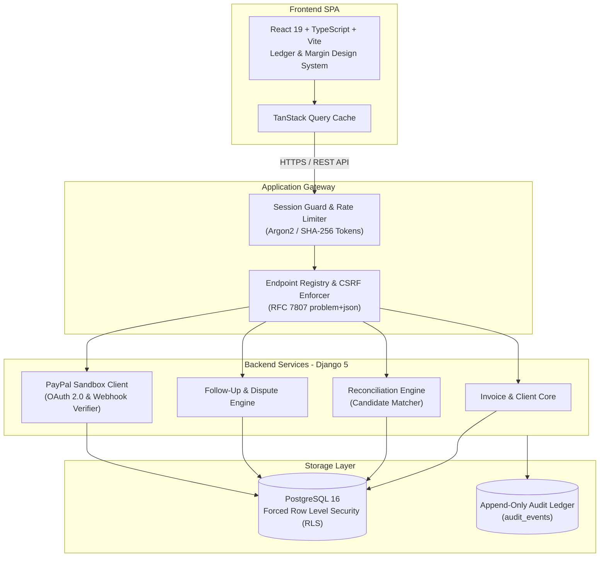

# CollectIQ

### Receivables Operations Copilot

> "Turn invoices, payment evidence and customer communication into clear, reviewable receivables operations."

CollectIQ is a specialized receivables operations platform designed to bridge the gap between accounting ledgers, payment providers, and customer communications. Rather than replacing existing accounting software or Enterprise Resource Planning (ERP) systems, CollectIQ acts as an operational copilot for finance and collections teams. It ingests invoices, tracks verified payment evidence, parses customer replies, and surfaces actionable reconciliation proposals—always maintaining human-in-the-loop confirmation before financial allocations or outbound notices are committed.

---

## Product Overview

Managing accounts receivable is frequently compromised by disconnected communication channels, unlinked bank transfers, and speculative automation. CollectIQ establishes operational certainty by treating payment records, customer statements, and correspondence as distinct, verifiable evidence items.

CollectIQ enables organizations to:
- **Monitor Outstanding Invoices:** Track real-time receivables aging across multiple currencies without destructive cross-currency rounding.
- **Ingest Verified Payment Evidence:** Import bank statements and ingest real-time webhook events from payment providers (such as PayPal Sandbox).
- **Intelligently Reconcile Balances:** Match incoming credits against open invoices using deterministic candidate matching while enforcing strict human review before allocations are confirmed.
- **Track Customer Commitments & Disputes:** Capture promises to pay, formal dispute notices, and payment claims directly from customer correspondence.
- **Automate Governed Follow-ups:** Draft context-aware payment reminders governed by deterministic policy gates and human approval.
- **Maintain an Immutable Audit Trail:** Enforce verifiable, append-only operational history across all state mutations, ledger adjustments, and communications.

> [!NOTE]
> CollectIQ is an operational copilot and evidence management system. It does not replace general ledger accounting packages, tax compliance software, or banking infrastructure.

---

## Core Capabilities

### 1. Receivables Dashboard & Monitoring
- **Currency-Segregated Overview:** Independent aging metrics, overdue totals, and weighted Days Sales Outstanding (DSO) calculated per currency (zero lossy multi-currency conversion).
- **Aging Buckets:** Standardized bucketing (Current, 1–30 days, 31–60 days, 61–90 days, 91+ days overdue).
- **Operational Risk Highlighting:** Automatic flagging of disputed invoices, active payment promises, and pending verification tasks.

### 2. Invoice & Client Management
- **Structured Ledger State:** Full lifecycle tracking (`DRAFT`, `ISSUED`, `PARTIALLY_PAID`, `PAID`, `DISPUTED`, `WRITTEN_OFF`, `CANCELLED`).
- **Strict Ledger Immutability:** Historical invoice amounts cannot be casually rewritten; adjustments require auditable credit notes or human-confirmed corrections.
- **Client Profiles & Contacts:** Contact role management with communication suppression flags (e.g. legal holds, opt-outs).

### 3. Payment Evidence & Statement Ingestion
- **Multi-Source Ingestion:** Ingestion of bank CSV statement exports, cash receipts, and payment gateway webhooks.
- **Statement Integrity:** Cryptographic fingerprinting (`SHA-256`) per statement line item to prevent duplicate ingestion or double-counting.
- **Credit-Only Defaults:** Inbound transactions default to credit allocations; reversals and debits require explicit human authorization.

### 4. Reconciliation Engine & Review Queue
- **Deterministic Candidate Matching:** Evaluates invoice reference numbers, exact and partial amount matches, and counterparty metadata hints.
- **Three-Tier Certainty Separation:**
  1. *Provider Transaction Evidence:* Verified proof that funds moved.
  2. *Candidate Match Proposal:* Algorithmic suggestion generated by the matching engine.
  3. *Confirmed Allocation:* Immutable ledger record created only upon human confirmation.
- **Split & Partial Payments:** Supports allocating single transactions across multiple invoices or leaving unapplied balances for future reconciliation.

### 5. Communication & Dispute Resolution
- **Customer Reply Analysis:** Classifies customer intent (e.g. payment claims, disputes, promise-to-pay dates) from inbound messages.
- **Dispute Protection Gates:** Opening a dispute immediately freezes automated follow-up cadences, preventing inappropriate collection actions.
- **Promise-to-Pay Tracking:** Deterministic date resolution tracks commitments and enforces a 24-hour cooling-off period upon dispute resolution.

### 6. Governed Follow-Up Reminders
- **Deterministic Fact Blocks:** Reminder drafts embed factual invoice details, outstanding balances, and verified payment instructions.
- **Linter & Policy Gates:** Automated checks verify that the customer is not suppressed, no open dispute exists, and payment claims are resolved prior to dispatch.
- **Human Approval Standard:** Reminders require human authorization before dispatch; approved drafts never send autonomously without explicit operator execution.

### 7. PayPal Sandbox Integration
- **Direct REST API Sandbox Support:** Authenticated against PayPal Sandbox endpoints (`https://api-m.sandbox.paypal.com`).
- **OAuth 2.0 Client Credentials:** Server-side token acquisition with thread-safe caching, expiry safety buffer, and exponential backoff with jitter.
- **Official Webhook Verification:** Validates transmission headers and HMAC signatures via `POST /v1/notifications/verify-webhook-signature`.
- **Minor-Unit Financial Normalization:** Ingests `PAYMENT.CAPTURE.COMPLETED`, `PENDING`, `DENIED`, `REFUNDED`, and `REVERSED` events directly into integer minor units using `Money.from_decimal_text` (zero floating-point math).
- **Reconciliation Ingestion:** Verified captures populate `payment_transactions` (`source_type = 'PAYPAL'`) and feed the reconciliation proposal queue.

---

## "Ledger & Margin" Design System

CollectIQ features the custom **Ledger & Margin** design language, specifically built for high-density, legible financial interfaces:
- **Warm Neutral Foundation:** Off-white canvas and warm paper-like card surfaces reduce visual fatigue during long operational sessions.
- **Deep Teal Accents:** Authoritative, high-contrast interactive states and navigation indicators.
- **Typography:** Set in **IBM Plex Sans** and **IBM Plex Mono**, ensuring unambiguous differentiation between numeral glyphs (e.g. `0`, `O`, `1`, `l`, `I`) across financial tables.
- **Evidence-First Layouts:** Data tables feature embedded provenance tags, verification indicators, and side rails displaying supporting documentation.
- **Responsive Architecture:** Fully adaptive responsive layouts supporting desktop workstations, tablets, and mobile inspection views.

---

## Architecture Overview



### Technology Stack
- **Frontend:** React 19, TypeScript 5, Vite 5, TanStack Query 5, CSS Modules, Lucide Icons.
- **Backend:** Python 3.12, Django 5.2, Django REST Framework, drf-spectacular (OpenAPI 3.0).
- **Database:** PostgreSQL 16 with forced Row Level Security (RLS) on application connections.
- **Cryptography & Security:** Argon2id password hashing, AES-256-GCM envelope encryption for integration tokens, SHA-256 session token hashing.
- **Testing:** Pytest, Vitest, Testing Library, Playwright (E2E).

---

## Security Architecture & Invariants

CollectIQ enforces strict defense-in-depth guarantees designed for financial compliance:

1. **PostgreSQL Row Level Security (RLS):**
   - The runtime application connects via `collectiq_app`, a non-superuser role with `BYPASSRLS = False`.
   - Every database query is scoped to `app.workspace_id`. Cross-tenant data access is physically prohibited at the database kernel level.
2. **Server-Side Authorization & Anti-Enumeration:**
   - Role-Based Access Control (RBAC) enforced on every endpoint (`OWNER`, `FINANCE_ADMIN`, `PROJECT_LEAD`, `VIEWER`).
   - Cross-tenant requests return `HTTP 404 Not Found` rather than `403 Forbidden`, preventing workspace UUID enumeration.
3. **Zero Floating-Point Financial Arithmetic:**
   - Financial amounts are strictly stored and computed as integer minor units (e.g. cents, pence) via `Money.from_decimal_text`. Floating-point arithmetic is prohibited.
4. **Argon2 Password Hashing & Timing Defense:**
   - Uses `Argon2PasswordHasher`. Login evaluations execute constant-time checks on non-existent accounts to eliminate timing side-channel email enumeration.
5. **Opaque Session Tokens:**
   - 32-byte cryptographically secure session tokens (`secrets.token_urlsafe(32)`). Only the SHA-256 digest is stored in the database, protecting sessions against database dump compromise.
   - Bound to `HttpOnly`, `SameSite=Lax`, and `Secure` cookies.
6. **No Admin Attack Surface:**
   - Standard Django admin (`django.contrib.admin`, `django.contrib.auth`) is omitted from `INSTALLED_APPS` and URL patterns. No public administrative portal exists.
7. **Strict Security Headers & CSP:**
   - Enforces `Content-Security-Policy: default-src 'none'; frame-ancestors 'none'; base-uri 'none'`, `X-Content-Type-Options: nosniff`, `X-Frame-Options: DENY`, `Cache-Control: no-store`, and HSTS.
   - `DEBUG = False` is enforced across all runtime profiles. Errors return sanitized RFC 7807 `application/problem+json` bodies without stack traces.

---

## Local Development Setup

### Prerequisites
- **Operating System:** Linux, macOS, or Windows (via WSL2).
- **Runtimes:** Python 3.12+, Node.js 22 or 24.
- **Database / Containers:** Podman or Docker.
- **Tools:** `make`, `uv` (optional, recommended for Python virtual environments).

### 1. Clone the Repository
```bash
git clone https://github.com/UniversalCodeBin/CollectIQ.git
cd CollectIQ
```

### 2. Environment Configuration
Create a local `.env` configuration from the provided template:
```bash
cp .env.example .env
```
*(When running `make db-up`, secure local cryptographic keys are automatically populated if `.env` does not exist).*

### 3. Start Database & Run Migrations
```bash
make db-up      # Starts containerized PostgreSQL on 127.0.0.1:54329
make migrate    # Applies database migrations using the owner role
make seed       # Seeds local demo workspace and sample invoices
```

### 4. Start Development Servers
Run the backend API and frontend development servers concurrently:
```bash
make dev
```
- **Frontend SPA:** `http://localhost:5173`
- **Backend API:** `http://127.0.0.1:8000`
- **OpenAPI Schema Documentation:** `http://127.0.0.1:8000/api/schema/swagger-ui/`

### 5. Local Demo Credentials
When seeded using `make seed`, log in with:
- **Email:** `owner@example.test`
- **Password:** `DemoPassword-2026`
- **Role:** Workspace Owner

---

## Environment Variables Reference

All credentials and sensitive configuration keys remain strictly server-side and must never be exposed to frontend bundles or committed to source control:

| Variable Name | Required | Default / Format | Description |
|---|---|---|---|
| `DJANGO_ENV` | Yes | `local` / `production` | Active runtime environment. |
| `DJANGO_SECRET_KEY` | Yes | 64-char string | Cryptographic secret for signing Django sessions and CSRF tokens. |
| `DJANGO_ALLOWED_HOSTS` | Yes | Comma-separated | Host/domain names that this Django site can serve. |
| `CSRF_TRUSTED_ORIGINS` | Yes | Comma-separated URLs | Trusted origins for unsafe (POST/PUT/PATCH) HTTP requests. |
| `DATABASE_URL` | Yes | PostgreSQL connection URI | Runtime non-privileged database role (`collectiq_app`). |
| `MIGRATION_DATABASE_URL`| Yes | PostgreSQL connection URI | Migration-only schema owner role (`collectiq_owner`). |
| `COLLECTIQ_MASTER_KEY` | Yes | 32-byte base64 string | Master encryption key used for AES-GCM envelope encryption. |
| `FEATURE_PAYPAL_WEBHOOK`| No | `true` / `false` | Toggles the PayPal webhook ingress listener (`E098`). |
| `PAYPAL_ENVIRONMENT` | Conditional | `sandbox` | PayPal API environment mode (`sandbox` or `live`). |
| `PAYPAL_BASE_URL` | Conditional | `https://api-m.sandbox.paypal.com` | Base URL for PayPal REST API endpoints. |
| `PAYPAL_CLIENT_ID` | Conditional | Alphanumeric | PayPal REST Application Client ID. |
| `PAYPAL_CLIENT_SECRET` | Conditional | Alphanumeric | PayPal REST Application Client Secret. |
| `PAYPAL_WEBHOOK_ID` | Conditional | 17-character alphanumeric | Webhook identifier registered with PayPal. |

---

## Testing & Quality Gates

CollectIQ is covered by a comprehensive automated test suite verifying financial invariants, security boundaries, and user interactions:

```bash
# Run all backend unit, integration, and safety tests
cd backend && .venv/bin/pytest

# Run frontend component, accessibility, and integration tests
cd frontend && npm test -- --run

# Run full repository static verification gates
make check
```

### Test Scope Breakdown
- **Unit Tests:** Fast, isolated tests covering model invariants, currency serialization, policy gate evaluations, and OAuth token caching.
- **Integration Tests:** Executed against PostgreSQL verifying transactions, multi-tenant RLS isolation (`tests/rls/`), idempotency, and job queues.
- **Safety & Audit Probe (`tests/safety/`):** Verifies that every mutating API request produces an immutable `audit_events` row matching the request's correlation ID (TS-023).
- **PayPal Verification:** 17 unit tests verifying OAuth backoff, signature decoding, and error classification; 10 integration tests validating webhook lifecycle, deduction deduplication, and candidate matching.

---

## Current Scope & Operational Boundaries

1. **PayPal Sandbox Mode:** The current PayPal integration is engineered and verified for the **PayPal REST API Sandbox**. Live production payments require independent merchant account verification and production credential provisioning.
2. **Human Reconciliation Requirement:** CollectIQ intentionally does **not** support fully autonomous payment allocation. Inbound webhooks surface verified transaction evidence and generated proposals, but invoice balance reduction requires human confirmation.
3. **Outbound Communications:** Payment reminder drafts generated by system rules or AI assistance require operator approval before transmission.
4. **Self-Contained Storage:** File attachments (e.g. uploaded statement CSVs) are stored in local encrypted file storage (`var/storage`) and require cloud object storage drivers (e.g. S3/GCS) for distributed multi-node production deployments.

---

## Project Status

CollectIQ has completed its primary milestone verification. Core ledgers, reconciliation services, policy evaluation engines, the Ledger & Margin design system, and the PayPal REST API Sandbox integration are fully built, migrated, and verified.

---

## License

License has not yet been specified.
